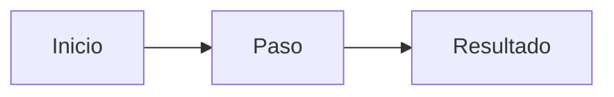

# <Nombre de negocio del módulo>

<!-- Audiencia: clientes y responsables de cumplimiento. Lenguaje de negocio, sin nombres de código.
     Términos del glosario, enlazando el primer uso de cada término clave. Si una sección no aplica,
     escribe «No aplica». Marcas: > TODO: confirmar … · > **Pendiente de implementar.** … ·
     > **Pendiente de definir.** … -->

## Propósito

<!-- Qué es el módulo y qué permite conseguir, en dos o tres frases. Indica si es Core o un módulo
     contratable. -->

## Problema que resuelve

<!-- Qué necesidad de la organización cubre, qué ocurre si no se cubre (riesgo regulatorio, operativo
     o de negocio) y qué aporta frente a hacerlo a mano. -->

## Roles

<!-- Tabla con los roles de la organización que intervienen y qué hace cada uno: quién prepara,
     revisa, aprueba o consulta. Usa los nombres de rol del glosario. -->

| Rol | Responsabilidad en el módulo |
|---|---|
|  |  |

## Flujo de trabajo

<!-- Pasos del proceso de principio a fin, numerados y en lenguaje de negocio: qué dispara el
     proceso, qué decisiones se toman y qué resultado queda. Acompáñalo de un diagrama Mermaid. -->

## Relación normativa

<!-- Artículos del AI Act y cláusulas de ISO/IEC 42001 (u otra norma) con relación directa y
     verificable en la funcionalidad, y qué parte de cada uno ayuda a cumplir el módulo. Formato:
     «AI Act, Art. 73». Si la relación es dudosa, TODO. -->

| Norma | Referencia | Qué cubre el módulo |
|---|---|---|
|  |  |  |

## Módulos relacionados

<!-- Qué recibe este módulo de otros y qué les entrega, con enlace al documento de negocio de cada uno.
     Termina con los enlaces a las vistas (funcional/) y a la documentación técnica (tecnica/) del
     módulo. -->

- <Módulo>: <relación>
