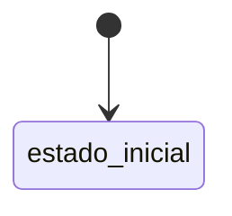

# <Nombre de la vista>

<!-- Audiencia: personas que usan, configuran o dan soporte a la aplicación. Describe la vista tal como
     la ve el usuario: etiquetas visibles en negrita, rutas de menú con «›». Los nombres de código
     (tablas, campos) van en `código`. Si una sección no aplica, escribe «No aplica». Marcas:
     > TODO: confirmar … · > **Pendiente de implementar.** … · > **Pendiente de definir.** … -->

## Propósito

<!-- Qué permite hacer la vista y en qué momento del flujo del módulo se usa. Dos o tres frases. -->

## Acceso y permisos

<!-- Cómo se llega a la vista (ruta URL y navegación: Sección › Entrada del menú, o desde qué otra
     vista), si requiere un módulo contratado, y qué puede ver y hacer cada rol. Distingue lo que
     aplica el código hoy de lo previsto. -->

- **Ruta:** `<ruta URL>`
- **Navegación:** <Sección › Entrada>
- **Disponibilidad:** <Core | módulo>

| Rol | Ver | Acciones permitidas |
|---|---|---|
|  |  |  |

## Campos

<!-- Cada dato que muestra o recoge la vista, agrupado por sección o pestaña: etiqueta visible, tipo,
     obligatorio u opcional, valores posibles y de dónde se lee o dónde se guarda. -->

| Campo | Tipo | Obligatorio | Descripción y valores | Origen (`tabla.columna`) |
|---|---|---|---|---|
|  |  |  |  |  |

## Acciones

<!-- Botones y operaciones disponibles: etiqueta visible, quién puede ejecutarla, qué hace y qué
     efectos produce (avisos, tareas, historial, aprobaciones, eventos). -->

| Acción | Quién | Qué hace | Efectos |
|---|---|---|---|
|  |  |  |  |

## Validaciones

<!-- Reglas que impiden guardar o avanzar: campos obligatorios, longitudes mínimas, rangos,
     dependencias entre campos. Incluye el mensaje que ve el usuario cuando se conozca. -->

- <Regla>: <mensaje>

## Estados

<!-- Estados del objeto principal de la vista, qué significa cada uno, qué acción provoca cada
     transición y quién puede hacerla. Acompáñalo de un diagrama Mermaid. -->

## Vistas relacionadas

<!-- Vistas desde las que se llega, vistas a las que lleva y vistas que muestran los mismos datos, con
     enlace a su documento. Termina con el enlace al documento de negocio del módulo. -->

- <Vista>: <relación>
