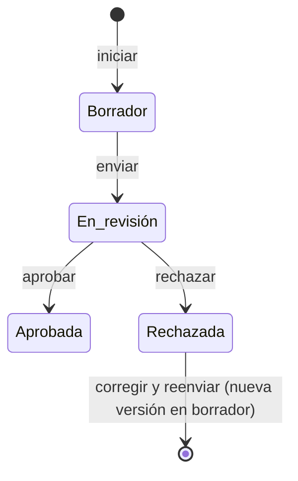

# Evaluación de impacto del sistema de IA (AISIA)

Asistente de seis secciones para completar la
[evaluación de impacto del sistema de IA](../glosario.md#evaluación-de-impacto-del-sistema-de-ia-aisia)
de un sistema y enviarla a aprobación.

## Propósito

Documentar las consecuencias del sistema sobre personas, grupos y sociedad, reutilizando el análisis de
modos de fallo y el plan de tratamiento. Las AISIA aprobadas alimentan la
[Declaración de Aplicabilidad](declaracion-aplicabilidad.md).

## Acceso y permisos

- **Ruta:** `/inventario/[id]/aisia/[assessmentId]`
- **Navegación:** pestaña **ISO 42001** de la [Ficha del sistema](ficha-sistema.md), **Continuar
  evaluación →** o **Ver evaluación →**.
- **Disponibilidad:** módulo Evaluación de impacto.

| Rol | Ver | Acciones permitidas |
|---|---|---|
| Todos los roles | Sí | Editar y enviar mientras está en borrador |
| Responsable del SGAI que no la ha creado ni enviado | Ídem | Aprobar o rechazar (desde la ficha del sistema). Lo comprueba el servidor |

Quien prepara no aprueba (DP-01). La ficha muestra el motivo a quien no puede decidir.

> **Pendiente de implementar.** DP-01 asigna la aprobación de la AISIA al Comité de IA. Hasta que pase a ser
> una plantilla del expediente con Flujos de aprobación (B15 y B11), la aprueba el Responsable del SGAI.

La evaluación solo se puede editar en borrador. En el resto de estados se muestra en solo lectura.

## Campos

La vista tiene una barra lateral con las seis secciones (Sistema, Datos, Riesgos, Tratamiento, Personas,
Social), su marca de completada y el progreso «N de 6 completadas».

Todo se guarda en `aisia_sections.data`. No hay campos obligatorios.

| Sección | Campos |
|---|---|
| **S1 · Descripción del sistema** | **Nombre del sistema**, **Versión**, **Uso previsto**, **Usos prohibidos**, **Descripción técnica** y los interruptores **Sistema completamente automatizado** e **Interactúa directamente con personas**, precargados desde la ficha. También **Contexto de despliegue** y **Stack tecnológico relevante** |
| **S2 · Datos e información** | **El sistema procesa datos personales**, **Categorías de datos tratados**, **Categorías especiales (Art. 9 RGPD)**, **Volumen de datos**, **Retención de datos** y **DPIA realizada** (Sí, En proceso, Parcial, No realizada), precargados desde la ficha. También **Descripción de las fuentes de datos**, **Medidas de calidad del dato** y **Notas sobre la DPIA / bases legales** |
| **S3 · Modos de fallo identificados** | Selección de los [modos de fallo](../glosario.md#modo-de-fallo) activados del sistema, con su dimensión y nivel; **Resumen de riesgos identificados**; **Riesgos adicionales no cubiertos por FMEA** |
| **S4 · Acciones de tratamiento** | Selección del [plan de tratamiento](../glosario.md#plan-de-tratamiento) de referencia (entre los tres más recientes); **Resumen de medidas de tratamiento**; **Riesgos residuales tras el tratamiento**; **Plan de monitoreo continuo** |
| **S5 · Impacto en personas** | **Personas y grupos directamente afectados**; **Afecta a colectivos vulnerables** (con descripción si se activa); **Derechos fundamentales potencialmente afectados**; **Severidad del impacto potencial** (Bajo, Medio, Alto, Crítico); **Probabilidad de materialización** (Baja, Media, Alta); **Descripción detallada del impacto**; **Salvaguardias y medidas de protección** |
| **S6 · Impacto social** | **Descripción del impacto social**, **Evaluación del riesgo de sesgo y discriminación**, **Consideraciones medioambientales**, **Implicaciones sociales más amplias**, **Consulta a partes interesadas** y **Conclusión y valoración global** |

**Precarga.** Al crear la AISIA, S1 y S2 se guardan con los datos de la ficha (nombre, versión, usos,
descripción técnica, automatización, interacción con personas, datos personales, categorías, volumen,
retención y estado de la DPIA). Si la ficha no tiene un dato, el campo queda vacío.

> TODO: confirmar varios datos de las secciones.
> - **S3:** cada modo muestra su origen de activación (`rule`, `ai`, `manual`) en lugar de su nombre.
> - **S3 y S4:** el nivel del modo y el estado del plan aparecen sin traducir.

## Acciones

| Acción | Quién | Qué hace | Efectos |
|---|---|---|---|
| **Siguiente →** / **← Anterior** / barra lateral | Todos | Guarda la sección actual como «en curso» y cambia de sección | — |
| **✓ Marcar completa** | Todos | Guarda la sección como completa | — |
| **Enviar para aprobación →** (en S6) | Todos | Guarda S6 y envía la evaluación | Estado «En revisión». Historial «AISIA enviada para aprobación». Vuelve a la ficha |
| **✓ Aprobar evaluación** (en la ficha) | Responsable del SGAI que no la preparó | Aprueba, con referencia de actas opcional | Historial «AISIA aprobada». Si la Declaración de Aplicabilidad está en borrador, marca como implantados los controles A.5.2 a A.5.5 cuando todos sus sistemas tienen AISIA aprobada; si no lo está, no la toca, lo avisa y lo aplica al iniciar su siguiente revisión |
| **✕ Rechazar** (en la ficha) | Ídem | Rechaza con motivo obligatorio | Historial «AISIA rechazada» |
| **✎ Corregir y reenviar** (en la ficha) | Todos | Crea una versión nueva en borrador con los datos de la rechazada | Historial «AISIA reabierta para corrección» |

> **Pendiente de implementar.** Nueva versión a partir de una AISIA aprobada: llega con su paso a plantilla
> del expediente (B15, DP-05), que ya tiene versiones.

> **Pendiente de implementar.** Propuesta de contenido por IA para las secciones.

Con una política de [Flujos de aprobación](../glosario.md#flujos-de-aprobación) para este tipo de objeto, la decisión se toma en [Aprobaciones](aprobaciones.md) (B11a): ver allí cuándo se abre la solicitud y qué efecto tiene.

## Validaciones

| Situación | Mensaje |
|---|---|
| Editar fuera de borrador | «Solo se puede editar una evaluación en borrador.» |
| Enviar fuera de borrador | «Solo se puede enviar una evaluación en borrador.» |
| Aprobar o rechazar una no enviada | «Solo se puede aprobar una evaluación enviada.» / «Solo se puede rechazar una evaluación enviada.» |
| Aprobar o rechazar sin el rol | «Solo el Responsable del SGAI puede aprobar o rechazar la AISIA.» |
| Aprobar o rechazar quien la preparó | «Quien prepara la AISIA no puede aprobarla ni rechazarla.» |
| Rechazar sin motivo | «Indica el motivo del rechazo.» |
| Reabrir con otra activa | «Ya existe una evaluación activa para este sistema. Complétala primero.» |
| Iniciar con otra activa | «Ya existe una evaluación AISIA activa para este sistema.» |

No se exige que las secciones estén completas para enviar.

## Estados

Cada sección pasa de «Pendiente» a «En curso» y a «Completa».

## Vistas relacionadas

- [Ficha del sistema](ficha-sistema.md): inicio, aprobación y rechazo.
- [Evaluación FMEA](fmea-evaluacion.md) y [Plan de tratamiento](plan-de-tratamiento.md): base de S3 y S4.
- [Declaración de Aplicabilidad ISO 42001](declaracion-aplicabilidad.md).
- Negocio: [Evaluación de impacto](../negocio/evaluacion-de-impacto.md).
