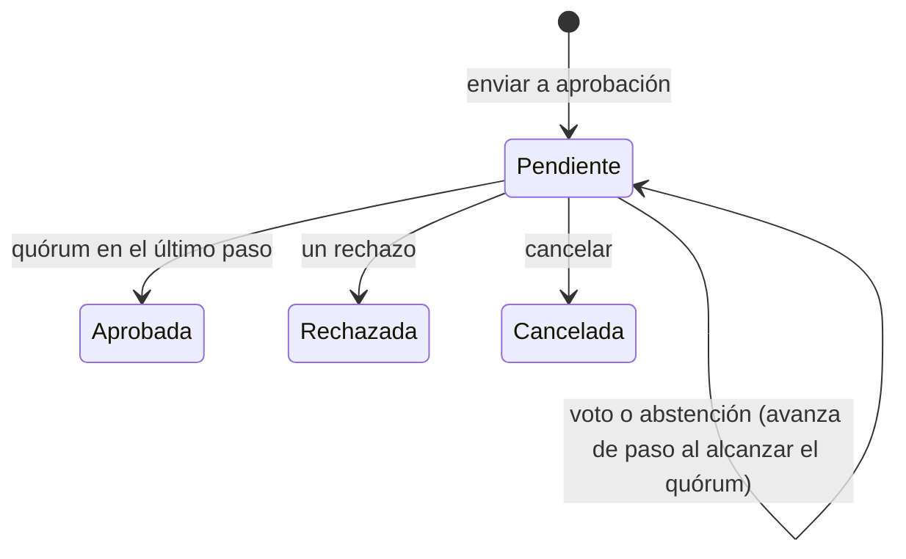

# Aprobaciones

Bandeja de los [flujos de aprobación](../glosario.md#flujos-de-aprobación): las solicitudes que le toca
decidir a cada persona y el histórico de las ya cerradas.

## Propósito

Decidir las solicitudes de aprobación y consultar el rastro de las decisiones. La vista dice: «Cada voto
queda registrado a nombre de quien lo emite: es lo que convierte una aprobación en evidencia.».

## Acceso y permisos

- **Ruta:** `/aprobaciones`
- **Menú:** **Aprobaciones**. Aparece siempre: Flujos de aprobación es Core.
- **Disponibilidad:** Core en todos los planes.

| Rol | Ver | Acciones permitidas |
|---|---|---|
| Quien puede decidir el paso actual | **Me toca decidir** | Aprobar, rechazar, abstenerse |
| Quien abrió la solicitud, Administrador, Responsable del SGAI | Ídem | Cancelar la solicitud |
| Todos los roles | **Histórico** de la organización (últimas 50) | Consultar |

Una persona puede decidir un paso si:
- no ha abierto ella la solicitud, salvo que la política lo permita;
- no ha votado ya en ese paso;
- y además cumple una de estas condiciones:
  - tiene el rol indicado en el paso;
  - está designada en la política;
  - es miembro del comité;
  - tiene una delegación vigente, si el paso la admite.

**Qué abre solicitudes (B11a).** Los cinco tipos de objeto, cuando la organización tiene una política activa
para su tipo:

| Objeto | Se abre al | Pantalla del objeto mientras está pendiente |
|---|---|---|
| Plan de tratamiento | Enviarlo a aprobación | El panel de aprobación remite a Aprobaciones |
| Evaluación AISIA | Enviarla para aprobación | La ficha muestra «La decisión se toma en Aprobaciones» en lugar de **Aprobar** y **Rechazar** |
| Expediente documental | Enviarlo a revisión (sin apartados obligatorios sin cubrir; la política puede depender de la plantilla, `template_key`) | En lugar de **Aprobar expediente**, el motivo. **Volver a borrador** cancela la solicitud |
| Declaración de Aplicabilidad | Enviarla a revisión (con todos los controles aplicables justificados) | **En Aprobaciones** en lugar de **Aprobar SoA**. **Iniciar nueva revisión** cancela la solicitud |
| Evidencia | Enviarla a revisión (también en bloque) | «Se decide en Aprobaciones». Si se cambia su contenido o su fichero, vuelve a borrador y la solicitud se cancela |

**Políticas por defecto (B11b).** Toda organización tiene una política para cada tipo de objeto, con el mapa
de aprobaciones de DP-01 (ver [Ajustes](ajustes.md), pestaña Aprobaciones), y cada tipo conserva siempre al
menos una activa. Solo un objeto cuyo contexto no encaje con ninguna (por ejemplo, un nivel del plan cuya
política se desactivó habiendo otras) se aprueba por su vía propia.

Al aplicar las políticas por defecto, los objetos que ya esperaban aprobación por la vía antigua (planes,
AISIA, expedientes y evidencias en revisión, y la Declaración en revisión) abrieron su solicitud.

**Respaldo.** Si un paso pide un comité que no está constituido o una función de gobierno sin designar,
decide el rol de respaldo de la política, y la tarjeta lo indica en ámbar.

> **Pendiente de implementar.** Pasos de consulta sin voto (dictamen del DPO, revisión del CISO) y pasos
> condicionales (B11d).

## Campos

**Pestañas:** **Me toca decidir (N)**, **Mis solicitudes (N)** (las pendientes que he abierto yo),
**Delegaciones** y **Histórico**. No hay filtros.

**Delegaciones** (B11c): cualquier miembro delega su autoridad en otra persona, con fecha de inicio y fin
obligatoria y, si quiere, solo para algunos tipos de objeto. El Administrador y el Responsable del SGAI pueden
registrar delegaciones en nombre de otros. Es el mecanismo de la delegación de la dirección en los planes de
Zona I.

**Cada solicitud:**

| Elemento | Descripción | Origen |
|---|---|---|
| Título | Objeto de la solicitud: nombre del sistema (plan), título (AISIA, expediente, evidencia) o «Declaración de Aplicabilidad ISO/IEC 42001» | `v_approval_requests.object_label` |
| **Ver {objeto} →** | Abre la pantalla del objeto para revisarlo antes de decidir | `object_href` |
| Tipo | Plan de tratamiento · Evaluación AISIA · Documento regulatorio · Declaración de Aplicabilidad · Evidencia | `object_type` |
| Estado (cerradas) | Aprobada · Rechazada · Cancelada | `status` |
| Datos | «{política} · Paso N de M · {votos} de {quórum} votos (en comités) · Solicitada por {persona} el {fecha}» | `policy_snapshot`, `current_position` |
| Motivo | Por qué le toca decidir: «Te corresponde por tu rol», «Estás designado en la política», «Eres miembro del comité» o «Por delegación» | `approval_can_decide` |
| Motivo de cierre | «Motivo: «…»» | `closed_reason` |
| **Descargar acta** | Si se ha generado un [acta](../glosario.md#acta) | `minutes_render_id` |
| **Histórico de decisiones** | «Paso N · {persona} aprobó / rechazó / se abstuvo [· por cuenta de {titular}] · {fecha}», con el motivo | `approval_decisions` |

**Si no hay solicitudes:**
- **Me toca decidir:** «No tienes nada pendiente de decidir.»
- **Histórico:** «Todavía no hay solicitudes cerradas.»

> TODO: confirmar el título de las solicitudes. En los planes de tratamiento muestra el nombre del
> sistema, no el código del plan.

## Acciones

| Acción | Quién | Qué hace | Efectos |
|---|---|---|---|
| **Aprobar** | Decisor | `decideApproval` | Si se alcanza el quórum, el paso se cierra y se avanza al siguiente. En el último paso, la solicitud queda aprobada |
| **Rechazar** | Decisor | Pide el motivo («Qué hay que corregir para que esto pueda aprobarse») y **Confirmar rechazo** | Cierra la solicitud como rechazada |
| **Abstenerse** | Decisor | Registra la abstención | «Consta, pero no acerca la aprobación» |
| **Cancelar solicitud** | Solicitante (en **Mis solicitudes**), Administrador y Responsable del SGAI | Pide el motivo y cancela | Cierra la solicitud como cancelada, devuelve el objeto a borrador (con historial) y avisa al solicitante, si no fue él, y a quien tenía que decidir |

**Al cerrarse una solicitud:**

1. **Efecto sobre el objeto** (`lib/approvals/effects.ts`):

   | Objeto | Aprobada | Rechazada |
   |---|---|---|
   | Plan de tratamiento | Aprobado; la evaluación de riesgos queda aprobada (B07) | Vuelve a borrador con la nota «[DEVUELTO] {motivo}» |
   | Evaluación AISIA | Aprobada, con quien decidió y la referencia `APR-…`; actualiza los controles A.5.2-A.5.5 si la Declaración está en borrador | Rechazada, con el motivo |
   | Expediente documental | Aprobado, con quien decidió | Vuelve a borrador |
   | Declaración de Aplicabilidad | Aprobada, con quien decidió | Vuelve a borrador |
   | Evidencia | Válida, con quien decidió | Rechazada, con el motivo |

   Cada efecto deja su evento en el historial del sistema (salvo la Declaración, que tiene su propio
   historial).
2. **Acta:** se genera en todo cierre con decisión (aprobada o rechazada), no solo con comité (B11c), y va
   al expediente del sistema cuando el objeto tiene sistema. Las cancelaciones y caducidades no llevan acta.
3. **Avisos:** el solicitante recibe un [aviso en la app](../glosario.md#aviso-en-la-app) y un correo
   «Aprobación {aprobada | rechazada | cancelada | caducada}», salvo que la cerrara él mismo.
4. **Integración saliente:** se envía `approval.{estado}` a las
   [integraciones salientes](../glosario.md#integración-saliente-webhook).

**Mientras siga pendiente:** se avisa a quienes pueden decidir el paso actual con «Aprobación pendiente:
{objeto}», en la aplicación, por correo y por los canales de aviso (con enlace absoluto). Solo se avisa al
abrir la solicitud y cada vez que avanza de paso, a los decisores del paso nuevo: un voto que deja el paso
pendiente no vuelve a avisar (B11c).

**Caducidad** (B11c). Si la política fija una caducidad, la tarjeta muestra «Caduca el {fecha}». La tarea
`approval-expiry` (cada hora) cancela las vencidas con el motivo «Caducada: nadie decidió en N días», con los
mismos efectos que una cancelación.

Los correos respetan las preferencias de notificación de cada persona (**Aprobación pendiente de mi
decisión** y **Decisión sobre mis solicitudes**).

Cada decisión queda en el registro de auditoría. Las decisiones no se pueden modificar ni borrar.

> TODO: confirmar un comportamiento de la bandeja: los avisos y mensajes que no son errores también se
> pintan en rojo.

**Configuración:** en **Ajustes › Aprobaciones**, para el Administrador, el Responsable del SGAI y el CAIO
(B11c):
- **Políticas:**
  - tipo de objeto y nombre;
  - niveles (planes de tratamiento) o plantillas (expedientes) a los que se aplica;
  - cadena de pasos, cada uno por rol, persona, comité concreto, tipo de comité o función de gobierno, con
    quórum, rol de respaldo y delegación;
  - si quien solicita puede aprobar;
  - caducidad de las solicitudes;
  - si la política está activa.
- Las **delegaciones** están en la pestaña **Delegaciones** de esta vista.

Ver [Ajustes](ajustes.md).

## Validaciones

| Situación | Mensaje |
|---|---|
| Rechazar sin motivo | **Confirmar rechazo** deshabilitado; en servidor, «Rechazar exige un motivo: quien rehaga el objeto necesita saber qué corregir.» |
| Cancelar sin permiso | «Solo quien la solicitó o un administrador puede cancelarla.» |
| Cancelar sin motivo | «Indica por qué se cancela.» |
| Solicitud inexistente | «La solicitud no existe.» |

Una persona solo puede votar una vez por paso. Solo puede haber una solicitud pendiente por objeto y una
política activa por tipo de objeto.

## Estados

## Vistas relacionadas

- [Plan de tratamiento](plan-de-tratamiento.md): envío a aprobación.
- [Ajustes](ajustes.md), pestaña Aprobaciones.
- [Organización](organizacion.md): comités.
- [Expediente documental](expediente-documental.md): actas generadas.
- Negocio: [Flujos de aprobación](../negocio/flujos-de-aprobacion.md).
