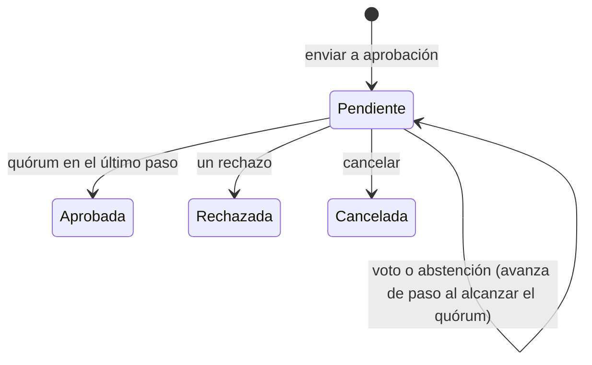

# Aprobaciones

Bandeja de los [flujos de aprobación](../glosario.md#flujos-de-aprobación): las solicitudes que le toca
decidir a cada persona y el histórico de las ya cerradas.

## Propósito

Decidir las solicitudes de aprobación y consultar el rastro de las decisiones. La vista dice: «Cada voto
queda registrado a nombre de quien lo emite: es lo que convierte una aprobación en evidencia.».

## Acceso y permisos

- **Ruta:** `/aprobaciones`
- **Menú:** **Aprobaciones**. Aparece siempre: Flujos de aprobación es Core.
- **Disponibilidad:** Core en todos los planes.

| Rol | Ver | Acciones permitidas |
|---|---|---|
| Quien puede decidir el paso actual | **Me toca decidir** | Aprobar, rechazar, abstenerse |
| Quien abrió la solicitud, Administrador, Responsable del SGAI | Ídem | Cancelar la solicitud |
| Todos los roles | **Histórico** de la organización (últimas 50) | Consultar |

Una persona puede decidir un paso si:
- no ha abierto ella la solicitud, salvo que la política lo permita;
- no ha votado ya en ese paso;
- y además cumple una de estas condiciones:
  - tiene el rol indicado en el paso;
  - está designada en la política;
  - es miembro del comité;
  - tiene una delegación vigente, si el paso la admite.

> **Pendiente de implementar.**
> - Solicitudes para la AISIA, los documentos, la Declaración de Aplicabilidad y las evidencias. Hoy solo
>   los planes de tratamiento abren solicitudes, aunque las políticas se pueden configurar para los cinco
>   tipos.

> **Pendiente de definir.** Qué rol aprueba en cada [nivel de aprobación](../glosario.md#nivel-de-aprobación)
> del plan de tratamiento.

## Campos

**Pestañas:** **Me toca decidir (N)** e **Histórico**. No hay filtros.

**Cada solicitud:**

| Elemento | Descripción | Origen |
|---|---|---|
| Título | Objeto de la solicitud | `v_approval_requests.object_label` |
| Tipo | Plan de tratamiento · Evaluación AISIA · Documento regulatorio · Declaración de Aplicabilidad · Evidencia | `object_type` |
| Estado (cerradas) | Aprobada · Rechazada · Cancelada | `status` |
| Datos | «{política} · Paso N de M · {votos} de {quórum} votos (en comités) · Solicitada por {persona} el {fecha}» | `policy_snapshot`, `current_position` |
| Motivo | Por qué le toca decidir: «Te corresponde por tu rol», «Estás designado en la política», «Eres miembro del comité» o «Por delegación» | `approval_can_decide` |
| Motivo de cierre | «Motivo: «…»» | `closed_reason` |
| **Descargar acta** | Si se ha generado un [acta](../glosario.md#acta) | `minutes_render_id` |
| **Histórico de decisiones** | «Paso N · {persona} aprobó / rechazó / se abstuvo [· por cuenta de {titular}] · {fecha}», con el motivo | `approval_decisions` |

**Si no hay solicitudes:**
- **Me toca decidir:** «No tienes nada pendiente de decidir.»
- **Histórico:** «Todavía no hay solicitudes cerradas.»

> TODO: confirmar el título de las solicitudes. En los planes de tratamiento muestra el nombre del
> sistema, no el código del plan.

## Acciones

| Acción | Quién | Qué hace | Efectos |
|---|---|---|---|
| **Aprobar** | Decisor | `decideApproval` | Si se alcanza el quórum, el paso se cierra y se avanza al siguiente. En el último paso, la solicitud queda aprobada |
| **Rechazar** | Decisor | Pide el motivo («Qué hay que corregir para que esto pueda aprobarse») y **Confirmar rechazo** | Cierra la solicitud como rechazada |
| **Abstenerse** | Decisor | Registra la abstención | «Consta, pero no acerca la aprobación» |
| **Cancelar solicitud** | Solicitante, Administrador, Responsable del SGAI | Pide el motivo y cancela | Cierra la solicitud como cancelada |

**Al cerrarse una solicitud:**

1. **Efecto sobre el objeto:** solo existe para el plan de tratamiento.
   - Aprobada: el plan pasa a aprobado.
   - Rechazada: el plan vuelve a borrador con la nota «[DEVUELTO] {motivo}».
2. **Acta:** se genera si algún paso es de comité.
3. **Avisos:** el solicitante recibe un [aviso en la app](../glosario.md#aviso-en-la-app) «Aprobación
   {aprobada | rechazada | cancelada}».
4. **Integración saliente:** se envía `approval.{estado}` a las
   [integraciones salientes](../glosario.md#integración-saliente-webhook).

**Mientras siga pendiente:** se avisa a quienes pueden decidir el paso actual con «Aprobación pendiente:
{objeto}».

Cada decisión queda en el registro de auditoría. Las decisiones no se pueden modificar ni borrar.

> TODO: confirmar varios comportamientos de la bandeja.
> - **Cancelar solicitud:** solo aparece en **Me toca decidir**, que no muestra las solicitudes propias.
>   Por eso el solicitante no ve el botón.
> - **Efectos de la cancelación:** no avisa y no devuelve el plan a borrador.
> - **Avisos repetidos:** cada voto que deja la solicitud pendiente vuelve a avisar a todos los decisores.
> - **Mensajes de error:** los del motor aparecen en texto técnico.
> - **Avisos y mensajes:** los que no son errores también se pintan en rojo.
> - **Caducidad:** las solicitudes no caducan. Si el quórum no se puede alcanzar, la solicitud queda
>   pendiente indefinidamente.

**Configuración:** en **Ajustes › Aprobaciones**:
- **Políticas:**
  - tipo de objeto y nombre;
  - niveles a los que se aplica (solo en planes de tratamiento);
  - cadena de pasos, cada uno por rol, persona o comité, con quórum y delegación;
  - si quien solicita puede aprobar;
  - si la política está activa.
- **Delegaciones:** en quién se delega, desde y hasta qué fecha, y para qué tipos de objeto.

Ver [Ajustes](ajustes.md).

> **Pendiente de definir.** Qué roles configuran las políticas. La pestaña solo la ve el Administrador,
> mientras que el servidor admite también al Responsable del SGAI y al CAIO. Las delegaciones de los demás
> usuarios no tienen pantalla.

## Validaciones

| Situación | Mensaje |
|---|---|
| Rechazar sin motivo | **Confirmar rechazo** deshabilitado; en servidor, «Rechazar exige un motivo: quien rehaga el objeto necesita saber qué corregir.» |
| Cancelar sin permiso | «Solo quien la solicitó o un administrador puede cancelarla.» |
| Cancelar sin motivo | «Indica por qué se cancela.» |
| Solicitud inexistente | «La solicitud no existe.» |

Una persona solo puede votar una vez por paso. Solo puede haber una solicitud pendiente por objeto y una
política activa por tipo de objeto.

## Estados

## Vistas relacionadas

- [Plan de tratamiento](plan-de-tratamiento.md): envío a aprobación.
- [Ajustes](ajustes.md), pestaña Aprobaciones.
- [Organización](organizacion.md): comités.
- [Expediente documental](expediente-documental.md): actas generadas.
- Negocio: [Flujos de aprobación](../negocio/flujos-de-aprobacion.md).
