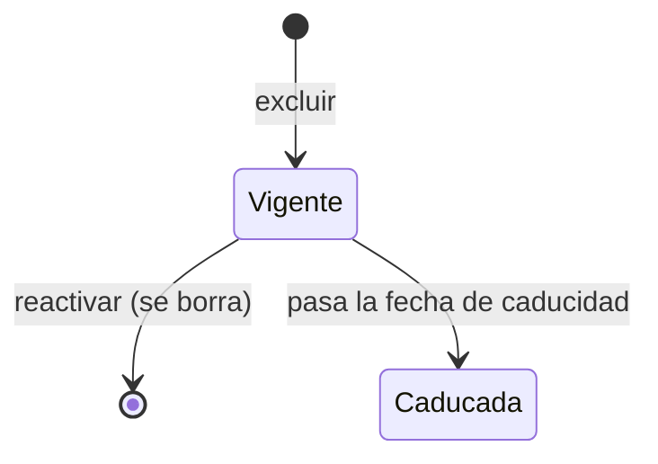

# Brechas excluidas

Lista de las [brechas](../glosario.md#brecha) que se han declarado «Brecha asumida» o «Fuera de
alcance» y que, por eso, no aparecen en la cola activa del [Análisis de brechas](brechas.md).

## Propósito

Consultar y justificar ante un auditor las brechas que la organización ha decidido no cerrar, y
devolverlas a la cola si la decisión cambia.

## Acceso y permisos

- **Ruta:** `/gaps/excluded`
- **Navegación:** botón **Excluidos** del [Análisis de brechas](brechas.md).
- **Disponibilidad:** Core.

| Rol | Ver | Acciones permitidas |
|---|---|---|
| Todos los roles | Sí | Exportar, ver origen |
| Administrador, Responsable del SGAI, CAIO | Ídem | Además, reactivar |

> TODO: confirmar el comportamiento de **Reactivar** para el resto de roles. El botón aparece, pero la
> base de datos no borra la exclusión y la vista no muestra ningún error.

## Campos

**Indicadores:**
- **Total excluidos**;
- **Aceptados** (riesgo conocido y asumido);
- **No aplica** (fuera del alcance definido).

Dos secciones: **Aceptados · riesgo conocido y asumido** y **No aplica · fuera del alcance**. No hay
filtros ni paginación.

| Campo | Descripción y valores | Origen (`tabla.columna`) |
|---|---|---|
| Etiquetas | Tipo de brecha, gravedad, código del sistema y «Aceptado» o «No aplica» | Brecha calculada · `gap_dispositions.disposition` |
| Título y contexto | — | Brecha calculada |
| **Justificación** | — | `gap_dispositions.rationale` |
| **Decidido por** | Nombre, o «Desconocido» | `decided_by` |
| **Fecha decisión** | — | `decided_at` |
| **Caduca exclusión** | Fecha, o «—» | `expires_at` |

Solo aparecen las exclusiones vigentes de brechas que siguen existiendo.

## Acciones

| Acción | Quién | Qué hace | Efectos |
|---|---|---|---|
| **Ver origen** | Todos | Navega al objeto de origen de la brecha | — |
| **Reactivar** | Administrador, Responsable del SGAI, CAIO | Pide confirmación («¿Reactivar este gap?») y ejecuta `revertGapDispositionAction` | Borra la exclusión: la brecha vuelve a la cola |
| **Exportar CSV** | Todos | Descarga `gaps_excluidos_AAAA-MM-DD.csv` | Columnas de la cola más Tipo exclusión, Justificación, Decidido por, Fecha decisión y Caduca exclusión |
| **Volver a análisis de gaps** | Todos | Navega al [Análisis de brechas](brechas.md) | — |

> TODO: confirmar la trazabilidad de las exclusiones. La vista dice que las brechas excluidas «siguen
> siendo auditables», pero al reactivar se borra la exclusión, y las caducadas desaparecen sin dejar
> histórico.

## Validaciones

No aplica.

## Estados

Una exclusión caducada deja de aplicarse y la brecha vuelve a la cola activa.

Si no hay ninguna exclusión, la vista muestra «Sin gaps excluidos» y el botón **Ir a la cola activa**.

## Vistas relacionadas

- [Análisis de brechas](brechas.md): donde se excluyen.
- [Instantáneas de brechas](brechas-instantaneas.md).
- Negocio: [Análisis de brechas](../negocio/brechas.md).
