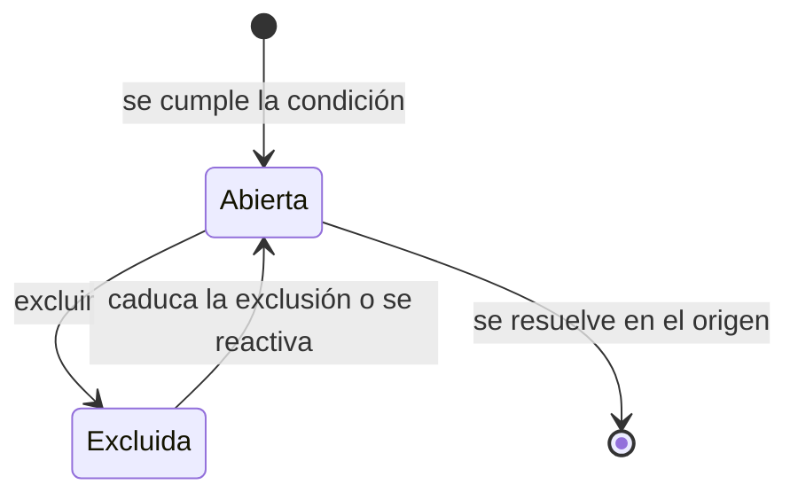

# Análisis de brechas

Vista consolidada de las [brechas](../glosario.md#brecha) de todos los sistemas de la organización. Las
agrupa en una cola por gravedad y en grupos de trabajo, con la exposición de cada sistema y las caducidades
próximas. Desde aquí se asignan, se convierten en tareas o se excluyen.

## Propósito

Priorizar el trabajo pendiente de cumplimiento y repartirlo. Las brechas se calculan en cada visita; no
existe una tabla de brechas.

## Acceso y permisos

- **Ruta:** `/gaps`. Parámetros de URL: `severity`, `layer`, `system_id`, `overdue`, `unassigned`,
  `no_due_date`, `due_soon`, `mine`, `view` (`hybrid` por defecto, `groups`, `detail`), `page` y `focus`.
- **Navegación:**
  - **Principal › Sistemas › Análisis de Gaps**;
  - desde una tarea originada en una brecha (`/gaps?focus=…`).
- **Disponibilidad:** Core.

| Rol | Ver | Acciones permitidas |
|---|---|---|
| Todos los roles | Todas las brechas | Asignar, crear tareas, exportar, guardar instantánea |
| Administrador, Responsable del SGAI, CAIO, DPO, Responsable del sistema, Analista de riesgos, Analista de cumplimiento | Ídem | Además, excluir brechas |

La vista no restringe ninguna acción por rol. El límite para excluir lo pone la base de datos.

## Campos

### Cabecera e indicadores

| Bloque | Contenido |
|---|---|
| Barra de inteligencia | Críticos, Altos y Medios (cada uno filtra por esa gravedad); sistemas afectados sobre el total; caducidades próximas |
| **Gaps normativos** | Brechas «Obligación sin cubrir» |
| **Gaps FMEA** | Brechas «Riesgo sin tratar» |
| **Controles pendientes** | Brechas «Control sin implantar» |
| **Caducidades** | Brechas «Evidencia caducada», incluidas las ya caducadas |
| **Estado inicial del módulo** | Total de brechas abiertas y capas activas |

### Tipos de brecha

| Tipo ([tipo de brecha](../glosario.md#tipo-de-brecha)) | Cuándo aparece | Gravedad | Lleva a |
|---|---|---|---|
| Normativo | Obligación AI Act del sistema no resuelta ni excluida | Según su prioridad: crítica, alta o media (baja y media cuentan como media) | Pestaña Obligaciones de la [Ficha del sistema](ficha-sistema.md) |
| FMEA | Modo de fallo de la última evaluación con severidad actual 7 o más, sin mitigación en curso ni cierre | 9 crítica · 8 alta · 7 media | [Evaluación FMEA del modo](fmea-evaluacion.md) |
| Control | Mitigación del último plan pendiente, en curso o con evidencia pendiente | Según la severidad del modo | [Plan de tratamiento de la acción](plan-de-tratamiento.md) |
| Caducidad | Evidencia que caduca en 30 días o menos, o ya caducada | 7 días o menos, o caducada: crítica · 14 días o menos: alta · 30 o menos: media | Pestaña Evidencias de la ficha |

Las brechas normativas muestran además los modos de fallo activos que agravan el incumplimiento:
«⚠ N modo(s) activo(s) amplifica(n) este incumplimiento».

### Exposición por sistema

Índice de 0 a 100 de los seis sistemas con mayor exposición (menor es mejor):
- **Presión correctiva:** brechas normativas críticas ×15 (máximo 45) + altas ×8 (máximo 24) + controles
  pendientes ×3 (máximo 15).
- **Riesgo activo:** modos con severidad 9 ×15 + severidad 8 ×8 + severidad 7 ×4 (máximo 60).
- **Presión preventiva:** evidencias caducadas ×5 + que caducan en 14 días o menos ×5 + en 15 a 30 días
  ×2 (máximo 15).

Cada sistema muestra también su [zona de riesgo](../glosario.md#zona-de-riesgo).

### Filtros

| Grupo | Filtros |
|---|---|
| Estado general | Todos · Mis gaps · Solo críticos · Sin owner · Vencidos |
| Bloqueos operativos | Sin owner · Sin fecha · Vence pronto (7 días o menos) |
| Tipo de gap | Normativo · FMEA · Control · Caducidad |
| Sistema | Uno por sistema |
| Vista | Híbrida (grupos y cola) · Grupos · Detalle (cola) |

Los filtros se combinan entre sí. **Todos** los quita todos.

### Grupos de trabajo detectados

Hasta 12 grupos:

| Grupo | Agrupa |
|---|---|
| Obligaciones AI Act pendientes | Brechas normativas de un sistema |
| {familia} sin tratamiento | Brechas FMEA de un sistema y una dimensión (Técnica, Seguridad, Ética, Gobernanza, ROI, Legal tipo B) |
| Acciones de tratamiento pendientes | Controles pendientes de un plan |
| Evidencias próximas a caducar | Caducidades de un sistema |

Cada grupo muestra su gravedad máxima, el número de brechas, los sistemas y el responsable sugerido.

### Cola unificada de gaps

Brechas ordenadas por gravedad, tipo y fecha, de 15 en 15, en tres secciones:
- **Críticos · acción inmediata**;
- **Altos · plan de mitigación requerido**;
- **Medios · monitorización activa**.

Cada tarjeta muestra:

| Campo | Contenido |
|---|---|
| Etiquetas | Tipo, gravedad y código del sistema |
| Título y contexto | Por ejemplo, «Modo S=8 sin tratamiento» o «Control implementado, falta evidencia» |
| **Sistema** | Nombre |
| **Responsable** | Nombre, o «Sin owner» |
| **Plazo** | «Vencido (fecha)», «fecha · N días» o «Sin fecha objetivo» |
| Origen | Referencia del objeto de origen |

### Caducidades próximas

Bloque aparte, siempre visible:
- **Contadores:** caducadas, en 7 días o menos, de 8 a 14 días y de 15 a 30 días.
- **Lista:** las evidencias ordenadas por urgencia.

Las mismas evidencias aparecen también en la cola, que es donde se pueden seleccionar y excluir.

> TODO: confirmar el texto de la cabecera. Dice que la pantalla «es de lectura» y que su intención es
> «priorizar trabajo, no editarlo aquí», pero permite asignar, fijar fechas, crear tareas y excluir.

## Acciones

| Acción | Quién | Qué hace | Efectos |
|---|---|---|---|
| **Asignar** / **Editar asignación** | Todos | `updateGapAssignment`: responsable y fecha. En caducidades, la fecha es la nueva caducidad de la evidencia | Actualiza la obligación, la acción del plan o la evidencia de origen. No disponible en brechas FMEA |
| **Asignar grupo** | Todos | `updateGapGroupAssignment` | Ídem, en todas las brechas del grupo |
| **Crear tarea** | Todos | `createGapTaskAction`: crea una [tarea](../glosario.md#tarea) con el título de la brecha, prioridad según la gravedad, responsable y fecha | Si ya existe, la reutiliza. Notifica al asignado. No disponible en brechas FMEA |
| **Crear tareas** (grupo) | Todos | Una tarea por brecha, o una tarea paraguas del grupo | La paraguas queda vinculada a cada brecha |
| **Excluir** | Roles con permiso | Modal de [disposición](../glosario.md#disposición-de-la-brecha) | La brecha sale de la cola y pasa a [Brechas excluidas](brechas-excluidas.md) |
| Selección múltiple › **Asignar** / **Crear tareas** / **Excluir** / **Exportar** | Según la acción | Acciones en bloque sobre las brechas seleccionadas de la página visible | FMEA queda excluida de la asignación y de las tareas |
| **Exportar CSV** | Todos | Descarga las brechas filtradas | Columnas: Clave, Capa, Severidad, Sistema (código), Sistema, Título, Responsable, Fecha límite, Vencido, Días hasta vencimiento, Contexto, Origen |
| **Guardar snapshot** | Todos | `saveGapAnalysisSnapshot` | Crea una [instantánea](../glosario.md#instantánea) y navega a ella |
| **Exportar / Imprimir** | Todos | Imprime la página desde el navegador | — |
| **Ver snapshots** · **Excluidos** · **Ver inventario** | Todos | Navegan a [Instantáneas de brechas](brechas-instantaneas.md), [Brechas excluidas](brechas-excluidas.md) e [Inventario](inventario.md) | — |

### Excluir brecha

| Campo | Tipo | Obligatorio | Descripción y valores | Origen (`tabla.columna`) |
|---|---|---|---|---|
| **Tipo de exclusión** | opciones | Sí | Aceptado (riesgo conocido y aceptado, por defecto) · No aplica (fuera del alcance) | `gap_dispositions.disposition` (`accepted`, `not_applicable`) |
| **Justificación** | texto largo | Sí | Mínimo 10 caracteres | `rationale` |
| **Caducidad de la exclusión** | fecha | No | Si se indica, la brecha vuelve a la cola en esa fecha | `expires_at` |

> TODO: confirmar varios fallos de esta vista.
> - **Crear tareas en bloque no crea ninguna:** la vista cuenta todas las brechas como si ya tuvieran
>   tarea y deshabilita el botón. Comprobado en el código.
> - **Asignar en bloque borra datos:** si solo se rellena el responsable o solo la fecha, el otro campo se
>   vacía en el origen, aunque la etiqueta diga «Sin cambios».

## Validaciones

| Situación | Mensaje |
|---|---|
| Justificación corta | «La justificación debe tener al menos 10 caracteres.» (con contador «n / 10 caracteres mínimos») |
| Selección sin brechas asignables | «No hay gaps asignables en la selección.» |
| Brecha FMEA | «Esta capa no admite asignación directa desde Análisis de gaps.» |
| Origen no encontrado | «No se encontraron registros para actualizar.» |
| Asignado sin perfil en la organización | «El usuario asignado no tiene perfil en esta organización.» |

No se valida que las fechas sean futuras. La caducidad de una exclusión puede ser una fecha pasada.

## Estados

## Vistas relacionadas

- [Brechas excluidas](brechas-excluidas.md), [Instantáneas de brechas](brechas-instantaneas.md).
- [Ficha del sistema](ficha-sistema.md), [evaluación FMEA](fmea-evaluacion.md), [plan de tratamiento](plan-de-tratamiento.md) y
  [tareas](tareas.md).
- Negocio: [Análisis de brechas](../negocio/brechas.md).
