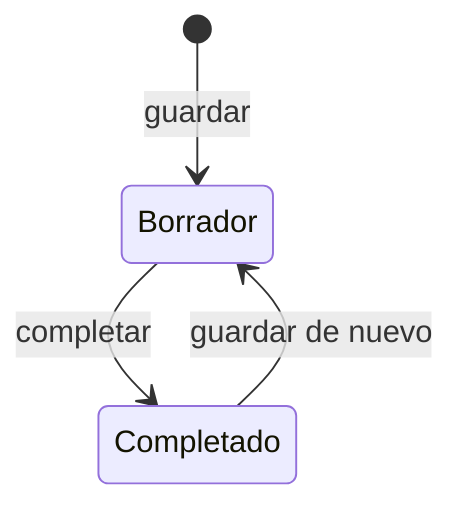

# Formulario del cuestionario preliminar

Formulario de siete secciones del [cuestionario preliminar](../glosario.md#cuestionario-preliminar): el
proyecto, el uso de la IA, el sistema y su proveedor, la finalidad prevista, los datos, la forma de
utilización y la posición en la cadena de valor.

## Propósito

Recoger, antes del alta en el inventario, la información necesaria para categorizar el sistema según el
AI Act e identificar sus implicaciones legales. Es de uso interno.

## Acceso y permisos

- **Rutas:** `/cuestionario-preliminar/nuevo` y `/cuestionario-preliminar/[id]`
- **Navegación:** desde [Cuestionarios preliminares](cuestionario-preliminar.md).
- **Disponibilidad:** módulo Evaluación de impacto.

| Rol | Ver | Acciones permitidas |
|---|---|---|
| Todos los roles | Sí | Rellenar, guardar y completar |

## Campos

Las secciones se recorren con pestañas numeradas o con **Anterior** y **Siguiente**. Todas las respuestas
se guardan en `preliminary_questionnaires.answers`.

| Tipo de campo | Comportamiento |
|---|---|
| Sí / No | Algunos añaden «No aplica». Si la pregunta tiene detalle, aparece al responder Sí o No |
| Opción única | Pulsar de nuevo la opción elegida la deselecciona |
| Casillas | Se pueden marcar varias |

| # | Sección | Preguntas (obligatorias en **negrita**) |
|---|---|---|
| 1 | **Proyecto** | **Responsable del proyecto** · **Mercado / Corporativo** · Mercado afectado o área corporativa · Cliente · Empresa del grupo |
| 2 | **Información básica** | **1. ¿Proyecto u oportunidad?** · **2. Objeto** · **3. ¿Se van a tratar datos personales?** (con detalle obligatorio) · **4. ¿Se va a utilizar tecnología IA?** · ¿De quién es el sistema de IA? (cuatro opciones de propiedad) · 5. Tecnología · 6. ¿El cliente ha autorizado el uso de IA? · 7. ¿El contrato se refiere al uso de IA? · 8. Uso que se va a hacer de la IA · 9. Infraestructura · 10. Exclusiones del Reglamento (fines militares, cooperación policial en terceros países, investigación y desarrollo, código abierto, uso exclusivamente profesional) |
| 3 | **Sistema de IA** | **Propiedad del sistema** (de un tercero o propio, adquirido o desarrollado para la organización o para el cliente) · Proveedor: nombre comercial y versión, nombre, grupo internacional, matriz fuera del EEE, ubicación en Europa, país · Estado de análisis: proveedor homologado, licencia revisada, documentación técnica e instrucciones de uso disponibles (las dos últimas con comentario obligatorio) |
| 4 | **Finalidad prevista** | **Clase 1 · Bloque A** (prácticas prohibidas): las ocho prácticas del AI Act, Art. 5 · **Clase 2 · Bloque A**: componente de seguridad de un producto y categorías de producto de la legislación de armonización (18) · **Clase 2 · Bloque B**: ámbitos de alto riesgo del Anexo III (biometría, infraestructura crítica, educación, empleo, asistencia pública, solvencia, seguros de salud y vida, emergencias, aplicación de la ley, migración, justicia y procesos democráticos) · **Clase 3**: funciones del sistema (generación de contenido, reconocimiento, interacción, apoyo a decisiones, patrones, predicciones, asignación, perfiles, acceso a servicios) · Descripción detallada |
| 5 | **Datos e información** | Datos personales para entrenar, datos especialmente protegidos, origen documentado · Información necesaria definida, trazable y sin vulnerar propiedad intelectual · Reutilización de software propio, trazabilidad y derechos. Cada respuesta exige justificación |
| 6 | **Forma de utilización** | Uso tal cual, con fine tuning o con prompts · Parametrizaciones previstas · Infraestructura de alojamiento |
| 7 | **Posición en la cadena** | [Rol en la cadena de valor](../glosario.md#rol-en-la-cadena-de-valor): proveedor, distribuidor, representante autorizado, importador, responsable del despliegue, o ninguno · Justificación · Cliente para el que se desarrolla |

El título del cuestionario se toma de la tecnología, el nombre comercial o el objeto, por ese orden. El
responsable sale de la pregunta **Responsable del proyecto**.

> TODO: confirmar varias reglas del formulario.
> - **«¿De quién es el sistema de IA?»** (sección 2) no depende de la pregunta 4 y repite la pregunta de
>   propiedad de la sección 3 con textos distintos.
> - **Detalle obligatorio con «No»:** los detalles que dicen «En caso afirmativo» se piden también al
>   responder «No».
> - **Sección 5:** dice que la justificación es obligatoria, pero sus preguntas se pueden dejar sin
>   responder.
> - **Parametrizaciones:** «Obligatorio si aplica» no se comprueba.
> - **Destinatario:** varias preguntas (cliente, empresa del grupo, autorización del cliente) parecen
>   pensadas para una organización que presta servicios a terceros.

## Acciones

| Acción | Quién | Qué hace | Efectos |
|---|---|---|---|
| **Guardar borrador** | Todos | `saveQuestionnaire`: crea o actualiza el cuestionario | Muestra «Guardado». Si el cuestionario estaba completado, vuelve a borrador |
| **Completar cuestionario** (sección 7) | Todos | Comprueba los obligatorios y lo marca como completado | Vuelve a la lista |
| **Anterior** / **Siguiente** / pestañas | Todos | Cambian de sección | No guardan: los cambios se pierden si se sale sin guardar |

> **Pendiente de implementar.** Clasificación a partir de las respuestas y alta del sistema en el
> inventario. Hoy el cuestionario solo guarda la información.

## Validaciones

| Situación | Mensaje |
|---|---|
| Faltan obligatorios al completar | «Faltan N campos obligatorios para completar el cuestionario.», con la lista «{sección}: {pregunta}» |
| Sesión sin organización | «No se encontró la organización del usuario.» |

## Estados

Un cuestionario completado sigue siendo editable.

## Vistas relacionadas

- [Cuestionarios preliminares](cuestionario-preliminar.md), [Alta de sistema](inventario-alta.md).
- Negocio: [Evaluación de impacto](../negocio/evaluacion-de-impacto.md).
