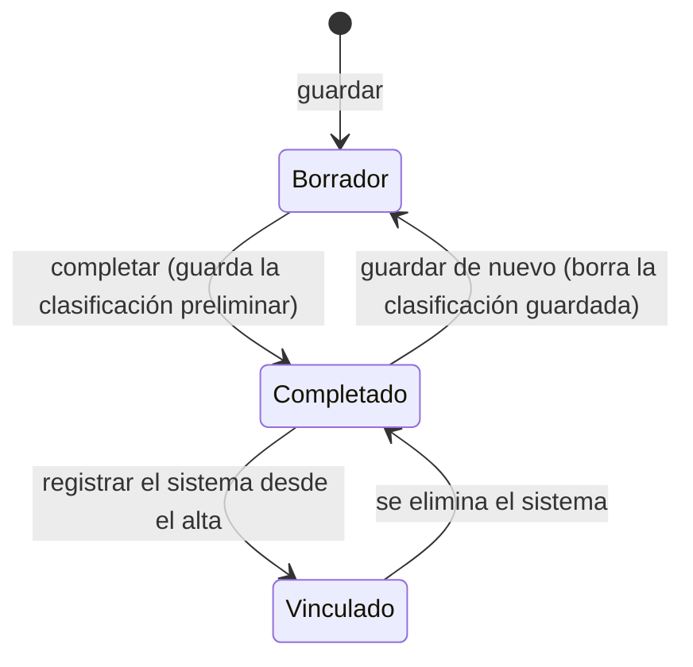

# Formulario del cuestionario preliminar

Formulario de siete secciones del [cuestionario preliminar](../glosario.md#cuestionario-preliminar): el
proyecto, el uso de la IA, el sistema y su proveedor, la finalidad prevista, los datos, la forma de
utilización y la posición en la cadena de valor. Mientras se rellena, muestra la
[clasificación AI Act](../glosario.md#clasificación-ai-act) preliminar que resulta de las respuestas.

## Propósito

Recoger, antes del alta en el inventario, la información necesaria para categorizar el sistema según el
AI Act e identificar sus implicaciones legales, y proponer una clasificación preliminar con el
[motor único de clasificación](../glosario.md#clasificación-ai-act) (el mismo que usa el alta). Es de uso
interno.

## Acceso y permisos

- **Rutas:** `/cuestionario-preliminar/nuevo` y `/cuestionario-preliminar/[id]`
- **Navegación:** desde [Cuestionarios preliminares](cuestionario-preliminar.md).
- **Disponibilidad:** módulo Evaluación de impacto.

| Rol | Ver | Acciones permitidas |
|---|---|---|
| Todos los roles | Sí | Rellenar, guardar, completar y dar de alta el sistema en el inventario |

Un cuestionario vinculado a un sistema del inventario es de solo lectura para todos los roles (ver
[Estados](#estados)).

## Campos

Las secciones se recorren con pestañas numeradas o con **Anterior** y **Siguiente**. Todas las respuestas
se guardan en `preliminary_questionnaires.answers` con la clave de cada pregunta. Cada pregunta se pinta
con el componente compartido `FieldView` (`components/questionnaire/field-view.tsx`), que también usa el
bloque **Supuestos AI Act** del [Alta de sistema](inventario-alta.md#paso-3--impacto-y-clasificación-ai-act).

| Tipo de campo | Comportamiento |
|---|---|
| Sí / No | Algunos añaden «No aplica». Si la pregunta tiene detalle, aparece al responder Sí o No; los detalles «En caso afirmativo» (preguntas 3 y 6, reutilización de software y justificaciones de las excepciones) solo aparecen y se exigen con Sí |
| Opción única | Pulsar de nuevo la opción elegida la deselecciona |
| Casillas | Se pueden marcar varias. Las casillas de prácticas prohibidas, Anexo I y funciones del sistema tienen además la opción «Ninguna de las anteriores» / «Ninguno de los anteriores», excluyente: al marcarla se desmarcan las demás y al marcar otra se desmarca ella. Se guarda como `__ninguno` |
| Condicional | Algunas preguntas y bloques solo se muestran si se cumple una condición (tabla siguiente). Una pregunta oculta no se exige. Las respuestas que tuviera se conservan |

| # | Sección | Preguntas (obligatorias en **negrita**) |
|---|---|---|
| 1 | **Proyecto** | **Responsable del proyecto** · **Mercado / Corporativo** · Mercado afectado o área corporativa · Cliente · Empresa del grupo |
| 2 | **Información básica** | **1. ¿Proyecto u oportunidad?** · **2. Objeto** · **3. ¿Se van a tratar datos personales?** (con Sí, detalle obligatorio) · **4. ¿Se va a utilizar tecnología IA?** (con la definición de sistema de IA del AI Act, Art. 3.1, como ayuda) · 5. Tecnología · 6. ¿El cliente ha autorizado el uso de IA? (con Sí, nombre del cliente) · 7. ¿El contrato se refiere al uso de IA? · 8. Uso que se va a hacer de la IA · 9. Infraestructura · 10. Exclusiones del Reglamento (fines militares, cooperación policial y judicial en terceros países, investigación y desarrollo, código abierto, uso por personas físicas en una actividad puramente personal y no profesional). Si no se marca ninguna, no aplica ninguna exclusión |
| 3 | **Sistema de IA** | **Propiedad del sistema** (de un tercero o propio, adquirido o desarrollado para la organización o para el cliente) · Proveedor: nombre comercial y versión, nombre, grupo internacional, matriz fuera del EEE, ubicación en Europa, país · Estado de análisis: proveedor homologado, licencia revisada, documentación técnica e instrucciones de uso disponibles (las dos últimas con comentario obligatorio) |
| 4 | **Finalidad prevista** | **Supuestos clase 1 · Bloque A** (prácticas prohibidas): las ocho prácticas del AI Act, Art. 5, o «Ninguna de las anteriores», y las preguntas de excepción · **Supuestos clase 2 · Bloque A**: componente de seguridad de un producto, producto regulado en sí mismo, evaluación de la conformidad de terceros, o «Ninguno de los anteriores»; categorías de producto de la legislación de armonización (19) · **Supuestos clase 2 · Bloque B**: ámbitos de alto riesgo del Anexo III (biometría, infraestructuras críticas, educación, empleo, asistencia pública, solvencia, seguros de salud y vida, emergencias, aplicación de la ley, migración, justicia y procesos democráticos) y **¿Ninguno de los supuestos de este bloque? (Anexo III)** · **Excepción del Art. 6.3** · **Supuestos clase 3**: **funciones del sistema** (generación de contenido, reconocimiento, interacción, apoyo a decisiones, patrones, predicciones, asignación, perfiles, acceso a servicios) o «Ninguna de las anteriores» · ¿Genera una ultrasuplantación (deep fake)? · ¿Genera texto que se publica para informar al público sobre asuntos de interés público? · Descripción detallada · **Modelo de IA de uso general (GPAI)**: **¿La organización desarrolla un modelo de IA de uso general y lo introduce en el mercado?**, cómputo de entrenamiento, licencia libre, ¿usa un modelo GPAI de un tercero?, ¿lo modifica (fine-tuning) y lo introduce en el mercado? |
| 5 | **Datos e información** | Datos personales para entrenar, datos especialmente protegidos, origen documentado · Información necesaria definida, trazable y sin vulnerar propiedad intelectual · Reutilización de software propio (con Sí, nombre y justificación), trazabilidad y derechos. Las demás respuestas exigen justificación |
| 6 | **Forma de utilización** | Uso tal cual, con fine tuning o con prompts · Parametrizaciones previstas · Infraestructura de alojamiento |
| 7 | **Posición en la cadena** | **[Rol en la cadena de valor](../glosario.md#rol-en-la-cadena-de-valor)**: proveedor, distribuidor, representante autorizado, importador, responsable del despliegue, o ninguno · Justificación · Cliente para el que se desarrolla · ¿La organización es un organismo de derecho público o una entidad privada que presta servicios públicos? · **Cambio de rol a proveedor (Art. 25)**: nombre o marca propios, modificación sustancial, cambio de finalidad prevista |

Preguntas y bloques condicionales:

| Pregunta o bloque | Se muestra si | Obligatorio |
|---|---|---|
| Excepción de cada práctica (`c1_exc_riesgo_delito`, `c1_exc_emociones`, `c1_exc_categorizacion_biometrica`, `c1_exc_rbi_tiempo_real`) | Está marcada esa práctica | No; con Sí, la **Justificación** es obligatoria |
| Categorías de producto (`c2a_productos`) | Hay algún supuesto de la clase 2 · Bloque A | Ver la coherencia del Anexo I en [Validaciones](#validaciones) |
| Bloque **Excepción del Art. 6.3** | Hay algún supuesto del Anexo III marcado | **¿Se invoca la excepción del Art. 6.3?** |
| Condiciones a) a d), **¿El sistema elabora perfiles de personas físicas?** y **Justificación de la excepción** | Se invoca la excepción | Sí |
| Cómputo de entrenamiento (obligatorio) y licencia libre | La organización desarrolla un modelo GPAI | Solo el cómputo |
| ¿Modifica ese modelo (fine-tuning)? | El sistema usa un modelo GPAI de un tercero | No |
| Bloque **Cambio de rol a proveedor (Art. 25)** | Hay algún supuesto del Anexo I o del Anexo III y no se ha marcado el rol Proveedor | No |

Reglas de obligatoriedad:

- **¿Ninguno de los supuestos de este bloque? (Anexo III)** es obligatoria salvo que se marque algún
  supuesto del Anexo III. Marcar «Sí» y a la vez algún supuesto es una contradicción.
- Si la pregunta **4** es «No», no se exigen **Finalidad prevista** ni **Posición en la cadena**.
- Si se marca una exclusión del Reglamento distinta de código abierto, **Finalidad prevista** pasa a ser
  opcional.

> **ℹ Aclaración.** El bloque B de la clase 2 tiene una sola pregunta «Ninguno» para los once ámbitos del
> Anexo III, en lugar de una opción «Ninguno» en cada ámbito como dice la
> [especificación](../producto/cuestionario-preliminar-reglas.md#8-cambios-en-el-cuestionario) (Q-01).
> Cumple la misma función: distinguir «no aplica» de «sin responder».

Responder «No» a **¿Ninguno de los supuestos de este bloque?** sin marcar ningún supuesto es una
contradicción: el cuestionario no se puede completar (ver [Validaciones](#validaciones)).

El título del cuestionario se toma de la tecnología, el nombre comercial o el objeto, por ese orden. El
responsable sale de la pregunta **Responsable del proyecto**.

Las respuestas antiguas se siguen leyendo: la opción retirada **Admisibilidad** de seguros se trata como
el Anexo III, punto 5.c; la propiedad de la antigua pregunta de la sección 2 (`q4_propiedad`) se usa si
falta la de la sección 3; y la antigua exclusión «actividades exclusivamente profesionales»
(`profesional`) ya no se trata como exclusión.

> TODO: confirmar varias reglas del formulario.
> - **Sección 5:** dice que la justificación es obligatoria, pero sus preguntas se pueden dejar sin
>   responder.
> - **Parametrizaciones:** «Obligatorio si aplica» no se comprueba.
> - **Destinatario:** varias preguntas (cliente, empresa del grupo, autorización del cliente) parecen
>   pensadas para una organización que presta servicios a terceros.

### Panel Clasificación preliminar

Encima de las pestañas, en todas las secciones, el panel **Clasificación preliminar** clasifica las
respuestas con el motor único (`classifyQuestionnaire`, de `lib/preliminary-questionnaire/to-aiact.ts`) en
cada cambio, sin guardar. Las respuestas se traducen a [supuestos AI Act](../glosario.md#supuestos-ai-act):
un bloque sin responder no equivale a «no» y deja la clasificación en «Pendiente de clasificar».

| Elemento | Contenido |
|---|---|
| Cabecera | Nivel de riesgo o ámbito («Práctica prohibida», «Alto riesgo», «Riesgo limitado», «Riesgo mínimo», «Pendiente de clasificar», «Fuera del ámbito», «No es un sistema de IA»), base legal resumida y número de avisos. Pulsarla despliega el detalle |
| Fundamento | Reglas aplicadas (`RN-…`) con su texto, o «Sin reglas aplicadas todavía.» |
| Transparencia | Artículos del Art. 50 que aplican y a quién obligan (proveedor o responsable del despliegue) |
| GPAI | Proveedor de modelo (con riesgo sistémico o sin determinar) o sistema basado en un modelo GPAI de terceros |
| Roles | Declarados en **Posición en la cadena** y sugeridos por el motor |
| Avisos | Contradicciones y datos que faltan, según el motor |
| Obligaciones sugeridas | Nombres del catálogo de obligaciones según el nivel, los roles y la respuesta sobre organismo público, o «Ninguna con las respuestas actuales.» |
| Nota | «Propuesta del motor de clasificación (reglas {versión}). La clasificación del sistema se fija al darlo de alta.» |

### Avisos sobre el formulario

| Aviso | Cuándo | Contenido |
|---|---|---|
| Alta en el inventario | Cuestionario completado, sin sistema vinculado y sin cambios sin guardar desde que se abrió o se guardó | «Cuestionario completado. Puedes registrar el sistema en el inventario con estas respuestas: el alta se abre rellena y la revisas antes de guardar.» y el botón **Dar de alta en el inventario** |
| Solo lectura | Cuestionario vinculado a un sistema (`ai_system_id`) | «Este cuestionario dio lugar a un sistema del inventario y es de solo lectura. Para cambiar datos, edita la ficha del sistema.» y el enlace **Ver la ficha →** |

## Acciones

| Acción | Quién | Qué hace | Efectos |
|---|---|---|---|
| **Guardar borrador** | Todos | `saveQuestionnaire`: crea o actualiza el cuestionario | Muestra «Guardado». Si el cuestionario estaba completado, vuelve a borrador y se borra la clasificación guardada (`classification` = `null`) |
| **Completar cuestionario** (sección 7) | Todos | Comprueba los obligatorios y las contradicciones, clasifica las respuestas en el servidor con el motor único (`classifyWithCatalog`) y lo marca como completado | Guarda la clasificación preliminar en `preliminary_questionnaires.classification` (resultado, obligaciones sugeridas y fecha). Vuelve a la lista |
| **Anterior** / **Siguiente** / pestañas | Todos | Cambian de sección | No guardan: los cambios se pierden si se sale sin guardar |
| **Dar de alta en el inventario** | Todos | Abre `/inventario/nuevo?cuestionario={id}` | Abre el [Alta de sistema](inventario-alta.md#alta-desde-un-cuestionario-preliminar) relleno con las respuestas guardadas. El cuestionario se vincula al registrar el sistema; si se abandona el alta, no se vincula nada |
| **Ver la ficha →** | Todos | Abre la [Ficha del sistema](ficha-sistema.md) vinculado | — |

En un cuestionario vinculado, las preguntas están desactivadas y no se muestran **Guardar borrador** ni
**Completar cuestionario**; solo se puede navegar entre secciones.

Guardar como borrador un cuestionario completado borra la clasificación preliminar guardada a propósito:
la clasificación guardada corresponde siempre a las respuestas con las que se completó.

## Validaciones

Al pulsar **Completar cuestionario**:

| Situación | Mensaje |
|---|---|
| Faltan obligatorios | «Faltan N campos obligatorios para completar el cuestionario.», con la lista «{sección}: {pregunta}» |
| Hay contradicciones | «Hay respuestas contradictorias: resuélvelas para completar el cuestionario.», con la lista «Coherencia: {contradicción}» |
| Sesión sin organización | «No se encontró la organización del usuario.» |
| Cuestionario vinculado a un sistema (al guardar o completar) | «El cuestionario está vinculado a un sistema y es de solo lectura: edita la ficha del sistema.» |

Contradicciones que impiden completar:

| Contradicción | Mensaje |
|---|---|
| Pregunta 4 «No» con supuestos marcados en la finalidad prevista | «Se indica que no se usa IA, pero hay supuestos marcados en la finalidad prevista (RN-V05).» |
| Supuestos del Anexo I sin categorías de producto, o al revés | «Anexo I incompleto: marca a la vez los supuestos y las categorías de producto, o ninguno (RN-V06).» |
| Rol «No aplican las opciones anteriores» con otro rol | ««No aplican las opciones anteriores» es incompatible con los demás roles (RN-V08).» |
| «Ninguno» del bloque B con algún supuesto del Anexo III | «Has marcado «Ninguno de los supuestos» del bloque B y también algún supuesto.» |
| «Ninguna/Ninguno de las anteriores» con otra opción de la misma pregunta | ««{opción}» es incompatible con las demás opciones de «{pregunta}».» |

## Estados

**Vinculado** no es un valor de `status` (sigue siendo `completado`): es el cuestionario con
`ai_system_id`. Es de solo lectura en la interfaz, en las server actions y en la base de datos (trigger
`trg_preliminary_questionnaire_locked`, que impide cambiar `answers` y `status` mientras esté vinculado).
Si se elimina el sistema, la clave foránea pone `ai_system_id` a nulo y el cuestionario vuelve a ser
editable. Cada cuestionario da lugar a un solo sistema y cada sistema tiene como mucho un cuestionario de
origen.

Un cuestionario completado y sin vincular sigue siendo editable. Los completados antes de B13b no tienen clasificación
guardada y, mientras no se respondan las preguntas nuevas, el panel los muestra como «Pendiente de
clasificar».

## Vistas relacionadas

- [Cuestionarios preliminares](cuestionario-preliminar.md), [Alta de sistema](inventario-alta.md).
- Especificación: [reglas de clasificación y volcado al alta](../producto/cuestionario-preliminar-reglas.md).
- Negocio: [Evaluación de impacto](../negocio/evaluacion-de-impacto.md),
  [Clasificación AI Act](../negocio/clasificacion-ai-act.md).
