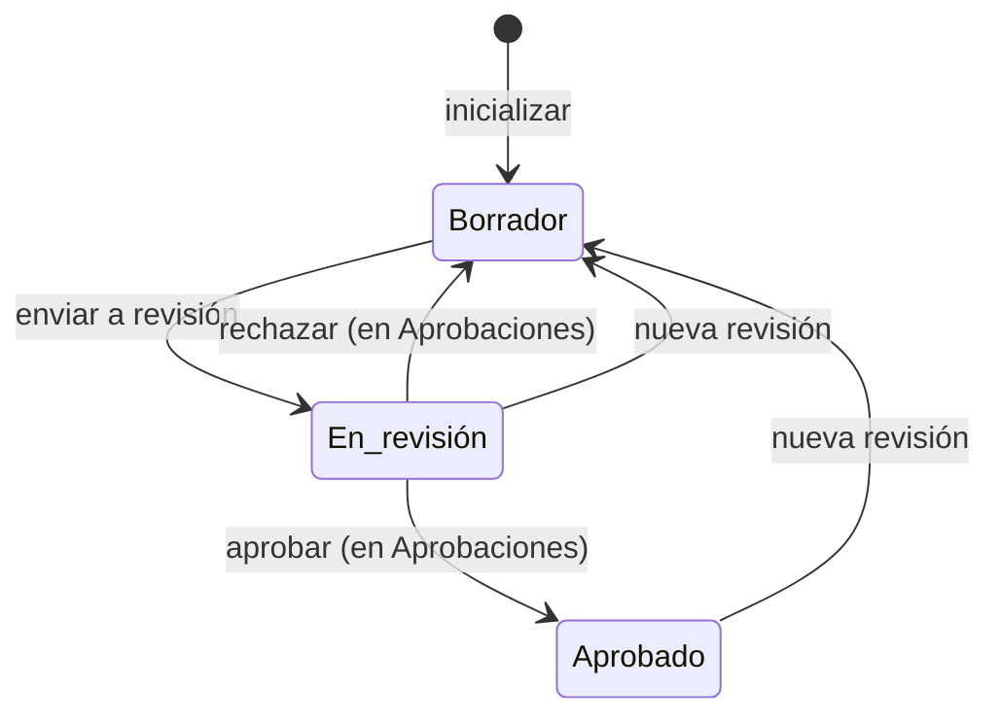

# Declaración de Aplicabilidad ISO 42001

Documento de la organización que recoge, para cada uno de los 38 controles del Anexo A de ISO/IEC 42001,
si aplica, su justificación y su estado de implantación. Incluye propuestas con IA, comprobación de
completitud, ciclo de revisión y aprobación, e impresión.

## Propósito

Elaborar y mantener la [Declaración de Aplicabilidad ISO 42001](../glosario.md#declaración-de-aplicabilidad-iso-42001)
de la organización y dejarla aprobada.

## Acceso y permisos

- **Ruta:** `/plantillas/soa-iso42001`
- **Navegación:**
  - **Cumplimiento › ISO 42001 › Declaración de Aplicabilidad**;
  - **Ver SoA** en el [Dashboard](dashboard.md) y en la pestaña ISO 42001 de la [Ficha del sistema](ficha-sistema.md).
- **Disponibilidad:** Core.

| Rol | Ver | Acciones permitidas |
|---|---|---|
| Todos los roles | Sí | Editar controles y cabecera, usar las propuestas con IA, ver el historial, imprimir |
| Responsable del SGAI, CAIO, DPO, Analista de cumplimiento, Administrador | Ídem | Enviar a revisión |
| Administrador, Responsable del SGAI, CAIO | Ídem | Iniciar una nueva revisión |
| Decisores de la política de aprobación de la Declaración | Ídem | Aprobar o rechazar, solo en [Aprobaciones](aprobaciones.md) |

El rol se toma del perfil de la sesión en la organización activa.

La Declaración se aprueba **solo** en [Flujos de aprobación](../glosario.md#flujos-de-aprobación) (B11g):
esta vista no tiene botón de aprobar. Por defecto (DP-01) la decide la Revisión por la Dirección, con el
Directivo como respaldo. Al aprobarse, «Aprobado por» toma el nombre de quien decide y la fecha de
aprobación, la de hoy.

## Campos

### Inicialización

Si la organización no tiene Declaración, la vista muestra «Inicializar Declaración de Aplicabilidad». El
botón **Crear Versión 0 del SoA** crea los 38 controles como no aplicables y no iniciados.

### Cabecera

| Campo | Tipo | Obligatorio | Descripción y valores | Origen (`tabla.columna`) |
|---|---|---|---|---|
| **Versión** | texto | Sí | Por defecto 1.0 | `organization_soa_metadata.version` |
| **Propietario** | texto | No | — | `owner_name` |
| **Aprobado por** · **Cargo / Rol** | texto | No | — | `approved_by`, `approved_by_role` |
| **Fecha de aprobación** | fecha | No | Se sustituye por la de hoy al aprobarse en Aprobaciones | `approved_at` |
| **Próxima revisión** | fecha | No | Se resalta si faltan 30 días o menos | `next_review_date` |
| **Sistemas incluidos en el alcance** | etiquetas | No | Etiquetas de los sistemas del inventario. Sin etiquetas, entran todos | `scope_system_tags` |
| **Justificación del alcance** | texto largo | No | — | `scope` |

### Indicadores y alertas

| Elemento | Contenido |
|---|---|
| **Controles aplicables** | Aplicables sobre 38 |
| **Controles implantados** | Aplicables en «Implantado»; debajo, cuántos están «En progreso» |
| **Cumplimiento SoA** | Implantados sobre aplicables |
| Alertas | Controles aplicables sin justificación y sin iniciar, con **Ver controles con gaps** |
| **Progreso por dominio** | Por grupo A.2 a A.10: implantados y externalizados, en curso y planificados |

### Controles

**Vistas:**
- **Por dominio:** controles agrupados de A.2 a A.10.
- **Por sistema:** los controles aplicables de cada sistema en alcance, con el estado de su
  [AISIA](../glosario.md#evaluación-de-impacto-del-sistema-de-ia-aisia).

**Filtros:**
- búsqueda por código o título;
- aplicabilidad: Todos · Solo aplicables · Solo excluidos;
- estado: No iniciado · Planificado · En progreso · Implantado · Externalizado · Sin justificación.

Edición de un control (panel lateral):

| Campo | Tipo | Obligatorio | Descripción y valores | Origen (`tabla.columna`) |
|---|---|---|---|---|
| **Propuesta: Implantado** | solo lectura | — | Solo si hay propuesta: el motivo y, en borrador, **Aceptar propuesta**. Ver [Propuesta desde el plan de tratamiento](#propuesta-desde-el-plan-de-tratamiento) | Calculada (`lib/soa/proposals.ts`) |
| Texto normativo | solo lectura | — | Descripción del control | `iso42001-catalog.ts` |
| **Aplicabilidad** | interruptor | — | ¿Aplica este control a tu SGIA? | `organization_soa_controls.is_applicable` |
| **Justificación de aplicabilidad/exclusión** | texto largo | Para aprobar, en los aplicables | Con **Sugerir con IA** | `justification` |
| **Estado de implantación** | selector | — | No iniciado · Planificado · En progreso · Implantado · Externalizado | `status` |
| **Propietario** | selector | No | Miembros de la organización | `owner_user_id` |
| **Evidencia asociada** | selector | No | Evidencias de los sistemas en alcance | `validation_evidence_id` |
| **Observaciones / Acciones pendientes** | texto largo | No | — | `notes` |
| **Sistemas en alcance** | solo lectura | — | Se vinculan automáticamente al guardar si el control aplica | `organization_soa_system_links` |

El propietario debe ser un miembro de la organización; si no, se muestra «El propietario seleccionado no
pertenece a la organización.».

#### Propuesta desde el plan de tratamiento

Un control aplicable que no está «Implantado» ni «Externalizado» propone **Implantado** cuando todos sus
sistemas vinculados tienen en su [plan de tratamiento](../glosario.md#plan-de-tratamiento) una acción de
mitigación completada, con evidencia válida, cuyo control sale de una
[plantilla de control](../glosario.md#plantilla-de-control) que corresponde a ese control del Anexo A. La
correspondencia la mantiene la administración de la plataforma en **Datos › Plantilla ↔ Anexo A**
(`compliance.control_template_soa_controls`); la inicial está en
[la correspondencia aprobada](../producto/correspondencia-controles-anexo-a.md). Sin sistemas vinculados no hay
propuesta.

La lista muestra la etiqueta **Propuesta: Implantado** junto al estado, con el motivo al pasar el ratón, y el
panel lateral, el motivo completo: las plantillas implantadas en cada sistema. La propuesta no cambia nada sola.

> TODO: confirmar un comportamiento de la edición de controles.
> - **Vista Por sistema:** muestra todos los controles aplicables en todos los sistemas en alcance, no los
>   vínculos reales.

## Acciones

| Acción | Quién | Qué hace | Efectos |
|---|---|---|---|
| **Guardar control** | Todos | `updateSoAControl` | Actualiza el control y sus sistemas vinculados. Historial «Actualización de control aplicable» en cada sistema |
| **Aceptar propuesta** (solo en borrador) | Todos | `acceptSoAProposal`: vuelve a calcular la propuesta y, si sigue vigente, pone el control en «Implantado» | Añade «Propuesta aceptada: …» a las observaciones. Historial en cada sistema vinculado y registro en **Cambios en controles** |
| **Setup rápido** › **Marcar aplicables** / **Marcar excluidos** | Todos | Aplicabilidad en bloque | Pone los controles en «No iniciado» |
| **Sugerir con IA** | Todos | Propone una justificación para el control, con el contexto de los sistemas y el alcance | Rellena el campo; no guarda |
| **Analizar AISIA** (solo en borrador) | Todos | Lee las AISIA aprobadas de los sistemas en alcance y propone con IA la aplicabilidad y la razón de los 38 controles | Muestra las propuestas, marca las que cambian algo y permite invertir cada una |
| **Aplicar N cambios** | Todos | `applySoASuggestions` | Guarda la aplicabilidad y la justificación propuestas |
| **Configurar Cabecera** | Todos | `updateSoAMetadata` | — |
| **Enviar a revisión** | Roles de envío | Comprueba la completitud y avisa de los controles aplicables sin justificación. Si se confirma igualmente, el servidor (`transitionSoAStatus`) lo rechaza: exige todos los aplicables justificados y una política de aprobación activa para la Declaración | Estado «En revisión», solicitud abierta en [Aprobaciones](aprobaciones.md). Registro de ciclo de vida |
| **En Aprobaciones** (en revisión) | Todos | Enlace a [Aprobaciones](aprobaciones.md), donde se decide. Si no hay solicitud pendiente, se muestra en su lugar «Sin solicitud de aprobación abierta: inicia una nueva revisión y envíala de nuevo.» | — |
| **Iniciar nueva revisión** | Administrador, Responsable del SGAI, CAIO | Devuelve a borrador (desde «En revisión» o «Aprobado») | Cancela la solicitud pendiente, si la hay. Registro de ciclo de vida |
| **Ver Historial** | Todos | Pestañas **Ciclo de vida** y **Cambios en controles** | — |
| **Exportar PDF** | Todos | Imprime desde el navegador la vista de impresión: portada, resumen y desglose de controles por grupo | — |

Cada guardado de un control queda en **Ver Historial › Cambios en controles**, y cada cambio de estado en
**Ciclo de vida**, con su autor.

> TODO: confirmar dos efectos secundarios.
> - **Aplicar propuestas:** también borra la justificación de los controles que quedan excluidos.
> - **Vista de impresión:** muestra «Fluxion SaaS» como organización y «Página 1 de 1» fijos.

La decisión se toma en [Aprobaciones](aprobaciones.md): ver allí qué efecto tiene aprobarla o rechazarla
(al rechazarse vuelve a borrador). `transitionSoAStatus` solo admite `under_review` y `draft`. En la base de
datos, el disparador `trg_soa_lifecycle_rules` impide que una sesión de usuario pase la Declaración a
«Aprobado» («La Declaración de Aplicabilidad se aprueba en Aprobaciones.»): solo lo hace el efecto de la
aprobación.

## Validaciones

| Situación | Mensaje |
|---|---|
| Sin sistemas en alcance (Analizar AISIA) | «No hay sistemas en alcance. Define tags de alcance en la cabecera del SoA primero.» |
| Sin AISIA aprobadas | «No hay evaluaciones AISIA aprobadas para los sistemas en alcance. Aprueba al menos una AISIA antes de usar esta función.» |
| Enviar con controles aplicables sin justificación | «No se puede enviar a aprobación: N control(es) aplicable(s) carece(n) de justificación (…)» |
| Enviar sin política de aprobación activa | «No hay ninguna política de aprobación activa para la Declaración de Aplicabilidad. Configúrala en Ajustes › Aprobaciones antes de enviarla.» |
| Enviar sin permiso | «No tienes permisos para enviar el documento a revisión.» |
| Iniciar nueva revisión sin permiso | «No tienes permisos para reabrir el documento SoA.» |
| Aprobar fuera de Aprobaciones (base de datos) | «La Declaración de Aplicabilidad se aprueba en Aprobaciones.» |
| Aceptar una propuesta que ya no se cumple | «La propuesta ya no está vigente: revisa el control y cámbialo a mano si procede.» |
| Aceptar una propuesta fuera de borrador | «La Declaración no está en borrador: inicia una nueva revisión para cambiar controles.» |
| Error de la IA | «Error en el motor de IA: …» / «No se pudo completar el análisis. Inténtalo de nuevo.» |

## Estados

Fuera de borrador, la vista bloquea la edición de controles y oculta el **Setup rápido**. La cabecera
sigue siendo editable.

## Vistas relacionadas

- [Aprobaciones](aprobaciones.md): decisión de la Declaración.
- [AISIA](aisia.md): fuente de las propuestas. Al aprobarse una AISIA, los controles A.5.2 a A.5.5 pasan a
  «Implantado» si todos sus sistemas tienen AISIA aprobada.
- [Análisis de brechas](brechas.md): cada control aplicable que no está «Implantado» ni «Externalizado» es una
  brecha «Control de la Declaración sin implantar» en cada sistema vinculado (B17e3). Su enlace abre la
  Declaración con el panel del control (`?control=A.x.y`).
- [Biblioteca de evidencias](evidencias.md), [Ficha del sistema](ficha-sistema.md), [Dashboard](dashboard.md).
- Negocio: [Declaración de Aplicabilidad ISO 42001](../negocio/declaracion-aplicabilidad.md).
