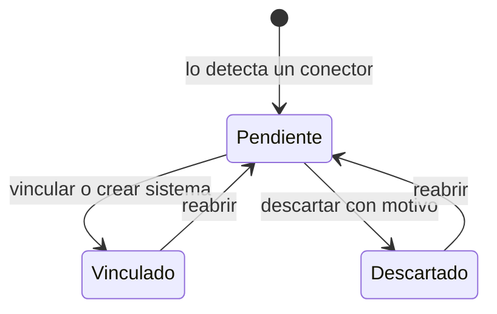

# Sistemas detectados

Bandeja de [sistemas detectados pendientes de alta](../glosario.md#sistema-detectado-pendiente-de-alta):
los activos que los conectores (MLflow, GitHub, GitLab) han encontrado. Para cada uno se decide si se
vincula a un sistema del inventario, si se da de alta como sistema nuevo o si se descarta.

## Propósito

Conciliar lo que encuentra el [Descubrimiento de inventario](../glosario.md#descubrimiento-de-inventario)
con el inventario. Nada entra en el inventario sin una decisión humana, y cada descarte queda
justificado para el auditor.

## Acceso y permisos

- **Ruta:** `/inventario/descubrimientos`
- **Navegación:** **Principal › Sistemas › Descubrimientos (N)**, donde N es el número de pendientes.
- **Disponibilidad:** módulo Descubrimiento de inventario. La entrada del menú solo aparece si está
  activo `connector-mlflow` o `shadow-ai`.

| Rol | Ver | Acciones permitidas |
|---|---|---|
| Administrador, Responsable del SGAI, CAIO, Analista de riesgos, Analista de cumplimiento | Sí | Vincular, crear sistema, descartar, reabrir |
| Resto de roles | Sí | Ninguna. Los botones aparecen, pero al pulsarlos se muestra «Sin permisos para conciliar descubrimientos.» |

> **Pendiente de implementar.** Acceso condicionado al módulo. Hoy la página se abre por URL aunque el
> módulo no esté activo.

## Campos

La vista tiene tres pestañas con contador: **Pendientes** (por defecto), **Vinculados** y **Descartados**.
Cada sistema detectado se muestra como una tarjeta, ordenadas por la última vez que se vio. No hay
búsqueda ni paginación.

| Campo | Descripción y valores | Origen (`tabla.columna`) |
|---|---|---|
| Nombre | — | `discovered_assets.name` |
| Tipo y origen | Etiquetas con el tipo de activo y el módulo de origen, sin traducir (por ejemplo `model`, `connector-mlflow`) | `asset_type`, `source_module` |
| Descripción | Si existe | `description` |
| Versiones | «N versiones · última: vX · en producción: vY», cuando el conector lo envía (MLflow) | `metadata` |
| Fechas | «Detectado el … · visto por última vez el …» | `first_seen_at`, `last_seen_at` |
| Vinculado a | Nombre del sistema, con enlace a su ficha | `linked_system_id` |
| Descartado | Motivo del descarte | `ignore_reason` |
| **Ver en origen ↗** | Enlace al activo en la herramienta externa | `external_url` |

### Indicios de IA no declarada

Solo en las tarjetas de la Detección de IA no declarada. El botón **¿Por qué se propone este
repositorio?** despliega los [hallazgos](../glosario.md#hallazgo-de-ia-no-declarada) abiertos, hasta 50.

| Campo | Descripción y valores | Origen (`tabla.columna`) |
|---|---|---|
| Tipo | credencial · librería · proveedor · modelo | `shadow_ai_findings.finding_type` |
| Patrón | Lo que se ha encontrado | `pattern` |
| Ubicación | Fichero y línea | `file_path`, `line_number` |
| Gravedad | Solo por color: rojo (crítica), naranja (alta), gris (resto) | `severity` |

Si hay alguna credencial, se muestra el aviso «Hay credenciales en el código. Fluxion no guarda su
valor, pero conviene rotarlas…».

> TODO: confirmar el orden de los hallazgos. Se ordenan por gravedad como texto, así que los críticos
> salen al final y pueden quedar fuera del límite de 50.

## Acciones

| Acción | Quién | Qué hace | Efectos |
|---|---|---|---|
| **Vincular a un sistema** › seleccionar › **Vincular** | Roles con permiso | `linkDiscovery`: comprueba que el sistema es de la organización y pasa a `linked` | A partir de ahí, el conector publica [señales](../glosario.md#señal-de-riesgo) en el historial de ese sistema |
| **Crear sistema nuevo** › **Crear y vincular ›** | Roles con permiso | `createSystemFromDiscovery`: crea el sistema con nombre, dominio y estado (Desarrollo por defecto), lo clasifica con el motor único de clasificación AI Act y lo vincula | Navega a la [Ficha del sistema](ficha-sistema.md) del sistema nuevo |
| **Descartar** | Roles con permiso | `ignoreDiscovery`: pasa a `ignored` con el motivo | — |
| **Reabrir** | Roles con permiso | `reopenDiscovery`: vuelve a `pending` y borra la decisión anterior | No borra el sistema creado, si lo hubo |

Ninguna acción escribe en el historial del sistema ni en el registro de auditoría.

**Clasificación al crear.** Como solo se conocen el nombre, el dominio y el estado, el motor usa la vía de
respaldo (ver [Alta de sistema](inventario-alta.md#clasificación-con-el-motor-único)) y el sistema queda
normalmente «Pendiente de clasificar», con el aviso «Clasificación aproximada por dominio y tipo de output:
faltan los supuestos del AI Act.» en la ficha. Con el dominio Infraestructura crítica queda en «Alto
riesgo» (Anexo III §2). Se guardan el resultado del motor, las etiquetas de las obligaciones sugeridas,
quién lo clasificó y cuándo. `created_by` guarda el usuario (`auth.users.id`), como en el alta desde el
asistente.

> TODO: confirmar el alta desde un sistema detectado.
> - El sistema se crea solo con nombre, dominio y estado, sin la descripción, las versiones ni el enlace
>   del activo.
> - A diferencia del [Alta de sistema](inventario-alta.md), no registra la versión de la clasificación
>   en el servicio de agentes, así que no crea obligaciones en estado «Sugerida», ni deja evento en el
>   historial.
> - El selector de dominio muestra los códigos internos y no los nombres.

## Validaciones

| Situación | Mensaje |
|---|---|
| Sin permisos | «Sin permisos para conciliar descubrimientos.» |
| Sistema de otra organización | «El sistema seleccionado no existe en esta organización.» |
| Descartar sin motivo | «Indica por qué se descarta: es la justificación que verá un auditor.» |
| Crear sin nombre | «El nombre es obligatorio.» |

Los botones **Vincular**, **Descartar** y **Crear y vincular** están deshabilitados mientras falta el
dato necesario.

## Estados

Un conector nunca cambia el estado ni el vínculo de un sistema detectado, aunque lo siga viendo.

Mensajes cuando una pestaña está vacía:
- **Pendientes:** «No hay descubrimientos pendientes. Los conectores activos reportarán aquí lo que
  encuentren.»
- **Vinculados:** «Todavía no has vinculado ningún descubrimiento a un sistema.»
- **Descartados:** «No has descartado ningún descubrimiento.»

## Vistas relacionadas

- [Ficha del sistema](ficha-sistema.md): destino al vincular o crear.
- [Inventario](inventario.md).
- [Ajustes](ajustes.md) › Conectores: configuración de las fuentes.
- Negocio: [Descubrimiento de inventario](../negocio/descubrimiento-inventario.md).
