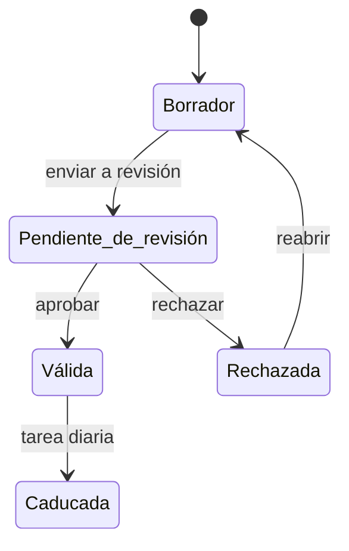

# Biblioteca de evidencias

Vista de todas las [evidencias](../glosario.md#evidencia) de la organización, de sistema y de
organización. Desde ella se revisan, se editan, se vinculan a obligaciones y se crean evidencias de
organización, y se ven las alertas de caducidad.

## Propósito

Vigilar el estado documental de la organización sin entrar sistema por sistema: qué evidencias faltan
por revisar, cuáles caducan, cuáles no tienen responsable y cuáles no respaldan ninguna obligación.

## Acceso y permisos

- **Ruta:** `/evidencias`. Parámetros de URL: `system`, `status`, `type` y `scope` (`expired`,
  `unassigned`, `orphan`, `expiring`).
- **Navegación:** **Principal › Sistemas › Evidencias**. También desde el [Dashboard](dashboard.md)
  (**Ver biblioteca**) y desde el aviso de caducidades.
- **Disponibilidad:** Core.

| Rol | Ver | Acciones permitidas |
|---|---|---|
| Administrador, Responsable del SGAI, CAIO, DPO, Responsable del sistema, Analista de riesgos, Analista de cumplimiento | Sí | Todas |
| Directivo, Auditor, Lector | Sí, con todos los botones | Crear evidencias y adjuntar ficheros. Editar, revisar o eliminar no tiene efecto, y la vista no avisa |

> **Pendiente de definir.** Qué roles pueden validar o rechazar evidencias.

## Campos

### Indicadores y bloques

| Bloque | Contenido |
|---|---|
| Alertas de caducidad | «N evidencia(s) con alerta de caducidad · N urgente(s)», con las cinco primeras alertas |
| Indicadores | **Evidencias totales** (sistemas afectados) · **Pendientes revisión** (borradores y en revisión) · **Caducadas** (y dentro de 30 días) · **Cobertura documental** (válidas + mitad de las pendientes, sobre el total; y % de trazabilidad) |
| **Requieren atención** | Cola de revisión, caducidades, trazabilidad débil, gobierno operativo |
| **Origen y trazabilidad** | Distribución por origen; evidencias reutilizadas (2 obligaciones o más), con instantánea y huérfanas (sin obligación) |
| **Biblioteca global** | La lista con sus filtros |
| **Cobertura documental por sistema** | Ranking de sistemas por fricción documental (caducadas, pendientes, huérfanas) |
| **Cola de revisión** | Borradores, pendientes y rechazadas |
| **Caducidades** | Caducadas, en 7 días o menos, de 8 a 30 días y sin caducidad |

### Filtros de la lista

| Filtro | Valores |
|---|---|
| **Sistema** | Todos o uno de los seis primeros |
| **Estado** | Todos · Pendiente revisión · Borrador · Válida · Caducada |
| **Tipo** | Todos o uno de los seis primeros |
| **Atención** | Todas · Caducadas · Sin owner · Huérfanas · Vence pronto (30 días o menos) |
| **Tags** | Una etiqueta, en el navegador |

> TODO: confirmar los límites de la lista.
> - Muestra solo las 24 primeras evidencias filtradas, sin paginación, aunque el contador indique el total.
> - Los filtros de sistema y tipo ofrecen solo seis opciones.
> - Falta el filtro «Rechazada».

### Tarjeta de evidencia

| Campo | Descripción y valores | Origen (`tabla.columna`) |
|---|---|---|
| Estado | Borrador · Pend. revisión · Válida · Caducada · Rechazada ([estado de la evidencia](../glosario.md#estado-de-la-evidencia)) | `system_evidences.status` |
| Ámbito | Código del sistema u «ORG» | `scope`, `ai_system_id` |
| Origen | Carga manual, Dossier técnico, Snapshot u otro, deducido del tipo o del enlace | `evidence_type`, `external_url` |
| Título | Enlace al [Detalle de evidencia](evidencia-detalle.md) | `title` |
| Sistema · tipo · responsable | — | `evidence_type`, `owner_user_id` |
| Etiquetas | — | `tags` |
| Caducidad | Caducada · Sin caducidad · Caduca hoy · Caduca en N días | `expires_at` |
| **Owner** · **Obligaciones vinculadas** · **Emitida** · **Trazabilidad** | Trazabilidad: Huérfana o número de obligaciones | `owner_user_id`, `system_obligation_evidences`, `issued_at` |

### Nueva evidencia organizacional / Editar evidencia

| Campo | Tipo | Obligatorio | Descripción y valores | Origen (`tabla.columna`) |
|---|---|---|---|---|
| **Título** | texto | Sí | — | `title` |
| **Tipo** | selector | — | Documento técnico, DPIA, Política (por defecto en las de organización), Contrato, Informe de auditoría, Registro formativo, Resultado de pruebas, Log de monitorización, Evaluación de riesgos, Certificado, Otro | `evidence_type` |
| **Estado** | selector | — | Borrador (por defecto), Pendiente de revisión, Válida, Caducada, Rechazada | `status` |
| **URL del documento** | URL | Sí, si no hay fichero | — | `external_url` |
| **Archivo adjunto** | fichero | No | PDF, imagen, Word, Excel, PowerPoint, texto o CSV. La vista indica máximo 20 MB | `storage_path`, `mime_type`, `file_size_bytes` |
| **Descripción** | texto largo | No | — | `description` |
| **Versión** | texto | No | — | `version` |
| **Tags** | etiquetas | No | Intro o coma para añadir; se guardan en minúsculas | `tags` |
| **Fecha de emisión**, **Caducidad** | fecha | No | — | `issued_at`, `expires_at` |

Los ficheros se suben en tres pasos:
1. El servidor firma una URL de subida válida 5 minutos.
2. El navegador sube el fichero directamente al almacenamiento.
3. El servidor comprueba que el fichero ha llegado y lo registra.

> TODO: confirmar varios comportamientos del formulario.
> - **Estado:** permite fijar «Válida» sin pasar por la revisión.
> - **Edición:** el fichero se sube al elegirlo, aunque después se cancele.
> - **Fichero:** quitar el fichero o eliminar la evidencia no borra el fichero del almacenamiento.
> - **Tamaño:** el límite es de 20 MB en la vista, pero de 100 MB en el servidor.
> - **Alta de organización:** si la subida del fichero falla, el error no se muestra y la evidencia queda en
>   borrador sin fichero.

## Acciones

| Acción | Quién | Qué hace | Efectos |
|---|---|---|---|
| **+ Evidencia organizacional** | Todos | `createOrganizationEvidence`: evidencia de toda la organización, con el usuario como responsable | Sin URL ni fichero queda en borrador |
| **Editar evidencia** | Roles con permiso | `updateSystemEvidence` | Registra una versión. Historial «Evidencia actualizada» en el sistema |
| **Enviar a revisión** · **Aprobar** · **Rechazar** (con motivo) · **Reabrir** | Roles con permiso | `reviewSystemEvidence` | Registra revisor y fecha. Historial «Revisión solicitada», «Evidencia aprobada», «Evidencia rechazada» o «Evidencia reabierta» |
| **Eliminar evidencia** | Roles con permiso | Pide confirmación y ejecuta `deleteSystemEvidence` | Borra también sus versiones, alertas y vínculos. Historial «Evidencia eliminada» |
| Vista previa | Todos | Abre el fichero (PDF o imagen) o lo descarga | — |
| **Ver historial de versiones** | Todos | Panel con los cambios de la evidencia y su diferencia campo a campo | — |
| Selección › **Enviar a revisión** / **Aprobar** | Roles con permiso | `bulkReviewEvidences`: solo las que admiten el cambio | Sin revisor ni historial |
| Selección › **Vincular obligación** | Roles con permiso | Vincula las seleccionadas a una obligación de la organización | — |
| Selección › **CSV** | Todos | Descarga `evidencias_AAAA-MM-DD.csv` | — |
| Descartar alerta (X) | Todos | Oculta la alerta de caducidad | — |

> TODO: confirmar que el historial de versiones se guarda. La tabla de versiones no admite inserciones con
> los permisos del usuario, así que probablemente no se registra ningún cambio y el historial siempre está
> vacío.

> TODO: confirmar el comportamiento sin permiso. Si un rol sin permiso edita, revisa o elimina, la base de
> datos no aplica el cambio y la vista no lo indica.

### Alertas de caducidad

Cada día a las 07:00 una tarea programada:
- crea alertas para las evidencias que caducan en 30 días, en 7 días o ya han caducado;
- pasa a «Caducada» las válidas vencidas;
- retira las alertas de las evidencias cuya caducidad se ha ampliado.

Una alerta descartada no vuelve a aparecer.

## Validaciones

| Situación | Mensaje |
|---|---|
| Sin título | «Faltan datos obligatorios.» |
| URL incorrecta | «La URL no es válida.» |
| Fuera de borrador sin fichero ni URL | «Una evidencia que no está en borrador necesita un fichero adjunto o una URL.» |
| Alta de organización sin fichero ni URL | «Adjunta un fichero o indica la URL del documento.» |
| Rechazo sin motivo | «Las notas de rechazo son obligatorias.» |
| Transición no permitida | «No se puede aplicar "…" desde el estado "…".» |
| Fichero de más de 100 MB | «El fichero supera el máximo de 100 MB.» |
| Almacenamiento no configurado | «El almacenamiento de ficheros no está configurado en este entorno.» |
| Fichero que no llegó | «El fichero no llegó al almacenamiento. Inténtalo de nuevo.» |

## Estados

## Vistas relacionadas

- [Detalle de evidencia](evidencia-detalle.md), [Ficha del sistema](ficha-sistema.md) (pestaña Evidencias).
- [Análisis de brechas](brechas.md): caducidades.
- Negocio: [Biblioteca de evidencias](../negocio/biblioteca-evidencias.md).
