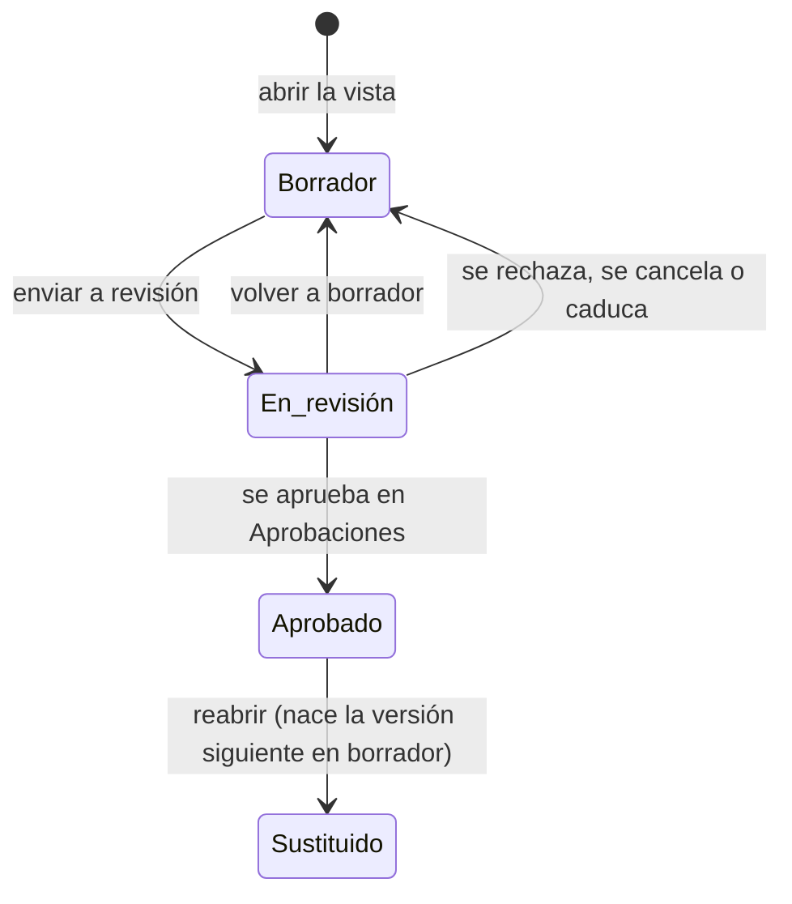

# Expediente documental

El [expediente documental](../glosario.md#expediente-documental) es la vista donde se redactan, aprueban
y exportan a PDF los documentos regulatorios de un sistema de IA. Hay cinco plantillas:

| Documento | Clave | Normativa |
|---|---|---|
| Documentación técnica | `annex_iv` | AI Act, Art. 11 y Anexo IV |
| FRIA | `fria` | AI Act, Art. 27 |
| DPIA | `dpia` | RGPD, Art. 35 |
| Ficha del modelo | `model_card` | AI Act, Anexo XII |

| AISIA | `aisia` | ISO/IEC 42001, §6.1.4 y A.5.2 a A.5.5 (B15). Ver [AISIA](aisia.md) |

## Propósito

Montar cada documento por los epígrafes de la norma. Lo que ya está en Fluxion se rellena solo
(derivado), y lo demás se redacta a mano. La vista señala los apartados obligatorios sin cubrir y genera
entregables PDF inmutables que se registran como evidencia.

## Acceso y permisos

- **Ruta:** `/inventario/[id]/expediente/[key]`, con `key` ∈ `annex_iv`, `fria`, `dpia`, `model_card`, `aisia`.
  Cualquier otra clave devuelve «no encontrado».
- **Navegación:**
  - **Acciones rápidas** de la [Ficha del sistema](ficha-sistema.md), tarjeta **Anexo IV**;
  - desde la vista, las pestañas de las demás plantillas.
- **Disponibilidad:** módulo Documentación del sistema.

| Rol | Ver | Acciones permitidas |
|---|---|---|
| Todos los roles | Sí | Redactar, enviar a revisión, volver a borrador, reabrir, generar y descargar PDF |

El expediente se aprueba siempre en [Aprobaciones](aprobaciones.md), con la política de su plantilla (B11f).
Por defecto (DP-01): Anexo IV y ficha del modelo, el Responsable del SGAI; FRIA, el Comité de IA con dictamen
del DPO; DPIA, el Responsable del tratamiento con dictamen del DPO. Quien redacta no aprueba: la solicitud
lleva en su contexto (`prepared_by`) a quienes escribieron algún apartado, y ni ellos ni quien la envió
pueden decidir, tampoco por delegación. La base de datos no deja aprobar un expediente desde la sesión de un
usuario (`trg_document_lifecycle_rules`).

Al abrir la vista, si el sistema no tiene un documento vivo para esa plantilla, se crea uno en borrador
con la versión activa más reciente de la plantilla.

## Campos

**Cabecera:**
- marco normativo (AI Act, RGPD, ISO 42001), título y descripción de la plantilla;
- pestañas de plantillas, solo si hay más de una. Un punto verde marca las que ya tienen documento.

**Tarjeta de estado:**
- estado y versión de la plantilla;
- botones de cambio de estado;
- barra de completitud: porcentaje de apartados obligatorios cubiertos, en verde al 100 %, en naranja
  desde el 60 % y en rojo por debajo;
- aviso de desactualización: «La ficha del sistema cambió el {fecha}, después de la última edición del
  expediente. Revisa los apartados derivados.».

**Huecos:** «Faltan N apartados obligatorios», con su referencia y título. Si no falta ninguno, «Todos los
apartados obligatorios están cubiertos».

**Apartados**, agrupados por los epígrafes de la norma:

| Elemento | Descripción |
|---|---|
| Referencia y título | Por ejemplo «IV.2.e». Si el apartado es opcional, lleva «cuando proceda» |
| Guía | Qué debe contener, según la plantilla |
| Fuente | **Ficha del sistema**, **FMEA y tratamiento**, **Historial** o **Redacción propia** |
| **Derivado automáticamente** | Texto que Fluxion compone en cada lectura a partir de la ficha, la última evaluación FMEA, el último plan de tratamiento, las decisiones de [supervisión humana](../glosario.md#supervisión-humana) de los últimos 180 días y los últimos 15 eventos del historial |
| **Redactado** | Texto escrito por el usuario, guardado en `documents.content` |
| Vacío | «Sin contenido. Es un apartado obligatorio del expediente.» o, si es opcional, «… si no aplica a este sistema, déjalo así.» |

Un apartado cuenta como cubierto si tiene texto derivado o redactado.

**Entregables:** PDF generados, con fecha, tamaño, «completo» o «incompleto · N apartados», huella
(SHA-256), autor y **Descargar**. Sin entregables: «Todavía no se ha generado ningún entregable.».

**Registros generados:** solo si hay. Documentos que produce la plataforma, como las [actas](../glosario.md#acta)
de aprobación. No se pueden editar, solo descargar.

> TODO: confirmar varios datos de la vista.
> - **Orden de las pestañas:** no es fijo.
> - **Ficha del modelo:** se ofrece aunque el sistema no sea GPAI.
> - **Apartados opcionales vacíos:** se marcan como «sin cubrir» aunque no cuenten como hueco.
> - **Apartado IV.8:** pide adjuntar un documento firmado, pero solo admite texto.
> - **Actas:** no se pueden abrir en esta vista y no enlazan con su solicitud de aprobación.

## Acciones

| Acción | Quién | Qué hace | Efectos |
|---|---|---|---|
| **Escribir o completar** (lápiz) | Todos | Abre el editor del apartado, también en los derivados. **Guardar** guarda el texto, y si queda vacío lo borra. Registra quién lo redacta | Solo en borrador |
| **Enviar a revisión** | Todos | Borrador → En revisión, sin apartados obligatorios sin cubrir y con una política activa para la plantilla. En revisión no se edita | Abre la solicitud en [Aprobaciones](aprobaciones.md) y avisa al primer paso; si no se abre, vuelve a borrador. Historial «Expediente enviado a revisión» |
| **Volver a borrador** | Todos | En revisión → Borrador | Cancela la solicitud. Historial «Expediente devuelto a borrador» |
| **Reabrir (versión nueva)** | Todos, con confirmación | `document_reopen`: la versión aprobada pasa a «Sustituido» y se abre la siguiente en borrador con el mismo contenido | Historial «Expediente reabierto». Los PDF de la versión aprobada se conservan |
| **Generar PDF** | Todos | Genera un entregable en cualquier estado | Ver abajo |
| **Descargar** | Todos | Descarga el PDF con un enlace temporal | — |
| **← {sistema}** | Todos | Vuelve a la [Ficha del sistema](ficha-sistema.md) | — |

Al pulsar **Generar PDF**:

1. Se compone el documento y se calcula la huella de su contenido.
2. Se guarda una [instantánea](../glosario.md#instantánea).
3. El servicio de renderizado genera el PDF.
4. El PDF se guarda en el almacenamiento de documentos.
5. Se crea una evidencia:
   - **Tipo:** documento regulatorio.
   - **Estado:** **válida** si el expediente está aprobado; si no, **pendiente de revisión**, con su
     solicitud de aprobación abierta automáticamente en [Aprobaciones](aprobaciones.md)
     (`openEvidenceReview`); si no hay política activa para las evidencias, queda en borrador.
   - **Responsable:** quien genera el PDF (no puede aprobarla él).
   - **Etiquetas:** la de la plantilla (`anexo-iv`, `fria`, `dpia`, `ficha-modelo`) y `generado`.
   - **Caducidad:** la vigencia de la plantilla, 12 meses.
6. Se registra el entregable, que es inmutable, con la versión y el estado del expediente.

El PDF lleva el rótulo y la referencia legal de su plantilla (Anexo IV: Reglamento (UE) 2024/1689, Anexo IV
y Art. 11.1; FRIA: Art. 27; DPIA: Reglamento (UE) 2016/679, Art. 35; ficha del modelo: Art. 53.1.b y
Anexo XII), el estado en español, la versión y la fecha de aprobación. El fichero se llama
`{plantilla}-{fecha}.pdf`. La lista de entregables incluye los de todas las versiones, con su versión y
estado.

El texto de la vista indica que no se puede borrar durante los diez años del Art. 18.

Las evidencias «Válidas» de PDF generados antes de esta regla con el expediente sin aprobar llevan la
etiqueta `sin-revision`.

Con una política de [Flujos de aprobación](../glosario.md#flujos-de-aprobación) para este tipo de objeto, la decisión se toma en [Aprobaciones](aprobaciones.md) (B11a): ver allí cuándo se abre la solicitud y qué efecto tiene. Para enviarlo con política, no puede quedar ningún apartado obligatorio sin cubrir.

## Validaciones

| Situación | Mensaje |
|---|---|
| Envío sin política para la plantilla | «No hay ninguna política de aprobación activa para {plantilla}. Configúrala en Ajustes › Aprobaciones antes de enviar el expediente.» |
| Plantilla sin versión activa | «No hay ninguna plantilla activa para "{key}". Revisa las migraciones.» |
| Editar un expediente aprobado | «El expediente está aprobado. Reábrelo para crear una versión nueva y editarla.» |
| Editar en revisión | «El expediente está en revisión. Vuelve a borrador para editarlo.» |
| Transición no permitida | «Esta acción no se puede aplicar a un expediente en estado «…».» |
| Aprobar desde la API con sesión de usuario | «El expediente se aprueba en Aprobaciones.» |
| Apartado inexistente en la plantilla | «El apartado {ref} no existe en esta versión de la plantilla.» |
| Enviar con huecos | «No se puede enviar a aprobación con apartados obligatorios sin cubrir: {refs}.» |
| Almacenamiento no configurado | «El almacenamiento de documentos no está configurado.» |
| Renderizador no configurado o con error | «El servicio de renderizado no está configurado (RENDERER_URL / RENDERER_SECRET).» / «el renderizador respondió {status}: …» |
| PDF generado pero no guardado | «El PDF se generó pero no se pudo guardar.» |
| Otros errores | «No se pudo crear el expediente.», «No se pudo guardar el apartado.», «No se pudo cambiar el estado del expediente.», «No se pudo generar el entregable.» |

Si no se puede crear o componer el documento, la vista muestra el error y **Volver al sistema**.

## Estados

En revisión, la vista muestra «La aprobación se decide en Aprobaciones, con la política de la organización.»,
o, si el expediente no tiene solicitud abierta, «Sin solicitud de aprobación abierta: vuelve a borrador y
envíalo de nuevo.».

Cada cambio de estado queda en el historial del sistema. Fuera de estas transiciones, la base de datos lo
rechaza; las actas de aprobación, que genera el sistema, nacen aprobadas.

## Vistas relacionadas

- [Ficha del sistema](ficha-sistema.md), [Dossier técnico](dossier-tecnico.md).
- [Evaluación FMEA](fmea-evaluacion.md), [Plan de tratamiento](plan-de-tratamiento.md): fuentes derivadas.
- [Biblioteca de evidencias](evidencias.md).
- Negocio: [Documentación del sistema](../negocio/documentacion-del-sistema.md).
