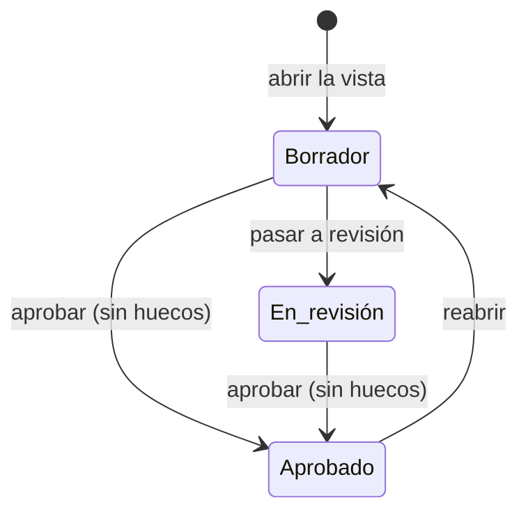

# Expediente documental

El [expediente documental](../glosario.md#expediente-documental) es la vista donde se redactan, aprueban
y exportan a PDF los documentos regulatorios de un sistema de IA. Hay cuatro plantillas:

| Documento | Clave | Normativa |
|---|---|---|
| Documentación técnica | `annex_iv` | AI Act, Art. 11 y Anexo IV |
| FRIA | `fria` | AI Act, Art. 27 |
| DPIA | `dpia` | RGPD, Art. 35 |
| Ficha del modelo | `model_card` | AI Act, Anexo XII |

## Propósito

Montar cada documento por los epígrafes de la norma. Lo que ya está en Fluxion se rellena solo
(derivado), y lo demás se redacta a mano. La vista señala los apartados obligatorios sin cubrir y genera
entregables PDF inmutables que se registran como evidencia.

## Acceso y permisos

- **Ruta:** `/inventario/[id]/expediente/[key]`, con `key` ∈ `annex_iv`, `fria`, `dpia`, `model_card`.
  Cualquier otra clave devuelve «no encontrado».
- **Navegación:**
  - **Acciones rápidas** de la [Ficha del sistema](ficha-sistema.md), tarjeta **Anexo IV**;
  - desde la vista, las pestañas de las demás plantillas.
- **Disponibilidad:** módulo Documentación del sistema.

| Rol | Ver | Acciones permitidas |
|---|---|---|
| Todos los roles | Sí | Redactar, cambiar el estado, generar y descargar PDF |

> **Pendiente de definir.** Qué roles pueden aprobar y reabrir un expediente. Hoy cualquier usuario de la
> organización puede hacerlo.

Al abrir la vista, si el sistema no tiene un documento vivo para esa plantilla, se crea uno en borrador
con la versión activa más reciente de la plantilla.

## Campos

**Cabecera:**
- marco normativo (AI Act, RGPD, ISO 42001), título y descripción de la plantilla;
- pestañas de plantillas, solo si hay más de una. Un punto verde marca las que ya tienen documento.

**Tarjeta de estado:**
- estado y versión de la plantilla;
- botones de cambio de estado;
- barra de completitud: porcentaje de apartados obligatorios cubiertos, en verde al 100 %, en naranja
  desde el 60 % y en rojo por debajo;
- aviso de desactualización: «La ficha del sistema cambió el {fecha}, después de la última edición del
  expediente. Revisa los apartados derivados.».

**Huecos:** «Faltan N apartados obligatorios», con su referencia y título. Si no falta ninguno, «Todos los
apartados obligatorios están cubiertos».

**Apartados**, agrupados por los epígrafes de la norma:

| Elemento | Descripción |
|---|---|
| Referencia y título | Por ejemplo «IV.2.e». Si el apartado es opcional, lleva «cuando proceda» |
| Guía | Qué debe contener, según la plantilla |
| Fuente | **Ficha del sistema**, **FMEA y tratamiento**, **Historial** o **Redacción propia** |
| **Derivado automáticamente** | Texto que Fluxion compone en cada lectura a partir de la ficha, la última evaluación FMEA, el último plan de tratamiento, las decisiones de [supervisión humana](../glosario.md#supervisión-humana) de los últimos 180 días y los últimos 15 eventos del historial |
| **Redactado** | Texto escrito por el usuario, guardado en `documents.content` |
| Vacío | «Sin contenido. Es un apartado obligatorio del expediente.» o, si es opcional, «… si no aplica a este sistema, déjalo así.» |

Un apartado cuenta como cubierto si tiene texto derivado o redactado.

**Entregables:** PDF generados, con fecha, tamaño, «completo» o «incompleto · N apartados», huella
(SHA-256), autor y **Descargar**. Sin entregables: «Todavía no se ha generado ningún entregable.».

**Registros generados:** solo si hay. Documentos que produce la plataforma, como las [actas](../glosario.md#acta)
de aprobación. No se pueden editar, solo descargar.

> TODO: confirmar varios datos de la vista.
> - **Orden de las pestañas:** no es fijo.
> - **Ficha del modelo:** se ofrece aunque el sistema no sea GPAI.
> - **Apartados opcionales vacíos:** se marcan como «sin cubrir» aunque no cuenten como hueco.
> - **Apartado IV.8:** pide adjuntar un documento firmado, pero solo admite texto.
> - **Actas:** no se pueden abrir en esta vista y no enlazan con su solicitud de aprobación.

## Acciones

| Acción | Quién | Qué hace | Efectos |
|---|---|---|---|
| **Escribir o completar** (lápiz) | Todos | Abre el editor del apartado, también en los derivados. **Guardar** guarda el texto, y si queda vacío lo borra | Oculto si el documento está aprobado |
| **Pasar a revisión** | Todos | Borrador → En revisión | — |
| **Aprobar expediente** | Todos | Borrador o En revisión → Aprobado. Deshabilitado si hay huecos («Quedan apartados obligatorios sin cubrir») | Guarda quién lo aprueba y cuándo |
| **Reabrir para editar** | Todos | Aprobado → Borrador | Borra la aprobación |
| **Generar PDF** | Todos | Genera un entregable en cualquier estado | Ver abajo |
| **Descargar** | Todos | Descarga el PDF con un enlace temporal | — |
| **← {sistema}** | Todos | Vuelve a la [Ficha del sistema](ficha-sistema.md) | — |

Al pulsar **Generar PDF**:

1. Se compone el documento y se calcula la huella de su contenido.
2. Se guarda una [instantánea](../glosario.md#instantánea).
3. El servicio de renderizado genera el PDF.
4. El PDF se guarda en el almacenamiento de documentos.
5. Se crea una evidencia:
   - **Tipo:** documento regulatorio.
   - **Estado:** **válida**.
   - **Caducidad:** la vigencia de la plantilla, 12 meses.
6. Se registra el entregable, que es inmutable.

El texto de la vista indica que no se puede borrar durante los diez años del Art. 18.

> TODO: confirmar varios datos del PDF y de los cambios de estado.
> - **Rótulo del PDF:** dice «Anexo IV» en portada y pie para todas las plantillas, incluidas FRIA, DPIA,
>   ficha del modelo y actas.
> - **Datos guardados con el PDF:** la instantánea y la evidencia se guardan siempre como Anexo IV.
> - **Estado en el PDF:** aparece sin traducir.
> - **Evidencias que genera:** nacen válidas, sin revisión, a diferencia de las de los informes del
>   sistema.
> - **Historial:** los cambios de estado no dejan rastro.
> - **Vuelta a borrador:** no se puede volver a borrador desde «En revisión».
> - **Estado «Sustituido»:** existe, pero nada lo asigna.

> **Pendiente de implementar.** Aprobación del expediente mediante
> [Flujos de aprobación](../glosario.md#flujos-de-aprobación).

## Validaciones

| Situación | Mensaje |
|---|---|
| Plantilla sin versión activa | «No hay ninguna plantilla activa para "{key}". Revisa las migraciones.» |
| Editar un expediente aprobado | «El expediente está aprobado. Reábrelo para poder editarlo.» |
| Apartado inexistente en la plantilla | «El apartado {ref} no existe en esta versión de la plantilla.» |
| Aprobar con huecos | «No se puede aprobar con apartados obligatorios sin cubrir: {refs}.» |
| Almacenamiento no configurado | «El almacenamiento de documentos no está configurado.» |
| Renderizador no configurado o con error | «El servicio de renderizado no está configurado (RENDERER_URL / RENDERER_SECRET).» / «el renderizador respondió {status}: …» |
| PDF generado pero no guardado | «El PDF se generó pero no se pudo guardar.» |
| Otros errores | «No se pudo crear el expediente.», «No se pudo guardar el apartado.», «No se pudo cambiar el estado del expediente.», «No se pudo generar el entregable.» |

Si no se puede crear o componer el documento, la vista muestra el error y **Volver al sistema**.

## Estados

## Vistas relacionadas

- [Ficha del sistema](ficha-sistema.md), [Dossier técnico](dossier-tecnico.md).
- [Evaluación FMEA](fmea-evaluacion.md), [Plan de tratamiento](plan-de-tratamiento.md): fuentes derivadas.
- [Biblioteca de evidencias](evidencias.md).
- Negocio: [Documentación del sistema](../negocio/documentacion-del-sistema.md).
