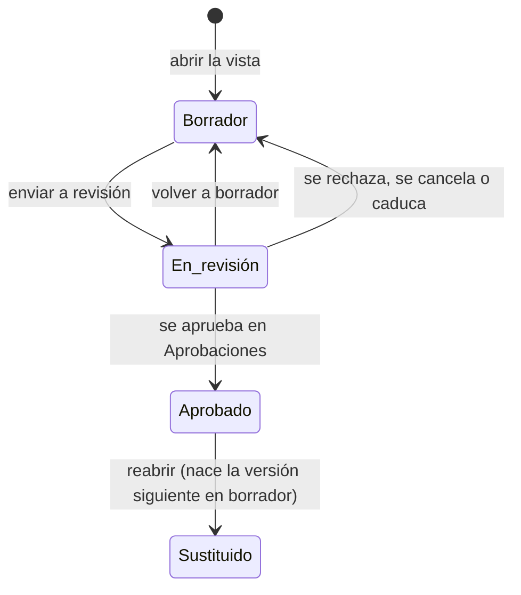

# Expediente documental

El [expediente documental](../glosario.md#expediente-documental) es la vista donde se redactan, aprueban
y exportan a PDF los documentos regulatorios de un sistema de IA. Hay seis plantillas:

| Documento | Clave | Normativa |
|---|---|---|
| Documentación técnica | `annex_iv` | AI Act, Art. 11 y Anexo IV |
| FRIA | `fria` | AI Act, Art. 27 |
| DPIA | `dpia` | RGPD, Art. 35 |
| Ficha del modelo | `model_card` | AI Act, Anexo XII |
| Ficha para el registro UE | `eu_registry` | AI Act, Art. 49 y Anexo VIII (B16b). Ver [Ficha para el registro UE](registro-ue.md) |

| AISIA | `aisia` | ISO/IEC 42001, §6.1.4 y A.5.2 a A.5.5 (B15). Ver [AISIA](aisia.md) |

## Propósito

Montar cada documento por los epígrafes de la norma. Lo que ya está en Fluxion se rellena solo
(derivado), y lo demás se redacta a mano. La vista señala los apartados obligatorios sin cubrir y genera
entregables PDF inmutables que se registran como evidencia.

## Acceso y permisos

- **Ruta:** `/inventario/[id]/expediente/[key]`, con `key` ∈ `annex_iv`, `eu_registry`, `fria`, `dpia`, `model_card`, `aisia`.
  Cualquier otra clave devuelve «no encontrado».
- **Navegación:**
  - **Acciones rápidas** de la [Ficha del sistema](ficha-sistema.md), tarjeta **Anexo IV**;
  - desde la vista, las pestañas de las demás plantillas.
- **Disponibilidad:** módulo Documentación del sistema.

| Rol | Ver | Acciones permitidas |
|---|---|---|
| Todos los roles | Sí | Redactar, enviar a revisión, volver a borrador, reabrir, generar y descargar PDF |

El expediente se aprueba siempre en [Aprobaciones](aprobaciones.md), con la política de su plantilla (B11f).
Por defecto (DP-01): Anexo IV y ficha del modelo, el Responsable del SGAI; FRIA, el Comité de IA con dictamen
del DPO; DPIA, el Responsable del tratamiento con dictamen del DPO. Quien redacta no aprueba: la solicitud
lleva en su contexto (`prepared_by`) a quienes escribieron algún apartado, y ni ellos ni quien la envió
pueden decidir, tampoco por delegación. La base de datos no deja aprobar un expediente desde la sesión de un
usuario (`trg_document_lifecycle_rules`).

Al abrir la vista, si el sistema no tiene un documento vivo para esa plantilla y la plantilla se redacta para
ese sistema, se crea uno en borrador con la versión activa más reciente de la plantilla.

### Aplicabilidad por sistema (DP-11, B16a)

Cada plantilla aplica a un sistema según el rol de la organización en su cadena de valor
(`ai_systems.value_chain_roles`, «Tu papel frente a este sistema» al editarlo) y su clasificación AI Act
(`documentApplicability` en `lib/documents/applicability.ts`), en uno de tres modos:

| Plantilla | Redactar | Documentación del proveedor | No aplica |
|---|---|---|---|
| Anexo IV | Proveedor y alto riesgo | Alto riesgo sin ser proveedor | Resto, también con la clasificación pendiente |
| Ficha para el registro UE | Proveedor de alto riesgo (sección A), proveedor con la excepción del Art. 6.3 (sección B) o responsable del despliegue que es organismo público (sección C). Ver [Ficha para el registro UE](registro-ue.md) | Alto riesgo sin ser proveedor | Resto e infraestructura crítica (registro nacional) |
| Plan de vigilancia poscomercialización (B26) | Proveedor y alto riesgo (AI Act, Art. 72 y Anexo IV, punto 9) | — | Resto. Como responsable del despliegue, la vigilancia es la del Art. 26.5 (ver [ficha](ficha-sistema.md), **Uso del sistema**) |
| FRIA | Responsable del despliegue de alto riesgo del Anexo III (salvo solo el punto 2) que es organismo público o presta servicios públicos (`aiact_inputs.publicBody`), o con los puntos 5b o 5c: la misma regla que la obligación del Art. 27 | — | Resto |
| Ficha del modelo | Proveedor de un modelo GPAI (`aiact_result.gpai.modelProvider`) | — | Resto |
| DPIA | La ficha marca que trata datos personales | — | Resto, también sin respuesta |
| AISIA | Siempre | — | — |

Sin roles declarados, la organización no se considera proveedora.

- **Pestañas:** solo las plantillas que aplican, con «· del proveedor» en las de documentación del proveedor.
  Una plantilla que no aplica sigue apareciendo, con «· no aplica», si el sistema ya tiene documento. La ayuda
  de cada pestaña da el motivo.
- **No aplica:** la vista dice «Este documento no aplica a este sistema» con el motivo, y no crea el documento.
- **FRIA como buena práctica** (DP-12, B29): si la organización es responsable del despliegue, la pestaña FRIA
  aparece aunque no aplique. Explica el motivo y, si el sistema es de alto riesgo del Anexo III y falta saber si
  la organización es organismo público (`aiact_inputs.publicBody` sin responder), lo pide con **Responder al
  editar el sistema**. **Redactar como buena práctica** (`?vista=voluntaria`) crea el documento con el mismo ciclo,
  pero no cuenta como obligación ni en la etapa de evaluación, no muestra el panel de notificación a la autoridad
  y no abre la revisión anual (B21b).
- **Documento que ha dejado de aplicar** (cambió la clasificación o el rol): se muestra con un aviso y se
  conserva lo redactado.

### Notificación del documento aprobado (B17b)

La FRIA aprobada se notifica a la autoridad de vigilancia del mercado (AI Act, Art. 27.3) y la ficha para el registro
UE se presenta en la base de datos de la UE (Art. 49). Fluxion no envía nada: el panel **Notificación a la autoridad de
vigilancia del mercado** (FRIA) o **Presentación en la base de datos de la UE** (ficha para el registro UE) deja
constancia.

| Campo | Tipo | Obligatorio | Descripción | Origen |
|---|---|---|---|---|
| **Autoridad notificada** / **Registro** | texto | Sí | Por defecto, «Autoridad de vigilancia del mercado» o «Base de datos de la UE (Art. 71)» | `document_notifications.authority` |
| **Fecha** | fecha | Sí | No posterior a hoy | `notified_at` |
| **Referencia o acuse** | texto | No | Número de registro, acuse o referencia | `reference` |
| **Notas** | texto | No | — | `notes` |

- **Registrar notificación** solo aparece con el documento aprobado; se registra por versión y no se edita ni se borra.
  Historial del sistema: evento con el título del panel.
- Con el documento aprobado y sin notificación, el panel lo avisa: «La FRIA está aprobada pero no consta su
  notificación a la autoridad de vigilancia del mercado (Art. 27.3).» o «La ficha está aprobada pero no consta su
  presentación en la base de datos de la UE (Art. 49).».
- Antes de aprobar: «Se registra cuando el documento esté aprobado.».

**FRIA v2** (`20261027170000`): el apartado 27.3 deja de ser obligatorio para enviar a aprobación (la notificación se
registra después). Dos apartados se trazan con el resto de Fluxion (`lib/documents/derive-fria.ts`), también en las
FRIA ya creadas con la v1:
- **27.1.d · Riesgos específicos de perjuicio:** versión y zona del análisis de riesgos vigente, los modos de fallo de
  las dimensiones ética y legal con severidad actual 7 o más, y las instrucciones de uso del proveedor adjuntas como
  documentación del proveedor (Art. 13).
- **27.4 · Relación con la DPIA:** la DPIA del expediente del sistema (versión, estado y fecha de aprobación) y lo que
  indica la ficha (Art. 27.4).

### Documentación del proveedor (DP-11, B16a)

Cuando la organización no es proveedora de un sistema de alto riesgo, el Anexo IV no se redacta: la vista
**Documentación del proveedor** permite adjuntar lo que entrega el proveedor como evidencias del sistema.

**También en los sistemas que no son de alto riesgo** (2026-10-28). Si la organización no es la proveedora, en
el **Anexo IV** y la **Ficha para el registro UE** la vista muestra «Este documento no aplica a este sistema» con
su motivo y, debajo, «Como la organización no es la proveedora, puedes adjuntar igualmente la documentación que te
entregue el proveedor. Es opcional.», con el mismo formulario. Su pestaña dice «· del proveedor (opcional)». Si el
sistema ya tenía el documento redactado, se muestra el documento.

| Campo | Tipo | Obligatorio | Descripción y valores | Origen |
|---|---|---|---|---|
| **Tipo** | selector | Sí | Instrucciones de uso (Art. 13) · Declaración UE de conformidad (Art. 47) · Número o ficha de registro en la base de datos de la UE (Art. 49) · Documentación técnica facilitada por el proveedor · Otro documento del proveedor | `system_evidences.evidence_type` (`technical_doc`, `certification`, `record`, `other`) y etiqueta `doc-proveedor-tipo-*` |
| **Título** | texto | Sí | — | `title` |
| **Fichero** y **URL** | fichero, URL o los dos | Al menos uno | «Adjunta el fichero, indica la URL o las dos cosas.» El fichero se sube al almacenamiento de evidencias | `storage_path` y `external_url` |

- **Añadir como evidencia** crea la evidencia en borrador, con las etiquetas `documentacion-proveedor` y
  `doc-proveedor-<plantilla>`, y el evento de historial «Documentación del proveedor añadida». Sigue la revisión
  habitual de las [evidencias](evidencias.md).
- **Documentos aportados:** título, tipo y estado de la evidencia, con **Abrir** (enlace) y **Ver evidencia →**.
- Si el sistema ya tenía el documento redactado, el aviso enlaza a él (`?vista=documento`).

**Registro del proveedor en la base de datos de la UE** (2026-10-28). Solo en la **Ficha para el registro UE**,
encima de los documentos aportados: **Número de registro UE** y **URL de la entrada**, juntos o por separado, con
**Guardar registro** («Registro del proveedor guardado.»; «La URL no es válida.»). Se guardan en el sistema
(`ai_systems.provider_eu_registry_number`, `provider_eu_registry_url`) y quedan en el historial («Registro UE del
proveedor actualizado»). Cuentan para el punto del plan de despliegue «Sistema registrado por el proveedor en la
base de datos de la UE» y, si la organización es autoridad pública, se vuelcan en el apartado C.3 de su ficha para
el registro UE.

## Campos

**Cabecera:**
- marco normativo (AI Act, RGPD, ISO 42001), título y descripción de la plantilla;
- pestañas de plantillas, solo si hay más de una. Un punto verde marca las que ya tienen documento.

**Tarjeta de estado:**
- estado y versión de la plantilla;
- botones de cambio de estado;
- barra de completitud: porcentaje de apartados obligatorios cubiertos, en verde al 100 %, en naranja
  desde el 60 % y en rojo por debajo;
- aviso de desactualización: «La ficha del sistema cambió el {fecha}, después de la última edición del
  expediente. Revisa los apartados derivados.».

**Huecos:** «Faltan N apartados obligatorios», con su referencia y título. Si no falta ninguno, «Todos los
apartados obligatorios están cubiertos».

**Apartados**, agrupados por los epígrafes de la norma:

| Elemento | Descripción |
|---|---|
| Referencia y título | Por ejemplo «IV.2.e». Si el apartado es opcional, lleva «cuando proceda» |
| Guía | Qué debe contener, según la plantilla |
| Fuente | **Ficha del sistema**, **FMEA y tratamiento**, **Historial** o **Redacción propia** |
| **Derivado automáticamente** | Texto que Fluxion compone en cada lectura a partir de la ficha, la última evaluación FMEA, el último plan de tratamiento, las decisiones de [supervisión humana](../glosario.md#supervisión-humana) de los últimos 180 días y los últimos 15 eventos del historial |
| **Redactado** | Texto escrito por el usuario, guardado en `documents.content` |
| Vacío | «Sin contenido. Es un apartado obligatorio del expediente.» o, si es opcional, «… si no aplica a este sistema, déjalo así.» |

Un apartado cuenta como cubierto si tiene texto derivado o redactado.

**Entregables:** PDF generados, con fecha, tamaño, «completo» o «incompleto · N apartados», huella
(SHA-256), autor y **Descargar**. Sin entregables: «Todavía no se ha generado ningún entregable.».

**Registros generados:** solo si hay. Documentos que produce la plataforma, como las [actas](../glosario.md#acta)
de aprobación. No se pueden editar, solo descargar.

> TODO: confirmar varios datos de la vista.
> - **Orden de las pestañas:** no es fijo.
> - **Ficha del modelo:** se ofrece aunque el sistema no sea GPAI.
> - **Apartados opcionales vacíos:** se marcan como «sin cubrir» aunque no cuenten como hueco.
> - **Apartado IV.8:** pide adjuntar un documento firmado, pero solo admite texto.
> - **Actas:** no se pueden abrir en esta vista y no enlazan con su solicitud de aprobación.

## Acciones

| Acción | Quién | Qué hace | Efectos |
|---|---|---|---|
| **Escribir o completar** (lápiz) | Todos | Abre el editor del apartado, también en los derivados. **Guardar** guarda el texto, y si queda vacío lo borra. Registra quién lo redacta | Solo en borrador |
| **Enviar a revisión** | Todos | Borrador → En revisión, sin apartados obligatorios sin cubrir y con una política activa para la plantilla. En revisión no se edita | Abre la solicitud en [Aprobaciones](aprobaciones.md) y avisa al primer paso; si no se abre, vuelve a borrador. Historial «Expediente enviado a revisión» |
| **Volver a borrador** | Todos | En revisión → Borrador | Cancela la solicitud. Historial «Expediente devuelto a borrador» |
| **Reabrir (versión nueva)** | Todos, con confirmación | `document_reopen`: la versión aprobada pasa a «Sustituido» y se abre la siguiente en borrador con el mismo contenido | Historial «Expediente reabierto». Los PDF de la versión aprobada se conservan |
| **Generar PDF** | Todos | Genera un entregable en cualquier estado | Ver abajo |
| **Descargar** | Todos | Descarga el PDF con un enlace temporal | — |
| **← {sistema}** | Todos | Vuelve a la [Ficha del sistema](ficha-sistema.md) | — |

Al pulsar **Generar PDF**:

1. Se compone el documento y se calcula la huella de su contenido.
2. Se guarda una [instantánea](../glosario.md#instantánea).
3. El servicio de renderizado genera el PDF.
4. El PDF se guarda en el almacenamiento de documentos.
5. Se crea una evidencia:
   - **Tipo:** documento regulatorio.
   - **Estado:** **válida** si el expediente está aprobado; si no, **pendiente de revisión**, con su
     solicitud de aprobación abierta automáticamente en [Aprobaciones](aprobaciones.md)
     (`openEvidenceReview`); si no hay política activa para las evidencias, queda en borrador.
   - **Responsable:** quien genera el PDF (no puede aprobarla él).
   - **Etiquetas:** la de la plantilla (`anexo-iv`, `fria`, `dpia`, `ficha-modelo`) y `generado`.
   - **Caducidad:** la vigencia de la plantilla, 12 meses.
6. Se registra el entregable, que es inmutable, con la versión y el estado del expediente.

El PDF lleva el rótulo y la referencia legal de su plantilla (Anexo IV: Reglamento (UE) 2024/1689, Anexo IV
y Art. 11.1; FRIA: Art. 27; DPIA: Reglamento (UE) 2016/679, Art. 35; ficha del modelo: Art. 53.1.b y
Anexo XII), el estado en español, la versión y la fecha de aprobación. El fichero se llama
`{plantilla}-{fecha}.pdf`. La lista de entregables incluye los de todas las versiones, con su versión y
estado.

El texto de la vista indica que no se puede borrar durante los diez años del Art. 18.

Las evidencias «Válidas» de PDF generados antes de esta regla con el expediente sin aprobar llevan la
etiqueta `sin-revision`.

Con una política de [Flujos de aprobación](../glosario.md#flujos-de-aprobación) para este tipo de objeto, la decisión se toma en [Aprobaciones](aprobaciones.md) (B11a): ver allí cuándo se abre la solicitud y qué efecto tiene. Para enviarlo con política, no puede quedar ningún apartado obligatorio sin cubrir.

## Validaciones

| Situación | Mensaje |
|---|---|
| Envío sin política para la plantilla | «No hay ninguna política de aprobación activa para {plantilla}. Configúrala en Ajustes › Aprobaciones antes de enviar el expediente.» |
| Plantilla sin versión activa | «No hay ninguna plantilla activa para "{key}". Revisa las migraciones.» |
| Editar un expediente aprobado | «El expediente está aprobado. Reábrelo para crear una versión nueva y editarla.» |
| Editar en revisión | «El expediente está en revisión. Vuelve a borrador para editarlo.» |
| Transición no permitida | «Esta acción no se puede aplicar a un expediente en estado «…».» |
| Aprobar desde la API con sesión de usuario | «El expediente se aprueba en Aprobaciones.» |
| Apartado inexistente en la plantilla | «El apartado {ref} no existe en esta versión de la plantilla.» |
| Enviar con huecos | «No se puede enviar a aprobación con apartados obligatorios sin cubrir: {refs}.» |
| Crear un documento que no se redacta para el sistema | El motivo de la aplicabilidad (DP-11) |
| Documentación del proveedor sin fichero ni enlace | «Adjunta un fichero o indica la URL del documento.» |
| Documentación del proveedor en una plantilla que se redacta | «Este documento no se adjunta como documentación del proveedor para este sistema.» |
| Notificación sin autoridad o sin fecha | «Indica a qué autoridad o registro se notificó.» / «Indica la fecha de la notificación.» |
| Fecha de notificación futura | «La fecha de la notificación no puede ser posterior a hoy.» |
| Notificación de un documento no aprobado | «Solo se registra la notificación de un documento aprobado.» |
| Fallo al subir el fichero del proveedor | «El documento se registró, pero el fichero no se pudo subir: … Súbelo desde Evidencias.» |
| Almacenamiento no configurado | «El almacenamiento de documentos no está configurado.» |
| Renderizador no configurado o con error | «El servicio de renderizado no está configurado (RENDERER_URL / RENDERER_SECRET).» / «el renderizador respondió {status}: …» |
| PDF generado pero no guardado | «El PDF se generó pero no se pudo guardar.» |
| Otros errores | «No se pudo crear el expediente.», «No se pudo guardar el apartado.», «No se pudo cambiar el estado del expediente.», «No se pudo generar el entregable.» |

Si no se puede crear o componer el documento, la vista muestra el error y **Volver al sistema**.

## Estados

En revisión, la vista muestra «La aprobación se decide en Aprobaciones, con la política de la organización.»,
o, si el expediente no tiene solicitud abierta, «Sin solicitud de aprobación abierta: vuelve a borrador y
envíalo de nuevo.».

Cada cambio de estado queda en el historial del sistema. Fuera de estas transiciones, la base de datos lo
rechaza; las actas de aprobación, que genera el sistema, nacen aprobadas.

**Plan de vigilancia poscomercialización** (B26, AI Act, Art. 72). Plantilla `post_market_plan` con seis apartados:
objeto y alcance (sistema, versión, finalidad y proporcionalidad); datos que se recopilan (funcionamiento y
cumplimiento; incidentes, reclamaciones y retroalimentación; registros del Art. 12, opcional); fuentes y canales
(responsables del despliegue y otras fuentes; interacción con otros sistemas de IA, opcional); análisis (métodos,
indicadores y umbrales; frecuencia y responsables); acciones derivadas (gestión de riesgos y acciones correctoras;
incidentes graves y comunicación); e integración con otros sistemas de vigilancia (Anexo I, sección A, opcional).
Todos se redactan a mano. Lo aprueba por defecto el Responsable del SGAI, como el Anexo IV. Aprobado, el Art. 72
propone «Resuelta» y cuenta para la etapa **Evaluado**.

> **Pendiente de definir.** El Art. 72.3 prevé un modelo de plan de la Comisión por acto de ejecución; cuando se
> publique, la plantilla se revisará con una versión nueva.

**Revisión anual de la FRIA y la AISIA** (B21b). En la FRIA y la AISIA aprobadas, junto a «aprobado el …»
aparece «· revisión anual antes del …» (12 meses después de la aprobación), o en rojo «· revisión anual vencida
desde el …». Al vencer, el cron diario abre un [disparador de reevaluación](flujo-completo-evaluacion.md#disparadores-de-reevaluación)
(«Revisión anual de la FRIA» o «… de la AISIA») que se cierra al aprobarse una versión nueva: **Reabrir** y
volver a aprobar.

## Vistas relacionadas

- [Ficha del sistema](ficha-sistema.md), [Dossier técnico](dossier-tecnico.md).
- [Evaluación FMEA](fmea-evaluacion.md), [Plan de tratamiento](plan-de-tratamiento.md): fuentes derivadas.
- [Biblioteca de evidencias](evidencias.md).
- Negocio: [Documentación del sistema](../negocio/documentacion-del-sistema.md).
