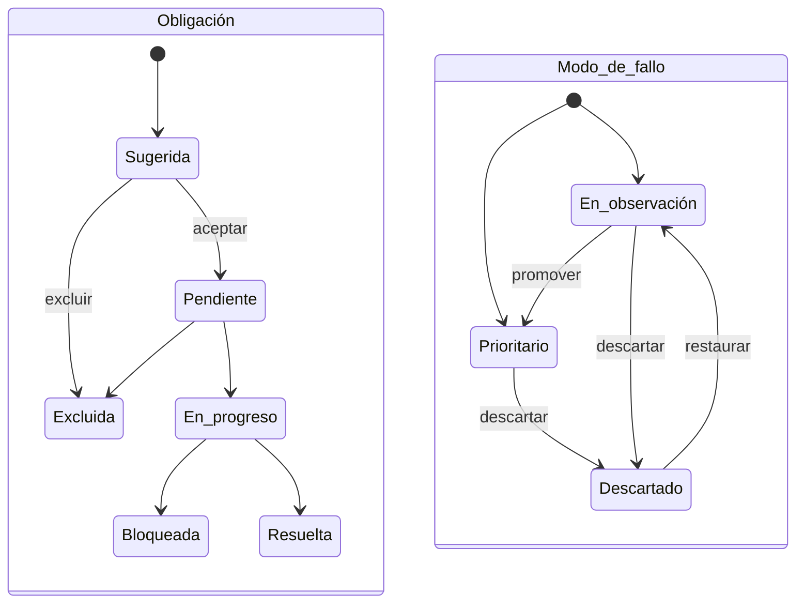

# Ficha del sistema

Vista de detalle de un [sistema de IA](../glosario.md#sistema-de-ia). Reúne su clasificación y sus
obligaciones, la ficha técnica, la situación ISO 42001, el historial, las evidencias, los modos de fallo
y el plan de tratamiento. Desde ella se accede a los informes y documentos del sistema.

## Propósito

Ser el punto de trabajo de cada sistema: ver su estado de cumplimiento y de riesgo y abrir cada una de
las tareas que lo componen.

## Acceso y permisos

- **Ruta:** `/inventario/[id]`. Parámetro opcional `?tab=` con los valores `obligaciones` (por defecto),
  `ficha`, `iso`, `historial`, `evidencias` y `modos`. La pestaña Plan de tratamiento no tiene valor
  propio.
- **Navegación:** desde el [Inventario](inventario.md), el [Dashboard](dashboard.md),
  [Sistemas detectados](descubrimientos.md) y los enlaces de otras vistas.
- **Disponibilidad:** Core.

| Rol | Ver | Acciones permitidas |
|---|---|---|
| Todos los roles | Toda la ficha | Todas las acciones, salvo las de aprobación de la AISIA |
| Responsable del SGAI | Ídem | Además, aprobar o rechazar la AISIA que no haya preparado (B08) |

Si el sistema no existe o es de otra organización, la vista devuelve «no encontrado».

> **Pendiente de definir.** Qué roles pueden clasificar, resolver obligaciones, revisar evidencias y
> gestionar modos de fallo. Hoy puede hacerlo cualquier miembro.

## Campos

### Cabecera y panel lateral

| Elemento | Contenido |
|---|---|
| Identidad | Nombre, versión, código interno y emoji del dominio |
| Etiquetas | Nivel de riesgo AI Act, estado, origen, dominio, fecha de próxima auditoría |
| **Compliance** | % de obligaciones resueltas sobre las no excluidas, y «N pendientes críticas» (pendientes más bloqueadas) |
| **Obligaciones** | Total y desglose: resueltas, en curso, pendientes |
| **Próx. hito** | Próxima auditoría y estado de certificación |
| **Responsable** | Responsable y equipo |
| Panel derecho | Anillo de cumplimiento AI Act, cobertura de evidencias, **Acciones rápidas** y dependencias externas |

**Acciones rápidas:**

| Acción | Destino |
|---|---|
| Anexo IV | [Expediente documental](expediente-documental.md) |
| Dossier técnico | [Dossier técnico](dossier-tecnico.md) |
| Eval. riesgos | [Análisis de modos de fallo](../glosario.md#análisis-de-modos-de-fallo-fmea) del sistema |
| Registro EU | [Ficha para el registro UE](registro-ue.md) |
| Gap report | [Informe de brechas del sistema](informe-brechas-sistema.md) |

> TODO: confirmar los botones **Exportar PDF** y **Abrir agente** de la cabecera, que no hacen nada.

### Pestaña Obligaciones AI Act

**Clasificación AI Act — Resultado general:**
- Nivel de riesgo, con la versión de la clasificación vigente, su método (clasificación inicial, revisión
  manual, agente IA o motor de reglas), el autor y la fecha.
- Fundamento, explicación y obligaciones.

**Obligaciones aplicables:**

| Columna | Descripción y valores | Origen (`tabla.columna`) |
|---|---|---|
| Obligación | Título de la [obligación](../glosario.md#obligación) | `system_obligations.obligation_label` / `title` |
| Referencia | Artículo o clave | `obligation_key` / `obligation_code` |
| Estado | Pendiente · En progreso · Resuelta · Bloqueada · Excluida | `status` |
| Evidencias | Sin evidencias · En curso · Documentada (alguna válida) · Resuelta · Bloqueada · Excluida | Evidencias vinculadas |

En sistemas antiguos sin obligaciones registradas, la lista se deriva de la clasificación guardada en
el sistema y se puede aceptar con **Aceptar sugerencias**.

**Resolver obligación** (modal):

| Campo | Tipo | Obligatorio | Descripción y valores | Origen (`tabla.columna`) |
|---|---|---|---|---|
| **Estado operativo** | selector | Sí | Pendiente · En progreso · Resuelta · Bloqueada | `system_obligations.status` |
| **Prioridad** | selector | Sí | Baja · Media · Alta · Crítica | `priority` |
| **Fecha objetivo** | fecha | No | — | `due_date` |
| **Evidencias vinculadas** | casillas | No | Evidencias del sistema. **Nueva evidencia** permite crear una | `system_obligation_evidences` |
| **Notas de trabajo** | texto largo | No | — | `notes` |
| **Notas de resolución** | texto largo | No | — | `resolution_notes` |

> TODO: confirmar el responsable de la obligación. El modal no permite asignarlo, aunque el dato existe
> (`owner_user_id`).

**Revisar clasificación** (modal): permite ajustar los factores y ver la clasificación resultante antes
de guardarla.

| Campo | Tipo | Descripción y valores |
|---|---|---|
| **Dominio** | selector | Los 15 dominios. «Infraestructura» marca infraestructura crítica |
| **Tipo de output** | selector | Sin definir o uno de los tipos |
| **Uso previsto** | texto | — |
| **¿Afecta directamente a personas físicas?** | Sí · No · Sin definir | Necesario para el alto riesgo por dominio |
| **Factores de clasificación** | casillas | Es un sistema de IA · Es modelo GPAI · Puede ser práctica prohibida · Procesa datos biométricos · Gestiona infraestructura crítica · Interactúa directamente con personas · Afecta a grupos vulnerables (informativo) · Involucra menores (informativo) |
| **Notas de revisión** | texto largo | — |

La columna derecha muestra la clasificación actual, la clasificación recalculada y las obligaciones
resultantes.

> TODO: confirmar los factores de **Revisar clasificación**. La revisión no envía al servidor tres de
> ellos (es sistema de IA, práctica prohibida, interactúa con personas), aunque la vista previa sí los
> usa.

**Historial de clasificaciones:** tarjetas por versión, activa o superada, con método, autor, fecha,
fundamento, notas y cambios en las obligaciones.

### Pestaña Ficha técnica

Datos del sistema en solo lectura, en cuatro bloques plegables con barra de completitud:
- **Resumen ejecutivo**;
- **Datos y privacidad**;
- **Tecnología**;
- **Gobierno y controles**.

Son los campos del [Alta de sistema](inventario-alta.md#campos). Se editan con **✏ Editar ficha**.

### Pestaña ISO 42001

| Bloque | Contenido |
|---|---|
| Alcance SoA | Si el sistema está dentro del alcance de la [Declaración de Aplicabilidad](../glosario.md#declaración-de-aplicabilidad-iso-42001), según sus etiquetas |
| **Controles SoA org vinculados** | Controles de la Declaración vinculados al sistema, con **Ver SoA →** |
| **Evaluación de Impacto (AISIA)** | Estado (Borrador, Enviada, Aprobada, Rechazada, Sin iniciar), versión y progreso por secciones S1 a S6 ([AISIA](../glosario.md#evaluación-de-impacto-del-sistema-de-ia-aisia)) |
| **Controles Anexo A — nivel sistema** | Controles A.4 a A.9 agrupados por dominio, con su estado en la Declaración |

### Pestaña Historial

- **Eventos:** cronología del [historial del sistema](../glosario.md#historial-del-sistema), agrupada
  por fecha (Hoy, Ayer, Esta semana…).
- **Filtros:** Todos, AI Act, Obligaciones, Edición, ISO 42001, FMEA y Evidencias.
- **Contenido de cada evento:** título, fecha, actor y, en las clasificaciones, el cambio de nivel.

> TODO: confirmar las etiquetas del historial. Varios eventos aparecen como «Evento» y quedan fuera de los
> filtros: obligaciones aceptadas y promoción, descarte, restauración o recálculo de modos de fallo.

### Pestaña Evidencias

- **Indicadores:** total, válidas, pendientes y caducadas.
- **Contenido de cada [evidencia](../glosario.md#evidencia):**
  - título, estado, tipo y versión;
  - responsable, fechas de emisión y caducidad;
  - obligaciones y modos de fallo vinculados;
  - enlace.

**Nueva evidencia / Editar evidencia** (modal):

| Campo | Tipo | Obligatorio | Descripción y valores | Origen (`tabla.columna`) |
|---|---|---|---|---|
| **Título** | texto | Sí | — | `system_evidences.title` |
| **Tipo** | selector | — | Documentación técnica, DPIA, Política, Contrato, Test, Informe, Captura, Registro, Otro | `evidence_type` |
| **Estado** | informativo | — | No se elige: se crea en borrador y cambia con el ciclo de revisión. Al editar, avisa de que cambiar el contenido la devuelve a borrador | `status` |
| **URL externa** | URL | Sí | — | `external_url` |
| **Descripción** | texto largo | No | — | `description` |
| **Versión** | texto | No | — | `version` |
| **Fecha de emisión**, **Caducidad** | fecha | No | — | `issued_at`, `expires_at` |

Desde esta pestaña las evidencias solo se registran por URL; la subida de ficheros está en la
[Biblioteca de evidencias](evidencias.md). Las reglas de estado y de revisión son las de la biblioteca
([Biblioteca de evidencias](evidencias.md#estados)).

### Pestaña Modos de fallo

| Bloque | Contenido |
|---|---|
| Resumen | Total activo, prioritarios, razones, dimensiones y familias dominantes, propagación causal (modos con efecto cascada, causas raíz, atractores) |
| Avisos | Riesgos de negocio fuera del FMEA, con enlace a [Riesgos de negocio](riesgos-negocio.md). Modos descartados por cuota, con **Promover varios** |
| Filtros | **Filtrar por dimensión** (seis [dimensiones](../glosario.md#dimensión-de-riesgo)) · **Cola de revisión** (Prioritarios, En observación, Pendientes de priorizar, Descartados) · **Ordenar por** (score o efecto cascada). 20 por página |
| Contenido de cada modo | Código y nombre; estado de [priorización](../glosario.md#priorización); nivel (en inglés: Critical, High, Medium, Low); fuente (motor de reglas, IA o manual); razón; descripción; motivo de activación; puntuación; propagación y familias |

**Grafo causal:** vista a pantalla completa del [grafo causal](../glosario.md#grafo-causal) del sistema.
- Los nodos muestran su severidad máxima.
- Las relaciones se dibujan como causa, amplifica o habilita.
- Se puede filtrar para ver solo los modos activos.

### Pestaña Plan de tratamiento

Resumen en solo lectura del [plan de tratamiento](../glosario.md#plan-de-tratamiento) de la última
evaluación:
- zona de partida y objetivo;
- acciones candidatas y nivel de aprobación;
- riesgo residual asumido;
- desglose de acciones con su severidad y opción.

Incluye el botón **Gestionar plan**. Si no hay plan: «No hay un plan activo» e **Ir a FMEA**.

> TODO: confirmar los valores de la pestaña Plan de tratamiento. Muestra códigos internos sin traducir:
> estado del plan, zonas (`zona_iv`), nivel de aprobación y opción de tratamiento.

## Acciones

| Acción | Quién | Qué hace | Efectos |
|---|---|---|---|
| **Clasificar con IA** | Todos | Pide al servicio de agentes una nueva clasificación con IA, apoyada en el [corpus normativo](../glosario.md#corpus-normativo), con el motor de reglas como referencia | Si cambia el conjunto de obligaciones, crea una [reclasificación](../glosario.md#reclasificación) pendiente. Si no, avisa «El agente IA ha confirmado la clasificación actual — no hay cambios.» |
| **✏ Revisar clasificación** › **Guardar revisión** | Todos | Reclasificación manual con los factores del modal | Ídem |
| **Confirmar cambios** (reconciliación) | Todos | Concilia las obligaciones nuevas (aceptar o excluir con motivo) y las que desaparecen con trabajo hecho (conservar o archivar con nota) | La nueva clasificación pasa a vigente y actualiza el nivel de riesgo del sistema |
| **Cancelar reclasificación** | Todos | Descarta la reclasificación pendiente | La borra |
| **Aceptar** / **Aceptar sugerencias** | Todos | `acceptSystemObligations` | Crea las obligaciones en Pendiente. Historial «Obligaciones aceptadas» |
| **Excluir** | Todos | `excludeSystemObligation`, con justificación obligatoria | Historial «Obligación excluida» |
| **Resolver →** › **Guardar obligación** | Todos | `resolveSystemObligation` | Actualiza la obligación y sus evidencias vinculadas. Historial «Obligación resuelta» o «Obligación actualizada» |
| **✏ Editar ficha** | Todos | Navega a [Edición de la ficha](ficha-sistema-edicion.md) | — |
| **Iniciar evaluación AISIA** | Todos | `initAisia`: crea la AISIA con sus seis secciones | Historial «Evaluación AISIA iniciada» |
| **Continuar evaluación →** / **Ver evaluación →** | Todos | Navega a la [AISIA](aisia.md) | — |
| **✓ Aprobar evaluación** | Responsable del SGAI que no la preparó | `approveAisia`, con referencia de actas opcional | Historial «AISIA aprobada». Con la Declaración en borrador, marca como implantados los controles A.5.2-A.5.5 si todos sus sistemas tienen AISIA aprobada; si no, lo deja para su siguiente revisión y lo avisa |
| **✕ Rechazar** | Ídem | `rejectAisia`, con motivo obligatorio | Historial «AISIA rechazada» |
| **✎ Corregir y reenviar** | Todos | `reopenAisia`: nueva versión en borrador | Navega a ella |
| **+ Añadir evidencia** / **Nueva evidencia** | Todos | `createSystemEvidence` | Historial «Evidencia registrada» |
| Editar / eliminar evidencia | Todos | `updateSystemEvidence`, `deleteSystemEvidence` | Guarda una versión; si cambia el contenido de una evidencia ya enviada, vuelve a borrador. Historial «Evidencia actualizada» o «Evidencia eliminada». Los errores se muestran en la evidencia |
| **Enviar a revisión** · **Reabrir** | Todos | Ciclo de revisión de la evidencia ([estado de la evidencia](../glosario.md#estado-de-la-evidencia)) | Historial del evento correspondiente |
| **Aprobar** · **Rechazar** | Responsable del SGAI que no la aportó (DP-01) | Ídem. A los demás se les muestra que está pendiente de su revisión | Historial del evento correspondiente |
| **+ Modo de fallo** | Todos | Vincula o desvincula la evidencia a modos de fallo activados | — |
| **Activar modos de fallo** | Todos | `activateSystemFailureModes`: [activación](../glosario.md#activación-de-modos-de-fallo) por reglas, una sola vez | Historial «Modos de fallo activados» |
| **Recalcular con contexto actual** | Todos | `recalculateSystemFailureModes`, previa confirmación | Añade los modos nuevos y actualiza los calculados por reglas. Respeta las decisiones manuales. No elimina los que ya no aplican |
| **Promover a prioritario** | Todos | Justificación de al menos 30 caracteres | Historial «failure_mode_promoted» |
| **Descartar** | Todos | Motivo de al menos 20 caracteres | Historial «failure_mode_dismissed» |
| **Restaurar a observación** | Todos | Devuelve un modo descartado a observación | Historial «failure_mode_restored» |
| **Promover varios** | Todos | Promueve en bloque modos descartados por cuota, con justificación común | — |
| **Gestionar plan** | Todos | Navega al [plan de tratamiento](plan-de-tratamiento.md) | — |

> **Pendiente de implementar.** **Refinar mediante IA** en Modos de fallo: aparece deshabilitado como
> «Próximamente».

> TODO: confirmar dos comportamientos de la reconciliación.
> - Si se recarga la página con una reclasificación pendiente, el panel de reconciliación ya no se puede
>   abrir y los botones de clasificación quedan deshabilitados.
> - Pulsar fuera del panel cancela la reclasificación.

> TODO: confirmar el comportamiento con obligaciones nacidas de una reconciliación. Al resolverlas o
> excluirlas, se crea una obligación duplicada en lugar de actualizarse.

> TODO: confirmar el efecto de reclasificar y conciliar en el resto de la ficha.
> - No dejan evento en el historial.
> - No actualizan la explicación ni el fundamento que muestra la cabecera.

## Validaciones

| Situación | Mensaje |
|---|---|
| Ya hay una reclasificación pendiente | «Hay una reclasificación pendiente de reconciliación. Resuelve los cambios antes de iniciar una nueva clasificación.» |
| Servicio de agentes no disponible | «No se pudo conectar con el agente de clasificación…» |
| Falta una decisión en la reconciliación | «Faltan decisiones en N obligación/es.» |
| Excluir sin justificación | «Por favor, indica una justificación para la exclusión.» |
| Evidencia de otro sistema | «Alguna de las evidencias seleccionadas no pertenece a este sistema.» |
| Evidencia sin título o URL | «Faltan datos obligatorios para registrar la evidencia.» / «La URL de la evidencia no es válida.» |
| Evidencia fuera de borrador sin fichero ni URL | «Una evidencia que no está en borrador necesita un fichero adjunto o una URL.» |
| AISIA ya activa | «Ya existe una evaluación AISIA activa para este sistema.» |
| Modos ya activados | «Los modos de fallo ya fueron activados previamente para este sistema.» |
| Promover con justificación corta | «La justificación debe tener al menos 30 caracteres.» |
| Descartar con motivo corto | «Indica el motivo del descarte (mínimo 20 caracteres).» |
| Promover un descartado | «Un modo descartado no puede promoverse directamente. Restáuralo primero.» |

## Estados

La clasificación sigue el ciclo de la [reclasificación](../glosario.md#reclasificación): pendiente de
conciliar, conciliada y sustituida. La AISIA sigue el suyo: borrador, enviada, aprobada o rechazada.

## Vistas relacionadas

- [Inventario](inventario.md), [Edición de la ficha](ficha-sistema-edicion.md),
  [Sistemas detectados](descubrimientos.md).
- [Biblioteca de evidencias](evidencias.md).
- Análisis de modos de fallo, Plan de tratamiento, AISIA, Riesgos de negocio, Expediente documental,
  Dossier técnico, Ficha para el registro UE e Informe de brechas del sistema (documentos pendientes).
- Negocio: [Inventario de sistemas de IA](../negocio/inventario.md),
  [Clasificación AI Act](../negocio/clasificacion-ai-act.md), [Obligaciones](../negocio/obligaciones.md),
  [Análisis de modos de fallo](../negocio/analisis-modos-de-fallo.md).
