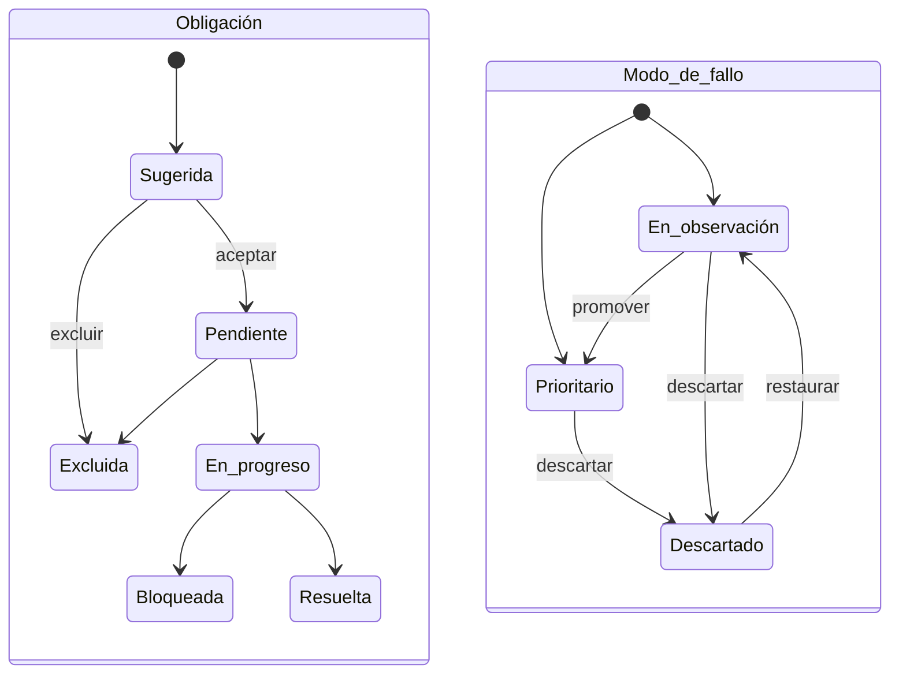

# Ficha del sistema

Vista de detalle de un [sistema de IA](../glosario.md#sistema-de-ia). Reúne su clasificación y sus
obligaciones, la ficha técnica, la situación ISO 42001, el historial, las evidencias, los modos de fallo
y el plan de tratamiento. Desde ella se accede a los informes y documentos del sistema.

## Propósito

Ser el punto de trabajo de cada sistema: ver su estado de cumplimiento y de riesgo y abrir cada una de
las tareas que lo componen.

## Acceso y permisos

- **Ruta:** `/inventario/[id]`. Parámetro opcional `?tab=` con los valores `obligaciones` (por defecto),
  `ficha`, `iso`, `historial`, `evidencias` y `modos`. La pestaña Plan de tratamiento no tiene valor
  propio.
- **Navegación:** desde el [Inventario](inventario.md), el [Dashboard](dashboard.md),
  [Sistemas detectados](descubrimientos.md) y los enlaces de otras vistas.
- **Disponibilidad:** Core.

| Rol | Ver | Acciones permitidas |
|---|---|---|
| Todos los roles | Toda la ficha | Todas las acciones de la ficha |

La AISIA y las evidencias del sistema no se aprueban ni se rechazan en la ficha: se deciden solo en
[Aprobaciones](aprobaciones.md), con la política de aprobación de la organización (B11g).

Si el sistema no existe o es de otra organización, la vista devuelve «no encontrado».

> **Pendiente de definir.** Qué roles pueden clasificar, resolver obligaciones, revisar evidencias y
> gestionar modos de fallo. Hoy puede hacerlo cualquier miembro.

## Campos

### Cabecera y panel lateral

| Elemento | Contenido |
|---|---|
| Identidad | Nombre, versión, código interno y emoji del dominio |
| Etiquetas | Nivel de riesgo AI Act, [categoría GPAI](../glosario.md#categoría-gpai) (si la tiene), estado, «Uso suspendido desde el …» (si lo está, B25a), origen, dominio, fecha de próxima auditoría |
| **Compliance** | % de obligaciones resueltas sobre las no excluidas, y «N pendientes críticas» (pendientes más bloqueadas) |
| **Obligaciones** | Total y desglose: resueltas, en curso, pendientes |
| **Próx. hito** | Próxima auditoría y estado de certificación |
| **Responsable** | Responsable y equipo |
| Panel derecho | Anillo de cumplimiento AI Act, cobertura de evidencias, **Uso del sistema**, **Reevaluación necesaria** (si hay disparadores abiertos), **Etapa de evaluación**, **Responsables**, **Registro de logs** (si aplica), **Requerimientos de la autoridad** (si los hay), **Acciones rápidas** y dependencias externas |

**Etiqueta de categoría GPAI** (B13d). Va junto al nivel de riesgo, porque GPAI no es un nivel sino una
categoría aparte:

| Etiqueta | Cuándo | Texto de ayuda | Origen |
|---|---|---|---|
| **Proveedor de modelo GPAI** | La organización es proveedora de un modelo GPAI. Se añade « · riesgo sistémico» si el riesgo sistémico es «sí», o « · riesgo sistémico sin determinar» si es «sin determinar» | «La organización desarrolla un modelo de IA de uso general y lo introduce en el mercado (Art. 3.63).» | `aiact_result.gpai.modelProvider` y `systemicRisk`; sin resultado del motor, `ai_systems.is_gpai` |
| **Basado en un modelo GPAI de terceros** | No es proveedora, pero el sistema usa un modelo GPAI de un tercero | «El sistema usa un modelo de IA de uso general de un tercero. No genera obligaciones de proveedor de modelo.» | `aiact_result.gpai.thirdPartyBased` |

Sin ninguno de los dos casos no se muestra etiqueta. Los sistemas que tenían GPAI como nivel de riesgo
pasaron a la categoría con el nivel «Pendiente» y la insignia «Pendiente de revisar con el motor nuevo»
(migración `20261026090000_ai_act_gpai_catalogo.sql`).

**Plan de despliegue** (B18b). En la misma tarjeta, solo en los sistemas de alto riesgo en los que la
organización tiene el rol de responsable del despliegue: lo que debe tener antes de pasar a Producción, cada
punto con su enlace.

| Punto | Se cumple cuando |
|---|---|
| Instrucciones de uso del proveedor verificadas (AI Act, Art. 13 y 26.1) | Documentación del proveedor de tipo instrucciones, o evidencia de tipo EVT-DOC-04, en estado Válida |
| Declaración UE de conformidad del proveedor verificada: marcado CE (Art. 47 y 48) | Documentación del proveedor de tipo declaración, o evidencia EVT-DOC-03, Válida. Acredita el marcado CE; no hay campo propio |
| Supervisión humana documentada: competencia, formación y autoridad (Art. 26.2) | La supervisión documentada del sistema está completa (B24, ver **Supervisión documentada**) |
| FRIA aprobada y notificada a la autoridad (Art. 27) | Solo si la FRIA aplica (DP-11): aprobada y con su notificación registrada |
| Datos de entrada (Art. 26.4), trabajadores informados (26.7), personas afectadas informadas (26.11) | Solo si el sistema tiene la obligación y no está excluida: resuelta |

Pasar a Producción sin completarlo avisa, no bloquea (decisión 2); el aviso queda en el historial con el
evento **Despliegue**. El plan no cambia la etapa.

**Uso del sistema** (B25a, AI Act, Art. 26.5). Si el uso conforme a las instrucciones puede dar lugar a un
riesgo, el responsable del despliegue suspende el uso e informa sin demora al proveedor o distribuidor y a la
autoridad de vigilancia del mercado. La suspensión es una marca aparte: el sistema conserva su estado (Producción,
Piloto…). La gestionan el Administrador, el Responsable del SGAI y el Responsable del sistema. Fluxion no envía los
avisos: deja constancia de que se hicieron.

| Acción | Campos | Resultado |
|---|---|---|
| **Suspender el uso** | Fecha (no futura), **Motivo** (obligatorio) e incidente que la motiva (opcional, entre los incidentes del sistema). Desde un incidente (**Suspender el uso →**, B25b) el formulario se abre con ese incidente elegido | La tarjeta pasa a **Uso suspendido** y la cabecera muestra «Uso suspendido desde el …». Historial «Uso suspendido». Solo puede haber una suspensión activa |
| **Registrar aviso** | **Destinatario** (Proveedor, Importador, Distribuidor o Autoridad de vigilancia del mercado), nombre, fecha (no anterior a la suspensión), canal, referencia y evidencia de la biblioteca (del sistema o de la organización), opcionales salvo destinatario y fecha | Se añade a la lista de avisos. Historial «Aviso de la suspensión del uso» |
| **Reanudar uso** | Fecha (no anterior a la suspensión) y **Por qué se puede reanudar** (obligatorio) | La suspensión se cierra y pasa a **Ver suspensiones anteriores**. Historial «Uso reanudado». Si faltan avisos, se avisa («Falta: …»), no se bloquea |

Mientras está suspendido, la tarjeta muestra los avisos exigidos con su marca: **Aviso al proveedor o
distribuidor** y **Aviso a la autoridad de vigilancia del mercado**. Las tres acciones quedan en la auditoría.

**Reevaluación necesaria** (B21a). Solo si el sistema tiene disparadores de reevaluación abiertos: para cada uno,
su tipo (Incidente grave, Cambio de supuestos AI Act, Revisión de la evaluación de riesgos vencida, Reglas de
clasificación actualizadas), la fecha, la descripción y lo que falta por reevaluar como enlaces (**Evaluación de
riesgos →**, **FRIA →**, **AISIA →**, **Clasificación AI Act →**). El Administrador y el Responsable del SGAI ven
**Descartar…**, que pide el motivo. Ver [disparadores de reevaluación](flujo-completo-evaluacion.md#disparadores-de-reevaluación).

**Etapa de evaluación** (B18a, DP-02). La etapa alcanzada (Sin clasificar, Clasificado, Evaluado, Tratado,
o Retirada o rediseño en una práctica prohibida), **Siguiente:** con lo primero que falta y la lista de
requisitos por etapa y de vigencia, cada uno con su enlace. Al pie, el requisito de la organización: si la
Declaración de Aplicabilidad está aprobada y si el sistema está en su alcance (sin etiquetas de alcance,
entran todos). Las reglas están en [etapa de evaluación](flujo-completo-evaluacion.md#qué-significa-sistema-totalmente-evaluado).

**Responsables** (B23b, DP-01). Se guardan al elegirlos; los cambia el Administrador, el Responsable del SGAI
o un Responsable del sistema:

| Campo | Descripción | Origen |
|---|---|---|
| **Responsable del sistema** | Miembro con el rol Responsable del sistema. Si la ficha tenía un nombre en texto libre, se muestra como «Equipo indicado en la ficha» | `ai_systems.owner_profile_id` |
| **Responsable de supervisión humana** | Cualquier miembro activo. Obligatorio en alto riesgo (AI Act, Art. 14 y 26.2): sin él no se puede enviar la evaluación de riesgos | `ai_systems.human_oversight_owner_id` |
| **Suplente de supervisión humana** | Otra persona | `ai_systems.human_oversight_backup_id` |

**Supervisión documentada** (B24, AI Act, Art. 26.2 y 14.4). Dentro de **Responsables**, para el responsable
de supervisión humana y el suplente, y las medidas del sistema. La editan los mismos roles que los responsables:

| Campo | Descripción | Origen |
|---|---|---|
| **Competencia** | Conocimiento del sistema, del ámbito en el que decide y de sus límites | `system_oversight_documentation.competence` (por sistema y persona) |
| **Autoridad** | Casilla «Tiene autoridad para no usar, anular o revertir la salida y detener el sistema (AI Act, Art. 14.4)» y dónde consta | `authority_confirmed`, `authority_notes` |
| **Formación** | Formaciones de la persona que sirven para este sistema (alfabetización en IA o supervisión de este sistema) con su estado: Válida, Caducada o Sin acreditar. **Registrar formación en Usuarios** abre su ficha | `member_trainings` |
| **Medidas de vigilancia** | Qué se revisa, cada cuánto y cómo se interviene o se detiene el sistema | `ai_systems.oversight_measures` |

Está **Completa** cuando hay responsable con competencia, autoridad y una formación válida, y medidas descritas;
el suplente se documenta igual, pero no cuenta. La documentación va con la persona: si cambia el responsable, la
del anterior se conserva. Guardar la documentación de una persona o las medidas queda en la auditoría.

**Registro de logs** (B25c, AI Act, Art. 26.6; decisión 5). Solo en los sistemas de alto riesgo en los que la
organización es responsable del despliegue. Es declarativo: Fluxion no se conecta a las fuentes de los registros.
Lo editan el Administrador, el Responsable del SGAI y el Responsable del sistema, y se guarda con **Guardar registro
de logs**:

| Campo | Descripción | Origen (`system_log_retention.`) |
|---|---|---|
| **Quién controla los registros** | La organización · El proveedor · Ambos | `controlled_by` |
| **Dónde se guardan** | Plataforma, servicio o repositorio | `storage_location` |
| **Conservación (meses)** | Entero mayor que cero. Si los controla la organización o ambos y es menor de 6: «Por debajo del mínimo de 6 meses. Se puede guardar, pero el Art. 26.6 no se dará por cumplido.» | `retention_months` |
| **Evidencia de la conservación** | Evidencia del sistema o de la organización; las no validadas se marcan «(no validada)» | `evidence_id` |
| **Última verificación** | Fecha no futura. Debajo, «Vuelve a verificarse antes del …» o «Verificación vencida el …» | `verified_at` |
| **Notas** | Por ejemplo, otro plazo exigido por el Derecho nacional o de la Unión | `notes` |

Está **[Completo](../glosario.md#registro-de-logs)** con: dónde se guardan, conservación de al menos 6 meses (o «Conservación a cargo del
proveedor» si los controla el proveedor), evidencia en estado Válida y verificación de los últimos 12 meses. Al
guardar queda en el historial («Registro de logs actualizado», etiqueta **Logs**, filtro **Edición**) y en la
auditoría.

La verificación vale 12 meses (decisión del responsable, 2026-10-28).

**Requerimientos de la autoridad** (B25d). Solo si algún requerimiento afecta al sistema: referencia y qué se pide
(enlace a su detalle), autoridad, estado y plazo. Se gestionan en [Incidentes › Requerimientos](incidentes.md#pestaña-requerimientos).
En el historial, la etiqueta **Requerimiento** y el filtro **Requerimientos** reúnen su recepción y su respuesta.

**Acciones rápidas:**

| Acción | Destino |
|---|---|
| Anexo IV | [Expediente documental](expediente-documental.md) |
| AISIA | [AISIA](aisia.md) del expediente |
| Eval. riesgos | [Análisis de modos de fallo](../glosario.md#análisis-de-modos-de-fallo-fmea) del sistema |
| Ficha registro UE | [Ficha para el registro UE](registro-ue.md), plantilla del expediente (B16b) |
| Gaps del sistema | [Análisis de brechas](brechas.md) filtrado por el sistema, con su instantánea (B16c) |

> TODO: confirmar los botones **Exportar PDF** y **Abrir agente** de la cabecera, que no hacen nada.

### Pestaña Obligaciones AI Act

**Clasificación AI Act — Resultado general:**
- Nivel de riesgo, con la versión de la clasificación vigente, su método (clasificación inicial, revisión
  manual, agente IA o motor de reglas), el autor y la fecha. Si el sistema está fuera del ámbito del AI Act
  (`aiact_scope`), en lugar del nivel muestra «Fuera del ámbito» o «No es un sistema de IA».
- Fundamento, explicación y obligaciones.
- Si el sistema se registró desde un [cuestionario preliminar](../glosario.md#cuestionario-preliminar)
  (`preliminary_questionnaires.ai_system_id`), bajo la explicación: «Registrado desde el cuestionario
  preliminar «{título}» (sus respuestas sin campo en la ficha se consultan allí).». El título enlaza al
  [formulario del cuestionario](cuestionario-preliminar-formulario.md), que es de solo lectura mientras
  esté vinculado.
- **Rol de la organización:** el [rol en la cadena de valor](../glosario.md#rol-en-la-cadena-de-valor)
  declarado (`ai_systems.value_chain_roles`) o «sin declarar (no se considera proveedora)», con **Cambiar**,
  que lleva a la edición del sistema («Tu papel frente a este sistema»). Si el motor sugiere roles que no
  están declarados (`aiact_result.roles.suggested`): «Según los supuestos AI Act, también podría ser {roles}
  (por ejemplo, por el Art. 25). Revísalo: decide qué documentos del expediente se redactan.». El rol decide
  qué documentos del [expediente](expediente-documental.md#aplicabilidad-por-sistema-dp-11-b16a) se
  redactan (DP-11).
- Si la clasificación vigente difiere de la que propone el motor (otro ámbito, u otro nivel dentro del
  ámbito), por ejemplo porque la fijó el Asistente de clasificación o una revisión manual: «La
  clasificación vigente ({nivel}) difiere de la que propone el motor de clasificación ({propuesta del
  motor}). Revísala si los supuestos AI Act del sistema han cambiado.».
- Bajo la explicación, los avisos del motor único de clasificación (`aiact_result.warnings`), por ejemplo
  «Clasificación aproximada por dominio y tipo de output: faltan los supuestos del AI Act.».
- Si el sistema se clasificó antes del motor único (`aiact_review_pending`) y no hay una reclasificación
  pendiente, la insignia «Pendiente de revisar con el motor nuevo». Al pasar el cursor: «Se clasificó
  antes del motor único. Usa ✏ Revisar clasificación para revisarlo con las reglas actuales.». Desaparece
  al conciliar una reclasificación.

**Obligaciones aplicables:**

| Columna | Descripción y valores | Origen (`tabla.columna`) |
|---|---|---|
| Obligación | Título de la [obligación](../glosario.md#obligación) | `system_obligations.obligation_label` / `title` |
| Referencia | Código del catálogo (`AI-ACT-ART9`…) | `obligation_key` / `obligation_code` |
| Estado | Pendiente · En progreso · Resuelta · Bloqueada · Excluida. Debajo, «Propuesta: Resuelta» si lo hecho en otras fases la resuelve (B17c); la ayuda da el motivo | `status`; `obligationProposal` |
| Evidencias | Sin evidencias · En curso · Documentada (alguna válida) · Resuelta · Bloqueada · Excluida | Evidencias vinculadas |

En sistemas antiguos sin obligaciones registradas, la lista se deriva de la clasificación guardada en
el sistema y se puede aceptar con **Aceptar sugerencias**. Al aceptar o excluir, el texto de la cabecera
(«Art. 9 — …», «Art. 26.1 — …») se traduce al código del catálogo (`catalogCodeFromRef`; cada apartado es su
propio código desde B17a), para que case con las obligaciones ya guardadas.

**Propuestas de estado (B17c).** Una obligación registrada y abierta propone «Resuelta» cuando lo hecho en otras
fases la cumple (`lib/obligations/proposals.ts`). No cambia sola: **Aceptar propuesta** la resuelve, después de
volver a comprobar la propuesta en el servidor, y añade a sus notas de resolución «Propuesta aceptada: {motivo}».

| Obligación | Se propone resuelta cuando |
|---|---|
| Art. 9 · Sistema de gestión de riesgos | Hay una evaluación de riesgos aprobada (la vigente) |
| Art. 11 · Documentación técnica | Hay un Anexo IV aprobado en el expediente |
| Art. 27 · FRIA | Hay una FRIA aprobada y consta su notificación a la autoridad |
| Art. 49 · Registro en la base de datos de la UE | Hay una ficha para el registro UE aprobada y consta su presentación |
| Art. 6.4 · Documentar la excepción del Art. 6.3 | Lo mismo, si la ficha es de la sección B |
| Art. 26.2 · Supervisión humana por personas competentes | La supervisión documentada del sistema está completa (B24) |
| Art. 26.6 · Conservación de los registros generados automáticamente | El **Registro de logs** está completo (B25c) |
| Cualquiera con tipos de evidencia obligatorios en el catálogo | Tiene vinculadas evidencias válidas de todos esos tipos (B17e1) |

**Resolver obligación** (modal):

| Campo | Tipo | Obligatorio | Descripción y valores | Origen (`tabla.columna`) |
|---|---|---|---|---|
| **Estado operativo** | selector | Sí | Pendiente · En progreso · Resuelta · Bloqueada | `system_obligations.status` |
| **Prioridad** | selector | Sí | Baja · Media · Alta · Crítica | `priority` |
| **Fecha objetivo** | fecha | No | — | `due_date` |
| **Evidencias vinculadas** | casillas | No | Evidencias del sistema. **Nueva evidencia** permite crear una | `system_obligation_evidences` |
| **Notas de trabajo** | texto largo | No | — | `notes` |
| **Notas de resolución** | texto largo | No | — | `resolution_notes` |

> TODO: confirmar el responsable de la obligación. El modal no permite asignarlo, aunque el dato existe
> (`owner_user_id`).

**Revisar clasificación** (modal): permite ajustar los factores y ver la clasificación resultante antes
de guardarla. La vista previa y el servidor usan el mismo motor único de clasificación; si el sistema
tiene supuestos AI Act, estos mandan sobre los factores de la ventana.

| Campo | Tipo | Descripción y valores |
|---|---|---|
| **Dominio** | selector | Los 15 dominios. «Infraestructura» marca infraestructura crítica |
| **Tipo de output** | selector | Sin definir o uno de los tipos. Es el tipo **principal**: al conciliar sustituye al principal anterior y los demás tipos del sistema se conservan |
| **Uso previsto** | texto | — |
| **¿Afecta directamente a personas físicas?** | Sí · No · Sin definir | Necesario para el alto riesgo por dominio |
| **Factores de clasificación** | casillas | Es un sistema de IA · Es modelo GPAI · Puede ser práctica prohibida · Procesa datos biométricos · Gestiona infraestructura crítica · Interactúa directamente con personas · Afecta a grupos vulnerables (informativo) · Involucra menores (informativo). «Es modelo GPAI» no fija un nivel de riesgo: marca a la organización como proveedora de un modelo GPAI |
| **Notas de revisión** | texto largo | — |

La columna derecha muestra la clasificación actual, la clasificación recalculada y las obligaciones
resultantes. Todos los factores viajan al servidor. Al conciliar la reclasificación, los campos de la
ventana (salvo «Es modelo GPAI» y «Puede ser práctica prohibida», que se derivan del resultado) se
guardan en la ficha del sistema.

**Historial de clasificaciones:** tarjetas por versión, activa o superada, con método, autor, fecha,
fundamento, notas y cambios en las obligaciones.

### Pestaña Ficha técnica

Datos del sistema en solo lectura, en cuatro bloques plegables con barra de completitud:
- **Resumen ejecutivo**;
- **Datos y privacidad**;
- **Tecnología**;
- **Gobierno y controles**.

Son los campos del [Alta de sistema](inventario-alta.md#campos). Se editan con **✏ Editar ficha**.

### Pestaña ISO 42001

| Bloque | Contenido |
|---|---|
| Alcance SoA | Si el sistema está dentro del alcance de la [Declaración de Aplicabilidad](../glosario.md#declaración-de-aplicabilidad-iso-42001), según sus etiquetas |
| **Controles SoA org vinculados** | Controles de la Declaración vinculados al sistema, con **Ver SoA →** |
| **Evaluación de Impacto (AISIA)** | Estado de su documento del expediente (Borrador, En revisión, Aprobada, Sin iniciar), versión y porcentaje de apartados obligatorios cubiertos con sus huecos, o la fecha de aprobación ([AISIA](aisia.md), B15) |
| **Controles Anexo A — nivel sistema** | Controles A.4 a A.9 agrupados por dominio, con su estado en la Declaración |

### Pestaña Historial

- **Eventos:** cronología del [historial del sistema](../glosario.md#historial-del-sistema), agrupada
  por fecha (Hoy, Ayer, Esta semana…).
- **Filtros:** Todos, AI Act, Obligaciones, Edición, Uso, Requerimientos, Reevaluación, ISO 42001, FMEA y
  Evidencias. **Reevaluación** (B21a) agrupa los disparadores abiertos, completados y descartados. **Uso** (B25a)
  agrupa la suspensión, sus avisos y la reanudación.
- **Contenido de cada evento:** título, fecha, actor y, en las clasificaciones, el cambio de nivel. Los
  eventos anteriores a B13d con el nivel `gpai` se señalan como de nivel antiguo: en la pestaña Historial,
  «GPAI (nivel antiguo)» si el evento no guarda la etiqueta del nivel; en las tarjetas del **Historial de
  clasificaciones**, la etiqueta guardada seguida de «(nivel antiguo)».

> TODO: confirmar las etiquetas del historial. Varios eventos aparecen como «Evento» y quedan fuera de los
> filtros: obligaciones aceptadas y promoción, descarte, restauración o recálculo de modos de fallo.

El alta desde un cuestionario preliminar (`system_registered_from_questionnaire`) aparece como «Alta» y en
el filtro **Edición**. Los eventos de clasificación (recálculo, revisión, propuesta y conciliación) aparecen
en el filtro **AI Act**.

### Pestaña Evidencias

- **Indicadores:** total, válidas, pendientes y caducadas.
- **Contenido de cada [evidencia](../glosario.md#evidencia):**
  - título, estado, tipo y versión;
  - responsable, fechas de emisión y caducidad;
  - obligaciones y modos de fallo vinculados;
  - enlace.

**Nueva evidencia / Editar evidencia** (modal):

| Campo | Tipo | Obligatorio | Descripción y valores | Origen (`tabla.columna`) |
|---|---|---|---|---|
| **Título** | texto | Sí | — | `system_evidences.title` |
| **Tipo** | selector | — | Documentación técnica, DPIA, Política, Contrato, Test, Informe, Captura, Registro, Otro | `evidence_type` |
| **Tipo del catálogo** | selector | No | Tipo de `compliance.evidence_types` (B17e1); decide qué obligaciones cubre la evidencia. Se preselecciona según el **Tipo** cuando la correspondencia es inequívoca (Documento técnico o Documentación técnica → Documentación técnica del sistema; DPIA → Análisis de impacto (DPIA/FRIA); Política → Política de IA; Registro formativo → Registro de formación; Resultado de pruebas o Test → Informe de validación y pruebas; Log de monitorización → Registro de monitorización; Evaluación de riesgos → Informe de evaluación de riesgos). «Sin tipo del catálogo» la deja sin cubrir obligaciones. Cambiarlo en una evidencia ya enviada la devuelve a borrador | `evidence_type_id` |
| **Estado** | informativo | — | No se elige: se crea en borrador y cambia con el ciclo de revisión. Al editar, avisa de que cambiar el contenido la devuelve a borrador | `status` |
| **URL externa** | URL | Sí | — | `external_url` |
| **Descripción** | texto largo | No | — | `description` |
| **Versión** | texto | No | — | `version` |
| **Fecha de emisión**, **Caducidad** | fecha | No | — | `issued_at`, `expires_at` |

Desde esta pestaña las evidencias solo se registran por URL; la subida de ficheros está en la
[Biblioteca de evidencias](evidencias.md). Las reglas de estado y de revisión son las de la biblioteca
([Biblioteca de evidencias](evidencias.md#estados)).

### Pestaña Modos de fallo

| Bloque | Contenido |
|---|---|
| Resumen | Total activo, prioritarios, razones, dimensiones y familias dominantes, propagación causal (modos con efecto cascada, causas raíz, atractores) |
| Avisos | Riesgos de negocio fuera del FMEA, con enlace a [Riesgos de negocio](riesgos-negocio.md). Modos descartados por cuota, con **Promover varios** |
| Filtros | **Filtrar por dimensión** (seis [dimensiones](../glosario.md#dimensión-de-riesgo)) · **Cola de revisión** (Prioritarios, En observación, Pendientes de priorizar, Descartados) · **Ordenar por** (score o efecto cascada). 20 por página |
| Contenido de cada modo | Código y nombre; estado de [priorización](../glosario.md#priorización); nivel (en inglés: Critical, High, Medium, Low); fuente (motor de reglas, IA o manual); razón; descripción; motivo de activación; puntuación; propagación y familias |

**Grafo causal:** vista a pantalla completa del [grafo causal](../glosario.md#grafo-causal) del sistema.
- Los nodos muestran su severidad máxima.
- Las relaciones se dibujan como causa, amplifica o habilita.
- Se puede filtrar para ver solo los modos activos.

### Pestaña Plan de tratamiento

Resumen en solo lectura del [plan de tratamiento](../glosario.md#plan-de-tratamiento) de la última
evaluación:
- zona de partida y objetivo;
- acciones candidatas y nivel de aprobación;
- riesgo residual asumido;
- desglose de acciones con su severidad y opción.

Incluye el botón **Gestionar plan**. Si no hay plan: «No hay un plan activo» e **Ir a FMEA**.

> TODO: confirmar los valores de la pestaña Plan de tratamiento. Muestra códigos internos sin traducir:
> estado del plan, zonas (`zona_iv`), nivel de aprobación y opción de tratamiento.

## Acciones

| Acción | Quién | Qué hace | Efectos |
|---|---|---|---|
| **Clasificar con IA** | Todos | Pide al servicio de agentes una nueva clasificación con IA, apoyada en el [corpus normativo](../glosario.md#corpus-normativo), con el resultado del motor único como referencia | Si cambian el nivel de riesgo o el conjunto de obligaciones, crea una [reclasificación](../glosario.md#reclasificación) pendiente. Si no, avisa «El agente IA ha confirmado la clasificación actual — no hay cambios.» |
| **✏ Revisar clasificación** › **Guardar revisión** | Todos | Reclasificación manual: el servidor clasifica con el motor único y los factores del modal | Ídem. Si no hay cambios: «La clasificación no ha cambiado. El conjunto de obligaciones se mantiene.» |
| **Confirmar cambios** (reconciliación) | Todos | Concilia las obligaciones nuevas (aceptar o excluir con motivo) y las que desaparecen con trabajo hecho (conservar o archivar con nota) | La nueva clasificación pasa a vigente: actualiza el nivel, el fundamento, la explicación, las obligaciones y el ámbito de la cabecera, y retira «Pendiente de revisar con el motor nuevo». Historial «Clasificación AI Act conciliada» |
| **Cancelar reclasificación** | Todos | Descarta la reclasificación pendiente | La borra |
| **Aceptar** / **Aceptar sugerencias** | Todos | `acceptSystemObligations` | Crea las obligaciones en Pendiente. Historial «Obligaciones aceptadas» |
| **Excluir** | Todos | `excludeSystemObligation`, con justificación de al menos 10 caracteres. Desde B17d es la exclusión de su brecha Obligación sin cubrir: si una política la gobierna (por defecto, DP-07), pasa por Aprobaciones | Si no hay política, la obligación queda Excluida («Obligación excluida y registrada en el historial de auditoría»). Si la hay: «Exclusión enviada a aprobación: la obligación sigue abierta hasta que se decida». Historial «Obligación excluida» al quedar activa |
| **Resolver →** › **Guardar obligación** | Todos | `resolveSystemObligation` | Actualiza la obligación y sus evidencias vinculadas. Historial «Obligación resuelta» o «Obligación actualizada» |
| **Aceptar propuesta** | Todos | `acceptObligationProposal` (B17c) | La obligación pasa a Resuelta con el motivo en sus notas de resolución. Historial «Obligación resuelta». Si la propuesta ya no está vigente: «La propuesta ya no está vigente: revisa la obligación y resuélvela a mano si procede.» |
| **✏ Editar ficha** | Todos | Navega a [Edición de la ficha](ficha-sistema-edicion.md) | — |
| **Iniciar evaluación AISIA** / **Continuar en el expediente →** / **Ver en el expediente →** | Todos | Navega a la [AISIA](aisia.md) del expediente, que se crea al abrirla por primera vez | — |
| **+ Añadir evidencia** / **Nueva evidencia** | Todos | `createSystemEvidence` | Historial «Evidencia registrada» |
| Editar / eliminar evidencia | Todos | `updateSystemEvidence`, `deleteSystemEvidence` | Guarda una versión; si cambia el contenido de una evidencia ya enviada, vuelve a borrador. Historial «Evidencia actualizada» o «Evidencia eliminada». Los errores se muestran en la evidencia |
| **Enviar a revisión** · **Reabrir** | Todos | Ciclo de revisión de la evidencia ([estado de la evidencia](../glosario.md#estado-de-la-evidencia)). **Enviar a revisión** abre la solicitud de aprobación y exige una política activa para las evidencias | Historial del evento correspondiente |
| **Se decide en Aprobaciones** (evidencia pendiente de revisión) | Todos | Enlace a [Aprobaciones](aprobaciones.md), donde se aprueba o rechaza | — |
| **+ Modo de fallo** | Todos | Vincula o desvincula la evidencia a modos de fallo activados | — |
| **Activar modos de fallo** | Todos | `activateSystemFailureModes`: [activación](../glosario.md#activación-de-modos-de-fallo) por reglas, una sola vez | Historial «Modos de fallo activados» |
| **Recalcular con contexto actual** | Todos | `recalculateSystemFailureModes`, previa confirmación | Añade los modos nuevos y actualiza los calculados por reglas. Respeta las decisiones manuales. No elimina los que ya no aplican |
| **Promover a prioritario** | Todos | Justificación de al menos 30 caracteres | Historial «failure_mode_promoted» |
| **Descartar** | Todos | Motivo de al menos 20 caracteres | Historial «failure_mode_dismissed» |
| **Restaurar a observación** | Todos | Devuelve un modo descartado a observación | Historial «failure_mode_restored» |
| **Promover varios** | Todos | Promueve en bloque modos descartados por cuota, con justificación común | — |
| **Gestionar plan** | Todos | Navega al [plan de tratamiento](plan-de-tratamiento.md) | — |

**AISIA en revisión.** En la pestaña ISO 42001, con la AISIA en revisión, la ficha muestra «La decisión se toma
en Aprobaciones, con la política de aprobación de la organización.» o, si no hay solicitud pendiente, «Sin
solicitud de aprobación abierta. Devuélvela a borrador desde el expediente o revisa las políticas en Ajustes ›
Aprobaciones.».
No hay botones de aprobar ni rechazar. Ver [AISIA](aisia.md).

> **Pendiente de implementar.** **Refinar mediante IA** en Modos de fallo: aparece deshabilitado como
> «Próximamente».

> TODO: confirmar dos comportamientos de la reconciliación.
> - Si se recarga la página con una reclasificación pendiente, el panel de reconciliación ya no se puede
>   abrir y los botones de clasificación quedan deshabilitados.
> - Pulsar fuera del panel cancela la reclasificación.

> TODO: confirmar el comportamiento con obligaciones nacidas de una reconciliación. Al resolverlas o
> excluirlas, se crea una obligación duplicada en lugar de actualizarse.

Conciliar una clasificación con IA fija el nivel, el fundamento, la explicación y las obligaciones que
propone el Asistente; el ámbito, la categoría GPAI, la versión de las reglas y los avisos salen del motor
con el que se reclasificó. Si el Asistente fija un nivel, el sistema queda dentro del ámbito aunque el
motor dijera otra cosa, y la cabecera muestra la divergencia.

## Validaciones

| Situación | Mensaje |
|---|---|
| Ya hay una reclasificación pendiente | «Hay una reclasificación pendiente de reconciliación. Resuelve los cambios antes de iniciar una nueva clasificación.» |
| Servicio de agentes no disponible | En **Clasificar con IA**, «Error: No se pudo conectar con el agente de clasificación…»; en **✏ Revisar clasificación**, «Error al reclasificar. Intenta de nuevo.» |
| Falta una decisión en la reconciliación | «Faltan decisiones en N obligación/es.» |
| Excluir sin justificación | «Por favor, indica una justificación para la exclusión.» |
| Evidencia de otro sistema | «Alguna de las evidencias seleccionadas no pertenece a este sistema.» |
| Evidencia sin título o URL | «Faltan datos obligatorios para registrar la evidencia.» / «La URL de la evidencia no es válida.» |
| Evidencia fuera de borrador sin fichero ni URL | «Una evidencia que no está en borrador necesita un fichero adjunto o una URL.» |
| Enviar una evidencia a revisión sin política de aprobación activa | «No hay ninguna política de aprobación activa para las evidencias. Configúrala en Ajustes › Aprobaciones.» La evidencia vuelve a su estado anterior |
| Modos ya activados | «Los modos de fallo ya fueron activados previamente para este sistema.» |
| Promover con justificación corta | «La justificación debe tener al menos 30 caracteres.» |
| Descartar con motivo corto | «Indica el motivo del descarte (mínimo 20 caracteres).» |
| Promover un descartado | «Un modo descartado no puede promoverse directamente. Restáuralo primero.» |

## Estados

La clasificación sigue el ciclo de la [reclasificación](../glosario.md#reclasificación): pendiente de
conciliar, conciliada y sustituida. La AISIA sigue el del
[expediente documental](expediente-documental.md#estados); la aprobación y el rechazo se deciden en
[Aprobaciones](aprobaciones.md).

## Vistas relacionadas

- [Inventario](inventario.md), [Edición de la ficha](ficha-sistema-edicion.md),
  [Sistemas detectados](descubrimientos.md).
- [Biblioteca de evidencias](evidencias.md), [Aprobaciones](aprobaciones.md).
- Análisis de modos de fallo, Plan de tratamiento, AISIA, Riesgos de negocio, Expediente documental,
  Dossier técnico, Ficha para el registro UE e Informe de brechas del sistema (documentos pendientes).
- Negocio: [Inventario de sistemas de IA](../negocio/inventario.md),
  [Clasificación AI Act](../negocio/clasificacion-ai-act.md), [Obligaciones](../negocio/obligaciones.md),
  [Análisis de modos de fallo](../negocio/analisis-modos-de-fallo.md).
