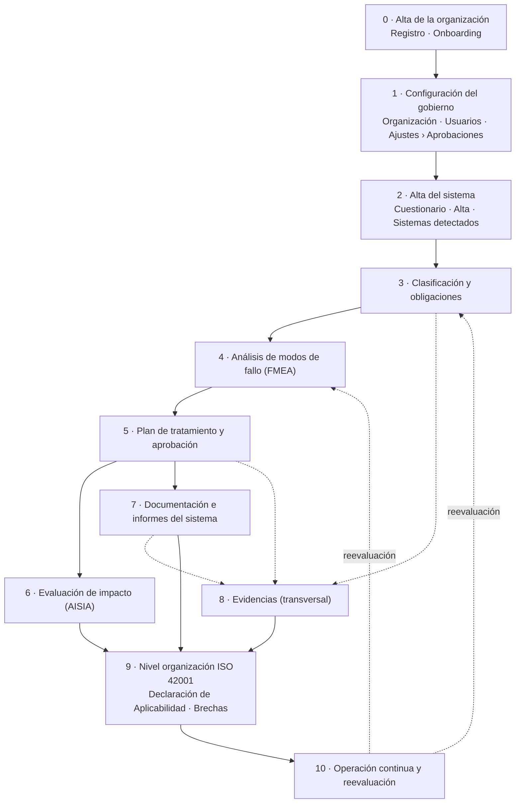
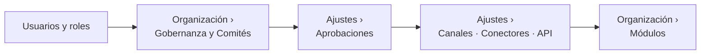
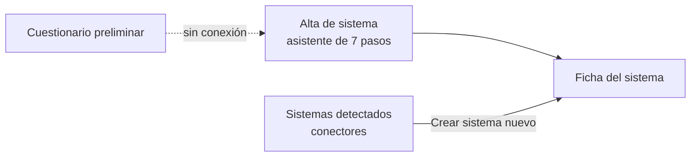
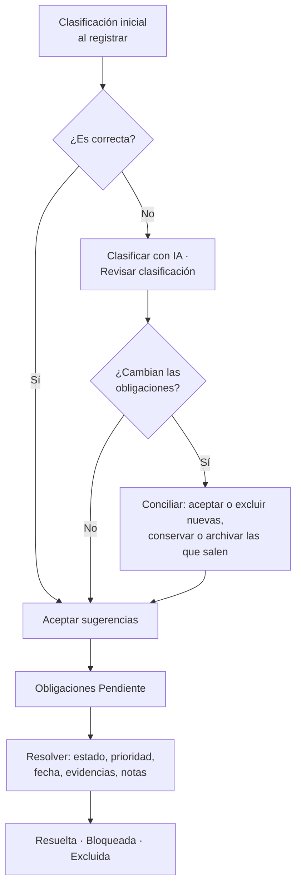
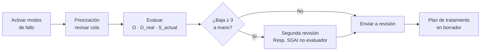
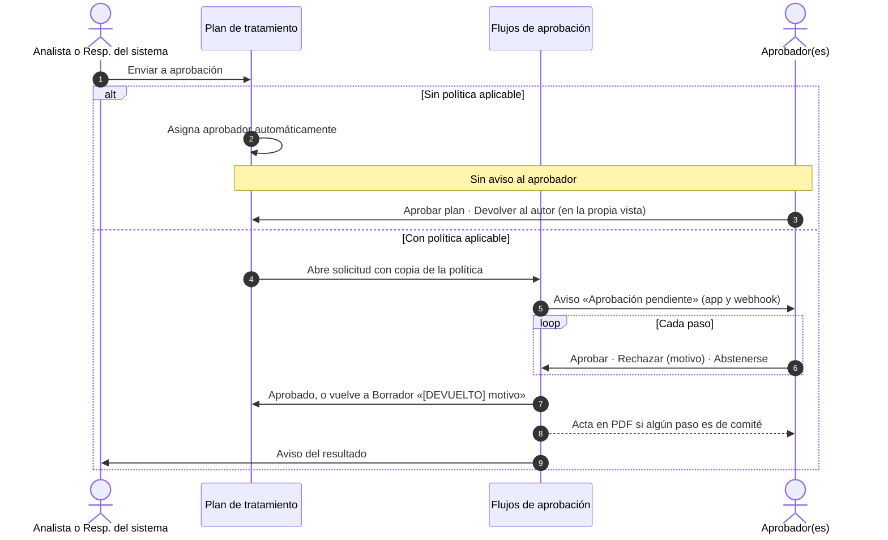
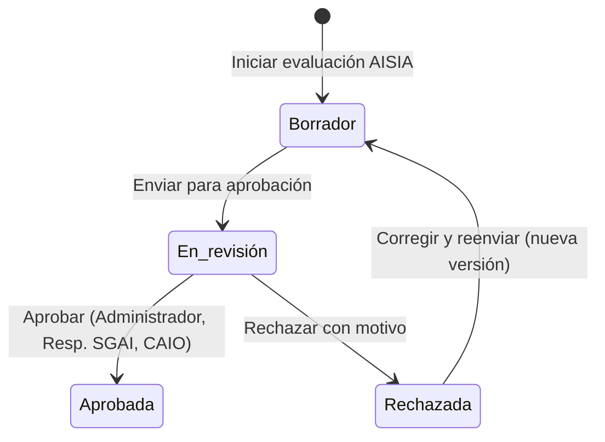
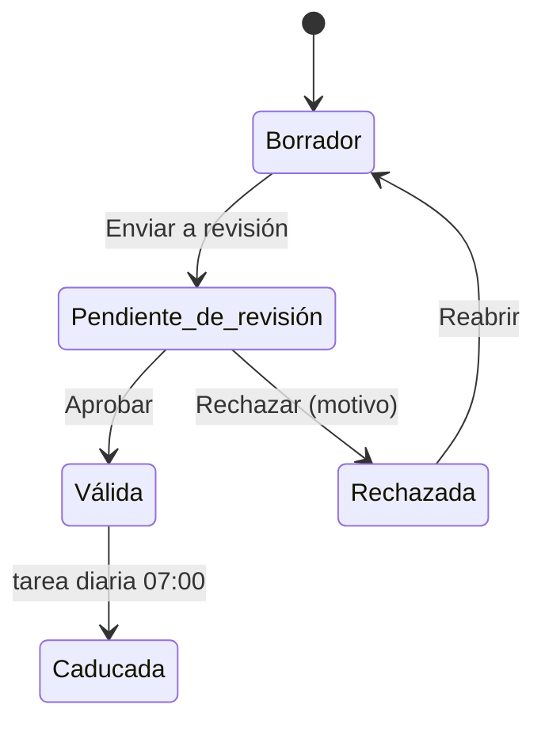
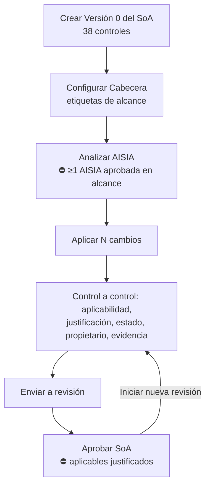

# Flujo completo, del onboarding al sistema evaluado

Recorrido de punta a punta por Fluxion: desde que una organización se registra hasta que uno o varios
[sistemas de IA](../glosario.md#sistema-de-ia) quedan evaluados frente al AI Act y a ISO/IEC 42001, con
el circuito de aprobaciones y de evidencias de cada etapa. Describe el flujo **tal como funciona hoy**,
señala los huecos (*gaps*) y añade sugerencias y aclaraciones.

> Este documento no sigue una plantilla: las de `docs/_plantillas/` son de módulo, de vista o técnicas,
> y este recorre varias vistas. Ver la nota en [`_pendientes.md`](../_pendientes.md).

## Propósito

- Dar a quien configura, da soporte o forma en Fluxion una guía ordenada del trabajo completo, con las
  vistas, las acciones y lo que bloquea cada paso.
- Reunir en un único sitio el circuito de [aprobaciones](../glosario.md#flujos-de-aprobación) y de
  [evidencias](../glosario.md#evidencia), que en la aplicación está repartido entre muchas vistas.
- Señalar dónde el flujo se corta, se puede saltar o no deja rastro.

El detalle de cada pantalla está en su documento funcional, enlazado en cada paso.

### Cómo leer este documento

| Marca | Significado |
|---|---|
| **⛔ Bloqueo** | El paso siguiente no se puede hacer hasta completar este |
| **⚠ Gap** | Hueco del flujo: algo que falta, se corta o no funciona como se espera. Tiene identificador `GAP-nn` y está resumido en la sección [Gaps](#gaps-consolidados) |
| **💡 Sugerencia** | Propuesta de mejora del flujo. Resumidas en [Sugerencias](#sugerencias) |
| **ℹ Aclaración** | Explicación de un comportamiento que no es evidente |
| `R1`, `E4`… | Identificador de la incidencia en [`_incidencias.md`](../_incidencias.md), donde está el detalle |

Además, se usan las marcas habituales de la documentación: `TODO: confirmar`, **Pendiente de
implementar** y **Pendiente de definir**.

### Qué significa «sistema totalmente evaluado»

> **Decisión DP-02 (2026-10-19).** Definición aprobada por el responsable del proyecto. **Pendiente de
> implementar**: hoy la aplicación no calcula ni muestra esta definición (bloque B18 del
> [plan de resolución de gaps](../producto/plan-resolucion-gaps.md)).

Un sistema está **totalmente evaluado** cuando, para su clasificación AI Act vigente y el rol de la
organización, tiene aprobadas todas las evaluaciones y documentos que le son exigibles y respaldadas sus
obligaciones con evidencias válidas. Además, está dentro del alcance de una Declaración de Aplicabilidad
aprobada y no tiene revisiones ni disparadores de reevaluación pendientes.

No es un sí o un no: se expresa como **etapas sucesivas**, con la vigencia como condición transversal.
La ficha del sistema mostrará la etapa alcanzada y lo que falta para la siguiente.

| Etapa | Se alcanza cuando | Dónde se comprueba |
|---|---|---|
| **Clasificado** | Clasificación confirmada sin reclasificación pendiente; obligaciones aceptadas o excluidas con justificación | [Ficha del sistema](ficha-sistema.md) › **Obligaciones AI Act** |
| **Evaluado** | Evaluación de riesgos y plan de tratamiento aprobados; AISIA aprobada; documentos exigibles aprobados | [Evaluaciones](evaluaciones.md), [Plan de tratamiento](plan-de-tratamiento.md), ficha › **ISO 42001**, [Expediente documental](expediente-documental.md) |
| **Tratado** | Acciones del plan cerradas con severidad residual y evidencia válida; obligaciones resueltas; sin brechas críticas abiertas | Plan de tratamiento, ficha, [Análisis de brechas](brechas.md) |
| **Vigente** (transversal) | Sin evidencias caducadas, revisiones vencidas ni disparadores de reevaluación abiertos | [Biblioteca de evidencias](evidencias.md), [Revisiones pendientes](revisiones-pendientes.md) |
| **Organización** (requisito previo) | Sistema dentro del alcance de una Declaración de Aplicabilidad aprobada | [Declaración de Aplicabilidad](declaracion-aplicabilidad.md) |

Un sistema puede estar **Evaluado** con el plan aprobado y las acciones en curso, que es lo habitual
durante meses. La Declaración se muestra en la ficha, pero no penaliza al sistema por algo que no depende
de él.

**Qué es exigible según la clasificación:**

| Criterio | Riesgo mínimo | Riesgo limitado | Alto riesgo |
|---|---|---|---|
| Clasificación y obligaciones | ✓ | ✓ | ✓ |
| Evaluación de riesgos y plan aprobados | ✓ | ✓ | ✓ |
| AISIA aprobada (ISO/IEC 42001, §6.1.4) | ✓ (versión ligera) | ✓ | ✓ |
| Medidas de transparencia del Art. 50 | — | ✓ | Si aplican |
| Documentación técnica (Anexo IV) aprobada | — | — | Si es proveedor |
| FRIA | — | — | Si es responsable del despliegue en los supuestos del Art. 27 |
| Ficha para el registro UE | — | — | Si es proveedor, o responsable del despliegue que es autoridad pública |
| Supervisión humana designada (AI Act, Art. 14 y 26.2) | — | — | ✓ |

La AISIA es exigible en todos los niveles porque ISO/IEC 42001 la pide para cualquier sistema del alcance
del [SGAI](../glosario.md#sgai-sistema-de-gestión-de-la-ia); para los sistemas de riesgo mínimo puede ser
una versión ligera.

> TODO: confirmar las etapas para los casos que la tabla no cubre:
> - **Práctica prohibida:** no se evalúa; propuesta de etapa final «Retirada o rediseño».
> - **Fuera del ámbito** o **No es un sistema de IA** (ver la
>   [especificación del cuestionario](../producto/cuestionario-preliminar-reglas.md)): propuesta de
>   quedarse en **Clasificado**.
> - **Proveedor de modelo GPAI:** qué documentos del Art. 53 se exigen en **Evaluado**.

> **ℹ Aclaración.** Hoy ninguna etapa se puede alcanzar de forma verificable a partir de **Evaluado**: la
> evaluación FMEA nunca se aprueba (GAP-13), la AISIA no tiene versión ligera, no existe el dato de
> responsable de la supervisión humana y las acciones del plan no se pueden cerrar (GAP-18).

## 1. Mapa general

Once fases. Las dos primeras ocurren una vez por organización; de la 2 a la 8 se repiten por sistema; la
9 es de la organización y la 10 es continua.

### Bloqueos reales del recorrido

| Paso | Qué bloquea | Condición |
|---|---|---|
| Onboarding | Todas las vistas protegidas | ⛔ Hasta pulsar **Acceder al Dashboard** |
| Alta del sistema | Todo el trabajo por sistema | ⛔ Sin sistema no hay nada |
| Activar modos de fallo | La evaluación FMEA | ⛔ «Activa antes los modos de fallo» |
| Evaluación FMEA completa | La creación del plan | ⛔ Sin pendientes, pospuestos, justificaciones ni segundas revisiones abiertas |
| Acciones del plan decididas | El envío a aprobación | ⛔ Todas con opción, responsable, fecha y datos de su opción |
| AISIA aprobada | **Analizar AISIA** en la Declaración | ⛔ Al menos una AISIA aprobada de un sistema en alcance |
| Expediente sin huecos | **Aprobar expediente** | ⛔ Apartados obligatorios cubiertos |
| Controles aplicables justificados | **Aprobar SoA** | ⛔ Todos los aplicables con justificación |

Todo lo demás se puede hacer en cualquier orden o dejar a medias. El orden de este documento es el que
evita rehacer trabajo.

> **ℹ Aclaración.** La dependencia que más se pasa por alto es **FMEA → plan → AISIA → Declaración de
> Aplicabilidad**. Las secciones S3 y S4 de la AISIA leen los modos de fallo y el plan, y la Declaración
> solo propone aplicabilidad a partir de AISIA aprobadas.

### Quién interviene hoy en cada etapa

Lo que la aplicación permite **hoy**. Los permisos marcados como pendientes de definir están en cada
documento funcional.

| Etapa | Quién la hace hoy | Quién aprueba hoy |
|---|---|---|
| Registro y onboarding | Quien registra la organización (Administrador) | — |
| Organización, usuarios, módulos | Administrador. Comités: también Responsable del SGAI y CAIO | — |
| Políticas de aprobación | Administrador (la pestaña solo la ve él) | — |
| Alta, clasificación y obligaciones | Cualquier miembro | — (la conciliación la decide cualquiera) |
| Modos de fallo y FMEA | Administrador, Responsable del SGAI, CAIO, DPO, Responsable del sistema, analistas | Segunda revisión: Responsable del SGAI, distinto del evaluador (B01) |
| Plan de tratamiento | Analista de riesgos y Responsable del sistema (B01) | Sin política: Responsable del SGAI distinto de quien envía; con política, sus pasos |
| Ejecución de acciones | Cualquier miembro | — |
| AISIA | Cualquier miembro | Administrador, Responsable del SGAI, CAIO |
| Expediente documental | Cualquier miembro | Cualquier miembro |
| Evidencias | Roles de gobierno y analistas (otros roles ven los botones, pero no tienen efecto) | Los mismos roles |
| Declaración de Aplicabilidad | Cualquier miembro edita | Envía: Responsable del SGAI, CAIO, DPO, Analista de cumplimiento, Administrador. Aprueba: Administrador, Responsable del SGAI, CAIO (corregido en B04) |
| Brechas | Cualquier miembro asigna y crea tareas | Excluir: roles de gobierno y analistas |

> **Decisión DP-01 (2026-10-19), pendiente de implementar.** Quién prepara, revisa y aprueba cada
> objeto está decidido en el [plan de resolución de gaps](../producto/plan-resolucion-gaps.md#5-decisiones-tomadas):
> el Responsable del sistema y el Analista de riesgos preparan; el Responsable del SGAI aprueba el
> nivel 1; el Comité de Riesgos de IA, el nivel 2; la Revisión por la Dirección, el nivel 3; el Comité de
> IA, la AISIA y la FRIA. Quien prepara no aprueba, y el DPO es consultivo: emite dictamen, pero no
> edita ni aprueba.

> **ℹ Aclaración (actualizada en B01).** Para recorrer el flujo, la organización necesita al menos un
> **Analista de riesgos** o un **Responsable del sistema** (preparan el plan) y un **Responsable del SGAI**
> distinto (resuelve segundas revisiones y aprueba el plan si no hay política). El DPO ya no es imprescindible.

---

## 2. Fase 0 · Alta de la organización

### 2.1 Registro

- **Vista:** [Registro](registro.md) (`/register`).
- **Quién:** cualquier persona sin sesión.
- **Qué pasa:**
  - Sin invitación pendiente, se crea la [organización](../glosario.md#organización) y la persona queda
    como **Administrador**. La organización nace con plan Starter y apetito al riesgo «Moderado».
  - Con invitación, la persona entra en la organización de la invitación con su rol.
  - Se conceden 30 días de prueba de cinco módulos: Conector MLflow, Detección de IA no declarada, Coste y
    uso de IA, Documentación del sistema y Supervisión humana.
- **Resultado:** cuenta creada y redirección al onboarding (o a **Inicio de sesión** si hay que confirmar
  el correo).

> **⚠ GAP-01 · Aprobaciones no visible en una organización nueva.** La prueba automática no incluye
> Flujos de aprobación, y la entrada **Aprobaciones** del menú solo aparece si ese módulo está activo.
> Una organización nueva puede crear políticas en **Ajustes › Aprobaciones**, pero sus aprobadores no ven
> la bandeja en el menú (sí por URL).
>
> **Pendiente de implementar.** Paso de Flujos de aprobación al Core y entrada del menú siempre visible
> (`_inventario.md` §14.2).

### 2.2 Onboarding

- **Vista:** [Onboarding](onboarding.md) (`/onboarding`). ⛔ Obligatorio para entrar en el resto de vistas
  protegidas.
- **Pasos:**
  1. **Detalles de la organización:** sector, país, apetito al riesgo, tamaño,
     [marcos aplicables](../glosario.md#marco-aplicable) (AI Act, ISO 42001, RGPD… según el sector) y
     logotipo.
  2. **Contexto de cumplimiento:** estado frente a ISO 42001, estado del inventario y madurez de
     gobernanza.
  3. **Prioridad de despliegue:** foco inicial (Inventario, Cumplimiento, Riesgos o Gobernanza).
  4. **Completado:** **Acceder al Dashboard**.
- **Validaciones:** ninguna; todos los pasos se pueden omitir.
- **Resultado:** datos de la organización guardados y onboarding marcado como completado para esa
  persona. El [Dashboard](dashboard.md) muestra la guía de primeros pasos del foco elegido.

> **⚠ GAP-02 · El onboarding no prepara el gobierno.** No pide responsables (Responsable del SGAI, DPO),
> miembros ni comités, que son los que después aprueban. El primer paso que lo necesita (enviar el plan
> de tratamiento) llega mucho más tarde y falla si no hay un DPO (ver [fase 5](#7-fase-5--plan-de-tratamiento-y-aprobación)).

> **⚠ GAP-03 · Invitados que no son administradores.** También pasan por el onboarding, pero sus
> respuestas no se guardan y la subida del logo falla (`A2`).

> **ℹ Aclaración.** El apetito al riesgo y los marcos aplicables se guardan, pero no cambian las zonas de
> riesgo, los niveles de aprobación ni las obligaciones.

---

## 3. Fase 1 · Configuración del gobierno

Una sola vez, antes de empezar con los sistemas. Orden recomendado:

### 3.1 Usuarios y roles

- **Vista:** [Usuarios](usuarios.md) (**Configuración › Usuarios**). Solo el Administrador.
- **Acciones:** **Crear usuario** (acceso inmediato, sin correo) o **Nueva invitación** (enlace
  `/register?invite=…` que hay que copiar y enviar a mano; caduca a los 7 días).
- **Mínimo para recorrer el flujo completo hoy:**
  - un **Analista de riesgos** o un **Responsable del sistema** (preparan el plan de tratamiento);
  - un **Responsable del SGAI** (resuelve segundas revisiones y aprueba el plan sin política);
  - un **Administrador**, **Responsable del SGAI** o **CAIO** distinto de quien redacta (aprueba la
    AISIA);
  - si se van a usar comités, sus miembros.

> **Pendiente de implementar.** Envío de la invitación por correo y bloqueo del acceso de miembros
> desactivados.

### 3.2 Organización: gobernanza y comités

- **Vista:** [Organización](organizacion.md) (**Configuración › Organización**).
- **Gobernanza:** nombre y correo del Responsable del SGAI, del DPO y del auditor externo.
- **Comités:** Comité de IA, Comité de Riesgos de IA y Revisión por la Dirección, con miembros internos o
  externos y su rol (Presidente, Secretario, Miembro, Asesor). Los comités se usan como aprobadores en
  las políticas.

> **⚠ GAP-04 · La gobernanza es texto libre.** Los responsables de **Gobernanza** no están ligados a
> miembros ni a roles, y ninguna otra parte de la aplicación los usa: no deciden quién aprueba ni
> aparecen en los documentos (`A11`).

> **⚠ GAP-05 · Comités sin sesiones.** Un comité puede votar en una solicitud, pero no hay sesiones, orden
> del día ni actas de sesión. La Revisión por la Dirección (ISO/IEC 42001, §9.3) no tiene flujo propio.
>
> **Pendiente de implementar.** Sesiones de comité y actas (`_inventario.md` §12, decisión 62).

### 3.3 Ajustes › Aprobaciones

- **Vista:** [Ajustes](ajustes.md) › **Aprobaciones**. Hoy solo la ve el Administrador.
- **Políticas:** una activa por tipo de objeto (Plan de tratamiento, Evaluación AISIA, Documento
  regulatorio, Declaración de Aplicabilidad, Evidencia). En planes de tratamiento, se puede limitar a
  niveles 1, 2 o 3. Cada paso se resuelve **por rol**, **persona concreta** o **comité** (con quórum),
  y puede admitir delegación. Por defecto, quien solicita no puede aprobar.
- **Delegaciones:** con fecha de fin obligatoria. Hoy solo para el propio Administrador.

> **ℹ Aclaración.** Hoy **solo los planes de tratamiento** abren solicitudes con estas políticas. Las de
> los otros cuatro tipos se pueden guardar, pero no se aplican: esos objetos se aprueban con su propio
> cambio de estado (ver [Circuito de aprobaciones](#13-circuito-de-aprobaciones)).

> **💡 Sugerencia.** Configurar al menos una política de plan de tratamiento antes de evaluar el primer
> sistema. Sin ella, el aprobador lo elige la aplicación y no recibe ningún aviso (GAP-14).

### 3.4 Canales, conectores y API

- **Canales de aviso** (Slack o Teams): reciben los avisos de incidentes y de picos de discordancia.
- **Conectores** (MLflow, GitHub, GitLab): alimentan [Sistemas detectados](descubrimientos.md).
- **API y desarrolladores:** [claves API](../glosario.md#clave-api) para la ingesta de señales y de
  decisiones de [supervisión humana](../glosario.md#supervisión-humana).

Son opcionales para la evaluación.

### 3.5 Módulos

- **Vista:** Organización › **Módulos**. El Administrador activa o desactiva pruebas de 30 a 120 días.
- **ℹ Aclaración.** Hoy el acceso por módulo solo oculta entradas del menú: todas las vistas de este
  recorrido funcionan aunque su módulo no esté activo.

> **⚠ GAP-06 · Dependencia del Core respecto a un módulo.** La Declaración de Aplicabilidad (Core) solo
> propone aplicabilidad a partir de AISIA aprobadas, y la AISIA pertenece al módulo Evaluación de impacto
> (`_inventario.md` §10, decisión 29). Cuando se active el control por módulo, una organización sin ese
> módulo no podrá usar **Analizar AISIA**, y ISO/IEC 42001 (§6.1.4) exige la evaluación de impacto.
>
> TODO: confirmar si la AISIA debe seguir fuera del Core o si la Declaración debe tener una vía
> alternativa.

---

## 4. Fase 2 · Alta del sistema

Se repite por cada sistema. Hay tres entradas:

### 4.1 Cuestionario preliminar (opcional)

- **Vista:** [Cuestionarios preliminares](cuestionario-preliminar.md) y su
  [formulario](cuestionario-preliminar-formulario.md). Se llega desde el Dashboard; no tiene entrada en el
  menú.
- **Qué recoge:** siete secciones (proyecto, información básica, sistema de IA, finalidad prevista con
  prácticas prohibidas y Anexo III, datos, forma de utilización y posición en la cadena de valor).
- **Estados:** Borrador · Completado.

> **⚠ GAP-07 · El cuestionario no alimenta el alta.** Sus respuestas no se usan para clasificar ni para
> crear el sistema: hay que volver a introducirlas en el asistente (`E20`).
>
> **Pendiente de implementar.** Clasificación y alta del sistema a partir del cuestionario.

### 4.2 Alta de sistema

- **Vista:** [Alta de sistema](inventario-alta.md) (**+ Registrar sistema**). Cualquier miembro.
- **Pasos:** 1 Identificación · 2 Propósito · 3 Impacto · 4 Datos · 5 Tecnología · 6 Gobierno ·
  7 Controles. Solo una docena de campos impiden avanzar; el resto son recomendados.
- **Datos que condicionan el resto del flujo:**

  | Dato (paso) | Qué condiciona |
  |---|---|
  | ¿Es IA? · GPAI · práctica prohibida · biometría · infraestructura crítica · dominio · tipo de output · afecta a personas (1-3) | Nivel de riesgo AI Act, obligaciones y [suelo AI Act](../glosario.md#suelo-ai-act) |
  | Rol en la cadena de valor (5) | Obligaciones aplicables y documentos (por ejemplo, FRIA) |
  | Datos personales y categorías especiales (4) | Avisos de DPIA y sección S2 de la AISIA |
  | Periodicidad y próxima revisión (6) | Fecha de próxima auditoría en la ficha |
  | Etiquetas (1) | Inclusión en el alcance de la Declaración de Aplicabilidad |
  | Documentación, logging, supervisión, evaluación de riesgos (7) | Lista de comprobación del registro UE y deducciones del informe de brechas |

- **Al registrar:** se clasifica con el motor de reglas, se guarda el sistema, se registran «Sistema
  registrado» y «Clasificación AI Act calculada» en el historial y se pide al servicio de agentes la
  clasificación inicial, que crea las obligaciones en estado **Sugerida**.

> **💡 Sugerencia.** Definir las **etiquetas** del sistema en el alta pensando en el alcance de la
> Declaración de Aplicabilidad (por ejemplo, `sgai`). Sin etiquetas de alcance en la Declaración, entran
> todos los sistemas.

### 4.3 Sistemas detectados (alternativa)

- **Vista:** [Sistemas detectados](descubrimientos.md). Requiere un conector configurado.
- **Acciones:** **Vincular a un sistema**, **Crear sistema nuevo** o **Descartar** con motivo.

> **⚠ GAP-08 · El alta desde un sistema detectado no clasifica.** Crea el sistema solo con nombre,
> dominio y estado, sin clasificación, sin obligaciones y sin evento en el historial (`I20`). Hay que
> completar la ficha con **✏ Editar ficha** y clasificar desde la ficha.

---

## 5. Fase 3 · Clasificación AI Act y obligaciones

- **Vista:** [Ficha del sistema](ficha-sistema.md) › **Obligaciones AI Act** (pestaña por defecto).
- **Quién:** cualquier miembro.

1. **Revisar la clasificación.** Comprobar el [nivel de riesgo](../glosario.md#nivel-de-riesgo-ai-act) y
   su fundamento. Si no es correcto:
   - **Clasificar con IA**: propuesta del [asistente de clasificación](../glosario.md#asistente-de-clasificación-ai-act)
     con base en el [corpus normativo](../glosario.md#corpus-normativo);
   - **✏ Revisar clasificación**: ajuste manual de los factores.

   Si cambia el conjunto de obligaciones, se abre una [reclasificación](../glosario.md#reclasificación)
   pendiente que hay que conciliar con **Confirmar cambios**.
2. **Aceptar o excluir obligaciones.** **Aceptar sugerencias** las pasa a «Pendiente». **Excluir** pide
   justificación.
3. **Trabajar cada obligación.** **Resolver →**: estado (Pendiente, En progreso, Resuelta, Bloqueada),
   prioridad, fecha objetivo, evidencias vinculadas (o **Nueva evidencia**) y notas.

- **Aprobación:** no hay. Ni la clasificación ni la conciliación ni la resolución de obligaciones pasan
  por un aprobador.
- **Evidencias:** cada obligación se respalda con evidencias del sistema (ver [fase 8](#10-fase-8--evidencias)).
- **Rastro:** historial del sistema (aceptar, excluir, resolver).

> **⚠ GAP-09 · Dos motores de clasificación.** El del alta y el de la reclasificación aplican reglas
> distintas; el segundo no detecta prácticas prohibidas y falla en varios dominios. Un sistema prohibido
> clasificado con IA puede quedar sin obligaciones (`I1` a `I4`).

> **⚠ GAP-10 · Clasificación sin aprobación ni rastro completo.** La clasificación es la decisión que
> condiciona todo el expediente, pero cualquier miembro la cambia y concilia sin aprobación, y la
> reclasificación no deja evento en el historial (`I10`).

> **⚠ GAP-11 · Las obligaciones no se actualizan desde las demás fases.** Aprobar el plan de tratamiento
> no resuelve la obligación de gestión de riesgos (AI Act, Art. 9), aprobar el Anexo IV no resuelve la de
> documentación técnica (Art. 11) y validar una evidencia no cambia el estado de la obligación que
> respalda. Todo se actualiza a mano.

> **⚠ GAP-12 · Solo obligaciones AI Act por sistema.** El catálogo incluye 10 obligaciones de ISO/IEC
> 42001 (objetivos, evaluación de impacto, competencia, auditoría interna, revisión por la dirección, no
> conformidades…), pero no se asignan a ningún sistema ni a la organización. Las cláusulas del sistema de
> gestión no tienen seguimiento (ver [fase 9](#11-fase-9--nivel-organización-isoiec-42001)).

---

## 6. Fase 4 · Análisis de modos de fallo (FMEA)

- **Vistas:** Ficha del sistema › **Modos de fallo**; [Evaluación FMEA](fmea-evaluacion.md)
  (**Eval. riesgos**); [Evaluaciones](evaluaciones.md) para la visión de conjunto.

1. **Activar modos de fallo** (pestaña **Modos de fallo**). ⛔ Sin activación el FMEA no arranca. La
   [activación](../glosario.md#activación-de-modos-de-fallo) es por reglas y solo se hace una vez;
   después, **Recalcular con contexto actual** añade los nuevos.
2. **Revisar la [priorización](../glosario.md#priorización).** **Promover a prioritario** (justificación
   de 30 caracteres), **Descartar** (20) o **Restaurar a observación**. Solo los priorizados se evalúan.
   Los [riesgos de negocio](../glosario.md#riesgo-de-negocio) salen del FMEA y se valoran aparte (ver
   [fase 6](#82-riesgos-de-negocio)).
3. **Evaluar** (**Eval. riesgos**). Para cada modo, [ocurrencia](../glosario.md#ocurrencia-o) y
   [detectabilidad real](../glosario.md#detectabilidad-real-d_real); Fluxion sugiere la
   [severidad actual](../glosario.md#severidad-actual-s_actual). Se puede trabajar modo a modo, por
   [estimación por familia](../glosario.md#estimación-por-familia), posponer o **Delegar como tarea**.
4. **Justificar y pasar la [segunda revisión](../glosario.md#segunda-revisión)** cuando la severidad se
   aparta de la de por defecto.
5. **Enviar a revisión** (o **Enviar a alta dirección** si hay severidad 9). ⛔ Sin pendientes,
   pospuestos, justificaciones ni segundas revisiones abiertas. Si hay modos con severidad 7 o más, se
   crea el plan de tratamiento en borrador con código PTR, [zona](../glosario.md#zona-de-riesgo), nivel de
   aprobación, aprobador asignado y fecha límite.

| Zona | Nivel de aprobación | Plazo del plan | Revisión |
|---|---|---|---|
| I · Crítico | 3 · Dirección | 30 días | Mensual |
| II · Alto | 2 · Comité | 90 días | Trimestral |
| III · Moderado | 1 · Responsable | 180 días | Semestral |
| IV · Aceptable | 1 · Responsable | 365 días | Anual |

- **Aprobación:** la evaluación como tal no se aprueba. La segunda revisión es la única aprobación dentro
  del FMEA y la resuelve el Responsable del SGAI, distinto del evaluador.
- **Evidencias:** ninguna obligatoria. Desde la ficha se pueden vincular evidencias a modos de fallo.
- **Rastro:** historial del ítem y del sistema; **Exportar PDF** (página imprimible).

> **ℹ Aclaración.** «En revisión» es el estado final real de la evaluación. Lo que se aprueba después es
> el plan de tratamiento. Si no hay candidatos a tratamiento, la evaluación queda «En revisión» y no se
> crea plan.

> **⚠ GAP-13 · Ciclo de vida de la evaluación incompleto.** Ninguna acción pasa la evaluación a «Aprobada»
> ni a «Sustituida», así que no se puede crear una versión 2 y la comparativa es inalcanzable. Además,
> guardar (también el guardado automático) devuelve a «Borrador» una evaluación ya enviada (`R3`, `R4`).
> El guardado automático rellena O = 3 y D = 3 en ítems pendientes (`R5`).

---

## 7. Fase 5 · Plan de tratamiento y aprobación

- **Vista:** [Plan de tratamiento](plan-de-tratamiento.md). Visión de conjunto en
  [Planes de tratamiento](planes-de-tratamiento.md).

### 7.1 Decidir las acciones

Para cada [acción de tratamiento](../glosario.md#acción-de-tratamiento) se elige una
[opción de tratamiento](../glosario.md#opción-de-tratamiento), responsable y fecha objetivo:

| Opción | Datos exigidos |
|---|---|
| Mitigar | [Control](../glosario.md#control) sugerido y severidad residual objetivo menor que la actual |
| Aceptar | Justificación de 100 caracteres y fecha de revisión. No con severidad 9 |
| Transferir · Evitar | Justificación de 50 caracteres |
| Diferir | Justificación de 50 caracteres (100 si supera 90 días) |

Se guarda con **Guardar decisión** o con el guardado automático (30 s).

> **✔ GAP-15 · Resuelto en B02** ([registro de cambios](../producto/registro-de-cambios.md)). La lista de
> controles sugeridos salía vacía por un error de consulta y no se podía crear un control libre (`R1`,
> `R9`). Ahora se muestran los sugeridos y se puede definir un **Control propio**.

> **⚠ GAP-16 · «Guardar borrador» no guarda las decisiones** aunque la vista las marque como guardadas
> (`R7`). Hay que usar **Guardar decisión**.

### 7.2 Enviar a aprobación

**Enviar a aprobación** (o **Enviar a alta dirección** en nivel 3). Lo hacen el Analista de riesgos o el
Responsable del sistema.

- ⛔ Todas las acciones decididas y completas.
- En nivel 3 sin política, se exige la referencia de un acta o comité.
- El plan pasa a «En aprobación» y se guarda una [instantánea](../glosario.md#instantánea).

A partir de aquí hay **dos vías**, según exista o no una política de plan de tratamiento para ese nivel:

| Aspecto | Sin política | Con política |
|---|---|---|
| Quién aprueba | Un Responsable del SGAI activo distinto de quien envía (B01). Sin ninguno, el envío se rechaza | Los pasos de la política: rol, persona o comité con quórum, con delegaciones |
| Dónde se decide | En la propia vista del plan: **Aprobar plan** / **Devolver al autor** | En [Aprobaciones](aprobaciones.md) |
| Aviso | Ninguno | Al aprobador de cada paso y al solicitante del resultado |
| Segregación | Sí: el aprobador nunca es quien envía (B01) | Por defecto, quien solicita no puede aprobar |
| Acta | Referencia de texto tecleada (obligatoria en nivel 3) | Generada en PDF si hay paso de comité |
| Rastro | Instantánea y evento del plan | Decisiones inmutables y auditoría |

> **⚠ GAP-14 · Aprobación sin aviso** (aprobador al azar resuelto en B01). Sin política, el aprobador es
> ahora un Responsable del SGAI, pero sigue sin recibir aviso: tiene que descubrir el plan por su cuenta
> (en **Planes de tratamiento** o en **Evaluaciones**).
>
> **Decidido (DP-01), pendiente de implementar.** Nivel 1: Responsable del SGAI · nivel 2: Comité de
> Riesgos de IA · nivel 3: Revisión por la Dirección.
>
> **Pendiente de implementar.** Integración completa de la aprobación del plan en Flujos de aprobación.

> **⚠ GAP-17 · Circuito de aprobación con cabos sueltos** (`O7`, `O8`, `S12`):
> - quien solicita no ve **Cancelar solicitud**, y cancelar no devuelve el plan a borrador ni avisa;
> - las solicitudes no caducan: si no se alcanza el quórum, el plan queda «En aprobación» indefinidamente;
> - el correo de aprobaciones nunca se envía; cada voto vuelve a avisar a todos los decisores.

### 7.3 Ejecutar el plan

Con el plan aprobado:

1. Cada acción, salvo las aceptadas, debería tener su [tarea](../glosario.md#tarea).
2. Al completar la tarea, en Mitigar se abre **Registrar S residual alcanzado** y la acción se cierra.
3. Si la acción tiene evidencia, la [severidad residual](../glosario.md#severidad-residual-s_residual)
   pasa al ítem del FMEA y la zona se recalcula.

> **⚠ GAP-18 · La ejecución del plan no se puede completar.** Las tareas de las acciones no se crean
> (`R2`), y la vista solo permite cerrar una acción y registrar su severidad residual desde el estado de
> su tarea vinculada. Sin tarea, la acción no se puede cerrar desde la aplicación, la zona del sistema no
> baja y el plan nunca refleja el tratamiento realizado.

> **⚠ GAP-19 · Residual sin evidencia validada.** La severidad residual pasa al FMEA si la acción tiene
> una evidencia adjunta, sin comprobar que esté validada. Además, esas evidencias se guardan aparte de la
> [Biblioteca de evidencias](../glosario.md#biblioteca-de-evidencias): no tienen ciclo de revisión ni
> cuentan en brechas ni en obligaciones.
>
> **Pendiente de implementar.** Biblioteca de evidencias única (`_inventario.md` §10.3, decisión 30).

> **⚠ GAP-20 · El plan nunca se cierra.** Los estados «En curso», «Cerrado» y «Sustituido» existen, pero
> nada los asigna (`R12`).

### 7.4 Revisión periódica

- **Vista:** [Revisiones pendientes](revisiones-pendientes.md) y aviso de la barra superior.
- Las acciones aceptadas se revisan en el plan con **Revisar**: reafirmar, cambiar a otra opción o
  **Escalar a comité** (justificación de 80 caracteres).
- Cada lunes se avisa en la app de las revisiones que vencen en 30 días.

> **⚠ GAP-21 · Revisiones incompletas.** «Diferir» no guarda fecha de revisión, así que esas acciones
> nunca se revisan (`R8`); el recordatorio puede no llegar a la persona correcta (`R11`); escalar a comité
> no avisa a nadie (**Pendiente de implementar**, decisión 70).

---

## 8. Fase 6 · Evaluación de impacto (AISIA) y riesgos de negocio

### 8.1 AISIA

- **Vistas:** Ficha del sistema › **ISO 42001** › **Iniciar evaluación AISIA**;
  [AISIA](aisia.md) (`/inventario/[id]/aisia/[assessmentId]`).
- **Cuándo:** después del plan de tratamiento, porque S3 lee los modos de fallo y S4 el plan.

| Sección | Se apoya en |
|---|---|
| S1 · Descripción del sistema | Ficha del sistema (precarga) |
| S2 · Datos e información | Paso «Datos» del alta (precarga) |
| S3 · Modos de fallo identificados | Modos activados (selección) |
| S4 · Acciones de tratamiento | Uno de los tres planes más recientes (selección) |
| S5 · Impacto en personas | Redacción propia |
| S6 · Impacto social | Redacción propia |

- **Aprobación:** desde la ficha, **✓ Aprobar evaluación** con referencia de actas opcional, o **✕
  Rechazar** con motivo. No pasa por Flujos de aprobación.
- **Efecto en la Declaración:** al aprobar, los controles A.5.2 a A.5.5 de la Declaración pasan a
  «Implantado» si todos los sistemas vinculados a cada control tienen AISIA aprobada.
- **Evidencias:** no genera evidencia.

> **⚠ GAP-22 · Aprobación de la AISIA sin garantías de circuito.**
> - La restricción de roles aprobadores solo está en la pantalla, y no hay segregación: quien la redacta
>   puede aprobarla si tiene uno de esos roles.
> - No hay acta: la referencia es un texto opcional.
> - La sincronización de los controles A.5.2-A.5.5 cambia su estado aunque la Declaración ya esté
>   aprobada, sin pasar por una nueva revisión.
>
> **Pendiente de implementar.** Aprobación de la AISIA mediante Flujos de aprobación.

> **⚠ GAP-23 · AISIA no actualizable.** Una AISIA aprobada no se puede reabrir ni versionar: si cambia el
> sistema o el plan, no hay forma de rehacerla (`E19`). Los valores precargados de S1 y S2 no se guardan si
> no se editan.

> **💡 Sugerencia.** Precargar S3 con los modos tratados del plan aprobado y S4 con sus acciones, en lugar
> de una selección libre. Hoy nada impide aprobar una AISIA sin modos ni plan seleccionados.

### 8.2 Riesgos de negocio

- **Vista:** [Riesgos de negocio](riesgos-negocio.md), desde el aviso de la pestaña **Modos de fallo**.
- Probabilidad × impacto = exposición; respuesta (Mitigar, Aceptar con justificación, Transferir,
  Evitar).
- **ℹ Aclaración.** Vía paralela, fuera del expediente regulatorio: sin aprobación, sin historial y sin
  evidencias. No forma parte de la definición de «evaluado».

---

## 9. Fase 7 · Documentación e informes del sistema

Puede hacerse en paralelo a la AISIA, una vez aprobado el plan, porque los apartados derivados leen la
ficha, la última evaluación FMEA y el último plan.

### 9.1 Expediente documental

- **Vista:** [Expediente documental](expediente-documental.md) (Ficha › **Acciones rápidas** › **Anexo
  IV**). Módulo Documentación del sistema.
- **Documentos:** Documentación técnica (AI Act, Art. 11 y Anexo IV), FRIA (Art. 27), DPIA (RGPD, Art.
  35) y ficha del modelo.
- **Flujo:** redactar los apartados sin derivar → **Pasar a revisión** → **Aprobar expediente** (⛔ sin
  huecos obligatorios) → **Generar PDF**.
- **Evidencia:** cada PDF crea una evidencia **válida** de tipo documento regulatorio con caducidad de
  12 meses y una instantánea inmutable.

> **⚠ GAP-24 · Aprobación del expediente sin control.** Cualquier miembro aprueba y reabre; los cambios de
> estado no dejan historial; no se puede volver a borrador desde «En revisión»; la evidencia nace válida
> sin revisión (`E16`). Los PDF de FRIA, DPIA y ficha del modelo salen rotulados «Anexo IV» (`E15`).
>
> **Decidido (DP-01), pendiente de implementar.** El Anexo IV lo aprueba el Responsable del SGAI (o la
> función de calidad si la organización es proveedora); la DPIA, el responsable del tratamiento con
> dictamen del DPO; la FRIA, el Comité de IA.
>
> **Pendiente de implementar.** Aprobación del expediente mediante Flujos de aprobación.

> **💡 Sugerencia.** Generar el PDF solo de expedientes aprobados, o marcar el entregable como
> «borrador» si no lo está. Hoy se genera en cualquier estado y la evidencia nace válida igualmente.

### 9.2 Informes del sistema

Desde **Acciones rápidas** de la ficha. Los tres se pueden **Guardar como evidencia**: crean una
instantánea y una evidencia **pendiente de revisión**.

| Informe | Para qué | Caducidad por defecto |
|---|---|---|
| [Dossier técnico](dossier-tecnico.md) | Vista consolidada del sistema | 180 días |
| [Ficha para el registro UE](registro-ue.md) | Preparar la inscripción (alto riesgo). La presentación es manual | 180 días |
| [Informe de brechas del sistema](informe-brechas-sistema.md) | Foto de lo que falta | 90 días |

> **⚠ GAP-25 · Ficha para el registro UE insuficiente.** La lista de comprobación no cubre la mayor parte
> del Anexo VIII del AI Act, y la evidencia que guarda no se puede abrir desde la biblioteca (`E13`,
> `E12`).

---

## 10. Fase 8 · Evidencias

Transversal: las evidencias se crean en varias fases y se revisan en un único ciclo.

### 10.1 De dónde salen las evidencias

| Origen | Fase | Almacén | Estado inicial | Pasa por revisión |
|---|---|---|---|---|
| Ficha › **Evidencias** › **+ Añadir evidencia** (solo URL) | 3 y siguientes | Biblioteca | El que se elija | Sí, salvo que se fije «Válida» al crear |
| Biblioteca › **+ Evidencia organizacional** (fichero o URL) | Cualquiera | Biblioteca | Borrador | Sí |
| Obligación › **Nueva evidencia** | 3 | Biblioteca | El que se elija | Ídem |
| Acción del plan (fichero o URL) | 5 | **Almacén aparte** | Pendiente de validar | No hay pantalla de revisión |
| Expediente › **Generar PDF** | 7 | Biblioteca | **Válida** | No |
| Informes › **Guardar como evidencia** | 7 | Biblioteca | Pendiente de revisión | Sí |
| Brechas › **Guardar snapshot** | 9 | Instantánea (no es evidencia) | — | — |

### 10.2 Ciclo de revisión

- **Dónde:** [Biblioteca de evidencias](evidencias.md), [Detalle de evidencia](evidencia-detalle.md) y
  ficha › **Evidencias**. Se pueden revisar varias a la vez.
- **Quién:** roles de gobierno y analistas. Para otros roles los botones aparecen, pero el cambio no se
  aplica y la vista no avisa.
- **Vínculos:** con obligaciones (respaldo), modos de fallo y controles de la Declaración (**Evidencia
  asociada**).
- **Caducidad:** alertas a 30 y 7 días y al caducar; las caducadas aparecen como brecha «Evidencia
  caducada».

> **⚠ GAP-26 · El ciclo de revisión se puede saltar y no deja versiones.** Al crear o editar se puede
> fijar «Válida» directamente; el historial de versiones no se guarda; el límite de tamaño difiere entre
> la vista y el servidor (`E4`, `E6`, `I16`). Validar no pasa por Flujos de aprobación aunque exista el
> tipo de objeto «Evidencia».

> **⚠ GAP-27 · Avisos de caducidad solo dentro de la biblioteca.** El responsable no recibe aviso.
>
> **Pendiente de implementar.** Aviso de caducidad a los responsables (decisión 71).

> **💡 Sugerencia.** Mostrar en la ficha, por obligación, los tipos de evidencia esperados según el
> catálogo (relación obligación-evidencia). Hoy esa relación existe pero solo se usa en el catálogo
> (`C6`).

---

## 11. Fase 9 · Nivel organización (ISO/IEC 42001)

### 11.1 Declaración de Aplicabilidad

- **Vista:** [Declaración de Aplicabilidad ISO 42001](declaracion-aplicabilidad.md) (**Cumplimiento ›
  ISO 42001 › Declaración de Aplicabilidad**).

1. **Inicializar:** **Crear Versión 0 del SoA**.
2. **Alcance:** **Configurar Cabecera** › **Sistemas incluidos en el alcance** (etiquetas). Sin
   etiquetas, entran todos.
3. **Analizar AISIA:** propuesta con IA de aplicabilidad y justificación para los 38 controles, a partir
   de las AISIA aprobadas. ⛔ Requiere sistemas en alcance y al menos una AISIA aprobada.
4. **Revisar control a control:** aplicabilidad, justificación (**Sugerir con IA**), estado de
   implantación, propietario, **Evidencia asociada** y notas. Al guardar un control aplicable se vincula
   a los sistemas en alcance.
5. **Enviar a revisión** y **Aprobar SoA**. ⛔ Todos los aplicables con justificación.

> **✔ GAP-28 · Resuelto en B04** ([registro de cambios](../producto/registro-de-cambios.md)). El rol se
> leía mal y nadie podía enviar ni aprobar la Declaración (`E1`); el propietario de un control no se
> guardaba (`E2`) y el historial de controles tampoco (`E3`, en parte).
>
> **Pendiente de implementar.** Aprobación de la Declaración mediante Flujos de aprobación.

> **⚠ GAP-29 · Estado de implantación desconectado del tratamiento.** El estado de cada control se fija a
> mano, salvo A.5.2-A.5.5 (AISIA). No se relaciona con los controles implantados en los planes de
> tratamiento ni con las evidencias validadas.

### 11.2 Análisis de brechas

- **Vistas:** [Análisis de brechas](brechas.md) (`/gaps`), [Brechas excluidas](brechas-excluidas.md),
  [Instantáneas de brechas](brechas-instantaneas.md).
- **Qué hace:** calcula en cada visita las [brechas](../glosario.md#brecha) de todos los sistemas:
  Obligación sin cubrir, Riesgo sin tratar, Control sin implantar y Evidencia caducada.
- **Acciones:** **Asignar**, **Crear tarea**, **Excluir** (Brecha asumida o Fuera de alcance, con
  justificación y caducidad opcional) y **Guardar snapshot**.
- **Cierre:** una brecha se cierra resolviendo su origen (obligación, plan, evidencia), no desde esta
  vista.

> **⚠ GAP-30 · Exclusión de brechas sin aprobación.** Asumir una brecha es aceptar un riesgo o un
> incumplimiento, pero no pasa por ningún aprobador: basta un rol con permiso y 10 caracteres de
> justificación. **Crear tareas** en bloque no crea ninguna (`R13`).

> **ℹ Aclaración.** Las brechas no incluyen la Declaración de Aplicabilidad: un control aplicable sin
> implantar en la Declaración no aparece como brecha.

### 11.3 Cláusulas del sistema de gestión

> **⚠ GAP-31 · ISO/IEC 42001 solo se cubre por el Anexo A.** Fluxion cubre la evaluación de riesgos y su
> tratamiento (§6.1.2, §6.1.3, §8.2, §8.3), la evaluación de impacto (§6.1.4) y la Declaración de
> Aplicabilidad, pero el resto de requisitos del [SGAI](../glosario.md#sgai-sistema-de-gestión-de-la-ia)
> no tienen flujo: política de IA, objetivos, competencia, auditoría interna, revisión por la dirección y
> no conformidades. El catálogo ya tiene obligaciones ISO para ellos (GAP-12), pero no se aplican.
>
> **Pendiente de implementar.** Sesiones de comité y actas (decisión 62), que cubrirían la revisión por la
> dirección.

---

## 12. Fase 10 · Operación continua y reevaluación

| Qué | Vista | Cadencia | Relación con la evaluación |
|---|---|---|---|
| Revisiones de aceptaciones | [Revisiones pendientes](revisiones-pendientes.md) | Según la zona | Reafirmar o cambiar la opción |
| Caducidad de evidencias | [Biblioteca de evidencias](evidencias.md) | Diaria | Renovar la evidencia |
| Incidentes (AI Act, Art. 73) | [Incidentes](incidentes.md) | Por suceso | Debería disparar la reevaluación |
| Supervisión humana (Art. 14) | [Supervisión humana](supervision-humana.md) | Continua | Alimenta el expediente |
| Tareas | [Tareas](tareas.md), [Kanban](kanban.md) | Continua | Ejecución de brechas y modos delegados |
| Aprobaciones | [Aprobaciones](aprobaciones.md) | Por suceso | Planes pendientes |
| Próxima revisión del sistema | Ficha (fecha) | Según la periodicidad | Debería disparar la reevaluación |

**Reevaluar un sistema** debería crear versiones nuevas de la evaluación FMEA, del plan, de la AISIA y
del expediente, y dejar las anteriores como sustituidas.

> **⚠ GAP-32 · La reevaluación no es posible de punta a punta.**
> - **FMEA:** no se crea una versión nueva mientras la anterior siga en borrador o en revisión, y nunca
>   sale de ahí (GAP-13).
> - **AISIA:** una aprobada no se puede rehacer (GAP-23).
> - **Plan:** nunca pasa a «Sustituido» (GAP-20).
> - **Disparadores:** la fecha de próxima revisión, los incidentes y los cambios en la ficha no avisan
>   ni abren una reevaluación. El expediente sí avisa si la ficha cambió después de la última edición.
>
> **Pendiente de implementar.** Disparadores de reevaluación del FMEA (decisión 63).

> **ℹ Aclaración.** Editar la ficha del sistema no inicia la reconciliación de la clasificación (`I17`):
> si un cambio afecta al nivel de riesgo, hay que lanzar **Revisar clasificación** a mano.

---

## 13. Circuito de aprobaciones

Resumen de todo lo que se aprueba en el recorrido:

| Objeto | Fase | Mecanismo hoy | Quién aprueba hoy | Segregación | Aviso | Acta | Efecto de aprobar |
|---|---|---|---|---|---|---|---|
| Clasificación AI Act | 3 | Ninguno (conciliación) | Cualquier miembro | No | No | No | Nueva clasificación vigente |
| Exclusión de obligación | 3 | Ninguno | Cualquier miembro | No | No | No | Obligación excluida |
| Segunda revisión FMEA | 4 | Propio del FMEA | Responsable del SGAI distinto del evaluador (B01) | Sí | No | No | Permite enviar el FMEA |
| Evaluación FMEA | 4 | Ninguno | — | — | — | — | Queda «En revisión» |
| Plan de tratamiento (sin política) | 5 | Propio del plan | Responsable del SGAI asignado por la aplicación (B01) | Sí (B01) | **No** | Referencia de texto (nivel 3) | Plan aprobado |
| Plan de tratamiento (con política) | 5 | **Flujos de aprobación** | Pasos de la política | Sí, por defecto | Sí | PDF si hay comité | Plan aprobado; rechazo lo devuelve a borrador |
| Revisión de aceptación | 5 | Propio del plan | Cualquier miembro | No | No (escalar tampoco) | No | Nueva fecha u opción |
| AISIA | 6 | Propio | Administrador, Resp. SGAI, CAIO (solo en pantalla) | No | No | Referencia opcional | AISIA aprobada; controles A.5.2-A.5.5 |
| Expediente documental | 7 | Propio | Cualquier miembro | No | No | No | Bloquea la edición |
| Evidencia | 8 | Propio | Roles de gobierno y analistas | No | No | No | Evidencia válida |
| Exclusión de brecha | 9 | Ninguno | Roles de gobierno y analistas | No | No | No | Brecha fuera de la cola |
| Declaración de Aplicabilidad | 9 | Propio | Administrador, Resp. SGAI, CAIO (B04) | No | No | No | Declaración aprobada |

> **ℹ Aclaración.** Según la decisión de `_inventario.md` §14.2, Flujos de aprobación es Core y debe
> absorber la aprobación de los cinco tipos de objeto. Hoy solo el plan la usa, y solo si hay política.

> **💡 Sugerencia.** Mientras se integra el resto, crear al dar de alta la organización una política por
> defecto para cada nivel del plan, con el aprobador por rol, y avisar al aprobador también en la vía sin
> política. Así ningún plan queda sin circuito ni sin aviso.

---

## 14. Circuito de evidencias por fase

| Fase | Qué debería quedar como evidencia | Cómo se genera hoy | Revisión |
|---|---|---|---|
| 1 · Gobierno | Política de IA, nombramientos, constitución de comités | **+ Evidencia organizacional** (manual) | Ciclo de la biblioteca |
| 3 · Obligaciones | Prueba de cada obligación resuelta | Evidencia vinculada a la obligación | Ciclo de la biblioteca |
| 4 · FMEA | La evaluación | **Exportar PDF** imprimible; no se guarda como evidencia | — |
| 5 · Plan | Aprobación del plan; controles implantados | Instantáneas del plan; acta si hay comité; evidencia de la acción en almacén aparte | Acta: no; acción: no |
| 6 · AISIA | La AISIA aprobada | No se genera | — |
| 7 · Documentos | Anexo IV, FRIA, DPIA, ficha del modelo | **Generar PDF** | **No** (nace válida) |
| 7 · Informes | Dossier, registro UE, informe de brechas | **Guardar como evidencia** | Sí |
| 9 · Declaración | La Declaración aprobada | **Exportar PDF** del navegador; no se guarda como evidencia | — |
| 9 · Brechas | Estado en una fecha | **Guardar snapshot** (instantánea, no evidencia) | — |

> **⚠ GAP-33 · Las piezas clave no se guardan como evidencia.** La evaluación FMEA, la AISIA aprobada y
> la Declaración aprobada no generan ningún entregable inmutable ni evidencia. Un auditor tiene que verlos
> en la aplicación, en su estado actual.
>
> **Pendiente de implementar.** Paquetes de auditoría (decisión 68).

---

## Gaps consolidados

Ordenados por su efecto en el flujo. **Corta** = impide completar el recorrido · **Debilita** = el
recorrido se completa, pero sin las garantías que debería · **Fricción** = trabajo de más.

| Id | Fase | Gap | Efecto | Ref. |
|---|---|---|---|---|
| GAP-15 | 5 | ✔ Resuelto en B02: no se podía mitigar (controles sugeridos vacíos) | — | `R1`, `R9` |
| GAP-18 | 5 | Las acciones no se pueden cerrar ni registrar residual (no hay tareas) | Corta | `R2` |
| GAP-28 | 9 | ✔ Resuelto en B04: la Declaración de Aplicabilidad no se podía enviar ni aprobar | — | `E1` |
| GAP-32 | 10 | La reevaluación no es posible (FMEA, AISIA, plan) | Corta | `R3`, `E19`, `R12` |
| GAP-13 | 4 | Evaluación FMEA sin estado final y vuelve a borrador al guardar | Corta | `R3`, `R4`, `R5` |
| — | 5 | ✔ Resuelto en B01: sin un DPO no se editaba el plan ni se resolvían segundas revisiones | — | `_inventario.md` §5.2 |
| GAP-09 | 3 | Dos motores de clasificación; prohibidos sin obligaciones | Debilita | `I1`-`I4` |
| GAP-14 | 5 | Plan sin política: sin aviso al aprobador (el aprobador al azar se resolvió en B01) | Debilita | — |
| GAP-17 | 5 | Cancelación, caducidad y avisos del circuito de aprobación | Debilita | `O7`, `O8`, `S12` |
| GAP-19 | 5 | Residual sin evidencia validada; evidencias del plan fuera de la biblioteca | Debilita | — |
| GAP-22 | 6 | AISIA aprobada sin segregación ni acta; toca la Declaración aprobada | Debilita | — |
| GAP-24 | 7 | Expediente aprobado por cualquiera; evidencia válida sin revisión; rótulo «Anexo IV» | Debilita | `E15`, `E16` |
| GAP-26 | 8 | Revisión de evidencias se puede saltar; sin versiones | Debilita | `E4`, `E6`, `I16` |
| GAP-10 | 3 | Clasificación sin aprobación ni historial | Debilita | `I10` |
| GAP-11 | 3 | Obligaciones no se actualizan desde las demás fases | Debilita | — |
| GAP-12, GAP-31 | 3, 9 | Cláusulas del SGAI de ISO/IEC 42001 sin flujo; obligaciones ISO no aplicadas | Debilita | `I22` |
| GAP-29 | 9 | Estado de controles de la Declaración desconectado del tratamiento | Debilita | — |
| GAP-30 | 9 | Exclusión de brechas sin aprobación | Debilita | `R13` |
| GAP-33 | 4 a 9 | FMEA, AISIA y Declaración no se conservan como evidencia | Debilita | — |
| GAP-20 | 5 | El plan nunca se cierra | Debilita | `R12` |
| GAP-21 | 5 | Revisiones de «Diferir» y escalados sin aviso | Debilita | `R8`, `R11` |
| GAP-25 | 7 | Registro UE no cubre el Anexo VIII | Debilita | `E12`, `E13` |
| GAP-06 | 1 | Declaración (Core) depende de la AISIA (módulo) | Debilita (futuro) | — |
| GAP-01 | 0 | Bandeja de Aprobaciones oculta en una organización nueva | Fricción | — |
| GAP-02 | 0 | El onboarding no prepara el gobierno | Fricción | — |
| GAP-03 | 0 | Onboarding de invitados no guarda datos | Fricción | `A2` |
| GAP-04 | 1 | Gobernanza en texto libre, sin uso | Fricción | `A11` |
| GAP-05 | 1 | Comités sin sesiones ni actas | Fricción | — |
| GAP-07 | 2 | Cuestionario preliminar desconectado del alta | Fricción | `E20` |
| GAP-08 | 2 | Alta desde sistema detectado sin clasificar | Fricción | `I20` |
| GAP-16 | 5 | «Guardar borrador» no guarda decisiones | Fricción | `R7` |
| GAP-23 | 6 | AISIA no actualizable; precarga no guardada | Fricción | `E19` |
| GAP-27 | 8 | Caducidades sin aviso al responsable | Fricción | — |

Además, el [Dashboard](dashboard.md) no guía el recorrido completo:

> **⚠ GAP-34 · El siguiente paso recomendado cubre una parte del flujo.** Solo propone activar modos de
> fallo de sistemas de alto riesgo, continuar un FMEA o un plan en borrador, revisar evidencias o atender
> el sistema más rezagado. Nunca propone clasificar, aceptar obligaciones, iniciar la AISIA, preparar el
> expediente, inicializar o aprobar la Declaración, decidir aprobaciones pendientes ni atender revisiones
> vencidas.

## Sugerencias

En orden de prioridad.

1. **Desbloquear el recorrido.** Corregir antes que nada los gaps que cortan el flujo: controles
   sugeridos (`R1`), creación de tareas o cierre de acciones sin tarea (`R2`), rol de la Declaración
   (`E1`), permiso de edición del plan y de la segunda revisión (roles inexistentes) y ciclo de vida de la
   evaluación FMEA.
2. **Cerrar el ciclo de la evaluación FMEA.** Pasar la evaluación a «Aprobada» cuando se aprueba su plan
   (o cuando se envía sin candidatos), y a «Sustituida» al iniciar una nueva versión. Es la base de la
   reevaluación y de la comparativa.
3. **Un único circuito de aprobación.** Aplicar Flujos de aprobación a los cinco tipos de objeto, con
   una política por defecto creada con la organización y la bandeja siempre visible. Mientras tanto,
   avisar al aprobador asignado en la vía sin política.
4. **Preparar el gobierno en el onboarding.** Añadir un paso que invite a los responsables con su rol
   (Responsable del SGAI, DPO, CAIO) y constituya los comités, y ligar **Gobernanza** a miembros reales.
   Indicar los roles mínimos para recorrer el flujo (ver la aclaración de la fase 1).
5. **Lista de verificación por sistema.** Una tarjeta en la ficha con la etapa de
   [«totalmente evaluado»](#qué-significa-sistema-totalmente-evaluado) alcanzada y lo que falta, y extender el
   siguiente paso del Dashboard con los eslabones que faltan (GAP-34).
6. **Conectar las fases.** Proponer el estado de las obligaciones a partir del plan aprobado (Art. 9),
   del expediente aprobado (Art. 11) y de las evidencias validadas; exigir evidencia validada para que el
   residual cuente; reflejar en la Declaración los controles implantados por los planes.
7. **Conservar los hitos como evidencia.** Generar un PDF inmutable de la evaluación FMEA, del plan
   aprobado, de la AISIA aprobada y de la Declaración aprobada, como ya se hace con el expediente.
8. **Completar ISO/IEC 42001.** Aplicar a la organización las obligaciones ISO del catálogo y habilitar
   las sesiones de comité para la revisión por la dirección.
9. **Reevaluación guiada.** Usar la próxima revisión del sistema, los incidentes graves y los cambios en
   la ficha como disparadores que abran una tarea de reevaluación.
10. **Conectar el cuestionario preliminar con el alta**, para no introducir dos veces los mismos datos.

## Aclaraciones

- **Orden recomendado frente a orden obligatorio.** Solo los bloqueos de la [tabla](#bloqueos-reales-del-recorrido)
  son obligatorios. El resto del orden es para no rehacer trabajo.
- **El hito real de la evaluación de riesgos** es el plan de tratamiento aprobado, no la evaluación FMEA.
- **Zona y nivel.** La zona de partida fija el nivel de aprobación, el plazo y la frecuencia de revisión.
  Un sistema de alto riesgo nunca queda por debajo de la Zona II ([suelo AI Act](../glosario.md#suelo-ai-act)).
- **Disponibilidad.** AISIA, riesgos de negocio y cuestionario preliminar son del módulo Evaluación de
  impacto, y el expediente del módulo Documentación del sistema. Hoy funcionan sin el módulo activo,
  porque el control por módulo no está implementado.
- **Registro UE.** Fluxion prepara la ficha; la inscripción la hace la organización a mano.
- **Riesgos de negocio** no forman parte de la evaluación regulatoria.
- **Brechas.** Se calculan en cada visita; una brecha se cierra en su origen.

## Vistas relacionadas

- Fase 0: [Registro](registro.md), [Onboarding](onboarding.md), [Dashboard](dashboard.md).
- Fase 1: [Usuarios](usuarios.md), [Organización](organizacion.md), [Ajustes](ajustes.md).
- Fase 2: [Cuestionarios preliminares](cuestionario-preliminar.md), [Alta de sistema](inventario-alta.md),
  [Sistemas detectados](descubrimientos.md).
- Fases 3 a 7: [Ficha del sistema](ficha-sistema.md), [Evaluaciones](evaluaciones.md),
  [Evaluación FMEA](fmea-evaluacion.md), [Plan de tratamiento](plan-de-tratamiento.md),
  [Revisiones pendientes](revisiones-pendientes.md), [Aprobaciones](aprobaciones.md), [AISIA](aisia.md),
  [Riesgos de negocio](riesgos-negocio.md), [Expediente documental](expediente-documental.md),
  [Dossier técnico](dossier-tecnico.md), [Ficha para el registro UE](registro-ue.md),
  [Informe de brechas del sistema](informe-brechas-sistema.md).
- Fase 8: [Biblioteca de evidencias](evidencias.md), [Detalle de evidencia](evidencia-detalle.md).
- Fase 9: [Declaración de Aplicabilidad](declaracion-aplicabilidad.md), [Análisis de brechas](brechas.md),
  [Instantáneas de brechas](brechas-instantaneas.md).
- Fase 10: [Incidentes](incidentes.md), [Supervisión humana](supervision-humana.md), [Tareas](tareas.md).
- Negocio: [Visión general](../negocio/vision-general.md),
  [Flujos de aprobación](../negocio/flujos-de-aprobacion.md),
  [Biblioteca de evidencias](../negocio/biblioteca-evidencias.md).
