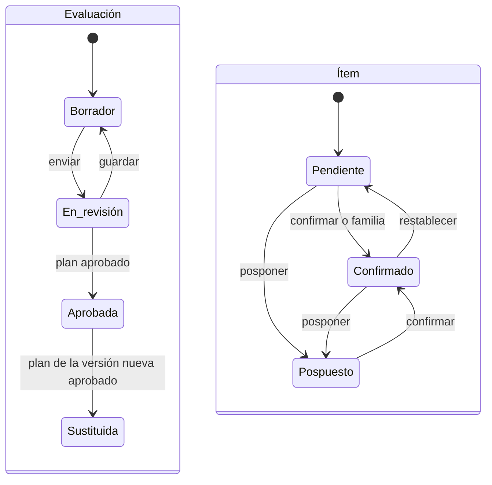

# Evaluación FMEA

Pantalla en la que se evalúan los modos de fallo priorizados de un sistema: ocurrencia, detectabilidad
y severidad, con justificación y segunda revisión cuando se exigen. Calcula la
[zona de riesgo](../glosario.md#zona-de-riesgo) y, al enviarla, crea el plan de tratamiento.

## Propósito

Realizar el [análisis de modos de fallo (FMEA)](../glosario.md#análisis-de-modos-de-fallo-fmea) de un
sistema de forma trazable y obtener las acciones que deben tratarse.

## Acceso y permisos

- **Ruta de entrada:** `/inventario/[id]/fmea`.
  - Abre la evaluación en curso, si no la vigente; solo crea la versión 1 si el sistema no tiene ninguna.
  - Después redirige a `…/fmea/[evaluationId]/evaluar` o, si ya hay plan, al plan.
  - Con `?item=` abre ese ítem.
- **Navegación:**
  - **Eval. riesgos** en la [Ficha del sistema](ficha-sistema.md);
  - [Evaluaciones](evaluaciones.md);
  - [Dashboard](dashboard.md);
  - brechas de control;
  - tareas delegadas desde un modo.
- **Disponibilidad:** Core.

| Rol | Ver | Acciones permitidas |
|---|---|---|
| Administrador, Responsable del SGAI, CAIO, DPO, Responsable del sistema, Analista de riesgos, Analista de cumplimiento | Sí | Evaluar, guardar, enviar a revisión |
| Responsable del SGAI | Ídem | Además, resolver segundas revisiones (no siendo el evaluador) |
| Directivo, Auditor, Lector | Sí, con los botones visibles | La base de datos rechaza los cambios |

La segunda revisión la resuelve el Responsable del SGAI, distinto del evaluador (bloque B01; DP-01,
confirmado el 2026-10-20). Para el resto de roles el botón no se muestra.

> **Pendiente de implementar.** Restringir la evaluación a quien prepara según DP-01 (Analista de riesgos y
> Responsable del sistema). Hoy la base de datos admite la edición de los roles de la tabla.

### Al entrar en el FMEA

| Situación | Resultado |
|---|---|
| El sistema no tiene modos activados | «Activa antes los modos de fallo» y **Volver al sistema** |
| No hay modos priorizados | «Todavía no hay una cola priorizada para este sistema…» |
| Todos los priorizados son de negocio | «Los modos priorizados de este sistema son todos de riesgo de negocio, que no forman parte del FMEA regulatorio.» |
| Hay una evaluación en borrador o en revisión | Se abre esa |
| No la hay, pero sí una aprobada | Se abre la vigente (la última aprobada), en solo lectura |
| El sistema no tiene ninguna evaluación | Se crea la versión 1 con un ítem por modo priorizado. Historial «Evaluación FMEA iniciada» |

Una versión nueva no se crea al entrar: se abre con **Nueva versión** (ver [Versiones](#versiones)).

## Campos

### Cabecera e indicadores

- **Identificación:** nombre del sistema, código, «Evaluación FMEA · Versión N».
- **Estado de guardado:** «Guardando…», «Cambios pendientes» o «Borrador sincronizado».
- **Zona activa:**
  - Zona I · requiere escalado;
  - Zona II · revisión prioritaria;
  - Zona III · seguimiento;
  - Zona IV · estable.
- **Indicadores:** Evaluados, Pendientes, Pospuestos, 2ª revisión, S_actual = 9, Tareas delegadas y
  [Suelo AI Act](../glosario.md#suelo-ai-act).

### Resumen al entrar

Recuadro sobre la estimación por familia (B14):
- «N modos priorizados · M con severidad 8 o más (P pendientes)».
- Con familias: «Empieza por las familias: X de Y estimadas, que cubren Z modos. Después revisa en la lista
  los que se salgan (K ajustes manuales). S modos no están en ninguna familia y se evalúan uno a uno.»
- Sin familias: «La lista está ordenada por criticidad: empieza por los de severidad más alta.»
- Con modos sin resolver y algún modo crítico, el estado del [plan parcial](#plan-parcial): «Plan parcial: faltan
  K de R modos de severidad 8 o más o de sus familias…» o «Plan parcial disponible: … Puedes enviarlo ya y dejar
  D modos para la segunda ronda».

La **severidad de referencia** de un modo es la severidad actual si está confirmado y la severidad por
defecto si no (`referenceSeverity` en `lib/fmea/families.ts`). Es la que usan el recuento, el orden por
criticidad y el filtro **S ≥ 8**.

### Mapa de calor O × D_real

Plegable. Rejilla de 5 × 5 con el número de modos evaluados en cada combinación, coloreada según la
severidad máxima: bajo, moderado, medio, alto, crítico.

### Estimación por familia

Panel «Estimación por familia · N de M». Permite valorar a la vez todos los modos de una
[familia](../glosario.md#estimación-por-familia). Es la forma de evaluar por defecto (B14).

- **Orden:** primero las familias con algún modo de severidad 8 o más; después, por severidad máxima y por
  número de modos.
- **Cada familia** muestra el número de modos, cuántos tienen severidad 8 o más, la severidad máxima
  («S máx.»), los ajustados a mano y, si está estimada, su O y su D. La lista de sus modos indica la
  severidad de referencia de cada uno.

| Campo | Tipo | Obligatorio | Descripción y valores | Origen (`tabla.columna`) |
|---|---|---|---|---|
| **Ocurrencia (O)** | botones 1-5 | Sí | Muy improbable · Improbable · Posible · Probable · Casi seguro. Por defecto 3 | `fmea_family_estimates.o_value` |
| **Detección (D)** | botones 1-5 | Sí | Se detecta siempre · casi siempre · Detección parcial · Difícil de detectar · No se detecta | `d_value` |
| **Justificación** | texto largo | Sí | Mínimo 50 caracteres. Sustituye a la de cada modo de la familia | `justification` |

- **Cálculo:** cada modo cubierto queda confirmado con la ocurrencia y la detección máximas de sus
  familias y la severidad sugerida.
- **Retirar la estimación:** los modos vuelven a pendiente.

Confirmar o posponer un modo uno a uno lo marca como ajuste manual: aplicar o retirar una estimación por
familia ya no lo modifica. También lo marca cambiar en la lista los valores, la justificación o el estado
de un modo que heredaba de una familia, aunque solo lo guarde el guardado automático. **Restablecer a
pendiente** quita esa marca, y **Volver a la estimación de familia** la quita y le aplica otra vez los
valores de su familia.

**Historial del modo.** Cada cambio de valores por la estimación por familia queda en el historial del
ítem (`fmea_item_history`), con las familias en la nota:

| Evento | Etiqueta | Cuándo |
|---|---|---|
| `family_estimated` | Estimado por familia | Se aplica o cambia la estimación de su familia, o el modo vuelve a ella |
| `family_withdrawn` | Estimación de familia retirada | Se retira la estimación que lo cubría: vuelve a pendiente |
| `family_exception` | Ajuste manual sobre la familia | Se retoca en la lista un modo que heredaba de una familia |

Volver a aplicar los mismos valores no añade entradas.

### Lista de modos

**Filtros:**
- **Estado:** Todos, Pendientes, Evaluados, Pospuestos, 2ª revisión, S ≥ 8 (por severidad de
  referencia).
- **Con familias:** Ajustes manuales (modos de alguna familia ajustados a mano) y Sin familia (si los hay).
- **[Dimensión](../glosario.md#dimensión-de-riesgo).**
- **[Familia de activación](../glosario.md#familia-de-activación)** («Por familia»), en el orden del panel.
- **Búsqueda:** por código o nombre.

**Ordenar por:**
- **Criticidad** (por defecto): severidad de referencia de mayor a menor; a igualdad, los pendientes
  primero. Se agrupa por tramos: Severidad 8 o más, Severidad 7, Severidad 5 y 6, Severidad 4 o menos.
- **Dimensión:** orden de las dimensiones y código, agrupado por dimensión.

Paginación de 20.

| Columna | Descripción y valores | Origen (`tabla.columna`) |
|---|---|---|
| Código y nombre | — | `compliance.failure_modes.code`, `name` |
| Estado | Pendiente · Confirmado · Pospuesto | `fmea_items.status` |
| Dimensión | — | `failure_modes.dimension_id` |
| Origen | **Por familia** (con las familias en la ayuda) o **Ajuste manual** (modo de una familia estimada ajustado a mano) | `fmea_items.estimate_source`, `estimate_families` |
| **def** | [Severidad por defecto](../glosario.md#severidad-por-defecto-s_default) | `fmea_items.s_default_frozen` |
| **act** | [Severidad actual](../glosario.md#severidad-actual-s_actual) confirmada, o la sugerida | `s_actual` |
| Tarea | Estado de la tarea delegada | `tasks.status` |

### Editor del modo

| Campo | Tipo | Obligatorio | Descripción y valores | Origen (`tabla.columna`) |
|---|---|---|---|---|
| Criterios R·I·D·E | solo lectura | — | [Criterios R.I.D.E.](../glosario.md#criterios-ride) del catálogo | `compliance.failure_modes` |
| **O · Ocurrencia en este sistema** | deslizador 1-5 | Sí | Por defecto 3. Improbable (1-2), Moderado (3), Probable (4-5) | `fmea_items.o_value` |
| **D_real · Detectabilidad real** | deslizador 1-5 | Sí | Por defecto 3. Detectable (1-2), Moderado (3), Difícil de detectar (4-5) | `d_real_value` |
| **S_actual sugerido** | calculado | — | Ver regla. Con 9: «⚠ S_actual = 9 activa Zona I y bloquea el despliegue hasta revisión.» | — |
| **Ajustar S_actual manualmente** | número 2-9 | No | Sustituye al sugerido | `s_actual` |
| **Justificación** | texto largo | Según regla | Mínimo 50 caracteres cuando es obligatoria | `narrative_justification` |

**Regla de severidad sugerida** (entre 2 y 9):

| Ocurrencia y detectabilidad | Severidad sugerida |
|---|---|
| O ≤ 2 y D ≤ 2 | Por defecto − 3 |
| O ≤ 2 y D = 3 | Por defecto − 2 |
| O ≤ 2 y D ≥ 4 | Por defecto − 1 |
| O ≥ 4 | Por defecto |
| Resto | Por defecto − 1 |

**La justificación es obligatoria si se cumple alguna de estas condiciones:**
- la severidad actual difiere 2 puntos o más de la severidad por defecto;
- se sube a 9;
- baja de 5 un modo que partía de 7 o más;
- el modo ya estaba confirmado con texto.

**Segunda revisión.** Se exige si la severidad se ajusta a mano y baja 3 puntos o más respecto a la
severidad por defecto. Estados posibles:
- Sin 2ª revisión;
- 2ª revisión pendiente;
- 2ª revisión aprobada;
- 2ª revisión rechazada.

Solo la puede resolver un usuario distinto del evaluador.

**Contexto FMEA** (panel lateral):
- descripción y clasificación del modo;
- contexto AI Act del sistema;
- controles relacionados del catálogo, con su estado en el sistema;
- notas por dimensión;
- historial de cambios del ítem.

### Exportación

**Exportar PDF** abre una página imprimible (HTML, no un fichero PDF). Contiene:
- metadatos de la evaluación;
- una tabla por dimensión con severidad por defecto, O, D, severidad actual, estado y justificación.

## Acciones

| Acción | Quién | Qué hace | Efectos |
|---|---|---|---|
| **Confirmar S_actual** | Roles con permiso | `saveFmeaItem`: confirma el ítem | Historial «Modo de fallo evaluado» y del ítem. Si se reconfirma, la segunda revisión vuelve a empezar |
| **Posponer** | Ídem | Pospone el ítem y borra sus valores | Historial «Modo de fallo pospuesto» |
| Confirmación con aviso de propagación | Ídem | Si la severidad es 4 o más y el modo puede causar o amplificar otros modos activos, muestra «Advertencia de propagación causal» con la lista | — |
| **Guardar borrador** y guardado automático (2,5 s tras cada cambio) | Ídem | `saveFmeaDraft` | Guarda todos los ítems. Historial «Borrador FMEA guardado» |
| **Delegar como tarea** | Ídem | Crea una [tarea](../glosario.md#tarea) con título, responsable, prioridad (Media por defecto) y fecha | Notifica al asignado |
| **Aprobar 2ª revisión** / **Solicitar revisión de nuevo** | Responsable del SGAI no evaluador | `resolveFmeaSecondReview` | El rechazo exige una nota de al menos 50 caracteres. Historial «Segunda revisión aprobada» o «rechazada» |
| **Aplicar a N modos** / **Retirar estimación** | Roles con permiso | Estimación por familia | Historial del modo. Recarga la página |
| **Volver a la estimación de familia** | Ídem | `restoreFamilyEstimateForItems`, en el editor de un modo con ajuste manual de una familia estimada. Deshabilitado con cambios sin guardar | El modo toma los valores de su familia. Historial «Estimado por familia». Recarga la página |
| **Posponer seleccionados** / **Restablecer a pendiente** | Ídem | Acciones en bloque, sin confirmación | Posponer borra también la justificación |
| **Enviar a revisión** / **Enviar a alta dirección** (si hay severidad 9) | Ídem | `submitFmeaForReview`. Con severidad 9 pide confirmación | Ver abajo |
| **Enviar plan parcial** | Ídem | Solo cuando el [plan parcial](#plan-parcial) está disponible y no quedan segundas revisiones. `submitFmeaForReview` con `partial`. Pide confirmación con el número de modos diferidos y la zona del envío | Como el envío completo; además guarda `deferred_items_count` |
| **Exportar PDF** · **Comparar versiones** | Todos | Abren la exportación y la [Comparativa FMEA](fmea-comparativa.md) (desde la versión 2) | — |
| **Nueva versión** | Analista de riesgos, Responsable del sistema | `startFmeaReevaluationAction`, con confirmación. Solo en la versión vigente y si no hay otra en curso | Ver [Versiones](#versiones) |

**Envío a revisión.** La evaluación pasa a «En revisión» y siempre se crea (o, en un reenvío, se
actualiza) su [plan de tratamiento](plan-de-tratamiento.md) en borrador: la evaluación y el plan son una
sola evaluación de riesgos y se aprueban juntos (DP-03, bloque B07).
- **Acciones:** una por candidato (modos con severidad 7 o más, o que pasaron segunda revisión). Sin
  candidatos, el plan no tiene acciones; se envía igualmente a aprobación y se cierra al aprobarse.
- **Plan:** lleva:
  - código PTR-año-nnn;
  - zona;
  - nivel de aprobación (sin aprobador asignado: lo decide la política del nivel en
    [Aprobaciones](aprobaciones.md), B11e);
  - fecha límite (30, 90, 180 o 365 días);
  - cadencia de revisión.
- **Reenvío** (plan devuelto a borrador y evaluación corregida): se recalculan zona, nivel de aprobación,
  cadencia y recuentos. Las acciones de modos que han
  dejado de ser candidatos se retiran y sus tareas se cancelan.
- **Evaluador:** se mantiene quien abrió la evaluación; quien la reenvía no lo sustituye.
- **Prioridades:** se recalculan con la severidad residual.
- **Navegación:** se abre el plan.

### Plan parcial

Decisión DP-08 (B14b). La evaluación se puede enviar sin evaluar todos los modos cuando:
- están evaluados todos los modos **críticos**: severidad por defecto 8 o más, o confirmados con 8 o más
  (`isCriticalForPartial`; bajar un modo al evaluarlo no lo saca del primer envío);
- están evaluados todos los modos de las [familias de activación](../glosario.md#familia-de-activación) que contienen algún modo crítico;
- no quedan segundas revisiones ni justificaciones obligatorias pendientes en los modos evaluados.

Los modos pendientes o pospuestos que no se exigen quedan para la **segunda ronda**
(`partialSubmission` en `lib/fmea/families.ts`). Sin modos críticos, el plan parcial no aplica.

| Aspecto | Comportamiento |
|---|---|
| Zona del envío | Se calcula contando los modos de la segunda ronda con su severidad por defecto (`withDeferredAtDefault`); de ella salen el nivel de aprobación, el plazo y la cadencia |
| Plan de tratamiento | Solo con los candidatos evaluados (severidad 7 o más, o con segunda revisión) |
| Prioridades residuales | Solo se recalculan las de los modos evaluados; los diferidos siguen priorizados |
| Registro | `fmea_evaluations.deferred_items_count` y el historial «Evaluación FMEA enviada a revisión» con «Plan parcial: N modos quedan para la segunda ronda» |
| Barra de versiones | «Plan parcial · N modos para la segunda ronda», también en la primera evaluación y en el plan. En revisión: «Se aprueban los modos críticos; los demás se evalúan en la versión siguiente». Aprobada: «Abre una nueva versión para evaluar la segunda ronda» |
| Segunda ronda | **Nueva versión**: los modos evaluados se copian y los diferidos arrancan pendientes |

> TODO: confirmar si el plan parcial debe acortar la próxima revisión o avisar de la segunda ronda con una
> fecha. Hoy la próxima revisión sigue la cadencia de la zona y la segunda ronda depende de que alguien abra
> la versión nueva.

**Cambios tras el envío.** Una evaluación enviada se puede retocar mientras su plan siga en borrador:
vuelve a «Borrador» para reenviarla, sin cambiar el evaluador. Con el plan en aprobación o aprobado, la
evaluación queda en solo lectura.

Los ítems pendientes se guardan tal como están: el guardado automático no les asigna severidad actual.

**Aprobación.** Al aprobarse el plan en su [flujo de aprobación](aprobaciones.md), la evaluación pasa a «Aprobada» con su aprobador, la fecha y la
próxima revisión según la cadencia del plan (mensual, trimestral, semestral o anual). Historial
«Evaluación de riesgos aprobada».

### Versiones

Una barra sobre los indicadores sitúa la evaluación entre las versiones del sistema (no aparece en la
primera evaluación mientras está en curso):

| Estado de la versión | Barra |
|---|---|
| Aprobada | «Versión N · Vigente», fecha de aprobación y próxima revisión (en rojo si ha vencido). Botón **Nueva versión** para quien puede abrirla; si no, indica quién la abre. Si ya hay otra en curso, enlace **Ir a la versión M en curso** |
| En borrador o en revisión, con una vigente | «Versión N · En curso»: «Sustituirá a la versión M cuando se apruebe su plan» y enlace **Ver versión vigente** |
| Sustituida | «Versión N · Sustituida», solo lectura, y enlace **Ver versión vigente** |

**Nueva versión** crea la versión siguiente con los modos priorizados en ese momento (solo los
regulatorios):
- los modos que estaban confirmados en la vigente arrancan con sus valores, su justificación y su segunda
  revisión; al cambiar un valor, el guardado vuelve a calcular la segunda revisión;
- los modos nuevos arrancan pendientes;
- se copian las estimaciones por familia;
- historial «Nueva versión de la evaluación FMEA», con el número de modos copiados.

La versión anterior sigue vigente hasta que se aprueba el plan de la nueva. Entonces pasa a «Sustituida»;
su plan, si seguía abierto, también, y sus acciones abiertas se cancelan con sus tareas (historial
«Versión anterior sustituida»).

## Validaciones

| Situación | Mensaje |
|---|---|
| Valores fuera de rango al confirmar | «Para confirmar un ítem necesitas O, D real y S actual válidos.» |
| Falta justificación | «La justificación es obligatoria y debe tener al menos 50 caracteres.» |
| Envío con ítems sin resolver | «La evaluación todavía no puede enviarse: quedan N pendiente(s) y M pospuesto(s) por resolver.» |
| Plan parcial con críticos sin evaluar | «El plan parcial todavía no puede enviarse: quedan N modo(s) de severidad 8 o más o de sus familias por evaluar.» |
| Plan parcial sin modos críticos | «No hay modos de severidad 8 o más: el plan parcial no aplica y hay que evaluar todos los modos.» |
| Envío con justificaciones pendientes | «Hay ítems que requieren justificación obligatoria antes de enviarse a revisión.» |
| Envío con segundas revisiones pendientes | «Quedan N modo(s) pendientes de 2ª revisión antes del envío.» |
| Envío de un sistema de alto riesgo sin responsable de supervisión humana | «Este sistema es de alto riesgo: asigna el Responsable de supervisión humana en la ficha (AI Act, Art. 14 y 26.2) antes de enviar la evaluación.» |
| Segunda revisión por el evaluador | «La segunda revisión debe realizarla un usuario distinto del evaluador principal.» |
| Segunda revisión sin permiso | «No tienes permisos para realizar la segunda revisión.» |
| Estimación por familia con cambios sin guardar | «Tienes cambios sin guardar en la lista de modos. Guárdalos antes de aplicar una estimación de familia.» |
| Volver a la familia sin familia estimada | «Ninguno de estos modos está en una familia estimada: no hay estimación a la que volver.» |
| Tarea ya delegada | «Ya existe una tarea delegada para este modo de fallo.» |

El botón de envío se deshabilita mientras quedan pendientes, pospuestos o segundas revisiones, y lo
explica en su ayuda.

## Estados

Las evaluaciones «Aprobada» y «Sustituida» son de solo lectura.

## Vistas relacionadas

- [Ficha del sistema](ficha-sistema.md): activación y priorización de modos de fallo.
- [Plan de tratamiento](plan-de-tratamiento.md): se crea al enviar.
- [Comparativa FMEA](fmea-comparativa.md), [Evaluaciones](evaluaciones.md).
- Negocio: [Análisis de modos de fallo (FMEA)](../negocio/analisis-modos-de-fallo.md).
