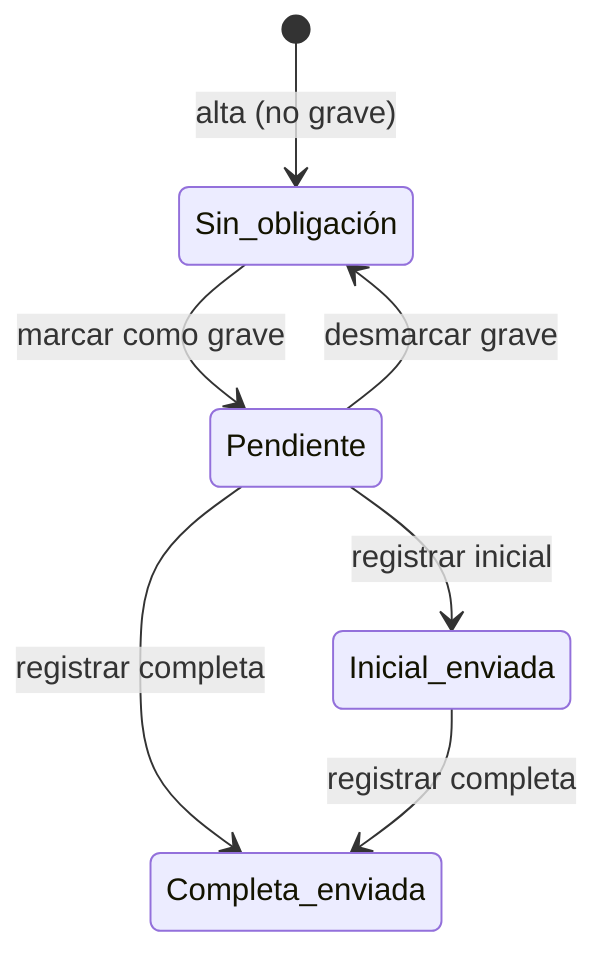

# Detalle de incidente

Ficha de un [incidente](../glosario.md#incidente): clasificación, plazo, notificación a la autoridad,
acciones correctivas, investigación y cierre.

## Propósito

Decidir si el incidente es un [incidente grave](../glosario.md#incidente-grave), calcular su
[plazo de notificación](../glosario.md#plazo-de-notificación), dejar constancia de la notificación
enviada y gestionar la investigación hasta el cierre.

## Acceso y permisos

- **Ruta:** `/incidentes/[id]`
- **Navegación:** desde [Incidentes](incidentes.md) y desde los avisos de incidente.
- **Disponibilidad:** Core.

| Rol | Ver | Acciones permitidas |
|---|---|---|
| Administrador, Responsable del SGAI, CAIO, DPO, Analista de riesgos, Analista de cumplimiento | Sí | Clasificar, registrar la notificación, añadir acciones correctivas, investigar y cerrar |
| Responsable del sistema, Directivo, Auditor, Lector | Cabecera, clasificación (solo lectura) y acciones correctivas | Ninguna |

Los roles sin permiso ven el aviso «Puedes consultar el incidente, pero clasificarlo y registrar la
notificación corresponde a los roles de gobierno.».

Si el incidente no existe o es de otra organización, la vista devuelve «no encontrado».

## Campos

**Cabecera:** referencia, título, marca «incidente grave», descripción, sistemas afectados y reloj del
plazo (ver [Incidentes](incidentes.md#campos)).

**Clasificación · artículo 3.49.** «De esto depende el plazo. Al guardar, el reloj se recalcula
automáticamente desde el momento en que se tuvo conocimiento.»

| Campo | Tipo | Obligatorio | Descripción y valores | Origen (`ai_incidents.`) |
|---|---|---|---|---|
| **Categoría** | opciones | Sí | Fallecimiento de una persona (Art. 3.49.a · 10 días) · Daño grave a la salud (Art. 3.49.a · 15 días) · Infraestructuras críticas (Art. 3.49.b · 2 días) · Vulneración de derechos fundamentales (Art. 3.49.c · 15 días) · Daños a la propiedad o al medio ambiente (Art. 3.49.d · 15 días) · Ninguno de los anteriores (por defecto) | `category` |
| **Es un incidente grave del artículo 3.49** | casilla | No | «Sin marcar esto no hay obligación de notificar ni plazo. Es una valoración humana…» | `is_serious` |
| **Infracción generalizada** | casilla | No | Reduce el plazo a 2 días (Art. 73.3) | `is_widespread_infringement` |
| **Conocimiento del incidente** | fecha y hora | Sí | Ancla del plazo. Al dar parte, la fecha del alta | `became_aware_at` |
| **Nexo causal establecido** | fecha y hora | No | «Obliga a notificar de inmediato.» | `causal_link_established_at` |
| **Nuestro rol** | selección | Sí | Proveedor · Responsable del despliegue (Art. 26.5). Al dar parte se propone Responsable del despliegue si en ningún sistema afectado la organización es proveedora (B25b); si no, o sin sistemas, Proveedor | `reporter_role` |

Debajo, un resumen: «Con esta clasificación: {plazo de la categoría | sin obligación de notificar}».

El plazo lo calcula la base de datos:
- **2 días:** infraestructura crítica o infracción generalizada;
- **10 días:** fallecimiento;
- **15 días:** el resto.

Solo hay plazo si el incidente es grave (AI Act, Art. 73).

> TODO: confirmar varias reglas de la clasificación.
> - **Resumen con infracción generalizada:** muestra el plazo de la categoría (por ejemplo, 15 días)
>   aunque se apliquen 2.
> - **Grave sin categoría:** se puede marcar como grave un incidente con «Ninguno de los anteriores». Se le
>   aplican 15 días.

**Avisos del responsable del despliegue · artículo 26.5** (B25b). Solo si el incidente es grave y **Nuestro
rol** es Responsable del despliegue. Visible para todos; registran los avisos los roles de gobierno. Fluxion no
envía los avisos: deja constancia ([aviso a terceros](../glosario.md#aviso-a-terceros)).

| Paso | Se cumple cuando |
|---|---|
| Aviso al proveedor, inmediatamente | Consta un aviso al Proveedor |
| Aviso al importador o distribuidor, si los hay | Consta un aviso al Importador o al Distribuidor. No es obligatorio para completar el circuito |
| Notificación a la autoridad de vigilancia del mercado (Art. 73) | Consta la notificación inicial o completa de **Notificación a la autoridad** |

Debajo, la lista de avisos (destinatario, nombre, fecha, canal, referencia y evidencia) y **Registrar aviso**,
con destinatario Proveedor, Importador o Distribuidor; nombre, fecha (no futura), canal, referencia y evidencia
(de los sistemas afectados o de la organización), opcionales salvo destinatario y fecha. Si la notificación a la
autoridad consta antes que el aviso al proveedor, se avisa: «La notificación a la autoridad consta antes que el
aviso al proveedor…». No se bloquea: si no se consigue contactar con el proveedor, se notifica igualmente a la
autoridad (Art. 26.5, que remite al Art. 73).

**Notificación a la autoridad** (solo roles de gobierno y solo si el incidente es grave). Como responsable del
despliegue sin aviso al proveedor, muestra «Como responsable del despliegue, avisa antes al proveedor (Art.
26.5), salvo que no consigas contactar con él.»:

| Campo | Tipo | Descripción | Origen |
|---|---|---|---|
| **Fecha de envío** | fecha y hora | Por defecto, ahora | `notified_at` |
| **Autoridad** | texto | Por ejemplo, «AESIA» | `authority` |
| **Referencia o acuse** | texto | Número de expediente | `notification_reference` |

**Uso de los sistemas afectados** (B25b). Para cada sistema afectado, su enlace a la ficha y «Uso suspendido
desde el …» (« por este incidente» si la suspensión lo cita) o **Suspender el uso →**, que abre la
[ficha](ficha-sistema.md) con el formulario de suspensión abierto y este incidente elegido
(`/inventario/{id}?suspender={incidente}`). La suspensión la gestionan los roles de la ficha.

**Acciones correctivas (N):** tareas vinculadas al incidente, con estado, título (enlace a
[Tareas](tareas.md)) y fecha límite. Sin acciones: «Sin acciones registradas. Se crean como tareas y
aparecen en el tablero de Ejecución.».

**Investigación y cierre** (solo roles de gobierno):

| Campo | Tipo | Descripción y valores | Origen |
|---|---|---|---|
| **Estado** | selección | Abierto · En investigación · Contenido · Cerrado | `status` |
| **Responsable** | selección | «Sin asignar» o un miembro de la organización | `owner_id` |
| **Causa raíz** | texto largo | — | `root_cause` |
| **Impacto** | texto largo | — | `impact_summary` |

> TODO: confirmar varios datos que no se muestran o no se pueden editar.
> - **Número de personas afectadas:** existe en los datos, pero la vista no lo muestra ni lo edita.
> - **Datos que no se muestran:** fecha en que ocurrió, quién dio parte y fecha de cierre.
> - **Roles sin permiso:** no ven el estado ni los datos de la notificación.
> - **Acciones correctivas:**
>   - el estado aparece sin traducir;
>   - el enlace lleva a la lista de tareas, no a la tarea;
>   - no se puede indicar responsable ni fecha límite.

## Acciones

| Acción | Quién | Qué hace | Efectos |
|---|---|---|---|
| **Registrar aviso** | Gobierno | `recordIncidentNotice`: crea un aviso en `external_notices` con `incident_id`. La autoridad no se admite aquí | «Aviso registrado.» |
| **Guardar clasificación** | Gobierno | `classifyIncident` | Recalcula plazo y estado de notificación. «Clasificación guardada y plazo recalculado.» Si pasa a grave, abre un [disparador de reevaluación](flujo-completo-evaluacion.md#disparadores-de-reevaluación) en cada sistema afectado (B21a) |
| **Registrar notificación inicial** | Gobierno | `recordNotification` (`initial_sent`) | «Notificación inicial registrada.» El plazo sigue contando |
| **Registrar notificación completa** | Gobierno | `recordNotification` (`complete_sent`) | «Notificación completa registrada. El reloj se detiene.» |
| **+ Añadir** (acción correctiva) | Gobierno | `addCorrectiveAction`: crea una [tarea](../glosario.md#tarea) de prioridad alta con origen «Incidente de IA» | «Acción correctiva creada como tarea.» |
| **Guardar** (investigación) | Gobierno | `updateIncident` | Al cerrar, guarda la fecha de cierre y quién cierra. «Incidente actualizado.» |
| **← Incidentes** | Todos | Vuelve a la lista | — |

**Avisos de plazo:** cada hora, para los incidentes graves con notificación pendiente o inicial, Fluxion
avisa una sola vez por umbral:

| Umbral | Aviso |
|---|---|
| Mitad del plazo | «Mitad del plazo consumida · {ref}» |
| 80 % del plazo | «Quedan {x} para notificar · {ref}» |
| Plazo vencido | «Plazo VENCIDO · {ref}» |

Los avisos llegan en la app al responsable y a los roles de gobierno, y a Slack o Teams.

> TODO: confirmar los destinatarios de los avisos de plazo. No incluyen al Analista de riesgos, que sí
> recibe el aviso de alta y puede gestionar el incidente.

> TODO: confirmar el registro de la notificación.
> - **Orden:** las dos notificaciones no tienen orden. Tras la completa se puede registrar una inicial y
>   el plazo vuelve a contar.
> - **Confirmación y rastro:** no se pide confirmación y no queda historial.

## Validaciones

| Situación | Mensaje |
|---|---|
| Rol sin permiso | «Solo los roles de gobierno pueden clasificar o notificar incidentes.» |
| Falta la fecha de conocimiento | **Guardar clasificación** deshabilitado |
| Acción correctiva sin título | **+ Añadir** deshabilitado; en servidor, «El título de la acción es obligatorio.» |
| Errores de guardado | «Error al clasificar: …», «Error al registrar la notificación: …», «Error al crear la acción: …», «Error al actualizar: …» |

No se comprueba que las fechas de notificación o de nexo causal sean posteriores a la de conocimiento.

## Estados

**Estado del incidente:** Abierto, En investigación, Contenido o Cerrado. Se puede pasar de cualquiera a
cualquiera.

> TODO: confirmar la reapertura. Si un incidente cerrado se reabre, conserva la fecha de cierre.

**Estado de la notificación:**

## Vistas relacionadas

- [Incidentes](incidentes.md), [Tareas](tareas.md).
- [Ajustes](ajustes.md), pestaña de canales de Slack y Teams.
- Negocio: [Incidentes](../negocio/incidentes.md).
