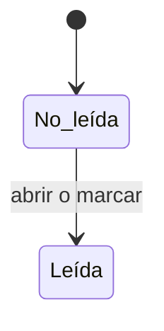

# Notificaciones

Centro de [avisos en la app](../glosario.md#aviso-en-la-app) de la persona: lista completa de sus
notificaciones, con filtro de no leídas y marcado como leídas.

## Propósito

Consultar todos los avisos recibidos, que en la campana de la barra superior solo aparecen los diez
últimos, e ir desde cada uno al objeto que lo origina.

## Acceso y permisos

- **Ruta:** `/notificaciones`
- **Navegación:** campana de la barra superior › **Ver todas las notificaciones →**. No tiene entrada en
  el menú lateral.
- **Disponibilidad:** Core.

| Rol | Ver | Acciones permitidas |
|---|---|---|
| Todos los roles | Solo sus propias notificaciones (`recipient_id` = su perfil) | Marcar como leídas, abrir el enlace |

## Campos

La vista tiene dos pestañas: **Todas** (por defecto) y **No leídas**. Muestra el total de notificaciones,
de 25 en 25.

| Campo | Tipo | Obligatorio | Descripción y valores | Origen (`tabla.columna`) |
|---|---|---|---|---|
| Icono | — | — | Según el tipo (ver tabla siguiente) | `notifications.type` |
| Título | texto | — | En negrita si no está leída | `notifications.title` |
| Texto | texto | — | Hasta dos líneas | `notifications.body` |
| Fecha | fecha y hora | — | Formato «dd mmm aaaa, hh:mm» | `notifications.created_at` |
| Marca de no leída | punto | — | Visible si no está leída | `notifications.read_at` nulo |

Tipos de notificación que genera la aplicación:

| Tipo | Origen | Icono propio |
|---|---|---|
| `task_assigned` | Tarea asignada | Sí |
| `status_changed` | Cambio de estado de una tarea que sigues | Sí |
| `mention` | Mención en un comentario de tarea | Sí |
| `comment_added` | Comentario en una tarea que sigues | Sí |
| `attachment_added` | Adjunto en una tarea que sigues | Sí |
| `review_due` | Revisión periódica próxima o vencida | Sí |
| `incident_reported` | Incidente registrado | No (genérico) |
| `incident_deadline` | Umbral del plazo de notificación de un incidente | No (genérico) |
| `signal_alert` | [Señal de riesgo](../glosario.md#señal-de-riesgo) de gravedad alta o crítica | No (genérico) |
| `approval_pending` | Aprobación pendiente | No (genérico) |
| `approval_closed` | Resultado de una aprobación | No (genérico) |

## Acciones

| Acción | Quién | Qué hace | Efectos |
|---|---|---|---|
| **Marcar todas como leídas** | El destinatario | `markAllAsReadAction` | Pone `read_at` en todas sus notificaciones no leídas. El botón solo aparece si hay no leídas en la página visible |
| Pulsar una notificación | El destinatario | `markAsReadAction` y navegación a `link_url` | La marca como leída |
| **Anterior** / **Siguiente** | El destinatario | Paginación | Solo si hay más de 25 |

## Validaciones

No aplica.

## Estados

### Preferencias y correo

- Las preferencias de avisos se configuran en [Perfil](perfil.md) y en [Ajustes](ajustes.md).
- Las notificaciones de tareas pueden enviarse también por correo.

> TODO: confirmar el comportamiento de las preferencias de avisos.
> - Hoy el aviso en la app se crea siempre, sea cual sea la preferencia.
> - Para el correo, el emisor busca las preferencias en un formato que ni [Perfil](perfil.md) ni
>   [Ajustes](ajustes.md) usan, así que se aplican siempre los valores por defecto.
> - Varias preferencias (acción asignada, acción vencida, plan pendiente de aprobación, evidencia por
>   caducar, resumen semanal) no tienen ningún emisor.

> TODO: confirmar el comportamiento en la pestaña **No leídas**. Una notificación que se marca como leída
> no desaparece de la lista hasta recargar.

## Vistas relacionadas

- [Navegación](navegacion.md): campana con las diez últimas.
- [Perfil](perfil.md) y [Ajustes](ajustes.md): preferencias de avisos.
- [Tareas](tareas.md), [Incidentes](incidentes.md), [Aprobaciones](aprobaciones.md),
  [Revisiones pendientes](revisiones-pendientes.md): orígenes de las notificaciones.
- Negocio: [Plataforma](../negocio/plataforma.md).
