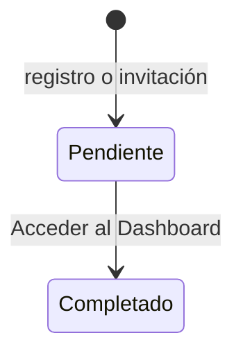

# Onboarding

Asistente de configuración inicial en cuatro pasos que recoge el perfil de la
[organización](../glosario.md#organización), su situación frente a ISO/IEC 42001 y el foco con el que quiere
empezar.

## Propósito

Adaptar Fluxion a la organización antes del primer uso: marcos normativos, madurez y guía de primeros
pasos del [Dashboard](dashboard.md). Mientras no se completa, la aplicación no deja acceder al resto de
vistas protegidas.

## Acceso y permisos

- **Ruta:** `/onboarding`
- **Navegación:**
  - tras el [Registro](registro.md);
  - tras el [Inicio de sesión](login.md) si `profiles.onboarding_completed = false`;
  - desde cualquier ruta protegida mientras no se complete.
- **Disponibilidad:** Core.

| Rol | Ver | Acciones permitidas |
|---|---|---|
| Cualquier rol con el onboarding sin completar | Sí | Recorrer los pasos y finalizar |
| Con el onboarding completado | No: redirige a `/dashboard` | — |
| Sin sesión | No: redirige a `/login` | — |

Todos los miembros nuevos pasan por el onboarding, también los invitados, pero solo un `org_admin` puede
guardar los datos de la organización.

> TODO: confirmar el comportamiento para invitados que no son administradores.
> - La subida del logotipo falla con un aviso.
> - Sus respuestas no se guardan, porque la política RLS de `organizations` solo deja actualizar a
>   `org_admin` y la escritura afecta a 0 filas sin error.
> - Su perfil sí queda marcado como completado.

## Campos

### Paso 1 · Detalles de la organización

| Campo | Tipo | Obligatorio | Descripción y valores | Origen (`tabla.columna`) |
|---|---|---|---|---|
| **Sector Industrial Principal** | selector | No | 21 sectores (Agricultura y Agroindustria … Otro). «Banca y Finanzas (EBA/DORA)», «Salud (MDR/IVDR)» y «Sector Público (ENS)» precargan marcos normativos | `organizations.sector` |
| **País de operación principal** | selector | No | Los 27 países de la UE. Por defecto «Espana» | `organizations.country` |
| **Apetito al riesgo** | selector | No | Conservador · Moderado · Amplio. Por defecto Moderado | `organizations.apetito_riesgo` |
| **Tamaño de la Compañía** | selector | No | 1 - 50 empleados · 51 - 500 empleados · Más de 500 empleados. Por defecto el primero | `organizations.size` |
| **Módulos normativos activos** | botones conmutables | No | AI Act, ISO 42001, DORA, RGPD, ENS, MDR/IVDR. Por defecto AI Act, ISO 42001 y RGPD. Banca añade DORA, Salud añade MDR/IVDR y Sector Público añade ENS; el resto de sectores los quita | `organizations.normative_modules` ([marcos aplicables](../glosario.md#marco-aplicable)) |
| **Logotipo Corporativo** | fichero | No | PNG, JPEG, WEBP o SVG, máximo 2 MB | `organizations.logo_url` (bucket `organization-logos`) |

### Paso 2 · Contexto de cumplimiento

| Campo | Tipo | Obligatorio | Descripción y valores | Origen (`tabla.columna`) |
|---|---|---|---|---|
| **Estado frente a ISO 42001** | tarjetas | No | Sin certificación · En proceso · Certificado. Por defecto Sin certificación | `organizations.iso_42001_status` (`none`, `in_progress`, `certified`) |
| **Fecha de certificación** | fecha | No | Solo si es Certificado | `organizations.iso_42001_cert_date` |
| **Organismo certificador** | texto | No | Solo si es Certificado. Placeholder «Ej. Bureau Veritas, AENOR...» | `organizations.iso_42001_cert_body` |
| **Estado del inventario de sistemas IA** | tarjetas | No | No iniciado · Parcial · Completo. Por defecto No iniciado | `organizations.ai_inventory_status` (`none`, `partial`, `complete`) |
| **Madurez de gobernanza IA** | tarjetas | No | Inicial (0 %) · En desarrollo (25 %) · Avanzado (50 %) · Optimizado (75 %). Por defecto Inicial | `organizations.compliance_maturity` |

### Paso 3 · Prioridad de despliegue

| Campo | Tipo | Obligatorio | Descripción y valores | Origen (`tabla.columna`) |
|---|---|---|---|---|
| Foco inicial | tarjetas | No | Inventario de Sistemas IA · Cumplimiento Regulatorio · Gestión de Riesgos · Gobernanza y Comités. Por defecto Inventario | `organizations.settings.first_focus` (`inventory`, `compliance`, `risk`, `governance`) |

### Paso 4 · Completado

Mensaje «¡Todo configurado!» y botón para acceder.

## Acciones

| Acción | Quién | Qué hace | Efectos |
|---|---|---|---|
| Subir logotipo | `org_admin` | `POST /api/organization/upload-logo` | Guarda el logo en el momento, aunque no se termine el onboarding |
| **Volver atrás** | Cualquiera | Paso anterior (oculto en los pasos 1 y 4) | — |
| **Siguiente paso** / **Omitir paso** | Cualquiera | Avanza de paso. Las dos acciones hacen lo mismo: omitir un paso guarda sus valores por defecto | — |
| **Acceder al Dashboard** | Cualquiera | Server action `saveOnboarding` | Ver abajo. Después navega a `/dashboard` |

`saveOnboarding` hace lo siguiente:
1. Actualiza en `organizations` todos los campos anteriores. La fecha y el organismo de certificación
   solo se guardan si el estado es Certificado.
2. Añade a `settings` los valores `first_focus`, `onboarding_completed` y `onboarding_completed_at`.
3. Marca `profiles.onboarding_completed = true`.

No genera registro de auditoría ni avisos.

## Validaciones

- **Cliente:** ninguna; todos los pasos se pueden omitir.
- **Logotipo:** «El archivo supera el límite de 2 MB»; sin permisos de administrador, «Sin permisos de
  administrador». En pantalla, cualquier error muestra «No se pudo subir el logo. Comprueba el tamaño
  (máx. 2 MB) e inténtalo de nuevo.»
- **Base de datos:** restricciones sobre los valores de estado ISO, estado del inventario y madurez. La
  fecha de certificación solo se admite con estado Certificado.
- **Errores al guardar:**
  - «No se encontró una organización vinculada a este usuario.»
  - «No se pudo guardar la configuración inicial de la organización.»
  - «No se pudo marcar el onboarding como completado.»

  En pantalla aparece un aviso genérico.

## Estados

El estado es por persona (`profiles.onboarding_completed`), no por organización.

## Vistas relacionadas

- [Registro](registro.md) e [Inicio de sesión](login.md): origen.
- [Dashboard](dashboard.md): destino. Su guía de primeros pasos abre el foco elegido.
- [Organización](organizacion.md): donde se editan después estos datos.
- Negocio: [Plataforma](../negocio/plataforma.md).
