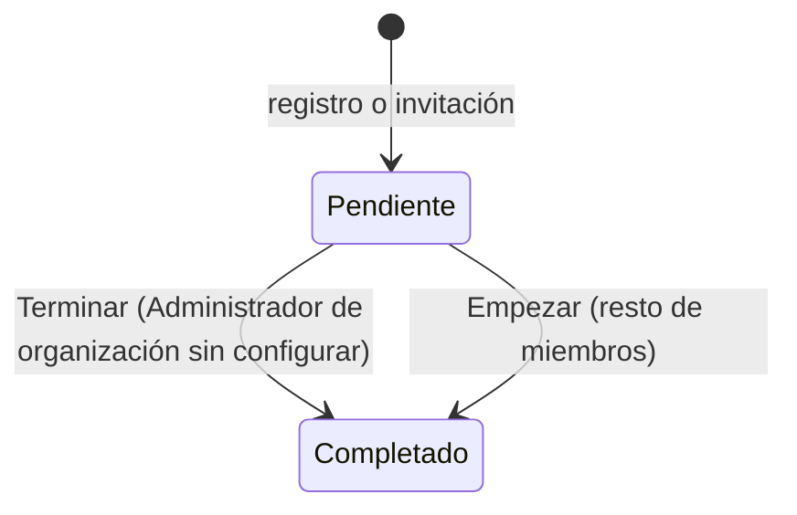

# Onboarding

Primer acceso a la plataforma. Desde B18c (F-17, GAP-02) hay dos recorridos:
- **Configuración inicial**, en tres pasos (Organización, Equipo y Primer sistema), para el Administrador de
  una [organización](../glosario.md#organización) que aún no está configurada;
- **Bienvenida**, una sola pantalla, para cualquier otro miembro: invitados y Administradores que llegan a
  una organización ya configurada. No toca la organización.

## Propósito

Dejar la organización lista para trabajar: su perfil y marcos normativos, las personas que deciden
(Responsable del SGAI y DPO) y el Comité de IA, y un primer paso con un sistema. Mientras el miembro no lo
completa, la aplicación no deja acceder al resto de vistas protegidas.

## Acceso y permisos

- **Ruta:** `/onboarding`
- **Navegación:**
  - tras el [Registro](registro.md);
  - tras el [Inicio de sesión](login.md) si `profiles.onboarding_completed = false`;
  - desde cualquier ruta protegida mientras no se complete.
- **Disponibilidad:** Core.

| Quién | Ve | Acciones permitidas |
|---|---|---|
| Administrador de una organización sin configurar (`organizations.settings.onboarding_completed` distinto de `true`) | Configuración inicial | Recorrer los tres pasos y terminar |
| Cualquier otro miembro con el onboarding sin completar | Bienvenida | **Empezar** |
| Con el onboarding completado | No: redirige a `/dashboard` | — |
| Sin sesión | No: redirige a `/login` | — |

## Campos

### Paso 1 · Organización

| Campo | Tipo | Obligatorio | Descripción y valores | Origen (`tabla.columna`) |
|---|---|---|---|---|
| **Sector Industrial Principal** | selector | No | 21 sectores (Agricultura y Agroindustria … Otro). «Banca y Finanzas (EBA/DORA)», «Salud (MDR/IVDR)» y «Sector Público (ENS)» precargan marcos normativos | `organizations.sector` |
| **País de operación principal** | selector | No | Los 27 países de la UE. Por defecto «Espana» | `organizations.country` |
| **Apetito al riesgo** | selector | No | Conservador · Moderado · Amplio. Por defecto Moderado | `organizations.apetito_riesgo` |
| **Tamaño de la Compañía** | selector | No | 1 - 50 empleados · 51 - 500 empleados · Más de 500 empleados. Por defecto el primero | `organizations.size` |
| **Módulos normativos activos** | botones conmutables | No | AI Act, ISO 42001, DORA, RGPD, ENS, MDR/IVDR. Por defecto AI Act, ISO 42001 y RGPD. Banca añade DORA, Salud añade MDR/IVDR y Sector Público añade ENS; el resto de sectores los quita | `organizations.normative_modules` ([marcos aplicables](../glosario.md#marco-aplicable)) |
| **Logotipo Corporativo** | fichero | No | PNG, JPEG, WEBP o SVG, máximo 2 MB | `organizations.logo_url` (bucket `organization-logos`) |

La madurez, el estado frente a ISO/IEC 42001 y el estado del inventario ya no se piden aquí: están en
[Organización](organizacion.md) › **Perfil regulatorio** › **Madurez**. El foco inicial desaparece; la guía
del Dashboard abre por defecto el inventario.

### Paso 2 · Equipo

Para el **Responsable del SGAI** y el **Delegado de Protección de Datos (DPO)**, una de tres opciones:

| Opción | Qué hace |
|---|---|
| **Invitar por correo** | Crea la invitación con ese rol (`inviteUser`). El enlace se copia y envía desde [Usuarios](usuarios.md) |
| **Lo asumo yo** | Añade el rol al Administrador (`updateMemberRoles`). DPO y Responsable del SGAI no pueden recaer en la misma persona (RGPD, Art. 38.6) |
| **Más tarde** | No hace nada |

**Comité de IA** · **Constituir**: crea el comité de tipo `ai_committee` («Comité de IA», revisión cada
3 meses, constituido hoy) con el Administrador como presidente (`committee_members.committee_role =
'president'`). Si ya existe uno, no crea otro. El resto de miembros se añade en **Organización › Comités**.

### Paso 3 · Primer sistema

| Opción | Destino al terminar |
|---|---|
| **Cuestionario preliminar** (por defecto) | `/cuestionario-preliminar/nuevo` |
| **Registrar un sistema** | `/inventario/nuevo` |
| **Más tarde** | `/dashboard` |

### Bienvenida

Nombre de la organización y los roles con los que entra el miembro, y el botón **Empezar**.

## Acciones

| Acción | Quién | Qué hace | Efectos |
|---|---|---|---|
| Subir logotipo | Administrador | `POST /api/organization/upload-logo` | Guarda el logo en el momento |
| **Siguiente paso** (paso 1) | Administrador | `saveOnboardingOrganization` | Guarda sector, país, tamaño, módulos y apetito, para no perderlos si el onboarding se deja a medias |
| **Siguiente paso** (paso 2) | Administrador | Avanza | Lo hecho en el paso ya está guardado |
| **Volver atrás** | Administrador | Paso anterior | — |
| **Terminar** | Administrador | `completeOnboarding` | `settings.onboarding_completed` y `onboarding_completed_at` en la organización y `profiles.onboarding_completed = true`; navega al destino del paso 3 |
| **Empezar** | Cualquier otro miembro | `completeWelcome` | Solo `profiles.onboarding_completed = true`; navega a `/dashboard` |

Las invitaciones, los cambios de rol y el comité generan los mismos registros de auditoría que desde
Usuarios y Organización.

## Validaciones

| Situación | Mensaje |
|---|---|
| Correo con formato incorrecto | «Indica un correo válido.» |
| Ya hay una invitación pendiente para ese correo | «Ya existe una invitación pendiente para este correo.» |
| Asumir DPO y Responsable del SGAI a la vez | «DPO y Responsable del SGAI no pueden recaer en la misma persona (RGPD, Art. 38.6).» |
| Un miembro que no es Administrador intenta guardar la organización (servidor) | «Solo un Administrador configura la organización.» |
| Logotipo | «El archivo supera el límite de 2 MB»; en pantalla, «No se pudo subir el logo. Comprueba el tamaño (máx. 2 MB) e inténtalo de nuevo.» |
| Error al cerrar | «No se pudo cerrar la configuración inicial: …» / «No se pudo marcar el onboarding como completado.» |

## Estados

El estado es por persona (`profiles.onboarding_completed`). La organización queda configurada
(`settings.onboarding_completed`) cuando su Administrador termina la configuración inicial; a partir de
ahí, los Administradores que se unan solo ven la bienvenida.

## Vistas relacionadas

- [Registro](registro.md) e [Inicio de sesión](login.md): origen.
- [Dashboard](dashboard.md), [Cuestionario preliminar](cuestionario-preliminar.md) y
  [Alta de sistema](inventario-alta.md): destinos.
- [Usuarios](usuarios.md): envío del enlace de las invitaciones.
- [Organización](organizacion.md): perfil, madurez y comités.
- Negocio: [Plataforma](../negocio/plataforma.md).
