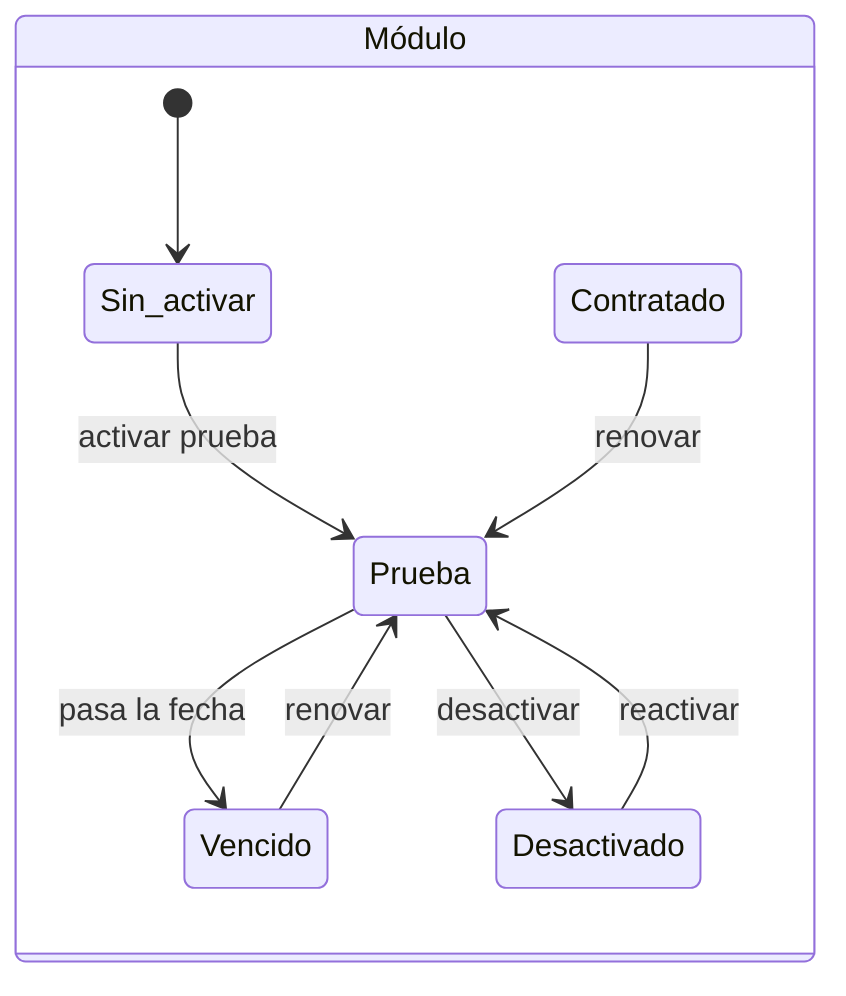

# Organización

Ficha de la [organización](../glosario.md#organización): identidad, datos legales, perfil regulatorio,
responsables de gobierno, parámetros operativos, [comités](../glosario.md#comité), plan y
[módulos](../glosario.md#módulo).

## Propósito

Mantener los datos de la organización y de su gobierno de la IA: quién es el responsable del SGAI, el
DPO y el auditor externo, y qué comités se constituyen. Es también donde se activan los módulos.

## Acceso y permisos

- **Ruta:** `/organizacion`
- **Navegación:** **Configuración › Organización**. También desde la guía de primeros pasos del
  [Dashboard](dashboard.md) (foco Gobernanza).
- **Disponibilidad:** Core.

| Rol | Ver | Acciones permitidas |
|---|---|---|
| Administrador | Todas las pestañas | Editar los datos de la organización, subir el logotipo, gestionar comités y módulos |
| Responsable del SGAI, CAIO | Todas las pestañas | Gestionar comités |
| Resto de roles | Todas las pestañas, en solo lectura | — (aviso «Contacta a un administrador para modificar estos datos.») |

## Campos

La vista tiene ocho pestañas. Las cinco primeras se guardan con **Guardar cambios**.

### Identidad

| Campo | Tipo | Obligatorio | Descripción y valores | Origen (`tabla.columna`) |
|---|---|---|---|---|
| **Nombre de la Organización** | texto | Sí | — | `organizations.name` |
| **ID Interno (Slug)** | texto | Sí | Solo minúsculas, números y guiones. Único | `organizations.slug` |
| **Logotipo de la organización** | fichero | No | PNG, JPG, SVG o WebP, máximo 2 MB | `organizations.logo_url` (bucket `organization-logos`) |

### Datos legales

| Campo | Tipo | Obligatorio | Descripción y valores | Origen (`tabla.columna`) |
|---|---|---|---|---|
| **Razón social** | texto | No | Nombre en el Registro Mercantil | `organizations.legal_name` |
| **CIF / NIF** | texto | No | Mayúsculas | `organizations.tax_id` |
| **Número de IVA intracomunitario** | texto | No | Mayúsculas | `organizations.vat_number` |
| **LEI (Legal Entity Identifier)** | texto | No | 20 caracteres (ISO 17442). Obligatorio para entidades financieras reguladas | `organizations.lei_code` |
| **Sitio web corporativo** | URL | No | — | `organizations.website` |
| **Descripción de la entidad** | texto largo | No | — | `organizations.description` |
| Domicilio fiscal: **Dirección**, **Ciudad**, **Código postal**, **País** | texto | No | — | `organizations.registered_address` (JSON) |

### Perfil regulatorio

| Campo | Tipo | Obligatorio | Descripción y valores | Origen (`tabla.columna`) |
|---|---|---|---|---|
| **Sector de la Empresa** | selector | No | Los 21 sectores del onboarding | `organizations.sector` |
| **País principal** | selector | No | Los 27 países de la UE | `organizations.country` |
| **Volumen de Empleados** | selector | No | Micro (1-10) · Pequeña (11-50) · Mediana (51-250) · Grande (251-1000) · Enterprise (+1000) | `organizations.size` |
| **Alcance geográfico** | selección múltiple | No | Países de la UE donde opera, además del principal | `organizations.geography` |
| **Módulos normativos** | selección múltiple | No | AI Act, ISO 42001, DORA, RGPD, ENS, MDR/IVDR | `organizations.normative_modules` ([marcos aplicables](../glosario.md#marco-aplicable)) |
| **Apetito al riesgo** | selección única | No | Conservador · Moderado (por defecto) · Amplio | `organizations.apetito_riesgo` |

> TODO: confirmar los valores de tamaño y país.
> - **Tamaño:** usa cinco valores, distintos de los tres del [Onboarding](onboarding.md).
> - **País:** la vista propone «España» por defecto, pero las opciones y la base de datos usan «Espana»
>   sin tilde, de modo que el selector puede quedar sin opción marcada.

### Gobernanza

| Campo | Tipo | Obligatorio | Descripción y valores | Origen (`tabla.columna`) |
|---|---|---|---|---|
| Responsable del SGAI: **Nombre completo**, **Email de contacto** | texto, email | No | — | `organizations.settings.sgai_responsible`, `settings.sgai_email` |
| DPO: **Nombre completo**, **Email del DPO**, **Teléfono del DPO** | texto, email, teléfono | No | — | `organizations.dpo_name`, `dpo_email`, `dpo_phone` |
| Auditor externo: **Nombre / Empresa auditora**, **Contacto**, **Certificación / Acreditación** | texto | No | — | `organizations.external_auditor_name`, `external_auditor_contact`, `external_auditor_cert` |

### Operaciones

| Campo | Tipo | Obligatorio | Descripción y valores | Origen (`tabla.columna`) |
|---|---|---|---|---|
| **Inicio del ejercicio fiscal** | selector | No | Enero a Diciembre. Por defecto Enero | `organizations.settings.fiscal_year_start` |
| **Idioma de los documentos** | selector | No | Español (por defecto) o English | `organizations.settings.report_language` |
| **Documentos de evidencia** | selector | No | 1, 2, 3, 5, 7 o 10 años. Por defecto 7 | `organizations.evidence_retention_months` |
| **Logs de auditoría** | selector | No | Ídem. Por defecto 3 | `organizations.audit_log_retention_months` |
| **Datos personales procesados** | selector | No | Ídem. Por defecto 5 | `organizations.personal_data_retention_months` |
| **Color principal** | color | No | Por defecto #00ADEF | `organizations.settings.brand_primary_color` |
| **Texto del pie de página** | texto largo | No | — | `organizations.settings.doc_footer_text` |

La vista advierte de que las retenciones son una política declarada y no borran datos.

> TODO: confirmar el efecto de los campos de Gobernanza y Operaciones.
> - Los responsables de gobierno, el ejercicio fiscal, el idioma, el color y el pie de página se guardan,
>   pero ninguna otra parte de la aplicación los usa todavía. Esto incluye los documentos generados.
> - Las ayudas citan efectos que no existen: «Agente 3», «ciclos de revisión FMEA», «cabeceras de
>   informes».
> - Las retenciones se editan también en [Ajustes](ajustes.md) › Auditoría.

### Comités

Hay tres tipos. Cada uno se puede constituir una sola vez por organización:

| Tipo | Descripción |
|---|---|
| Comité de IA | Supervisión operacional del SGAI. Revisa inventario, riesgos y tratamientos |
| Comité de Riesgos de IA | Integración con el comité de riesgos corporativo. Revisa FMEA y apetito al riesgo |
| Revisión por la Dirección | ISO/IEC 42001, §9.3. Revisión periódica por la alta dirección |

| Campo | Tipo | Obligatorio | Descripción y valores | Origen (`tabla.columna`) |
|---|---|---|---|---|
| **Nombre del comité** | texto | Sí | Por defecto, el nombre del tipo | `committees.name` |
| **Descripción** | texto largo | No | — | `committees.description` |
| **Cadencia de sesiones** | botones | No | Mensual · Trimestral (por defecto) · Semestral · Anual | `committees.cadence_months` |
| **Fecha de constitución** | fecha | No | — | `committees.established_at` |
| **Comité activo** | casilla | No | Solo al editar | `committees.is_active` |
| Miembro interno: **Miembro** | selector | Sí | Miembros de la organización que no están ya en el comité | `committee_members.profile_id` |
| Miembro externo: **Nombre completo**, **Email**, **Organización**, **Cargo / Descripción** | texto | Email obligatorio | — | `committee_members.external_*` |
| **Rol en el comité** | selector | — | Presidente · Secretario · Miembro (por defecto) · Asesor | `committee_members.committee_role` |

### Plan

En solo lectura: plan activo (Starter, Pro o Enterprise), fecha de inicio y vigencia. Para cambiarlo hay
que contactar con el equipo de Fluxion.

### Módulos

Lista de módulos por grupo (Integración, Supervisión, Cumplimiento), cada uno con su estado:
- **Prueba · hasta {fecha}**;
- **Contratado**;
- **Desactivado**;
- **Vencido {fecha}**;
- **En construcción**, para los no disponibles.

El administrador elige la **Duración de la prueba**: 30 (por defecto), 60, 90 o 120 días.

> **Pendiente de implementar.** Nombres y estructura de módulos de negocio
> (ver [Módulos y planes](../negocio/modulos-y-planes.md)). La vista usa todavía los nombres anteriores
> (Conector MLOps, Detección de Shadow AI, Telemetría y evaluación, Auditoría de discordancias,
> Documentación regulatoria). Flujos de aprobación ya no aparece en la lista: es Core.

## Acciones

| Acción | Quién | Qué hace | Efectos |
|---|---|---|---|
| **Guardar cambios** (pestañas 1 a 5) | Administrador | `updateOrganizationProfile` | Actualiza `organizations`; `settings` se fusiona con lo existente. Auditoría `org.settings_updated` |
| Subir logotipo | Administrador | `POST /api/organization/upload-logo` | Guarda el logo en el momento, sin esperar a **Guardar cambios** |
| **Constituir** / **Editar** comité | Administrador, Responsable del SGAI, CAIO | `upsertCommittee` | Auditoría `org.committee_created` / `org.committee_updated` |
| **Añadir miembro** | Ídem | Alta en `committee_members` | Sin auditoría |
| **Eliminar del comité** | Ídem | Baja lógica: `is_active = false`, con fecha de salida | Sin confirmación ni auditoría |
| **Activar prueba** / **Renovar** / **Reactivar** | Administrador | `setOrganizationModule` | Estado `trial` con fecha de fin = hoy + duración. Auditoría `org.module_granted`. El menú se actualiza |
| **Desactivar** | Administrador | `setOrganizationModule` | Estado `disabled`, sin confirmación. Auditoría `org.module_revoked` |

> TODO: confirmar dos comportamientos de módulos y comités.
> - **Renovar un módulo contratado** lo pasa a «en prueba».
> - **Volver a añadir a un miembro interno dado de baja** falla con «Este miembro ya está en el comité»,
>   aunque el selector lo ofrece.

## Validaciones

| Situación | Mensaje |
|---|---|
| Sin permisos al guardar | «No tienes permisos de administrador para realizar esta acción.» |
| Logotipo de formato no admitido | «Formato no soportado. Usa PNG, JPG, SVG o WebP.» |
| Logotipo de más de 2 MB | «El archivo supera el límite de 2 MB.» |
| Comité sin nombre | «El nombre es obligatorio.» |
| Miembro interno sin seleccionar | «Selecciona un miembro.» |
| Miembro externo sin correo | «El email es obligatorio para miembros externos.» |
| Miembro duplicado | «Este miembro ya está en el comité.» |
| Módulo no disponible | «Ese módulo aún no está disponible.» |
| Guardado correcto | «Organización actualizada correctamente.» |

No se valida el formato de correos, URL, LEI, NIF ni color. Un `slug` duplicado devuelve el error de la
base de datos.

## Estados

- **Contratado** no se puede asignar desde la vista.
- **Comité:** no constituido, activo o inactivo.
- **Miembro del comité:** activo o dado de baja.

## Vistas relacionadas

- [Onboarding](onboarding.md): primera carga de estos datos.
- [Usuarios](usuarios.md): miembros que pueden formar parte de los comités.
- [Ajustes](ajustes.md): políticas de aprobación que usan los comités y retenciones.
- [Navegación](navegacion.md): entradas que dependen de los módulos.
- Negocio: [Plataforma](../negocio/plataforma.md), [Módulos y planes](../negocio/modulos-y-planes.md).
