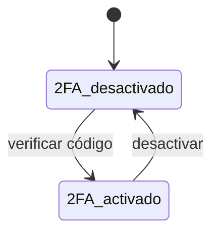

# Perfil

Datos personales, cuenta, seguridad y preferencias de la persona que usa Fluxion.

## Propósito

Que cada [miembro](../glosario.md#miembro) mantenga su identidad dentro de la organización (nombre, foto,
cargo, responsable) y configure su seguridad (contraseña, verificación en dos pasos, sesiones) y su
experiencia (región, avisos, tema visual).

## Acceso y permisos

- **Ruta:** `/perfil`
- **Navegación:** menú de usuario de la barra superior › **Mi Perfil**.
- **Disponibilidad:** Core.

| Rol | Ver | Acciones permitidas |
|---|---|---|
| Todos los roles | Su propio perfil | Editar sus datos, seguridad y preferencias |

## Campos

La vista tiene seis pestañas. Todas, salvo **Seguridad**, se guardan con **Guardar cambios**.

### Información personal

| Campo | Tipo | Obligatorio | Descripción y valores | Origen (`tabla.columna`) |
|---|---|---|---|---|
| Foto | fichero | No | PNG, JPG o WebP, máximo 2 MB | Bucket `user-avatars`; URL en `profiles.avatar_url` |
| **Nombre** | texto | No | — | `profiles.first_name` |
| **Apellidos** | texto | No | — | `profiles.last_name` |
| **Cargo / Puesto** | texto | No | Placeholder «Ej. Director de Riesgos» | `profiles.preferences.job_title` |
| **Departamento** | texto | No | Placeholder «Ej. Compliance / IT» | `profiles.preferences.department` |
| **Roles** | solo lectura | — | Todos los [roles](../glosario.md#rol) del usuario. Se gestionan en [Usuarios](usuarios.md) | `profiles.roles` |
| **Bio corta** | texto largo | No | Contador de 280 caracteres. Aparece en el detalle del miembro en [Usuarios](usuarios.md) | `profiles.bio` |
| **Manager** | selector | No | «Sin asignar» o un miembro activo de la organización | `profiles.manager_id` |
| **Pronombres** | texto | No | Placeholder «Ej. ella, él, elle» | `profiles.pronouns` |

> TODO: confirmar el destino de **Cargo / Puesto** y **Departamento**. Existen las columnas
> `profiles.job_title` y `profiles.department`, que tienen prioridad al leer, pero la vista guarda en
> `preferences`. Si la columna tiene valor, el cambio no se ve.

### Cuenta

| Campo | Tipo | Obligatorio | Descripción y valores | Origen (`tabla.columna`) |
|---|---|---|---|---|
| Email primario | solo lectura | — | — | `auth.users.email` |
| Miembro desde | solo lectura | — | — | `profiles.created_at` |
| Organización | solo lectura | — | — | `organizations.name` |
| **Teléfono** | teléfono | No | «Se usa para escalados de incidentes» | `profiles.phone` |
| **Email alternativo** | email | No | — | `profiles.secondary_email` |

> TODO: confirmar el uso del **Email alternativo**. La ayuda dice que las notificaciones también llegarán
> a esa dirección, pero el envío de correos solo usa el email primario.

### Seguridad

| Bloque | Campos | Descripción |
|---|---|---|
| **Contraseña** | Contraseña actual · Nueva contraseña · Confirmar nueva contraseña | Mínimo 8 caracteres |
| **Autenticación de dos factores** | Estado «2FA activado» o «2FA desactivado» | Con una app TOTP: Google Authenticator, Authy, 1Password… |
| **Sesiones activas** | Sesión actual y último acceso | — |

### Preferencias

| Campo | Tipo | Obligatorio | Descripción y valores | Origen (`tabla.columna`) |
|---|---|---|---|---|
| **Zona horaria** | selector | No | 12 ciudades europeas y UTC. Por defecto Madrid | `profiles.preferences.timezone` |
| **Idioma de la interfaz** | selector deshabilitado | — | Solo Español («Más idiomas disponibles próximamente») | No se guarda |
| **Formato de fecha** | selector | No | DD/MM/YYYY (por defecto), MM/DD/YYYY, YYYY-MM-DD, D MMM YYYY | `profiles.preferences.date_format` |
| **Primer día de la semana** | selector | No | Lunes (por defecto) o Domingo | `profiles.preferences.week_starts_on` |

> TODO: confirmar el efecto de la zona horaria, el formato de fecha y el primer día de la semana. Se
> guardan, pero ninguna otra vista los usa. [Ajustes](ajustes.md) › Mi cuenta guarda además otras
> preferencias equivalentes con distinto formato.

### Notificaciones

Matriz de eventos con dos columnas, **Email** e **In-app**, cada una con **Pausar todo** / **Reanudar
todo**. Todos los eventos están activados por defecto. Se guarda en
`profiles.preferences.notification_prefs`.

| Categoría | Eventos |
|---|---|
| Asignaciones | Acción asignada a mí · Tarea asignada a mí |
| Aprobaciones | Plan pendiente de mi aprobación · Decisión sobre mis planes |
| Vencimientos | Acción vencida · Revisión periódica próxima · Evidencia por caducar |
| Resúmenes | Resumen semanal (solo correo) |

Ver el TODO sobre preferencias en [Notificaciones](notificaciones.md#estados).

### Apariencia

| Campo | Tipo | Obligatorio | Descripción y valores | Origen (`tabla.columna`) |
|---|---|---|---|---|
| **Tema** | tarjetas | No | Claro (por defecto) · Oscuro · Sistema. Se previsualiza al instante | `profiles.preferences.theme` |
| **Densidad de tablas** | tarjetas | No | Cómoda (por defecto) · Compacta | `profiles.preferences.table_density` |

El tema oscuro se aplica al área de contenido; el menú lateral y la barra superior conservan su estilo.

## Acciones

| Acción | Quién | Qué hace | Efectos |
|---|---|---|---|
| **Guardar cambios** | El propio usuario | `updateProfile` | Actualiza su fila de `profiles`. `full_name` se recalcula como nombre y apellidos. El rol solo cambia si es `org_admin`. Sin registro de auditoría |
| Subir foto | El propio usuario | `POST /api/user/upload-avatar` | Sube el fichero, pero no lo guarda en el perfil hasta pulsar **Guardar cambios** |
| Eliminar foto (X) | El propio usuario | Vacía la foto en el formulario | Se aplica al guardar; el fichero no se borra |
| **Cambiar contraseña** | El propio usuario | `changePasswordAction` | Comprueba la contraseña actual y la cambia. Sin auditoría |
| **Activar 2FA** | El propio usuario | Asistente: escanear el código QR (o copiar el secreto) e introducir el código de 6 dígitos | Activa el factor TOTP en Supabase Auth |
| **Desactivar 2FA** | El propio usuario | Pide confirmación y desactiva el factor | — |
| **Cerrar sesión en otros dispositivos** | El propio usuario | Pide confirmación y ejecuta `signOutOtherSessionsAction` | Cierra el resto de sesiones de la cuenta |

> **Pendiente de implementar.**
> - **2FA en el inicio de sesión:** la pantalla dice «Se requerirá un código TOTP en cada inicio de
>   sesión», pero el inicio de sesión no lo pide.
> - **Avatar:** guardarlo en el perfil al subirlo.

> TODO: confirmar el destino de las preferencias al guardar. **Guardar cambios** reemplaza todas las
> preferencias del usuario, incluidas las que guarda [Ajustes](ajustes.md), que se pierden.

## Validaciones

| Situación | Mensaje |
|---|---|
| Email alternativo con formato incorrecto | «El email alternativo no tiene un formato válido.» |
| Nueva contraseña con menos de 8 caracteres | «La nueva contraseña debe tener al menos 8 caracteres.» |
| La confirmación no coincide | «La nueva contraseña y la confirmación no coinciden.» |
| Nueva contraseña igual a la actual | «La nueva contraseña debe ser distinta de la actual.» |
| Contraseña actual incorrecta | «La contraseña actual no es correcta.» |
| Foto de otro formato | «Usa PNG, JPG o WebP.» |
| Foto de más de 2 MB | «Máximo 2 MB.» |
| Código 2FA incorrecto | «Código incorrecto. Comprueba que el reloj de tu dispositivo está sincronizado.» |
| Guardado correcto | «Perfil actualizado correctamente.» |

## Estados

## Vistas relacionadas

- [Navegación](navegacion.md): acceso desde el menú de usuario.
- [Ajustes](ajustes.md): preferencias personales de cuenta, avisos y sesiones.
- [Usuarios](usuarios.md): detalle del miembro, que muestra la bio y el manager.
- Negocio: [Plataforma](../negocio/plataforma.md).
