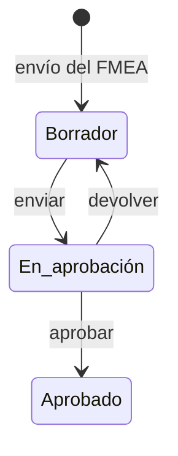

# Plan de tratamiento

Pantalla del [plan de tratamiento](../glosario.md#plan-de-tratamiento) de una evaluación FMEA. Desde ella
se decide una [opción de tratamiento](../glosario.md#opción-de-tratamiento) por modo de fallo, se envía
el plan a aprobación, se aprueba o se devuelve, se sigue su ejecución y se registran las revisiones
periódicas.

## Propósito

Convertir los modos de fallo que requieren tratamiento en
[acciones de tratamiento](../glosario.md#acción-de-tratamiento) con responsable, plazo, control y
evidencia, y obtener la aprobación del nivel que corresponda.

## Acceso y permisos

- **Ruta:** `/inventario/[id]/fmea/[evaluationId]/plan`. Con `?action=` abre esa acción.
- **Navegación:**
  - al enviar la [Evaluación FMEA](fmea-evaluacion.md);
  - desde la [Ficha del sistema](ficha-sistema.md) (**Gestionar plan**);
  - desde [Planes de tratamiento](planes-de-tratamiento.md) y [Revisiones pendientes](revisiones-pendientes.md);
  - desde las brechas de control.
- **Disponibilidad:** Core.

| Rol | Ver | Acciones permitidas |
|---|---|---|
| Analista de riesgos, Responsable del sistema | Sí | Editar el plan en borrador y enviarlo |
| Aprobador asignado (sin política: Responsable del SGAI) | Sí | Aprobar o devolver el plan en revisión |
| Todos los roles | Sí | Gestionar evidencias, estado de tareas, severidad residual y revisiones periódicas |

Permisos según la decisión DP-01 (bloque B01): quien prepara no aprueba y el DPO es consultivo, así que no
edita el plan. Para los demás roles la vista se muestra en solo lectura.

**Aprobador sin política** en Flujos de aprobación: un Responsable del SGAI activo distinto de quien envía,
en cualquier nivel. Si no hay ninguno, el envío se rechaza (ver Validaciones). Los niveles 2 y 3 los aprueba
un comité según DP-01, lo que exige una política de Flujos de aprobación.

> **Pendiente de implementar.** Políticas por defecto con los comités de los niveles 2 y 3 (bloque B11).

Si la evaluación todavía no tiene plan, la vista muestra un **Borrador de Previsualización** con los
modos de severidad 7 o más.

El plan solo se puede editar en borrador. En el resto de estados se muestra en solo lectura.

## Campos

### Cabecera e indicadores

| Bloque | Contenido |
|---|---|
| Cabecera | Nombre del sistema; código del plan (PTR-…), versión de la evaluación y código del sistema |
| Barra de estado | Zona proyectada, [nivel de aprobación](../glosario.md#nivel-de-aprobación), fecha límite, acciones definidas, tareas completadas, estado del plan, zona al crear, suelo AI Act, pendientes, cadencia, aprobador asignado |
| Eficacia | Acciones vencidas, que vencen en 7 días, tasa de slippage (mitigaciones cerradas sin severidad residual o por encima del objetivo) y mediana de días de cierre |
| **Progreso de ejecución** | % de acciones completadas o aceptadas, contadores por estado, días restantes, acciones vencidas, tareas vinculadas |
| Avisos | Revisiones vencidas o próximas; acciones vencidas; Zona I (requiere alta dirección y referencia de acta); acciones sin definir o incompletas |
| **Riesgo residual asumido** | Texto libre (`treatment_plans.residual_risk_notes`) y resumen: acciones candidatas, aceptaciones, nivel requerido |

### Acciones

Pestañas **Acciones** e **Historial de auditoría**. Las acciones se agrupan en tres bloques según la
severidad actual del modo:
- **Tratamiento crítico · S_actual = 9**;
- **Tratamiento prioritario · S_actual = 8**;
- **Tratamiento relevante · S_actual = 7**.

Filtros: **Vencidas**, **Vencen pronto**, **Slippage**.

| Columna | Descripción y valores | Origen (`tabla.columna`) |
|---|---|---|
| S | Severidad al crear la acción | `treatment_actions.s_actual_at_creation` |
| Modo | Nombre, código, dimensión y bloque | `compliance.failure_modes` |
| Zona | Zona I (9), Zona II (8), Zona III / IV | — |
| Opción | Mitigar · Aceptar · Transferir · Evitar · Diferir · Pendiente | `option` |
| Tarea | Estado de la tarea vinculada (editable) | `tasks.status` |
| Revisión | Revisión vencida · Revisar hoy · Revisión próxima, con botón **Revisar** | `review_due_date` |

### Detalle de la acción

| Campo | Tipo | Obligatorio | Descripción y valores | Origen (`tabla.columna`) |
|---|---|---|---|---|
| **Decisión de tratamiento** | 5 botones | Sí | Mitigar · Aceptar (no disponible con severidad 9) · Transferir · Evitar · Diferir | `option` |
| **Controles sugeridos** | lista | Sí, en Mitigar (uno de los sugeridos o un control propio) | [Plantillas de control](../glosario.md#plantilla-de-control) asociadas al modo. Indica si el control ya existe en el sistema o se creará | `control_id` |
| **Control propio** | título y descripción | Título de 5 caracteres o más, si se elige | Control que no está en el catálogo. Se crea para el sistema al guardar la decisión; si la acción ya tenía uno, se actualiza | `controls.title`, `controls.description` (sin `template_id`) |
| **S residual objetivo** | deslizador | Sí, en Mitigar | De 1 a la severidad actual − 1. Por defecto, la actual − 2 | `s_residual_target` |
| **Justificación y trazabilidad** | texto largo | Sí, salvo en Mitigar | Aceptar: 100 caracteres mínimo. Transferir, Evitar y Diferir: 50. Diferir más de 90 días: 100 | `justification` |
| **Responsable** | selector | Sí | Miembros de la organización | `owner_id` |
| **Fecha objetivo** | fecha | Sí | No puede superar la fecha límite del plan | `due_date` |
| **Fecha de revisión** | fecha | Sí, en Aceptar | — | `review_due_date` |
| **Evidencia** | fichero (máx. 20 MB) o URL | No | Con la evidencia esperada según la opción. Estado: Pendiente de validar, Validada, Rechazada | `treatment_actions.evidence_id` → `evidences` |

> TODO: confirmar la fecha de revisión de «Diferir». La opción se considera revisable, pero solo «Aceptar»
> guarda fecha de revisión, así que las acciones pospuestas nunca entran en
> [Revisiones pendientes](revisiones-pendientes.md).

## Acciones

| Acción | Quién | Qué hace | Efectos |
|---|---|---|---|
| **Guardar decisión** | Editor del plan | `saveTreatmentActionDecision`. En Mitigar reutiliza el control del sistema o crea uno en estado «Planificado» | Evento «Opción seleccionada». Historial «Decisión de tratamiento guardada» |
| Guardado automático (30 s tras cada cambio) | Editor del plan | Guarda las acciones modificadas y el riesgo residual, sin validar | — |
| **Guardar borrador** | Editor del plan | Guarda el riesgo residual y la zona objetivo | Historial «Borrador del plan guardado» |
| **Enviar a aprobación** / **Enviar a alta dirección** (nivel 3) | Editor del plan | `submitTreatmentPlanForApproval`. En nivel 3 pide la referencia del acta o comité | Plan «En aprobación», con aprobador asignado. Si hay política en [Flujos de aprobación](../glosario.md#flujos-de-aprobación), abre la solicitud y avisa al primer paso. Guarda una [instantánea](../glosario.md#instantánea) |
| **Aprobar plan** | Aprobador asignado | Con notas de comité opcionales | Plan «Aprobado». Instantánea. Historial «Plan de tratamiento aprobado» |
| **Devolver al autor** | Aprobador asignado | Con motivo obligatorio | Plan a «Borrador», con el motivo visible. Instantánea. Historial «Plan devuelto al autor» |
| Cambiar estado de la tarea | Todos | Actualiza la tarea vinculada | Al completarla, la acción pasa a «Completada». En Mitigar abre **Registrar S residual alcanzado** |
| **Cerrar acción** (S residual) | Todos | Registra la severidad residual alcanzada, o marca que no se pudo medir | Cierra la acción y la tarea. Si hay evidencia, la severidad residual pasa al ítem del FMEA |
| Subir / vincular / desvincular evidencia | Todos | Gestiona la evidencia de la acción | Sin evento ni historial |
| **Revisar** (revisión periódica) | Todos | Decisión: Reafirmar aceptación (con nueva fecha) · Cambiar a Mitigar · Transferir · Evitar · Escalar a comité. Justificación de 80 caracteres | Registro en `treatment_action_reviews`. Evento «periodic_review» |
| **Reasignar** · **Due date** · **Cambiar opción** (en bloque) | Editor del plan | Sobre las acciones seleccionadas no cerradas. Mitigar no se admite en bloque | Eventos por acción e historial del cambio masivo |
| **Exportar CSV** · **Imprimir PDF** | Todos | Descargan las acciones o imprimen la página | — |

> **Pendiente de implementar.**
> - **Aviso al escalar:** al escalar una revisión no se avisa al aprobador, aunque la vista lo promete.
> - **Integración completa con Flujos de aprobación:** si hay una solicitud abierta, el aprobador sigue
>   viendo aquí los botones, que fallan con «Este plan está en un circuito de aprobación. Decide desde
>   Aprobaciones.»

> TODO: confirmar la creación de tareas. Los textos y el diseño suponen que cada acción, salvo las
> aceptadas, genera una tarea. Pero las acciones se crean sin opción y la regla de la base de datos solo
> crea la tarea al insertar una acción con opción, así que no se crea ninguna automáticamente.

> TODO: confirmar el comportamiento de **Guardar borrador**. No guarda las decisiones de las acciones,
> aunque la vista las marca como guardadas: solo las guarda el guardado automático o **Guardar decisión**.

> TODO: confirmar los nombres de los responsables. La vista guarda un identificador de usuario y busca los
> nombres por otro, así que pueden aparecer como «Usuario». El reasignado en bloque también puede fallar
> por esto.

## Validaciones

| Situación | Mensaje |
|---|---|
| Sin opción elegida | «Selecciona una opción de tratamiento antes de guardar la acción.» |
| Sin responsable / sin fecha | «Debes asignar un responsable para esta acción.» / «Debes definir una fecha objetivo para esta acción.» |
| Fecha posterior al plan | «La fecha objetivo no puede superar la fecha límite global del plan.» |
| Mitigar sin control | «Selecciona un control sugerido o define un control propio para la acción de mitigación.» |
| Control propio con título corto | «El control propio necesita un título de al menos 5 caracteres.» |
| Objetivo residual no menor que la actual | «El S residual objetivo debe ser menor que el S actual del modo de fallo.» |
| Aceptar con severidad 9 | «Los modos con S_actual = 9 no pueden marcarse como aceptados.» |
| Aceptar con justificación corta o sin fecha de revisión | «La aceptación requiere una justificación de al menos 100 caracteres.» / «La aceptación requiere una fecha de revisión obligatoria.» |
| Transferir, Evitar o Diferir con justificación corta | «Necesitas una justificación de al menos 50 caracteres para documentar esta decisión.» |
| Diferir más de 90 días | «Un diferimiento superior a 90 días requiere una justificación reforzada de al menos 100 caracteres.» |
| Envío con acciones sin definir | «Debes definir N acción/acciones antes de enviarlo a aprobación.» |
| Zona I sin acta | «Los planes de Zona I requieren una referencia de acta o comité antes de enviarse a alta dirección.» |
| Aprobar sin ser el aprobador | «No eres el aprobador asignado a este plan.» |
| Devolver sin motivo | «Debes indicar el motivo de devolución para que el autor pueda corregir el plan.» |
| Editar sin permiso | «No tienes permisos para editar este plan de tratamiento: lo preparan el Analista de riesgos y el Responsable del sistema.» |
| Envío sin aprobador ni política | «No hay ningún miembro activo con rol Responsable del SGAI (distinto de quien envía) para aprobar el plan. Asigna ese rol en Usuarios, o configura una política de plan de tratamiento en Ajustes › Aprobaciones.» |
| Evidencia de más de 20 MB | «El archivo no puede superar los 20 MB.» |

## Estados

- **Estados del plan sin flujo:** «En ejecución», «Cerrado» y «Sustituido» existen, pero ningún flujo los
  asigna.
- **Estados de la acción que se usan:** «Pendiente» y «Completada».

### Historial de auditoría

| Elemento | Contenido |
|---|---|
| Instantáneas | Enviado a aprobación · Aprobado · Devuelto al autor |
| Decisiones | Opción seleccionada · Responsable cambiado · Fecha objetivo cambiada · S residual alcanzado registrado · Slippage aceptado · Tarea actualizada |
| Detalle de cada instantánea | Plan y acciones en ese momento, con **Comparar con anterior** |

## Vistas relacionadas

- [Evaluación FMEA](fmea-evaluacion.md): origen del plan.
- [Planes de tratamiento](planes-de-tratamiento.md), [Revisiones pendientes](revisiones-pendientes.md).
- Aprobaciones y Tareas (documentos pendientes).
- Negocio: [Plan de tratamiento](../negocio/plan-de-tratamiento.md),
  [Flujos de aprobación](../negocio/flujos-de-aprobacion.md).
