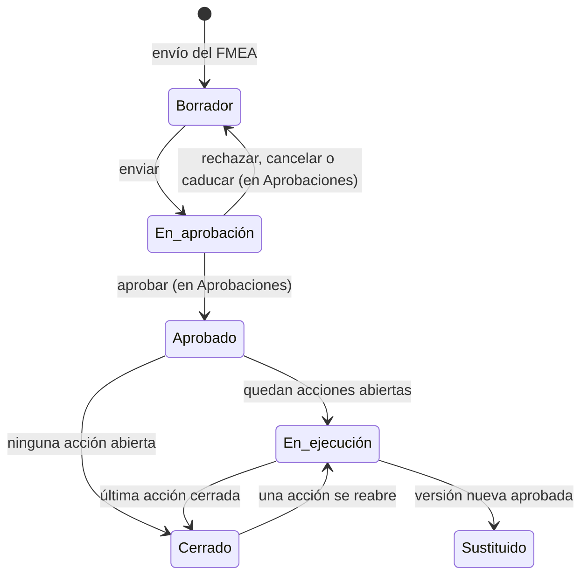

# Plan de tratamiento

Pantalla del [plan de tratamiento](../glosario.md#plan-de-tratamiento) de una evaluación FMEA. Desde ella
se decide una [opción de tratamiento](../glosario.md#opción-de-tratamiento) por modo de fallo, se envía
el plan a aprobación, se aprueba o se devuelve, se sigue su ejecución y se registran las revisiones
periódicas.

## Propósito

Convertir los modos de fallo que requieren tratamiento en
[acciones de tratamiento](../glosario.md#acción-de-tratamiento) con responsable, plazo, control y
evidencia, y obtener la aprobación del nivel que corresponda.

## Acceso y permisos

- **Ruta:** `/inventario/[id]/fmea/[evaluationId]/plan`. Con `?action=` abre esa acción.
- **Navegación:**
  - al enviar la [Evaluación FMEA](fmea-evaluacion.md);
  - desde la [Ficha del sistema](ficha-sistema.md) (**Gestionar plan**);
  - desde [Planes de tratamiento](planes-de-tratamiento.md) y [Revisiones pendientes](revisiones-pendientes.md);
  - desde las brechas de control.
- **Disponibilidad:** Core.

| Rol | Ver | Acciones permitidas |
|---|---|---|
| Analista de riesgos, Responsable del sistema | Sí | Editar el plan en borrador y enviarlo |
| Todos los roles | Sí | Gestionar evidencias, estado de tareas, severidad residual y revisiones periódicas |

Permisos según la decisión DP-01 (bloque B01): quien prepara no aprueba y el DPO es consultivo, así que no
edita el plan. Para los demás roles la vista se muestra en solo lectura. El plan se aprueba o se devuelve
siempre en [Aprobaciones](aprobaciones.md), con la política de su nivel (B11e); esta vista no tiene botones
de aprobación.

**Aprobador sin política** en Flujos de aprobación: un Responsable del SGAI activo distinto de quien envía,
en cualquier nivel. Si no hay ninguno, el envío se rechaza (ver Validaciones). Los niveles 2 y 3 los aprueba
un comité según DP-01, lo que exige una política de Flujos de aprobación.

> **Pendiente de implementar.** Políticas por defecto con los comités de los niveles 2 y 3 (bloque B11).

Si la evaluación todavía no tiene plan, la vista muestra un **Borrador de Previsualización** con los
modos de severidad 7 o más.

El plan solo se puede editar en borrador. En el resto de estados se muestra en solo lectura.

## Campos

### Cabecera e indicadores

| Bloque | Contenido |
|---|---|
| Cabecera | Nombre del sistema; código del plan (PTR-…), versión de la evaluación y código del sistema |
| Barra de estado | Zona proyectada, [nivel de aprobación](../glosario.md#nivel-de-aprobación), fecha límite, acciones definidas, tareas completadas, estado del plan, zona al crear, suelo AI Act, pendientes, cadencia, **Aprobado por** (quien emitió la decisión final; «Pendiente en Aprobaciones» mientras está en revisión, «—» antes) |
| Eficacia | Acciones vencidas, que vencen en 7 días, tasa de slippage (mitigaciones cerradas sin severidad residual o por encima del objetivo) y mediana de días de cierre |
| **Progreso de ejecución** | % de acciones completadas o aceptadas, contadores por estado, días restantes, acciones vencidas, tareas vinculadas |
| Avisos | Revisiones vencidas o próximas; acciones vencidas; Zona I (la aprueba la Revisión por la Dirección en Aprobaciones; el acta se genera al cerrarse); acciones sin definir o incompletas |
| **Riesgo residual asumido** | Texto libre (`treatment_plans.residual_risk_notes`) y resumen: acciones candidatas, aceptaciones, nivel requerido |

### Acciones

Pestañas **Acciones** e **Historial de auditoría**. Las acciones se agrupan en tres bloques según la
severidad actual del modo:
- **Tratamiento crítico · S_actual = 9**;
- **Tratamiento prioritario · S_actual = 8**;
- **Tratamiento relevante · S_actual = 7**.

Filtros: **Vencidas**, **Vencen pronto**, **Slippage**.

| Columna | Descripción y valores | Origen (`tabla.columna`) |
|---|---|---|
| S | Severidad al crear la acción | `treatment_actions.s_actual_at_creation` |
| Modo | Nombre, código, dimensión y bloque | `compliance.failure_modes` |
| Zona | Zona I (9), Zona II (8), Zona III / IV | — |
| Opción | Mitigar · Aceptar · Transferir · Evitar · Diferir · Pendiente | `option` |
| Tarea | Estado de la tarea vinculada (editable) | `tasks.status` |
| Revisión | Revisión vencida · Revisar hoy · Revisión próxima, con botón **Revisar** | `review_due_date` |

### Detalle de la acción

| Campo | Tipo | Obligatorio | Descripción y valores | Origen (`tabla.columna`) |
|---|---|---|---|---|
| **Decisión de tratamiento** | 5 botones | Sí | Mitigar · Aceptar (no disponible con severidad 9) · Transferir · Evitar · Diferir | `option` |
| **Controles sugeridos** | lista | Sí, en Mitigar (uno de los sugeridos o un control propio) | [Plantillas de control](../glosario.md#plantilla-de-control) asociadas al modo. Indica si el control ya existe en el sistema o se creará | `control_id` |
| **Control propio** | título y descripción | Título de 5 caracteres o más, si se elige | Control que no está en el catálogo. Se crea para el sistema al guardar la decisión; si la acción ya tenía uno, se actualiza | `controls.title`, `controls.description` (sin `template_id`) |
| **S residual objetivo** | deslizador | Sí, en Mitigar | De 1 a la severidad actual − 1. Por defecto, la actual − 2 | `s_residual_target` |
| **Justificación y trazabilidad** | texto largo | Sí, salvo en Mitigar | Aceptar: 100 caracteres mínimo. Transferir, Evitar y Diferir: 50. Diferir más de 90 días: 100 | `justification` |
| **Responsable** | selector | Sí | Miembros de la organización | `owner_id` |
| **Fecha objetivo** | fecha | Sí | No puede superar la fecha límite del plan | `due_date` |
| **Fecha de revisión** | fecha | Sí, en Aceptar y Diferir | — | `review_due_date` |
| **Evidencia** | fichero (máx. 20 MB) o URL | No | Con la evidencia esperada según la opción. Se guarda en la [Biblioteca de evidencias](evidencias.md) (B12), vinculada al sistema, de tipo «Otro» y con la etiqueta `accion-plan`, y nace **Pendiente de revisión** con su solicitud en [Aprobaciones](aprobaciones.md) (sin política, en borrador). Muestra su estado en la biblioteca y **Ver en la biblioteca de evidencias**; si no está válida, avisa de que la severidad residual solo pasa al FMEA con la evidencia válida | `treatment_actions.evidence_id` → `system_evidences.id` |

**Fecha de revisión** es obligatoria en Aceptar y en Diferir («Posponer con revisión»): las dos entran en
[Revisiones pendientes](revisiones-pendientes.md).

## Acciones

| Acción | Quién | Qué hace | Efectos |
|---|---|---|---|
| **Guardar decisión** | Editor del plan | `saveTreatmentActionDecision`. En Mitigar reutiliza el control del sistema o crea uno en estado «Planificado» | Evento «Opción seleccionada». Historial «Decisión de tratamiento guardada» |
| Guardado automático (30 s tras cada cambio) | Editor del plan | Guarda las acciones modificadas y el riesgo residual, sin validar | — |
| **Guardar borrador** | Editor del plan | Guarda el riesgo residual y la zona objetivo | Historial «Borrador del plan guardado» |
| **Enviar a aprobación** / **Enviar a alta dirección** (nivel 3) | Editor del plan | `submitTreatmentPlanForApproval`. Exige una política activa para el nivel. Ya no pide referencia de acta (B11e) | Plan «En aprobación» y solicitud abierta en [Flujos de aprobación](../glosario.md#flujos-de-aprobación), con el contexto `approval_level` y `has_security_controls`; aviso a quien decide el primer paso. Si la solicitud no se abre, el plan vuelve a borrador. Guarda una [instantánea](../glosario.md#instantánea). Historial «Plan enviado a aprobación» y «Solicitud de aprobación emitida» |
| Cambiar estado de la tarea | Todos | Actualiza la tarea vinculada | Al completarla, la acción pasa a «Completada» (también si se completa desde [Tareas](tareas.md)). En Mitigar abre **Registrar S residual alcanzado** |
| **Cerrar acción** (S residual) | Todos, con el plan aprobado | Registra la severidad residual alcanzada, o marca que no se pudo medir. En una mitigación sin tarea vinculada aparece como botón en el detalle de la acción. Si la evidencia no está válida, el diálogo avisa de que la acción quedará «Evidencia pdte.» | Con evidencia **Válida**, cierra la acción y la severidad residual pasa al ítem del FMEA. Sin ella (B12), la acción queda «Evidencia pdte.» y se completa sola, trasladando la severidad, cuando la evidencia se aprueba. Cierra la tarea, si la hay |
| Subir / vincular / desvincular evidencia | Todos | Gestiona la evidencia de la acción (`uploadEvidenceForActionAction`, `linkUrlEvidenceToActionAction`) | La crea en la biblioteca y abre su revisión (`openEvidenceReview`). Sin evento en el plan |
| **Revisar** (revisión periódica) | Todos | Decisión: Reafirmar aceptación (con nueva fecha) · Cambiar a Mitigar · Transferir · Evitar · Escalar a comité. Justificación de 80 caracteres | Registro en `treatment_action_reviews`. Evento «periodic_review». Si una aceptación pasa a tratarse, la acción vuelve a «Pendiente» y el plan se reabre. **Escalar a comité** avisa en la app a quien aprobó el plan en Flujos de aprobación o, si no consta, al Administrador y al Responsable del SGAI: «Revisión de aceptación escalada · {código del plan}» con el motivo (B22, decisión 70) |
| **Reasignar** · **Due date** · **Cambiar opción** (en bloque) | Editor del plan | Sobre las acciones seleccionadas no cerradas. Mitigar no se admite en bloque | Eventos por acción e historial del cambio masivo |
| **Exportar CSV** · **Imprimir PDF** | Todos | Descargan las acciones o imprimen la página | — |

> **Pendiente de implementar.**
> - **Aviso al escalar:** al escalar una revisión no se avisa al aprobador, aunque la vista lo promete.
> - **Integración completa con Flujos de aprobación:** si hay una solicitud abierta, el aprobador sigue
>   viendo aquí los botones, que fallan con «Este plan está en un circuito de aprobación. Decide desde
>   Aprobaciones.»

Cada acción, salvo las aceptadas, tiene su [tarea](../glosario.md#tarea): la base de datos la crea al
decidir la opción, con el responsable y la fecha de la acción, y las mantiene sincronizadas (requiere la
migración `20261019100000`).

**Guardar borrador** guarda las notas del riesgo residual y las acciones modificadas, igual que el
guardado automático. Los controles nuevos (de plantilla o propios) se crean con **Guardar decisión**.

## Validaciones

| Situación | Mensaje |
|---|---|
| Sin opción elegida | «Selecciona una opción de tratamiento antes de guardar la acción.» |
| Sin responsable / sin fecha | «Debes asignar un responsable para esta acción.» / «Debes definir una fecha objetivo para esta acción.» |
| Fecha posterior al plan | «La fecha objetivo no puede superar la fecha límite global del plan.» |
| Mitigar sin control | «Selecciona un control sugerido o define un control propio para la acción de mitigación.» |
| Control propio con título corto | «El control propio necesita un título de al menos 5 caracteres.» |
| Objetivo residual no menor que la actual | «El S residual objetivo debe ser menor que el S actual del modo de fallo.» |
| Aceptar con severidad 9 | «Los modos con S_actual = 9 no pueden marcarse como aceptados.» |
| Aceptar con justificación corta o sin fecha de revisión | «La aceptación requiere una justificación de al menos 100 caracteres.» / «La aceptación requiere una fecha de revisión obligatoria.» |
| Transferir, Evitar o Diferir con justificación corta | «Necesitas una justificación de al menos 50 caracteres para documentar esta decisión.» |
| Diferir más de 90 días | «Un diferimiento superior a 90 días requiere una justificación reforzada de al menos 100 caracteres.» |
| Envío con acciones sin definir | «Debes definir N acción/acciones antes de enviarlo a aprobación.» |
| Editar sin permiso | «No tienes permisos para editar este plan de tratamiento: lo preparan el Analista de riesgos y el Responsable del sistema.» |
| Envío sin política para el nivel | «No hay ninguna política de aprobación activa para el {nivel}. Configúrala en Ajustes › Aprobaciones antes de enviar el plan.» |
| Evidencia de más de 20 MB | «El archivo no puede superar los 20 MB.» |

## Estados

La evaluación FMEA y su plan forman una sola evaluación de riesgos con un ciclo común (DP-03, bloque
B07). Toda evaluación enviada tiene plan, también sin candidatos a tratamiento: entonces el plan no tiene
acciones («No hay acciones de tratamiento pendientes») y su aprobación es la de la evaluación.

**Al aprobarse el plan** en su [flujo de aprobación](aprobaciones.md), con quien emitió la decisión final como
aprobador (`approver_id`) y la referencia `APR-…` del acta, en una sola
transacción de la base de datos (`fmea_aplicar_aprobacion_plan`):
1. Las acciones «Aceptar» quedan «Aceptadas», con el aprobador y la fecha como aprobación de la aceptación.
2. La [evaluación FMEA](fmea-evaluacion.md) pasa a «Aprobada», con su próxima revisión según la cadencia.
3. Las versiones anteriores de la evaluación pasan a «Sustituida». Sus planes abiertos pasan a
   «Sustituido» y sus acciones abiertas se cancelan, con sus tareas. Los planes ya cerrados se quedan
   cerrados.
4. El plan pasa a «En ejecución» o, si no tiene acciones abiertas, a «Cerrado».

Se guardan las instantáneas «Ejecución iniciada» o «Plan cerrado» del plan y «Reemplazado por nuevo plan» de
los planes sustituidos, y
el historial del sistema registra «Evaluación de riesgos aprobada» y, si procede, «Versión anterior
sustituida».

**Después**, el estado de ejecución lo mantiene la base de datos: una acción abierta es la que no está
«Completada», «Aceptada» ni «Cancelada»; el plan está «En ejecución» mientras quede alguna y «Cerrado»
cuando no queda ninguna. Si una acción se reabre, el plan vuelve a «En ejecución».

- **Estados de la acción que se usan:** «Pendiente», «En curso» (desde la tarea), «Completada»,
  «Aceptada» y «Cancelada».
- **Versiones:** la barra de versiones de la [Evaluación FMEA](fmea-evaluacion.md#versiones) aparece
  también aquí, con **Nueva versión** en la versión vigente. Si la evaluación se envió como plan parcial,
  indica «Plan parcial · N modos para la segunda ronda» (B14b).

> **Pendiente de implementar.** Las instantáneas «Ejecución iniciada» y «Plan cerrado» solo se guardan al aprobarse el
> plan; si se cierra más tarde, al cerrar su última acción, no se guarda instantánea.

### Historial de auditoría

| Elemento | Contenido |
|---|---|
| Instantáneas | Enviado a aprobación · Aprobado · Devuelto al autor · Ejecución iniciada · Plan cerrado · Reemplazado por nuevo plan |
| Decisiones | Opción seleccionada · Responsable cambiado · Fecha objetivo cambiada · S residual alcanzado registrado · Slippage aceptado · Tarea actualizada |
| Detalle de cada instantánea | Plan y acciones en ese momento, con **Comparar con anterior** |

## Vistas relacionadas

- [Evaluación FMEA](fmea-evaluacion.md): origen del plan.
- [Planes de tratamiento](planes-de-tratamiento.md), [Revisiones pendientes](revisiones-pendientes.md).
- Aprobaciones y Tareas (documentos pendientes).
- Negocio: [Plan de tratamiento](../negocio/plan-de-tratamiento.md),
  [Flujos de aprobación](../negocio/flujos-de-aprobacion.md).
