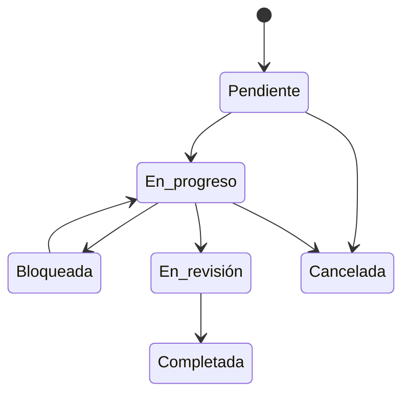

# Tareas

Lista de las [tareas](../glosario.md#tarea) de la organización, con su ficha de detalle: comentarios,
adjuntos, lista de comprobación y actividad.

## Propósito

Hacer el seguimiento de las tareas de cumplimiento, manuales y generadas desde otros módulos. Es la
entrada a las demás vistas de tareas.

## Acceso y permisos

- **Ruta:** `/tareas`
- **Menú:** **Tareas**, en el grupo Seguimiento.
- **Disponibilidad:** Core.

| Rol | Ver | Acciones permitidas |
|---|---|---|
| Administrador, Responsable del SGAI, CAIO | Todas las tareas de la organización | Crear, editar y eliminar |
| DPO, Responsable del sistema, Analista de riesgos, Analista de cumplimiento | Ídem | Crear y editar |
| Directivo, Auditor, Lector | Ídem | Ninguna |

La vista muestra todos los botones a todos los roles. Si un rol no tiene permiso, el cambio no se guarda
y la vista no avisa.

> **Pendiente de definir.** Qué roles pueden comentar, adjuntar y marcar la lista de comprobación.

## Campos

**Indicadores** (no dependen de los filtros):
- **Total tareas**;
- **En progreso**;
- **Bloqueadas**;
- **Vencidas**: con fecha límite pasada y sin completar ni cancelar.

**Filtros:**
- **Buscar tarea...**, en el título;
- estado, prioridad, origen y asignado;
- **Mis tareas**;
- etiquetas: la tarea debe tenerlas todas;
- **Vencimiento desde** y **Vencimiento hasta**.

**Vistas guardadas:** **Vistas › Guardar filtros actuales…**, con nombre y visibilidad **Solo yo** o
**Toda la org**.

**Tabla**, ordenada por fecha límite (las que no tienen, al final) y después por creación:

| Columna | Descripción y valores | Origen (`fluxion.tasks.`) |
|---|---|---|
| **Tarea** | Título, descripción abreviada y hasta tres etiquetas | `title`, `description`, `tags` |
| **Sistema** | Sistema de IA | `system_id` |
| **Asignado** | Persona responsable | `assignee_id` (`profiles.id`) |
| **Prioridad** | Baja · Media · Alta · Crítica | `priority` |
| **Estado** | Pendiente · En progreso · Bloqueada · En revisión · Completada · Cancelada. Se puede cambiar en la propia fila | `status` |
| **Vencimiento** | En rojo si está vencida | `due_date` |

Sin tareas: «No hay tareas aún», con **Crear la primera tarea**. Sin resultados: «No hay tareas con estos
filtros».

**Orígenes** (`source_type`):

| Origen | Cuándo se crea |
|---|---|
| Manual | Desde esta vista, una plantilla o una tarea recurrente |
| Análisis de gaps | Desde una [brecha](../glosario.md#brecha), en [Brechas](brechas.md) |
| Grupo de gaps | Una tarea que cubre varias brechas |
| Modo FMEA | Al delegar un modo de fallo en la [Evaluación FMEA](fmea-evaluacion.md) |
| Señal de supervisión | Al recibir una [señal de riesgo](../glosario.md#señal-de-riesgo) crítica |
| Incidente de IA | Acción correctiva en el [Detalle de incidente](incidente-detalle.md). Desde B25d, el enlace de origen del detalle de la tarea lleva al incidente |
| Reevaluación del sistema | Tarea «Reevaluar sistema · {nombre}» de un [disparador de reevaluación](flujo-completo-evaluacion.md#disparadores-de-reevaluación) (B21a); una abierta por sistema; se completa sola al cerrarse sus disparadores. El enlace de origen lleva a la ficha |
| Informe anual (Art. 26.10) | Tarea anual del informe de uso de la identificación biométrica remota en diferido (B21c), una por sistema y año. El enlace de origen lleva a la ficha |
| Cese del uso (Art. 5) | Tarea «Cesar el uso · {sistema}», prioridad crítica, de un sistema clasificado como práctica prohibida que no está Retirado (B27). Se completa sola al pasar a Retirado o si deja de ser prohibido. El enlace de origen lleva a la ficha |
| Requerimiento de la autoridad | Tarea «Responder al requerimiento…» o tarea añadida en el detalle del requerimiento ([Incidentes › Requerimientos](incidentes.md#pestaña-requerimientos), B25d). El enlace de origen lleva al requerimiento |
| Plan de tratamiento | Acción del [plan de tratamiento](plan-de-tratamiento.md) |
| Evaluación de riesgos | — |

> TODO: confirmar un origen.
> - **Evaluación de riesgos:** nada crea tareas con este origen.

**Ficha de la tarea** (se abre al pulsar una tarea):

| Bloque | Contenido |
|---|---|
| Datos | **Título**, **Estado**, **Prioridad**, **Asignado a**, **Fecha límite** («· Vencida»), **Descripción** y **Etiquetas**, editables. **Sistema IA**, solo lectura. **Origen**, con enlace. **Creada** y **Completada** |
| **Gaps cubiertos (N)** | En las tareas de grupo de brechas, las brechas que cubre |
| **Seguidores (N)** | **Seguir** / **Dejar de seguir** |
| **Checklist** | Ítems con progreso «hechos/total (%)». Doble clic para editar |
| **Comentarios** | Con menciones (@), editables y eliminables por su autor |
| **Actividad** | Creación y cambios de estado, prioridad, asignado, fecha y título |
| **Adjuntos** | PDF, imágenes, Office, TXT y CSV, hasta 25 MB. **Descargar**; eliminar, solo quien lo subió |

> TODO: confirmar varios datos de la ficha.
> - **Origen sin enlace:** las tareas de señal y de incidente no tienen enlace a su origen.
> - **Cambio de asignado:** en la actividad aparece sin traducir («assignee id changed»).
> - **Cambios que no se registran:** los de descripción, etiquetas, lista de comprobación y adjuntos
>   borrados.
> - **Ítems «requerido» de las plantillas:** no se conservan ni impiden completar la tarea.
> - **Adjuntos eliminados:** el fichero no se borra del almacenamiento.

## Acciones

| Acción | Quién | Qué hace | Efectos |
|---|---|---|---|
| **Nueva tarea** | Con permiso | Abre **Crear tarea**: en blanco o desde plantilla | Ver abajo |
| Cambiar el estado en la fila | Con permiso | `updateTaskStatusAction` | Igual que **Guardar cambios** |
| **Guardar cambios** (ficha) | Con permiso | `updateTaskAction` | Registra la actividad. Avisa a los seguidores del cambio de estado y al nuevo asignado. Al completar, envía `task.completed` a las [integraciones salientes](../glosario.md#integración-saliente-webhook) |
| Eliminar (papelera o ficha) | Con permiso | Elimina la tarea. Solo tareas manuales. En la tabla no pide confirmación; en la ficha pide «¿Eliminar?» | — |
| Selección múltiple | Con permiso | **Cambiar estado…** o **Eliminar** (sin confirmación) | Sin actividad, avisos ni integraciones |
| **CSV** | Todos | Exporta las tareas filtradas | — |
| **Comentar** / **Adjuntar** | Todos | Añade un comentario o un fichero | Avisa a los mencionados y a los seguidores |
| **Calendario** · **Métricas** · **Recurrentes** · **Plantillas** | Todos | Navegan a [Calendario](tareas-calendario.md), [Métricas](tareas-metricas.md), [Recurrentes](tareas-recurrentes.md) y [Plantillas](tareas-plantillas.md) | — |

**Crear tarea:**

| Campo | Tipo | Obligatorio | Descripción |
|---|---|---|---|
| **Título** | texto | Sí | Hasta 300 caracteres |
| **Descripción** | texto largo | No | Oculto si se usa plantilla |
| **Prioridad** | selección | No | Media por defecto; con plantilla, la de la plantilla |
| **Sistema IA** | selección | No | «Sin sistema» por defecto |
| **Asignado a** | selección | No | «Sin asignar» por defecto |
| **Fecha límite** | fecha | No | Desde hoy |
| **Etiquetas** | etiquetas | No | En minúsculas. Con plantilla, las de la plantilla |

Al crear la tarea:
- quien la crea y la persona asignada quedan como seguidores;
- se registra en la actividad;
- la persona asignada recibe el [aviso en la app](../glosario.md#aviso-en-la-app) «Nueva tarea asignada:
  {título}».

Las tareas que crean otros módulos no generan ni seguidores ni este aviso.

> TODO: confirmar varios comportamientos de las acciones.
> - **Eliminar varias:** se quitan de la lista también las no manuales, aunque no se borran.
> - **Errores al cambiar el estado:** se deshace el cambio sin avisar.
> - **Enlace desde incidentes:** abre la lista, no la tarea concreta.

## Validaciones

| Situación | Mensaje |
|---|---|
| Título vacío | **Crear tarea** deshabilitado |
| Comentario vacío | «El comentario no puede estar vacío» |
| Ítem de la lista vacío | «La etiqueta no puede estar vacía» |
| Fichero de más de 25 MB | «El archivo supera el límite de 25 MB» |
| Tipo de fichero no admitido | «Tipo de archivo no permitido» |
| Plantilla inexistente | «Plantilla no encontrada» |
| Otros errores | «Error al crear la tarea», «Error al subir: …», «Error al registrar el adjunto» |

## Estados

La aplicación no restringe las transiciones: se puede pasar de cualquier estado a cualquier otro.

Al completar una tarea se guarda la fecha de cierre. Si la tarea nace de una acción del plan de
tratamiento, la acción pasa a completada. Al reabrir la tarea se borra la fecha de cierre.

## Vistas relacionadas

- [Kanban](kanban.md), [Calendario de tareas](tareas-calendario.md), [Métricas de tareas](tareas-metricas.md),
  [Plantillas de tareas](tareas-plantillas.md), [Tareas recurrentes](tareas-recurrentes.md).
- [Brechas](brechas.md), [Detalle de incidente](incidente-detalle.md), [Evaluación FMEA](fmea-evaluacion.md).
- Negocio: [Tareas](../negocio/tareas.md).
