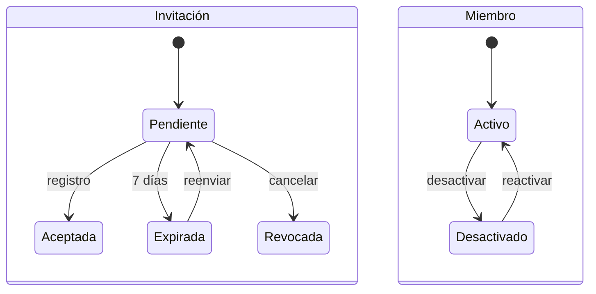

# Usuarios

Gestión de los [miembros](../glosario.md#miembro) de la organización: alta, invitaciones, cambio de
[rol](../glosario.md#rol), desactivación e historial de cambios.

## Propósito

Controlar quién accede a la organización en Fluxion y con qué rol, y conservar el historial de cambios
de rol y de estado de cada miembro.

## Acceso y permisos

- **Ruta:** `/usuarios`
- **Navegación:** **Configuración › Usuarios**.
- **Disponibilidad:** Core.

| Rol | Ver | Acciones permitidas |
|---|---|---|
| Administrador | Las cuatro pestañas | Crear usuarios, invitar, reenviar y cancelar invitaciones, cambiar roles, desactivar y reactivar |
| Resto de roles | Las cuatro pestañas, en solo lectura | Copiar enlaces de invitación |

## Campos

La vista tiene cuatro pestañas (**Miembros**, **Invitaciones**, **Roles y permisos**, **Auditoría**),
dos paneles de alta (**Crear usuario** y **Nueva invitación**) y el panel **Detalle del miembro**.

### Crear usuario

El usuario puede acceder de inmediato con la contraseña inicial.

| Campo | Tipo | Obligatorio | Descripción y valores | Origen (`tabla.columna`) |
|---|---|---|---|---|
| **Nombre** | texto | Sí | — | Metadatos del usuario → `profiles.first_name` |
| **Apellidos** | texto | No | — | → `profiles.last_name` |
| **Correo electrónico** | email | Sí | — | `auth.users.email` |
| **Contraseña inicial** | password | Sí | Mínimo 8 caracteres | Supabase Auth |
| **Rol** | selector | — | Los diez roles, incluido Administrador. Por defecto Lector. Los demás roles se añaden después en **Miembros** | `profiles.roles` |

### Nueva invitación

El usuario se registra con un enlace de invitación.

| Campo | Tipo | Obligatorio | Descripción y valores | Origen (`tabla.columna`) |
|---|---|---|---|---|
| **Invitación múltiple** | interruptor | — | Cambia entre un correo y varios | — |
| **Correo electrónico** / **Correos electrónicos** | email / texto largo | Sí | En modo múltiple, uno por línea o separados por coma | `invitations.email` |
| **Rol** | selector | — | Los diez roles, incluido Administrador. Por defecto Lector | `invitations.role` |
| **Mensaje personal** | texto largo | No | Máximo 300 caracteres | `invitations.message` |

### Miembros

- **Filtros:** búsqueda por nombre o correo y filtro por rol. Se muestran 20 por página.
- **Columnas:** foto, nombre (con la marca «Tú»), correo, fecha de alta y **roles** (todos, el principal
  primero). El filtro por rol encuentra a quien tenga ese rol entre los suyos.
- **Editar roles:** el Administrador pulsa **Editar** en la fila, marca los roles y pulsa **Guardar**.
  Puede editar también los suyos. Un miembro puede tener varios roles y puede haber varios
  Administradores (B23a).
- **Desactivados:** sección aparte con los miembros desactivados (`profiles.is_active = false`).

> TODO: confirmar por qué la vista no muestra los correos de los miembros. Se piden a la API de
> administración de usuarios sin las credenciales necesarias, así que la columna de correo sale vacía y
> la búsqueda por correo no encuentra nada. Ocurre lo mismo con «Último acceso» y «Autenticación MFA» en
> el detalle del miembro.

### Invitaciones

- **Pendientes:** caducidad, número de reenvíos y mensaje personal.
- **Expiradas:** se separan aparte. La invitación caduca a los 7 días.

### Roles y permisos

Tarjetas descriptivas de los diez roles: Administrador, SGAI Manager, CAIO, DPO, System Owner, Analista
de Riesgos, Analista de Cumplimiento, Directivo, Auditor y Lector. Explica que un miembro puede tener
varios roles y que sus permisos son la suma de todos. Es solo informativa: no hay una matriz de permisos
configurable.

### Auditoría

Historial de cambios de rol, desactivaciones, reactivaciones y eliminaciones (`member_role_changes`,
últimos 200), con filtro por tipo de evento. Formato: «{actor} cambió el rol de {miembro}: {anterior} →
{nuevo}».

### Detalle del miembro

Panel lateral en solo lectura:
- nombre, cargo, rol, teléfono y bio;
- miembro desde, último acceso y estado de MFA;
- sistemas asignados (con la marca «Principal» si es responsable principal);
- comités y su papel en cada uno;
- últimos 20 cambios de rol.

## Acciones

| Acción | Quién | Qué hace | Efectos |
|---|---|---|---|
| **Crear usuario** | Administrador | `createUser`: crea una invitación interna y el usuario con el correo ya confirmado. El trigger lo asocia a la organización y se marca su onboarding como completado | Auditoría `member.created`. No envía correo: hay que comunicar la contraseña |
| **Generar enlace** (invitación) | Administrador | `inviteUser`: crea la invitación | Muestra el enlace `/register?invite={token}` para copiarlo. Auditoría `member.invited` |
| **Invitar todos** | Administrador | `inviteUserBulk` | Resultado por correo con su enlace. Auditoría `member.bulk_invited` |
| **Reenviar** | Administrador | `resendInvitation`: nuevo enlace y 7 días más | Auditoría `invitation.resent` |
| **Copiar** | Todos | Copia el enlace de la invitación | — |
| **Cancelar invitación** | Administrador | `cancelInvitation`: estado `revoked` | Auditoría `invitation.cancelled` |
| **Editar** › **Guardar** (roles de la fila) | Administrador, sobre cualquier miembro (también él mismo) | `updateMemberRoles` | Registro en `member_role_changes` con los roles anteriores y nuevos. Auditoría `member.role_changed` |
| **Desactivar** | Administrador, sobre otros | Pide confirmación y ejecuta `deactivateMember`: `is_active = false` | Registro en `member_role_changes`. Auditoría `member.deactivated` |
| **Reactivar** | Administrador | `reactivateMember` | Auditoría `member.reactivated` |

> **Pendiente de implementar.**
> - **Envío por correo de la invitación:** hoy el enlace se copia y se envía a mano. El mensaje personal
>   solo se guarda.
> - **Bloqueo del acceso de los miembros desactivados.**
> - **Restricción de invitaciones a los dominios permitidos** configurados en [Ajustes](ajustes.md) ›
>   Seguridad.
> - **Botón para eliminar a un miembro:** la acción existe en el servidor, pero no hay botón.

> TODO: confirmar un comportamiento de la gestión de miembros. Si fallan la reactivación o la
> cancelación de una invitación, la vista no muestra ningún mensaje (los errores al cambiar roles y al
> desactivar ya se muestran).

## Validaciones

| Situación | Mensaje |
|---|---|
| Correo no válido | «El correo electrónico no es válido.» |
| Sin nombre | «El nombre es obligatorio.» |
| Rol no permitido | «El rol seleccionado no es válido.» |
| DPO y Responsable del SGAI a la vez | «DPO y Responsable del SGAI no pueden recaer en la misma persona (RGPD, Art. 38.6).» |
| Quitar, desactivar o eliminar al último Administrador | «La organización debe tener al menos un Administrador activo. Asigna antes el rol a otro miembro.» |
| Sin roles | «Un miembro necesita al menos un rol.» |
| Contraseña corta | «La contraseña debe tener al menos 8 caracteres.» |
| Ya hay una invitación pendiente | «Ya existe una invitación pendiente para este correo.» |
| El correo ya tiene usuario | «Ya existe un usuario con ese correo electrónico.» |
| El alta no quedó en la organización | «El usuario no quedó asociado a tu organización, así que se ha deshecho el alta.» |
| Modo múltiple sin correos válidos | «No se encontraron emails válidos.» |
| Intento de desactivarse a uno mismo | «No puedes desactivarte a ti mismo.» |
| Sin permisos | «Solo los administradores pueden …» |

## Estados

## Vistas relacionadas

- [Registro](registro.md): donde la persona invitada crea su usuario.
- [Perfil](perfil.md): datos que se ven en el detalle del miembro.
- [Organización](organizacion.md): comités.
- [Ajustes](ajustes.md): seguridad y registro de auditoría completo.
- Negocio: [Plataforma](../negocio/plataforma.md).
