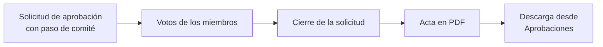

# Actas y paquetes de auditoría

Actas y paquetes de auditoría es un módulo que deja constancia formal de las decisiones de gobierno de
la IA. Hoy genera el [acta](../glosario.md#acta) de las decisiones colegiadas tomadas en los
[Flujos de aprobación](../glosario.md#flujos-de-aprobación). Está previsto que reúna además la
información para una auditoría.

## Propósito

Sustituir la referencia a un acta que nadie comprueba por un documento generado a partir de los votos
reales, con nombres, fechas y resultado, y facilitar la preparación de las auditorías. Es un
[módulo](../glosario.md#módulo) contratable.

## Problema que resuelve

Cuando un comité aprueba algo, por ejemplo aceptar el riesgo residual de un sistema crítico, el acta se
redacta después, a mano y a veces nunca. En una auditoría, la pregunta es quién votó qué y cuándo. El
módulo:

- **Genera el acta de la decisión real:** el acta sale íntegramente de los datos de la solicitud de
  aprobación (quién votó, en qué sentido, en nombre de quién y cuándo) y no de una redacción posterior.
- **Solo cuando aporta:** se genera para las decisiones en las que participó un
  [comité](../glosario.md#comité). En una aprobación individual, el historial de la solicitud ya es
  prueba suficiente.
- **Prueba verificable:** el acta se genera en PDF, queda vinculada a la solicitud y se descarga desde
  **Aprobaciones**.

## Roles

| Rol | Responsabilidad |
|---|---|
| Miembros del comité | Votan en la solicitud; sus votos forman el acta |
| Secretario del comité | Responsable de que la decisión quede documentada |
| Responsable del SGAI | Usa las actas como prueba de las decisiones de gobierno |
| Auditor | Consulta y descarga las actas |

> TODO: confirmar si el papel de secretario del comité tiene alguna función en la generación o firma
> del acta. Hoy el acta se genera sola al cerrarse la solicitud.

## Flujo de trabajo

1. **Decisión colegiada.** Una solicitud de aprobación incluye un paso resuelto por un comité, con su
   quórum.
2. **Cierre.** Al aprobarse o rechazarse la solicitud, Fluxion genera el acta con el contenido de la
   decisión:
   - objeto aprobado;
   - política aplicada;
   - votos;
   - delegaciones;
   - resultado y fechas.
3. **Consulta.** El acta aparece junto a la solicitud en **Aprobaciones**, con su enlace de descarga.
4. **Garantía.** Si el acta no se puede generar, la decisión sigue siendo válida: los votos ya están
   registrados y no se pueden modificar. Fluxion muestra un aviso.

> **Pendiente de implementar.**
> - Paquetes de auditoría: exportación conjunta de la información de un sistema o de la organización
>   para auditoría (clasificación, análisis de riesgos, planes, evidencias, documentos y actas). Figura
>   en la [Hoja de ruta](hoja-de-ruta.md).
> - Actas de las sesiones de comité (orden del día, asistentes y decisiones).
> - Acceso condicionado a la activación del módulo.

> TODO: confirmar el alcance comercial del módulo mientras no existan los paquetes de auditoría. Hoy su
> única funcionalidad, el acta de aprobación, depende de Flujos de aprobación, que forma parte del Core.

## Relación normativa

| Norma | Referencia | Qué cubre |
|---|---|---|
| AI Act | Art. 9.5 | Constancia de quién juzga aceptable el riesgo residual |
| ISO/IEC 42001 | §9.3 | Resultados documentados de la revisión por la dirección (previsto con las sesiones de comité) |
| ISO/IEC 42001 | §7.5 | Información documentada |

## Módulos relacionados

- **[Flujos de aprobación](flujos-de-aprobacion.md):** origen de las decisiones documentadas.
- **[Plataforma](plataforma.md):** comités y sus miembros.
- **[Plan de tratamiento](plan-de-tratamiento.md):** principal objeto de las decisiones colegiadas.
- **Documentación del sistema** (módulo): misma tecnología de generación de PDF.
- **Vistas:** [Aprobaciones](../funcional/aprobaciones.md).
