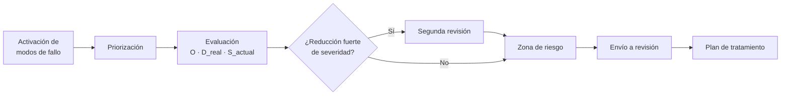

# Análisis de modos de fallo (FMEA)

El [análisis de modos de fallo (FMEA)](../glosario.md#análisis-de-modos-de-fallo-fmea) es el método con
el que Fluxion evalúa el riesgo de cada [sistema de IA](../glosario.md#sistema-de-ia). Identifica las
formas concretas en que el sistema puede fallar, valora cada una con escalas fijas y obtiene una
[zona de riesgo](../glosario.md#zona-de-riesgo) que decide cuánto tratamiento y qué nivel de
aprobación necesita.

## Propósito

Dar a la organización una evaluación de riesgos homogénea, justificada y comparable entre sistemas, que
sirva de base al [plan de tratamiento](plan-de-tratamiento.md) y que pueda presentarse ante un auditor.
Forma parte del [Core](../glosario.md#core).

## Problema que resuelve

La evaluación de riesgos de IA suele hacerse con matrices genéricas que cada equipo rellena a su
manera, sin conexión con la normativa ni trazabilidad. Fluxion la estructura:

- **Punto de partida común:** un catálogo de más de 400 [modos de fallo](../glosario.md#modo-de-fallo),
  agrupados en seis [dimensiones de riesgo](../glosario.md#dimensión-de-riesgo) (técnica, seguridad,
  ética, gobernanza, ROI y legal) y anclados a los artículos de los que proceden. Cada modo trae una
  [severidad por defecto](../glosario.md#severidad-por-defecto-s_default) calculada con los
  [criterios R.I.D.E.](../glosario.md#criterios-ride).
- **Menos trabajo:** Fluxion activa automáticamente los modos que aplican al sistema y prioriza cuáles
  evaluar, de modo que el equipo no empieza ante cientos de filas.
- **Escalas fijas y justificación:** cada modo se valora con la misma escala en todos los sistemas, y
  los cambios importantes respecto al valor por defecto exigen justificación o una segunda revisión.
- **Relaciones entre riesgos:** las [familias causales](../glosario.md#familia-causal) muestran cómo
  unos fallos provocan o amplifican otros, por ejemplo «deriva y calidad de datos → sesgo →
  discriminación».

## Roles

| Rol | Responsabilidad |
|---|---|
| Analista de riesgos | Evalúa los modos de fallo priorizados y propone la zona de riesgo |
| Responsable del sistema | Aporta el conocimiento del sistema: ocurrencia real, controles existentes, capacidad de detección |
| Responsable del SGAI | Supervisa las evaluaciones y resuelve las segundas revisiones |
| Auditor | Consulta las evaluaciones, sus justificaciones y su historial |

> **Pendiente de definir.** Qué roles pueden evaluar y cuáles pueden resolver las segundas revisiones.

## Flujo de trabajo

1. **[Activación](../glosario.md#activación-de-modos-de-fallo).** A partir de las características del
   sistema (dominio, personas afectadas, datos biométricos, menores, infraestructura crítica, nivel de
   riesgo AI Act…), un motor de reglas activa los modos de fallo del catálogo que le aplican. También se
   pueden activar a mano. Sin modos activados, el análisis no puede empezar.
2. **[Priorización](../glosario.md#priorización).** Cada modo activado recibe una puntuación de 0 a 100 y
   queda como «Priorizado», «En vigilancia» o «Descartado».
   - Entran siempre los de severidad alta, los ligados a supuestos sensibles del AI Act y los de
     combinaciones delicadas, como biometría con personas afectadas.
   - El resto entra por puntuación, con un máximo orientativo de unos 80 modos priorizados por sistema.
   - Solo los priorizados se evalúan. La priorización se puede ajustar a mano, con justificación.
3. **Evaluación.** Para cada modo priorizado se valoran:
   - **[Ocurrencia (O)](../glosario.md#ocurrencia-o)** en este sistema, de 1 a 5.
   - **[Detectabilidad real (D_real)](../glosario.md#detectabilidad-real-d_real)**, de 1 a 5, según la
     observabilidad, el testing y los controles que existen hoy.

   Con esos dos valores Fluxion sugiere la [severidad actual (S_actual)](../glosario.md#severidad-actual-s_actual),
   de 2 a 9, que el evaluador puede ajustar. Hay tres formas de trabajar:
   - **Modo a modo.**
   - **[Estimación por familia](../glosario.md#estimación-por-familia):** una valoración común para todos
     los modos de una familia causal, con una justificación de al menos 50 caracteres, detallando solo
     las excepciones.
   - **Posponer o delegar:** un modo se puede posponer, o delegar como [tarea](../glosario.md#tarea) a
     otra persona.
4. **Justificación y [segunda revisión](../glosario.md#segunda-revisión).** Apartarse de forma notable
   de la severidad por defecto exige una justificación de al menos 50 caracteres. Por ejemplo:
   - una diferencia de 2 puntos o más;
   - subir a 9;
   - bajar de 5 un modo que partía de 7 o más.

   Si la severidad se ajusta a mano y baja 3 puntos o más, el modo requiere además una segunda revisión
   aprobada.
5. **Zona de riesgo.** Fluxion calcula la zona del sistema con dos criterios:
   - **La severidad actual más alta:** 9 lleva a Zona I, 8 a Zona II y 7 a Zona III.
   - **El perfil agregado**, cuántos modos superan ciertos umbrales y en cuántas dimensiones. Por
     ejemplo, tres modos de 8 o más en al menos dos dimensiones llevan a Zona I.

   La zona nunca queda por debajo del [suelo AI Act](../glosario.md#suelo-ai-act): un sistema de alto
   riesgo está como mínimo en Zona II.
6. **Envío a revisión.** La evaluación solo se puede enviar cuando no quedan modos pendientes ni
   pospuestos, todas las justificaciones obligatorias están escritas y las segundas revisiones están
   aprobadas. Al enviarla, los modos con severidad actual de 7 o más, y los que pasaron por segunda
   revisión, pasan al [plan de tratamiento](plan-de-tratamiento.md).
7. **Versiones.** Cada reevaluación crea una versión nueva, que se puede comparar con las anteriores. La
   evaluación se puede exportar en un formato imprimible.

| Zona | Nombre | Qué implica |
|---|---|---|
| I | Crítico | Aprobación de nivel 3 (Dirección), revisión mensual, plazo de 30 días |
| II | Alto | Aprobación de nivel 2 (Comité), revisión trimestral, plazo de 90 días |
| III | Moderado | Aprobación de nivel 1 (Responsable), revisión semestral, plazo de 180 días |
| IV | Aceptable | Aprobación de nivel 1 (Responsable), revisión anual, plazo de 365 días |

La vista **Evaluaciones** reúne, para toda la organización, la cola priorizada, las evaluaciones en
curso, las segundas revisiones pendientes y los planes.

Los riesgos que amenazan el retorno o la viabilidad del sistema, y no el cumplimiento, no se evalúan
aquí: van al registro de [riesgos de negocio](../glosario.md#riesgo-de-negocio), con su propia escala.

> TODO: confirmar cuándo se considera «aprobada» una evaluación. La aplicación prevé los estados
> borrador, en revisión, aprobada y sustituida, pero no se ha encontrado en el código el paso a
> «aprobada». Lo que se aprueba es el plan de tratamiento.

> **Pendiente de implementar.**
> - Revisión de la priorización por IA.
> - Disparadores automáticos de reevaluación.

## Relación normativa

| Norma | Referencia | Qué cubre |
|---|---|---|
| AI Act | Art. 9.2.a y 9.2.b | Identificación, análisis y estimación de los riesgos conocidos y previsibles |
| AI Act | Art. 9.5 | Riesgo residual juzgado aceptable, a través de la zona de riesgo y su aprobación |
| ISO/IEC 42001 | §6.1.2 | Evaluación de riesgos de la IA con criterios definidos |
| ISO/IEC 42001 | §8.2 | Evaluación de riesgos de la IA a intervalos planificados (la frecuencia de revisión depende de la zona) |

## Módulos relacionados

- **[Inventario de sistemas de IA](inventario.md) y [Clasificación AI Act](clasificacion-ai-act.md):**
  determinan qué modos se activan y el suelo de la zona.
- **[Plan de tratamiento](plan-de-tratamiento.md):** recibe los modos que necesitan tratamiento.
- **[Análisis de brechas](brechas.md):** muestra los modos de severidad alta sin tratar.
- **[Catálogo de tablas básicas](../glosario.md#catálogo-de-tablas-básicas):** contiene los modos de
  fallo, sus severidades por defecto y el grafo causal.
- **Evaluación de impacto (AISIA)** (módulo): su sección de modos de fallo se alimenta de este
  análisis.
- **Vistas:** Evaluaciones, Evaluación FMEA, Comparativa FMEA (documentos funcionales pendientes).
  **Técnico:** [modelo-datos.md](../tecnica/modelo-datos.md#riesgo-y-tratamiento).
