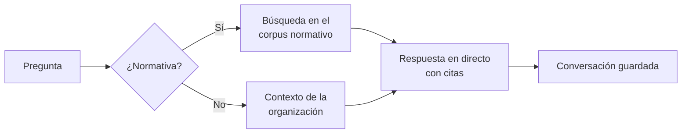

# Asistente SGAI

El [Asistente SGAI](../glosario.md#asistente-sgai) es un asistente conversacional integrado en toda la
aplicación. Responde en lenguaje natural preguntas sobre la normativa, el estado de los sistemas de la
organización y el uso de Fluxion, citando los artículos y cláusulas en que se apoya.

## Propósito

Dar al responsable del [SGAI](../glosario.md#sgai-sistema-de-gestión-de-la-ia) y a su equipo un apoyo
permanente que conoce el marco normativo y la situación de su organización, sin salir de la
herramienta. Forma parte del [Core](../glosario.md#core).

## Problema que resuelve

Quien gestiona el cumplimiento de la IA tiene que interpretar normas extensas y saber en todo momento
cómo están sus sistemas. Buscar un artículo, recordar un plazo o saber qué falta en un sistema lleva
tiempo y obliga a consultar varias fuentes. El asistente:

- **Responde sobre la norma:** cita el artículo o la cláusula exacta, apoyándose en un
  [corpus normativo](../glosario.md#corpus-normativo) con el AI Act, ISO/IEC 42001, el RGPD, DORA, el MDR,
  el IVDR, el ENS y las guías de la AESIA.
- **Conoce la situación de la organización:** sistemas, nivel de riesgo, zonas, planes de tratamiento y
  sus plazos, y evidencias. Si se abre desde la ficha de un sistema, tiene en cuenta ese sistema.
- **Explica Fluxion:** cómo funciona la metodología (zonas de riesgo, criterios R.I.D.E., análisis de
  modos de fallo, Declaración de Aplicabilidad) y dónde se hace cada cosa.
- **Separa hechos de orientación:** distingue lo que dice la norma de su recomendación y reconoce lo
  que no sabe.

## Roles

| Rol | Responsabilidad |
|---|---|
| Cualquier miembro | Consulta al asistente; sus conversaciones son personales |
| Responsable del SGAI | Usuario principal: estado del SGAI, planificación, preparación de auditorías |

El asistente es solo consultivo. No toma decisiones ni actúa sobre los datos: no confirma
clasificaciones, no aprueba planes y no cierra brechas. Esas acciones corresponden siempre a una
persona.

## Flujo de trabajo

1. **Acceso.** El asistente se abre desde un botón disponible en todas las pantallas. Propone preguntas
   según dónde está el usuario, por ejemplo:
   - «¿Qué sistemas tengo sin clasificar?»
   - «¿Qué le falta a este sistema para cumplir el AI Act?»
   - «¿Cuándo necesito segunda revisión en la evaluación FMEA?»
2. **Pregunta.**
   - Si es sobre normativa (artículos, obligaciones, plazos, sanciones, certificación), el asistente
     busca los fragmentos relevantes del corpus.
   - Si es sobre el estado de la organización o sobre el uso de la plataforma, responde con el contexto
     de la organización.
3. **Respuesta.** La respuesta se muestra a medida que se genera, con las referencias normativas citadas.
4. **Historial.** Las conversaciones se guardan.

   > TODO: confirmar cómo se retoma una conversación. Hoy la pantalla no permite retomarlas ni borrarlas:
   > al recargar la página, la conversación se pierde de la vista.

El asistente no produce dictámenes jurídicos vinculantes ni accede a datos de otras organizaciones.

> **Pendiente de implementar.**
> - Que el asistente consulte también los documentos propios de la organización (políticas internas).
> - Elección del modelo de IA por organización; hoy se usa GPT de OpenAI.

> TODO: confirmar si las conversaciones del asistente se consideran información de la organización (y
> por tanto visible para el administrador) o solo de quien las inicia. Hoy cada persona ve solo las
> suyas.

## Relación normativa

No aplica: el asistente es una herramienta de apoyo y no cubre por sí mismo ningún requisito normativo.
Sus respuestas se fundamentan en el corpus normativo descrito arriba.

> TODO: confirmar si se quiere presentar el asistente como apoyo a la competencia y la toma de
> conciencia del personal (ISO/IEC 42001, §7.2 y §7.3; AI Act, Art. 4, alfabetización en IA).

## Módulos relacionados

- **Todos los módulos del Core:** el asistente explica su metodología y consulta su estado.
- **[Clasificación AI Act](clasificacion-ai-act.md):** comparte el corpus normativo con el Asistente de
  clasificación.
- **Vistas:** [Asistente SGAI](../funcional/asistente-sgai.md). **Técnico:** [Servicio de agentes](../tecnica/servicio-agentes.md),
  [RAG y corpus normativo](../tecnica/rag.md).
