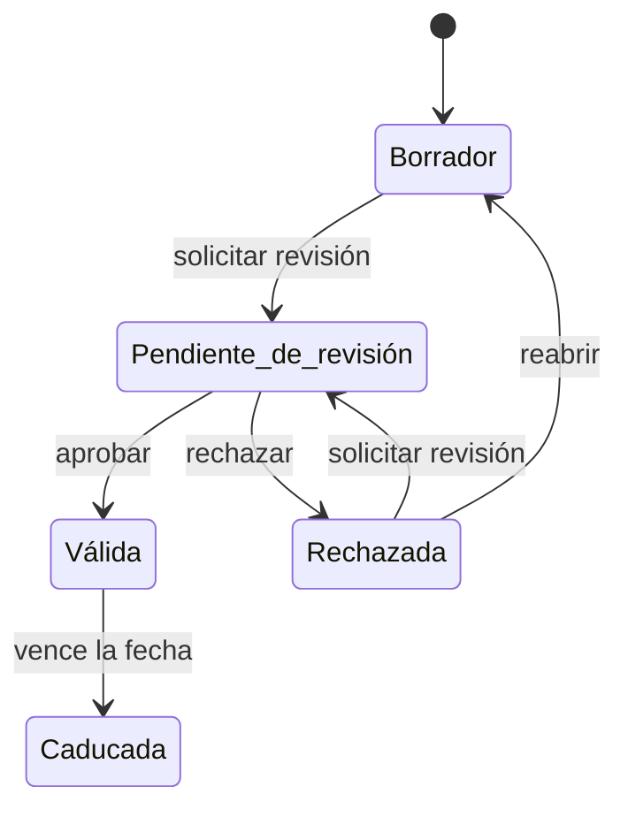

# Biblioteca de evidencias

La [Biblioteca de evidencias](../glosario.md#biblioteca-de-evidencias) reúne todas las
[evidencias](../glosario.md#evidencia) de la organización: documentos, registros y enlaces que
demuestran que se cumplen las obligaciones, que los controles están implantados y que los riesgos se han
tratado. Cada evidencia pasa por un ciclo de revisión, conserva sus versiones y avisa antes de caducar.

## Propósito

Tener las pruebas de cumplimiento en un solo lugar, revisadas, vigentes y vinculadas a lo que
demuestran, listas para presentarlas ante un auditor o una autoridad. Forma parte del
[Core](../glosario.md#core).

## Problema que resuelve

Las pruebas de cumplimiento suelen estar en carpetas compartidas, correos y gestores documentales, sin
saber cuál es la versión vigente, quién la validó, qué obligación cubre ni cuándo deja de valer. Ante una
auditoría, reunirlas lleva semanas. Fluxion:

- **Una biblioteca** para evidencias de un sistema concreto o de toda la organización, por ejemplo una
  política general.
- **Revisión:** cada evidencia pasa por borrador, revisión y validación o rechazo.
- **Vínculos:** cada evidencia se relaciona con las [obligaciones](obligaciones.md), los
  [modos de fallo](../glosario.md#modo-de-fallo) o los controles de la
  [Declaración de Aplicabilidad](../glosario.md#declaración-de-aplicabilidad-iso-42001) que respalda.
- **Vigencia:** Fluxion calcula cada día las caducidades, avisa con 30 y 7 días de antelación y marca
  como caducadas las vencidas.
- **Integridad:** los ficheros se guardan con una huella de integridad y cada cambio queda en el
  historial de versiones.

## Roles

| Rol | Responsabilidad |
|---|---|
| Responsable del sistema | Aporta las evidencias de sus sistemas y las mantiene vigentes |
| Analista de cumplimiento | Revisa, valida o rechaza las evidencias y las vincula a las obligaciones |
| DPO | Aporta y revisa las evidencias de protección de datos |
| Responsable del SGAI | Aporta las evidencias de nivel organización y supervisa la vigencia |
| Auditor | Consulta las evidencias, sus versiones y sus revisiones |

> **Pendiente de definir.** Qué roles pueden validar o rechazar evidencias. Hoy lo puede hacer cualquier
> miembro de la organización.

## Flujo de trabajo

1. **Alta.** Una evidencia se crea desde la ficha de un sistema o desde la biblioteca. Se crea como
   evidencia del sistema o de la organización, con:
   - título, descripción, [tipo de evidencia](../glosario.md#tipo-de-evidencia) y etiquetas;
   - fecha de emisión y de caducidad;
   - un fichero o un enlace externo.

   Los ficheros se suben de forma segura y se guardan con su huella de integridad.
2. **Evidencias generadas por Fluxion.** El dossier técnico, la ficha para el registro UE y el informe
   de brechas de un sistema se pueden guardar como evidencia en un clic. Los documentos de
   [Documentación del sistema](../glosario.md#documentación-del-sistema) quedan vinculados a una
   evidencia al generarse.
3. **[Revisión](../glosario.md#estado-de-la-evidencia).** El autor solicita la revisión, y el revisor
   aprueba (la evidencia pasa a «Válida») o rechaza con notas. Una evidencia rechazada se corrige y se
   vuelve a enviar, o se reabre como borrador. Se pueden revisar varias a la vez.
4. **Vínculos.** Cada evidencia se vincula, una a una o varias a la vez, con:
   - las obligaciones que cubre;
   - los modos de fallo que respalda;
   - como validación de un control de la Declaración de Aplicabilidad.

   Para cada obligación, el catálogo indica qué tipos de evidencia se esperan.
5. **Versiones.** Cada edición y cada cambio de estado deben guardarse en el historial de la evidencia,
   que muestra qué cambió, quién lo cambió y cuándo.

   > TODO: confirmar en una instalación real que el historial de versiones se registra. Según el código,
   > es probable que no se esté guardando ninguna versión.
6. **Caducidad.** Cada mañana Fluxion revisa las fechas de caducidad:
   - genera alertas para las evidencias que caducan en 30 días, en 7 días o ya han caducado;
   - marca como «Caducada» las vencidas;
   - retira las alertas de las evidencias renovadas.

   Las alertas se ven en la biblioteca, se pueden descartar y aparecen como «Evidencia caducada» en el
   [análisis de brechas](brechas.md).

> **Pendiente de implementar.**
> - Biblioteca única. Las evidencias que se adjuntan a las acciones del
>   [plan de tratamiento](plan-de-tratamiento.md) se guardan hoy por separado de la biblioteca; está
>   decidido unificarlas.
> - Aviso de caducidad a los responsables. Hoy las alertas solo se ven dentro de la biblioteca.

## Relación normativa

| Norma | Referencia | Qué cubre |
|---|---|---|
| ISO/IEC 42001 | §7.5 | Información documentada: creación, actualización, control de versiones y conservación |
| AI Act | Art. 11 y 18 | Documentación técnica y su conservación, como evidencias del sistema |
| AI Act | Art. 17 | Sistema de gestión de la calidad del proveedor, que exige documentar políticas y procedimientos |

> TODO: confirmar si la política de retención de evidencias configurada en la organización (en años)
> se aplica a la biblioteca, por ejemplo bloqueando el borrado antes de plazo, o es solo informativa.

## Módulos relacionados

- **[Obligaciones](obligaciones.md):** las evidencias cubren obligaciones.
- **[Análisis de modos de fallo (FMEA)](analisis-modos-de-fallo.md) y [Plan de tratamiento](plan-de-tratamiento.md):**
  las evidencias respaldan los modos de fallo y verifican los controles.
- **[Análisis de brechas](brechas.md):** muestra las evidencias caducadas o a punto de caducar.
- **Declaración de Aplicabilidad ISO 42001:** las evidencias validan sus controles.
- **Documentación del sistema** (módulo) e **Informes del sistema:** generan evidencias.
- **Vistas:** [Biblioteca de evidencias](../funcional/evidencias.md),
  [Detalle de evidencia](../funcional/evidencia-detalle.md).
  **Técnico:** [modelo-datos.md](../tecnica/modelo-datos.md#evidencias-brechas-y-cumplimiento-iso),
  [Almacenamiento de ficheros](../tecnica/almacenamiento-ficheros.md).
