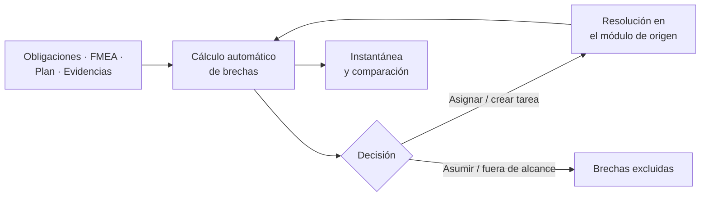

# Análisis de brechas

El análisis de [brechas](../glosario.md#brecha) muestra en una sola vista todo lo que le falta a la
organización para cumplir: obligaciones sin cubrir, riesgos sin tratar, controles sin implantar y
evidencias caducadas, en todos sus sistemas de IA. Fluxion lo calcula automáticamente a partir del
trabajo hecho en el resto de la plataforma.

## Propósito

Responder en cualquier momento a la pregunta «¿qué nos falta y qué es lo más urgente?», asignar cada
carencia a un responsable y demostrar el progreso con fotos fechadas. Forma parte del [Core](../glosario.md#core).

## Problema que resuelve

Las carencias de cumplimiento están dispersas: una obligación sin resolver en un sistema, una mitigación
sin evidencia en otro plan, una evidencia que caduca la semana que viene. Encontrarlas exige revisar
cada sistema por separado. Fluxion:

- **Reúne** todas las brechas de todos los sistemas, ordenadas por gravedad.
- **No exige mantenimiento:** las brechas se calculan solas; se cierran cuando se resuelve el origen.
- **Pone contexto:** indica qué modos de fallo activos agravan una obligación sin cubrir.
- **Convierte en trabajo:** cada brecha se puede asignar o convertir en tarea.
- **Demuestra el progreso:** las [instantáneas](../glosario.md#instantánea) fechadas y su comparación
  muestran la evolución ante un auditor.

## Roles

| Rol | Responsabilidad |
|---|---|
| Responsable del SGAI | Revisa el estado global, prioriza y decide qué brechas se asumen o quedan fuera de alcance |
| Analista de cumplimiento | Asigna las brechas normativas y de evidencias y sigue su cierre |
| Analista de riesgos | Atiende las brechas de riesgo y de control |
| Responsable del sistema | Resuelve las brechas asignadas de sus sistemas |
| Directivo, Auditor | Consultan el estado, las instantáneas y su comparación |

> **Pendiente de definir.** Qué roles pueden asumir o declarar fuera de alcance una brecha. Hoy lo puede
> hacer cualquier miembro de la organización.

## Flujo de trabajo

1. **Cálculo.** Fluxion detecta cuatro [tipos de brecha](../glosario.md#tipo-de-brecha):

   | Tipo | Cuándo aparece | Gravedad |
   |---|---|---|
   | Obligación sin cubrir | Una obligación del sistema no está resuelta ni excluida | Según la prioridad de la obligación: crítica, alta o media |
   | Riesgo sin tratar | Un modo de fallo evaluado con severidad 7 o más no tiene mitigación en curso ni está cerrado | Severidad 9: crítica · 8: alta · 7: media |
   | Control sin implantar | Una mitigación del plan está pendiente o le falta la evidencia | Según la severidad del modo de fallo |
   | Evidencia caducada | Una evidencia ha caducado o caduca en los próximos 30 días | 7 días o menos: crítica · 14 o menos: alta · 30 o menos: media |

   Las obligaciones sin cubrir muestran además los modos de fallo activos del sistema relacionados con
   ese artículo, que agravan la carencia.
2. **Revisión.**
   - La vista ofrece tres modos: combinado, por grupos y detalle.
   - Muestra indicadores de brechas sin responsable, sin fecha, que vencen pronto y asignadas a ti.
   - Cada brecha lleva directamente a la pantalla donde se resuelve: obligaciones, análisis de modos de
     fallo, plan o evidencias.
3. **Asignación y tareas.** Las brechas normativas, de control y de evidencias se asignan a un
   responsable con fecha límite, una a una, en grupo o en bloque. De cualquier brecha, o de un grupo, se puede crear una
   [tarea](../glosario.md#tarea) vinculada.
4. **[Disposición](../glosario.md#disposición-de-la-brecha).** Cuando una brecha no se va a cerrar, se
   puede declarar «Brecha asumida» o «Fuera de alcance», con una justificación de al menos 10
   caracteres. La decisión se puede revertir y la brecha pasa a la vista de brechas excluidas, también
   exportable. Excluir un riesgo sin tratar o una obligación sin cubrir equivale a aceptar un riesgo o un
   incumplimiento, así que pasa por los [flujos de aprobación](flujos-de-aprobacion.md) (por defecto, la
   aprueba el Responsable del SGAI): la brecha sigue en la cola hasta que se aprueba.
5. **Cierre.** No hay que cerrar las brechas a mano: desaparecen cuando se resuelve la obligación, se
   trata el riesgo, se completa el control o se renueva la evidencia.
6. **Instantáneas.** El análisis se puede guardar como instantánea fechada, consultar después y
   comparar con otra para ver qué se ha cerrado y qué ha aparecido. También se exporta a CSV y en
   formato imprimible.

Cada sistema tiene además su propio informe de brechas, dentro de los
[informes del sistema](../glosario.md#informes-del-sistema).

> TODO: confirmar si las disposiciones tienen fecha de vencimiento. El modelo de datos la contempla,
> pero no se ha comprobado que la interfaz la pida ni que una disposición vencida vuelva a mostrar la
> brecha.

## Relación normativa

| Norma | Referencia | Qué cubre |
|---|---|---|
| AI Act | Art. 9 y Capítulo III | Seguimiento de los requisitos aplicables y de los riesgos sin tratar |
| ISO/IEC 42001 | §9.1 | Seguimiento, medición y evaluación del desempeño del sistema de gestión |
| ISO/IEC 42001 | §10.2 | No conformidades y acciones correctivas, mediante la asignación y las tareas vinculadas |

> TODO: confirmar si se quiere presentar el análisis de brechas como apoyo a la auditoría interna
> (ISO/IEC 42001, §9.2).

## Módulos relacionados

- **[Obligaciones](obligaciones.md):** origen de las obligaciones sin cubrir.
- **[Análisis de modos de fallo (FMEA)](analisis-modos-de-fallo.md):** origen de los riesgos sin tratar.
- **[Plan de tratamiento](plan-de-tratamiento.md):** origen de los controles sin implantar.
- **[Biblioteca de evidencias](biblioteca-evidencias.md):** origen de las evidencias caducadas.
- **[Tareas](../glosario.md#tarea):** ejecución de las brechas asignadas.
- **Vistas:** Análisis de brechas, Brechas excluidas, Instantáneas de brechas (documentos funcionales
  pendientes). **Técnico:** [modelo-datos.md](../tecnica/modelo-datos.md#evidencias-brechas-y-cumplimiento-iso).
