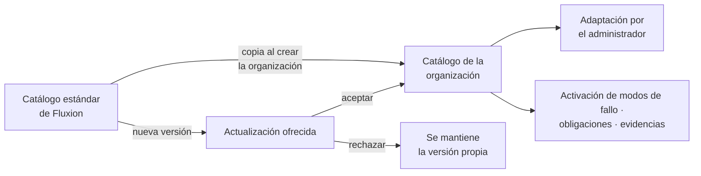

# Catálogo de tablas básicas

El [catálogo de tablas básicas](../glosario.md#catálogo-de-tablas-básicas) es el conocimiento
metodológico sobre el que trabaja Fluxion: los modos de fallo de la IA, los controles que los mitigan,
las obligaciones normativas, los tipos de evidencia y las relaciones entre ellos. Viene listo con el
[catálogo estándar de Fluxion](../glosario.md#catálogo-estándar-de-fluxion) y el administrador de cada
organización lo puede adaptar.

## Propósito

Que la organización empiece a evaluar riesgos y cumplimiento desde el primer día con un método completo
y anclado a la normativa, y que pueda ajustarlo a su realidad sin perder las mejoras que Fluxion vaya
incorporando. Forma parte del [Core](../glosario.md#core).

## Problema que resuelve

Construir desde cero una taxonomía de riesgos de IA, relacionarla con la normativa y con los controles
aplicables y mantenerla al día exige un trabajo experto de meses. Fluxion lo aporta hecho:

| Contenido | Volumen en el catálogo estándar |
|---|---|
| [Modos de fallo](../glosario.md#modo-de-fallo), con [criterios R.I.D.E.](../glosario.md#criterios-ride), [severidad por defecto](../glosario.md#severidad-por-defecto-s_default) y [origen normativo](../glosario.md#origen-normativo-del-modo-de-fallo) | Más de 430, en 6 [dimensiones de riesgo](../glosario.md#dimensión-de-riesgo) |
| [Plantillas de control](../glosario.md#plantilla-de-control) | 59 |
| Relaciones entre modos de fallo y controles | 683 |
| [Obligaciones](../glosario.md#obligación) | 36 del AI Act y 10 de ISO/IEC 42001 |
| [Tipos de evidencia](../glosario.md#tipo-de-evidencia) y su relación con las obligaciones | 20 tipos |
| [Grafo causal](../glosario.md#grafo-causal): [familias causales](../glosario.md#familia-causal), nodos y [relaciones](../glosario.md#relación-causal) | 8 familias, 98 nodos y 120 relaciones |

Las ocho familias causales describen cadenas típicas de daño:
- deriva y calidad de datos → sesgo → discriminación;
- opacidad → responsabilidad → explicación;
- supervisión humana → gobernanza → responsabilidad;
- seguridad → integridad del modelo → gobernanza;
- alucinación de la IA generativa → confianza → daño;
- proceso de desarrollo deficiente;
- propiedad intelectual y contenido generado;
- convergencia en sistemas de alto riesgo.

## Roles

| Rol | Responsabilidad |
|---|---|
| Administrador | Mantiene el catálogo de su organización: altas, cambios y bajas, y aceptación de las actualizaciones del catálogo estándar |
| Equipo de Fluxion | Mantiene el catálogo estándar y publica sus actualizaciones |
| Resto de roles | Usan el catálogo a través del análisis de modos de fallo, las obligaciones y las evidencias |

> **Pendiente de implementar.** Restringir el mantenimiento del catálogo al administrador.

## Flujo de trabajo

1. **Punto de partida.** Cada organización nueva parte de una copia del catálogo estándar de Fluxion
   vigente en ese momento.
2. **Adaptación.** El administrador consulta y mantiene el catálogo desde la sección **Datos**:
   - modos de fallo;
   - medidas de control;
   - tipos de evidencia;
   - obligaciones;
   - relación obligación-evidencia, con nivel de exigencia: requerida, recomendada u opcional;
   - relación modo de fallo-control, distinguiendo la mitigación principal;
   - relaciones causales;
   - visualización interactiva del grafo causal.
3. **Uso.** Los cambios se reflejan en el trabajo de la organización:
   - qué modos de fallo se activan en sus sistemas y con qué severidad por defecto;
   - qué controles se sugieren en el plan de tratamiento;
   - qué tipos de evidencia se esperan para cada obligación.

   > TODO: confirmar dos de estos usos. Es probable que hoy no se sugiera ningún control en el plan de
   > tratamiento, y los tipos de evidencia esperados por obligación todavía no se usan fuera del
   > catálogo.
4. **Actualizaciones del estándar.** Cuando Fluxion publica una nueva versión del catálogo estándar,
   por ejemplo nuevos modos de fallo a raíz de una guía de la AESIA, las organizaciones existentes no la
   reciben automáticamente. Se les ofrece y el administrador decide si la acepta, para no perder sus
   adaptaciones.

> **Pendiente de implementar.**
> - Catálogo por organización, copia al crear la organización y oferta de actualizaciones. Hoy existe un
>   único catálogo común, que corresponde al catálogo estándar de Fluxion.

> TODO: confirmar el nombre definitivo («Catálogo de tablas básicas» o «Catálogo metodológico») y el
> término «Medidas» frente a «Controles».

## Relación normativa

| Norma | Referencia | Qué cubre |
|---|---|---|
| AI Act | Art. 9.2.a | Base para identificar los riesgos conocidos y razonablemente previsibles |
| ISO/IEC 42001 | §6.1.2 | Criterios documentados para la evaluación de riesgos de la IA |
| ISO/IEC 42001 | §6.1.3 y Anexo A | Controles de referencia para el tratamiento |

Cada modo de fallo del catálogo indica el marco del que procede (AI Act, ISO/IEC 42001, ISO/IEC 27001,
RGPD, otra norma, buena práctica o negocio) y los artículos con que se relaciona.

## Módulos relacionados

- **[Análisis de modos de fallo (FMEA)](analisis-modos-de-fallo.md):** activa y evalúa los modos de
  fallo del catálogo.
- **[Plan de tratamiento](plan-de-tratamiento.md):** sugiere controles del catálogo.
- **[Obligaciones](obligaciones.md) y [Biblioteca de evidencias](biblioteca-evidencias.md):** usan el
  catálogo de obligaciones y de tipos de evidencia.
- **Vistas:** sección Datos del catálogo (documentos funcionales pendientes).
