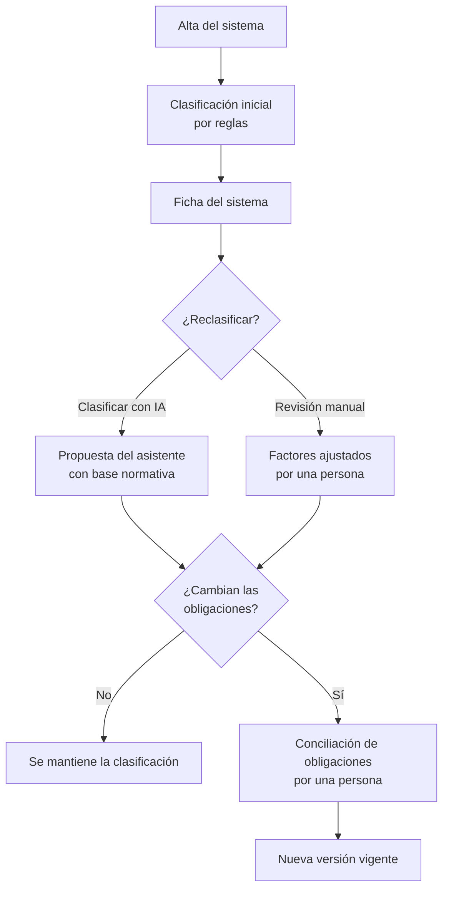

# Clasificación AI Act

La [clasificación AI Act](../glosario.md#clasificación-ai-act) determina el
[nivel de riesgo AI Act](../glosario.md#nivel-de-riesgo-ai-act) de cada
[sistema de IA](../glosario.md#sistema-de-ia) y, con él, las [obligaciones](../glosario.md#obligación)
que le aplican. Fluxion la propone a partir de los datos del inventario y una persona concilia cualquier cambio.

## Propósito

Encuadrar cada sistema en una categoría del Reglamento con una justificación trazable, y mantener la
clasificación al día cuando el sistema cambia. Forma parte del [Core](../glosario.md#core).

## Problema que resuelve

Clasificar un sistema exige recorrer las prácticas prohibidas, los supuestos de alto riesgo del
Anexo III y las obligaciones de transparencia, y documentar por qué se llega a una conclusión. Hacerlo a
mano es lento, poco homogéneo entre equipos y difícil de mantener cuando el sistema evoluciona. Fluxion
aporta:

- **Propuesta inmediata:** al dar de alta un sistema se obtiene una primera clasificación por reglas.
- **Análisis asistido por IA:** el [Asistente de clasificación AI Act](../glosario.md#asistente-de-clasificación-ai-act)
  analiza el sistema con el texto del Reglamento y las guías de las autoridades, y señala cuándo su
  conclusión no coincide con la del motor de reglas.
- **Decisión humana:** ningún cambio de clasificación se aplica hasta que una persona concilia sus
  efectos sobre las obligaciones.
- **Versiones:** cada clasificación queda registrada con su método, su fecha y su autor. Si una
  reclasificación cambia las obligaciones, la organización decide qué hacer con cada una antes de que
  se aplique.

## Roles

| Rol | Responsabilidad |
|---|---|
| Analista de cumplimiento | Lanza la clasificación con IA o la revisión manual y concilia las obligaciones tras una reclasificación |
| Responsable del sistema | Mantiene los datos del sistema de los que depende la clasificación |
| Responsable del SGAI | Supervisa la clasificación de la cartera de sistemas |
| Directivo, Auditor, Lector | Consultan la clasificación y su historial |

> **Pendiente de definir.** Qué roles pueden reclasificar y conciliar. Hoy lo puede
> hacer cualquier miembro de la organización.

## Flujo de trabajo

1. **Clasificación inicial.** Al dar de alta el sistema, un motor de reglas lo clasifica con un orden
   fijo:
   - si presenta una práctica prohibida, es «Práctica prohibida»;
   - si es un modelo de IA de uso general, «Modelo de IA de uso general»;
   - si encaja en un supuesto del Anexo III (por ejemplo, biometría, empleo o servicios esenciales),
     «Alto riesgo»;
   - si tiene obligaciones de transparencia, «Riesgo limitado»;
   - en el resto de casos, «Riesgo mínimo».

   Mientras no se clasifica, figura como «Pendiente de clasificar». Con la clasificación se generan las
   obligaciones sugeridas.

   > TODO: confirmar qué motor de reglas manda. En el alta intervienen dos: uno fija el nivel de riesgo
   > con el orden descrito; el otro registra la versión de la clasificación y genera las obligaciones,
   > pero no evalúa prácticas prohibidas y da prioridad al modelo de uso general sobre el resto. Con
   > datos que indiquen una práctica prohibida, ambos pueden no coincidir.
2. **Clasificación con IA.** Desde la ficha se puede pedir una clasificación al asistente. Este sigue
   el árbol de decisión del AI Act:
   - prácticas prohibidas (Art. 5);
   - modelo de uso general (Art. 51 a 55);
   - alto riesgo (Art. 6, Anexos II y III);
   - transparencia (Art. 50);
   - papel de proveedor o responsable del despliegue.

   Se apoya en el [corpus normativo](../glosario.md#corpus-normativo) y usa el motor de reglas como
   referencia: si sus conclusiones no coinciden, lo indica en la explicación. Si la clasificación
   propuesta es la misma que la vigente, Fluxion lo comunica y no cambia nada.
3. **Revisión manual.** Una persona puede ajustar los factores que determinan la clasificación (dominio,
   tipo de resultado, si afecta a personas, biometría, infraestructura crítica, modelo de uso general…).
   Antes de guardar ve la clasificación resultante y sus obligaciones.
4. **[Reclasificación](../glosario.md#reclasificación).** Tanto la clasificación con IA como la revisión
   manual, si cambian el conjunto de obligaciones, crean una reclasificación pendiente. Solo puede haber
   una por sistema, y se puede cancelar.
5. **Conciliación de obligaciones.** Si la nueva clasificación cambia el conjunto de obligaciones,
   Fluxion muestra la diferencia y pide una decisión:
   - **Obligaciones nuevas:** se aceptan o se excluyen.
   - **Obligaciones que desaparecen y ya tenían trabajo** (en curso o resueltas): se conservan activas
     o se archivan con una nota.
   - **Obligaciones que desaparecen sin trabajo:** se archivan automáticamente.
   - **Obligaciones que no cambian:** se conservan.

   Al terminar, la nueva clasificación pasa a ser la vigente y la anterior queda en el histórico.

Un sistema clasificado como «Práctica prohibida» no puede desplegarse en la UE: Fluxion lo indica como
retirada o rediseño obligatorio.

> TODO: confirmar el tratamiento comercial de «Modelo de IA de uso general». En el AI Act es una
> categoría de modelo, no un nivel de riesgo de sistema, pero Fluxion la guarda como nivel.

> **Pendiente de implementar.** Mostrar el razonamiento del asistente en directo y las fuentes
> normativas consultadas. Existe un panel con esa función, pero ninguna pantalla lo usa todavía.

## Relación normativa

| Norma | Referencia | Qué cubre la clasificación |
|---|---|---|
| AI Act | Art. 5 | Detección de prácticas prohibidas |
| AI Act | Art. 6, Anexo I y Anexo III | Determinación del alto riesgo, por ámbito de uso o como componente de seguridad de un producto regulado |
| AI Act | Art. 50 | Obligaciones de transparencia (riesgo limitado) |
| AI Act | Art. 3.63 y Art. 51 a 55 | Modelos de IA de uso general y riesgo sistémico |
| AI Act | Art. 3.3, 3.4 y 25 | Papel de proveedor o responsable del despliegue |

> TODO: confirmar si la propuesta comercial debe mencionar que el resultado es una propuesta de apoyo
> y no un dictamen jurídico. El código siempre exige que una persona concilie los cambios, pero no muestra ningún aviso
> legal.

## Módulos relacionados

- **[Inventario de sistemas de IA](inventario.md):** aporta los datos de entrada.
- **[Obligaciones](obligaciones.md):** se generan y concilian a partir de la clasificación.
- **[Análisis de modos de fallo (FMEA)](analisis-modos-de-fallo.md):** el nivel de riesgo fija el
  [suelo AI Act](../glosario.md#suelo-ai-act) de la zona de riesgo.
- **Informes del sistema:** la ficha para el registro UE solo aplica a sistemas de alto riesgo.
- **Vistas:** [Ficha del sistema](../funcional/ficha-sistema.md). **Técnico:** [Servicio de agentes](../tecnica/servicio-agentes.md),
  [RAG y corpus normativo](../tecnica/rag.md).
