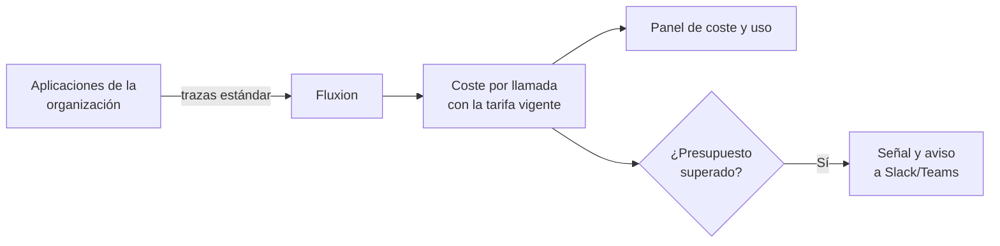

# Coste y uso de IA (FinOps)

[Coste y uso de IA](../glosario.md#coste-y-uso-de-ia-finops) es un módulo que mide cuánto cuesta, cuánto
se usa y cuánto tarda cada llamada a modelos de IA de la organización, por modelo y por sistema. Permite
fijar [presupuestos](../glosario.md#presupuesto-de-ia) y avisa cuando se superan.

## Propósito

Dar visibilidad y control sobre el gasto en modelos de IA, a menudo disperso entre proveedores y
equipos, y relacionarlo con los sistemas del inventario. Es un [módulo](../glosario.md#módulo)
contratable.

## Problema que resuelve

El consumo de modelos de IA se factura por uso y crece sin que nadie lo vea hasta que llega la factura.
Además, la latencia afecta a la experiencia de quien usa el sistema. El módulo:

- **Centraliza el gasto:** coste del periodo, número de llamadas y latencia, por modelo y por sistema.
- **Calcula el coste con tarifas propias:** cada organización registra sus
  [tarifas de modelo](../glosario.md#tarifa-de-modelo) con fecha de vigencia, de modo que el coste de cada
  llamada queda fijado con el precio de su momento.
- **Avisa a tiempo:** presupuestos mensuales con umbral de aviso, para la organización o para un sistema.
- **Protege los datos:** solo se guardan metadatos de cada llamada. El contenido de prompts y respuestas
  se descarta aunque se envíe, para que Fluxion no trate los datos personales que contienen.

## Roles

| Rol | Responsabilidad |
|---|---|
| Responsable del SGAI, CAIO | Consultan el coste y definen presupuestos |
| Responsable del sistema | Sigue el coste y la latencia de sus sistemas |
| Directivo | Consulta el gasto agregado |
| Equipo técnico de la organización | Envía las trazas a Fluxion desde sus aplicaciones |

> **Pendiente de definir.** Qué roles pueden gestionar tarifas y presupuestos. Hoy lo puede hacer
> cualquier miembro de la organización.

## Flujo de trabajo

1. **Conexión.** El equipo técnico configura sus aplicaciones para enviar trazas a Fluxion con el
   estándar OpenTelemetry, autenticadas con una [clave API](../glosario.md#clave-api). Fluxion se queda
   solo con las llamadas a modelos de IA y descarta el resto.
2. **Tarifas.** La organización registra el precio por token de los modelos que usa, con fecha de
   vigencia. Si un modelo no tiene tarifa, su coste figura como desconocido y la pantalla lo señala. Si
   se calcula con datos parciales, figura como estimado.
3. **Panel.**
   - Para un periodo de 7, 30 o 90 días, la vista **Observabilidad** muestra el coste del periodo, el
     número de llamadas y la latencia (hasta el primer token y de la llamada completa).
   - Muestra también el desglose por modelo y por sistema, y los modelos sin tarifa.
   - Los datos se agregan cada hora.
4. **Presupuestos.** Se define un presupuesto mensual para la organización o para un sistema, con el
   porcentaje a partir del cual avisar. Cada hora Fluxion compara el gasto con los presupuestos. Al
   alcanzarse un umbral, registra una [señal de riesgo](../glosario.md#señal-de-riesgo) y avisa a los
   canales de Slack o Teams configurados.

> TODO: confirmar qué ve la organización sobre el estado de cada llamada (coste exacto, estimado o
> desconocido) y si el panel desglosa por sistema cuando la traza no indica el sistema de origen.

> **Pendiente de implementar.**
> - Evaluación de calidad de sistemas basados en recuperación de información: separada de este módulo
>   y en la [Hoja de ruta](hoja-de-ruta.md).
> - Acceso condicionado a la activación del módulo. Hoy la vista aparece siempre en el menú.

## Relación normativa

| Norma | Referencia | Qué cubre |
|---|---|---|
| AI Act | Art. 12 | Registro automático de eventos (logs) de las llamadas, como apoyo a la trazabilidad |
| ISO/IEC 42001 | §9.1 | Seguimiento y medición del uso de los sistemas de IA |
| ISO/IEC 42001 | §7.1 | Recursos: control del coste de los recursos de IA |

> TODO: confirmar si se quiere presentar la relación con el Art. 12 del AI Act. El módulo registra
> metadatos de cada llamada, pero no está diseñado como el registro de eventos que exige el Reglamento.

## Módulos relacionados

- **[Inventario de sistemas de IA](inventario.md):** el coste se asocia a los sistemas.
- **[Plataforma](plataforma.md):** claves API y avisos a Slack o Teams.
- **[Hoja de ruta](hoja-de-ruta.md):** Evaluación de calidad.
- **Vistas:** [Coste y uso de IA](../funcional/coste-uso-ia.md), [Tarifas de modelos](../funcional/tarifas-modelos.md),
  [Presupuestos de IA](../funcional/presupuestos.md). **Técnico:** [Telemetría](../tecnica/telemetria.md).
