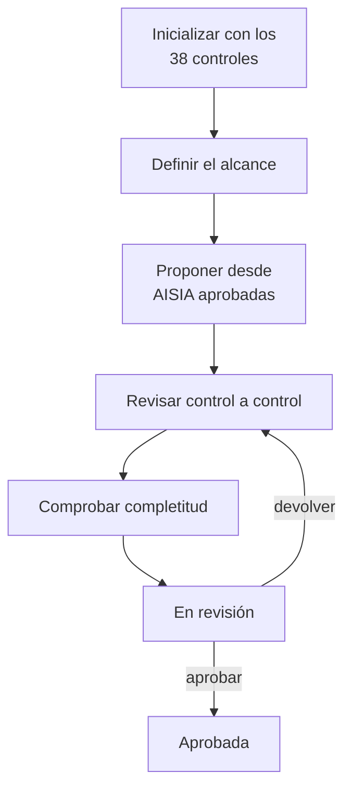

# Declaración de Aplicabilidad ISO 42001

La [Declaración de Aplicabilidad ISO 42001](../glosario.md#declaración-de-aplicabilidad-iso-42001) es el
documento en que la organización declara, para cada uno de los 38 controles del Anexo A de ISO/IEC 42001,
si le aplica, por qué y en qué estado de implantación está. Fluxion la construye a partir del trabajo
hecho en los sistemas y propone la aplicabilidad y la justificación de cada control con IA.

## Propósito

Disponer de una Declaración de Aplicabilidad completa, justificada y aprobada, coherente con los
sistemas de IA de la organización y lista para una auditoría de certificación. Es el único documento del
recorrido que pertenece a la organización y no a un sistema concreto. Forma parte del
[Core](../glosario.md#core).

## Problema que resuelve

La Declaración de Aplicabilidad es un documento obligatorio para certificarse en ISO/IEC 42001. Suele
redactarse en una hoja de cálculo, desconectada de los sistemas y de los riesgos reales, y se
desactualiza pronto. Fluxion:

- **Parte del catálogo oficial:** los 38 controles del Anexo A, agrupados en sus nueve apartados (A.2
  Políticas relacionadas con la IA a A.10 Relaciones con terceros y clientes).
- **Conecta con los sistemas:** propone aplicabilidad y justificación a partir de las
  [evaluaciones de impacto](../glosario.md#evaluación-de-impacto-del-sistema-de-ia-aisia) aprobadas de
  los sistemas en alcance.
- **Prueba la implantación:** cada control se vincula a la [evidencia](../glosario.md#evidencia) que lo
  valida y a los sistemas a los que afecta.
- **Gobierna el documento:** borrador, revisión y aprobación, con roles autorizados, historial y
  registro de cada cambio de estado.

## Roles

| Rol | Responsabilidad |
|---|---|
| Responsable del SGAI | Prepara la Declaración, la envía a revisión y puede aprobarla |
| Analista de cumplimiento | Completa la aplicabilidad y las justificaciones y puede enviarla a revisión |
| DPO | Puede enviarla a revisión |
| CAIO | Puede enviarla a revisión y aprobarla |
| Administrador | Puede enviarla a revisión y aprobarla |
| Responsable de cada control | Responde de la implantación del control que tiene asignado |
| Auditor | Consulta la Declaración aprobada, su historial y sus evidencias |

## Flujo de trabajo

1. **Inicialización.** La organización crea su Declaración, que arranca en borrador con los 38
   controles en estado «No iniciado».
2. **Datos generales.** En la cabecera se registran los datos del documento, entre ellos el alcance:
   las etiquetas que determinan qué sistemas entran en el sistema de gestión. Si no se definen etiquetas,
   entran todos los sistemas.
3. **Propuesta desde las evaluaciones de impacto.** Fluxion lee las AISIA aprobadas de los sistemas en
   alcance y propone, con IA, la aplicabilidad y una justificación para cada control. Requiere al menos
   un sistema en alcance y al menos una AISIA aprobada; si no, explica qué falta. La IA también ayuda a
   redactar la justificación de un control concreto.
4. **Revisión control a control.** Para cada control se decide:
   - si aplica, con su justificación;
   - el estado de implantación: «No iniciado», «Planificado», «En progreso», «Implantado» o
     «Externalizado»;
   - el responsable;
   - la evidencia que lo valida;
   - los sistemas a los que afecta;
   - notas.

   Las propuestas de la IA se aplican revisándolas una a una, y la aplicabilidad se puede marcar en
   bloque.
5. **Completitud.** Fluxion comprueba que todos los controles aplicables tienen justificación y señala
   los que faltan.
6. **Revisión y aprobación.**
   - La Declaración pasa a «En revisión» y después a «Aprobada»; también puede volver a borrador.
   - Fuera de borrador es de solo lectura: para modificarla hay que abrir una revisión.
   - Cada cambio de estado queda registrado con su autor y su fecha.
   - Hay un historial de los cambios por control.

7. **Impresión.** La Declaración se puede imprimir o guardar en PDF desde el navegador.

> TODO: confirmar el estado de implantación «Externalizado». Aparece en la interfaz, pero no se ha
> comprobado que se guarde como un estado distinto.

> **Pendiente de implementar.** Aprobación de la Declaración a través de
> [Flujos de aprobación](../glosario.md#flujos-de-aprobación). La política se puede configurar, pero hoy
> la aprobación se hace con el cambio de estado del propio documento.

## Relación normativa

| Norma | Referencia | Qué cubre |
|---|---|---|
| ISO/IEC 42001 | §6.1.3 | Elaboración de la Declaración de Aplicabilidad con los controles necesarios y la justificación de su inclusión o exclusión |
| ISO/IEC 42001 | Anexo A | Los 38 controles de referencia (A.2 a A.10) |
| ISO/IEC 42001 | §6.1.4 | Uso de las evaluaciones de impacto como base de la aplicabilidad |
| ISO/IEC 42001 | §4.3 | Alcance del sistema de gestión, mediante las etiquetas de alcance |

## Módulos relacionados

- **Evaluación de impacto (AISIA)** (módulo): fuente de la propuesta de aplicabilidad.
- **[Biblioteca de evidencias](biblioteca-evidencias.md):** evidencias que validan cada control.
- **[Inventario de sistemas de IA](inventario.md):** sistemas en alcance.
- **[Análisis de brechas](brechas.md):** vista de lo que falta en el conjunto de la organización.
- **Vistas:** [Declaración de Aplicabilidad ISO 42001](../funcional/declaracion-aplicabilidad.md). **Técnico:**
  [modelo-datos.md](../tecnica/modelo-datos.md#evidencias-brechas-y-cumplimiento-iso).
