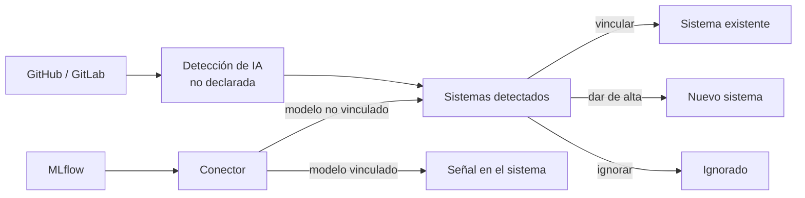

# Descubrimiento de inventario

[Descubrimiento de inventario](../glosario.md#descubrimiento-de-inventario) es un módulo que encuentra
sistemas de IA en las herramientas de la organización y los propone para el inventario. Tiene dos
fuentes:
- el [Conector MLflow](../glosario.md#conector-mlflow), que lee el registro de modelos;
- la [Detección de IA no declarada](../glosario.md#detección-de-ia-no-declarada), que analiza los
  repositorios de código.

## Propósito

Que el [inventario de sistemas de IA](inventario.md) esté completo sin depender solo de que cada equipo
declare lo que usa, y que los cambios relevantes de un modelo ya inventariado lleguen a Fluxion. Es un
[módulo](../glosario.md#módulo) contratable.

## Problema que resuelve

El mayor riesgo del inventario es lo que no está en él: modelos registrados que nadie ha dado de alta,
o aplicaciones que llaman a un proveedor de IA sin que el área de cumplimiento lo sepa. Revisarlo a mano
no escala. El módulo:

- **Detecta lo que falta:** los modelos del registro de MLflow y los repositorios con uso de IA aparecen
  como [sistemas detectados pendientes de alta](../glosario.md#sistema-detectado-pendiente-de-alta).
- **Vigila lo que ya está:** cuando se registra una nueva versión de un modelo vinculado o se promociona
  a producción, el sistema recibe una [señal de riesgo](../glosario.md#señal-de-riesgo). Indica que el
  sistema puede no ser ya el que describe su documentación.
- **Encuentra credenciales expuestas:** la detección señala claves de proveedores de IA presentes en el
  código para que se roten, sin guardar nunca su valor.
- **Respeta la decisión humana:** nada entra en el inventario sin que una persona lo vincule, lo dé de
  alta o lo ignore. Una decisión tomada no se revierte aunque el conector siga viendo el mismo modelo.

## Roles

| Rol | Responsabilidad |
|---|---|
| Administrador, Responsable del SGAI | Configuran las conexiones con MLflow, GitHub o GitLab |
| Administrador, Responsable del SGAI, CAIO, Analista de riesgos, Analista de cumplimiento | Resuelven los sistemas detectados: vincular, dar de alta, ignorar o reabrir |
| Responsable del sistema | Recibe las señales de su sistema |

## Flujo de trabajo

1. **Conexión.** En **Ajustes › Conectores** se da de alta cada fuente: la URL, las credenciales y la
   frecuencia de revisión, desde cada 5 minutos hasta una vez al día. Las credenciales se guardan cifradas.
   - **MLflow:** credenciales de acceso al registro de modelos.
   - **GitHub y GitLab:** la organización o grupo que se analiza y un token de solo lectura. El módulo
     nunca necesita permisos de escritura.

   También se puede pedir una sincronización inmediata.
2. **Revisión automática.**
   - **MLflow:** el conector lee solo el registro de modelos, no los experimentos: registrar un modelo
     es la señal de que alguien quiere usarlo.
   - **Repositorios:** la detección lee los manifiestos de dependencias y una muestra del código y de
     los ficheros de modelo, y busca:
     - librerías de IA;
     - llamadas a proveedores;
     - ficheros de modelo;
     - credenciales.

     No guarda código. Si un fichero menciona cuatro o más proveedores, lo trata como un listado y lo
     marca como informativo. Respeta los límites de uso de la API del proveedor y continúa en la
     siguiente pasada lo que no haya podido revisar.
3. **Resolución.** En **Sistemas › Descubrimientos**, cada sistema detectado se:
   - **vincula** a un sistema del inventario;
   - **da de alta** como sistema nuevo;
   - **ignora**.

   Una decisión se puede reabrir. De los repositorios se ven los
   [hallazgos de IA no declarada](../glosario.md#hallazgo-de-ia-no-declarada): qué patrón, en qué
   fichero y en qué línea.
4. **Señales.** A partir de la vinculación, el conector de MLflow publica en el
   [historial del sistema](../glosario.md#historial-del-sistema) cada versión registrada (informativa) y
   cada promoción a producción (gravedad media).
5. **Seguimiento.** Cada sincronización queda registrada con su resultado (correcta, con errores o
   parcial) y sus cifras.

El menú muestra el número de sistemas detectados pendientes de resolver.

> **Pendiente de implementar.**
> - Fusión de los dos módulos actuales (Conector MLOps y Detección de Shadow AI) en uno con dos fuentes.
>   Hoy se activan por separado, aunque comparten la misma bandeja.
> - Acceso condicionado a la activación del módulo. Hoy la activación solo muestra u oculta la entrada
>   del menú.

## Relación normativa

| Norma | Referencia | Qué cubre |
|---|---|---|
| AI Act | Art. 3.1 | Identificación de los sistemas que entran en el ámbito del Reglamento |
| AI Act | Art. 26 y 16 | Base para que proveedores y responsables del despliegue conozcan los sistemas sobre los que tienen obligaciones |
| ISO/IEC 42001 | §4.3 | Alcance completo del sistema de gestión |

> TODO: confirmar las referencias normativas. El AI Act no exige expresamente un inventario ni la
> detección automática; la relación es de apoyo.

## Módulos relacionados

- **[Inventario de sistemas de IA](inventario.md):** destino de los sistemas detectados.
- **[Plataforma](plataforma.md):** conectores y claves API.
- **Señales de riesgo y [Tareas](tareas.md):** las señales críticas generan tareas.
- **Vistas:** [Sistemas detectados](../funcional/descubrimientos.md), [Ajustes](../funcional/ajustes.md).
  **Técnico:** [Conectores](../tecnica/conectores.md).
