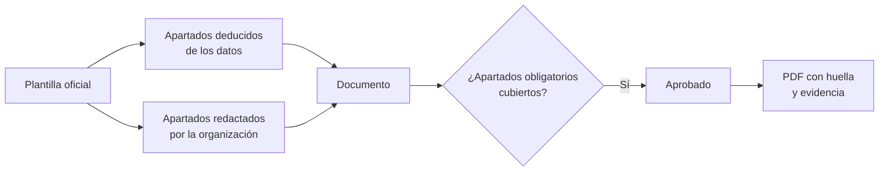

# Documentación del sistema

[Documentación del sistema](../glosario.md#documentación-del-sistema) es un módulo que genera los
documentos regulatorios de cada sistema de IA con la estructura exacta que exige la norma. Fluxion
rellena lo que ya sabe del sistema, la organización completa el resto, el documento se aprueba y se
entrega en PDF con huella de integridad.

## Propósito

Producir la documentación regulatoria de cada sistema organizada por los apartados oficiales, de modo
que cualquier carencia se pueda citar («falta el punto 2.g del Anexo IV») y corregir, y que el
entregable sea verificable. Es un [módulo](../glosario.md#módulo) contratable.

## Problema que resuelve

La documentación técnica del AI Act, la FRIA o la DPIA se suelen redactar en documentos de texto que
copian datos de otras fuentes y quedan desactualizados. Si se organizan por las pantallas de una
herramienta y no por los apartados de la norma, los huecos son difíciles de ver. El módulo:

- **Estructura oficial:** cada documento sigue los apartados del texto legal, verificados contra la
  fuente oficial.
- **Menos redacción:** los apartados que Fluxion puede deducir de la ficha del sistema, del análisis de
  modos de fallo o del historial se rellenan solos. La organización solo redacta lo que falta.
- **Sin aprobaciones con huecos:** un documento no se puede aprobar mientras tenga apartados
  obligatorios sin cubrir.
- **Entregable verificable:** cada PDF generado es inmutable, lleva huella de integridad y queda como
  [evidencia](../glosario.md#evidencia) del sistema.

## Roles

| Rol | Responsabilidad |
|---|---|
| Responsable del sistema | Redacta los apartados que no se deducen de los datos |
| Analista de cumplimiento | Revisa el documento y lo envía a revisión |
| DPO | Interviene en la DPIA y en la relación de la FRIA con la protección de datos |
| Aprobador | Aprueba el documento |
| Auditor | Consulta los documentos aprobados y sus PDF |

> **Pendiente de definir.** Qué roles pueden aprobar un documento. Hoy lo puede hacer cualquier miembro
> de la organización.

## Flujo de trabajo

1. **Elección del documento.** Desde el expediente documental del sistema se abre uno de los cuatro
   documentos:

   | Documento | Estructura | Para quién |
   |---|---|---|
   | Documentación técnica | Anexo IV del AI Act | Sistemas de alto riesgo (proveedor) |
   | Evaluación de impacto en los derechos fundamentales (FRIA) | Art. 27 del AI Act | Responsables del despliegue obligados |
   | Evaluación de impacto relativa a la protección de datos (DPIA) | Art. 35 del RGPD | Tratamientos de alto riesgo para las personas |
   | Ficha del modelo | Anexo XII del AI Act | Proveedores de modelos de IA de uso general |

2. **Composición.** Cada apartado indica si es obligatorio, una guía de qué debe contener y de dónde
   sale su contenido: de la ficha del sistema, del análisis de modos de fallo, del historial o de la
   redacción de la organización. Los datos deducidos se actualizan solos cuando cambia el sistema.
3. **Redacción.** La organización redacta los apartados manuales. Solo se guarda lo que escriben las
   personas; el resto se compone en cada momento a partir de los datos.
4. **Revisión y aprobación.** El documento pasa por borrador, en revisión y aprobado. Fluxion impide
   aprobarlo mientras falte algún apartado obligatorio e indica cuáles. Un documento aprobado se puede
   reabrir para editarlo.

   > TODO: confirmar el versionado de los documentos. Hoy no se crean versiones nuevas: al reabrir, se
   > edita el mismo documento.
5. **Generación del PDF.** Del documento se genera un PDF con el nombre de la organización. Cada PDF:
   - es inmutable;
   - lleva una huella del fichero y otra del contenido;
   - se guarda como evidencia del sistema.

   Se pueden descargar los PDF generados anteriormente.

   > TODO: confirmar el rótulo de los PDF. Todos se titulan «Anexo IV», también los de FRIA, DPIA y ficha
   > del modelo.

Fluxion no deja enviar al servicio de PDF ningún enlace ni credencial de la aplicación: recibe el
documento ya construido.

> TODO: confirmar si el PDF debe usar la identidad visual configurada en la organización (logotipo,
> idioma y pie de los documentos). Hoy solo incluye el nombre de la organización.

> TODO: confirmar si Fluxion indica para qué sistemas aplica cada documento. Hoy los cuatro se ofrecen
> en todos los sistemas, sea cual sea su nivel de riesgo o el rol de la organización.

> **Pendiente de implementar.**
> - Redacción automática de los apartados manuales por el
>   [Generador de documentos](../glosario.md#generador-de-documentos), en la [Hoja de ruta](hoja-de-ruta.md).
> - Aprobación de los documentos mediante [Flujos de aprobación](../glosario.md#flujos-de-aprobación).
> - Acceso condicionado a la activación del módulo.

## Relación normativa

| Norma | Referencia | Qué cubre |
|---|---|---|
| AI Act | Art. 11 y Anexo IV | Documentación técnica de los sistemas de alto riesgo |
| AI Act | Art. 27 | Evaluación de impacto en los derechos fundamentales |
| AI Act | Art. 53.1.b y Anexo XII | Información que el proveedor de un modelo de uso general entrega a quien lo integra |
| AI Act | Art. 18 | Conservación de la documentación (diez años) |
| RGPD | Art. 35 | Evaluación de impacto relativa a la protección de datos |
| ISO/IEC 42001 | §7.5 | Información documentada: control de versiones y aprobación |

> TODO: confirmar que la conservación del Art. 18 está cubierta. El almacenamiento de documentos tiene
> un bloqueo de borrado de diez años, pero no se ha comprobado que se informe de ello en la aplicación.

## Módulos relacionados

- **[Inventario de sistemas de IA](inventario.md) y [Análisis de modos de fallo (FMEA)](analisis-modos-de-fallo.md):**
  origen de los apartados deducidos.
- **[Biblioteca de evidencias](biblioteca-evidencias.md):** recibe los PDF generados.
- **[Informes del sistema](informes-del-sistema.md):** visión documental automática, sin redacción ni
  aprobación.
- **[Plataforma](plataforma.md):** datos de la organización que aparecen en los documentos.
- **Vistas:** [Expediente documental](../funcional/expediente-documental.md). **Técnico:** [Generación de PDF](../tecnica/generacion-pdf.md).
