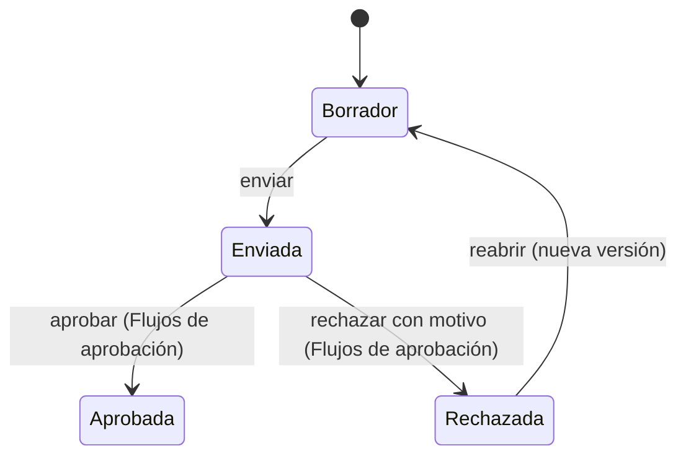

# Evaluación de impacto

[Evaluación de impacto](../glosario.md#evaluación-de-impacto) es un módulo con tres herramientas:
- la [evaluación de impacto del sistema de IA (AISIA)](../glosario.md#evaluación-de-impacto-del-sistema-de-ia-aisia),
  que mide las consecuencias de un sistema sobre personas y sociedad;
- el registro de [riesgos de negocio](../glosario.md#riesgo-de-negocio), para los riesgos que afectan a
  la viabilidad del sistema y no al cumplimiento;
- el [cuestionario preliminar](../glosario.md#cuestionario-preliminar), que recoge información antes de
  dar de alta un sistema.

## Propósito

Completar la evaluación de riesgos regulatoria con una mirada sobre el impacto en las personas, sobre
el valor de negocio y sobre la información previa al alta. La AISIA es además la base de la
[Declaración de Aplicabilidad ISO 42001](declaracion-aplicabilidad.md). Es un [módulo](../glosario.md#módulo)
contratable.

## Problema que resuelve

- **Impacto en personas y sociedad:** ISO/IEC 42001 exige evaluar las consecuencias de los sistemas de
  IA sobre individuos, grupos y sociedad. La AISIA lo estructura en seis secciones y reutiliza lo ya
  hecho en el análisis de modos de fallo y en el plan de tratamiento.
- **Riesgos que no son de cumplimiento:** un sistema puede cumplir el Reglamento y fracasar porque nadie
  presupuestó su infraestructura. Esos riesgos no caben en la escala del análisis de modos de fallo,
  donde un sobrecoste competiría con un daño a personas. El registro de riesgos de negocio los mide con
  probabilidad e impacto, sin el rigor ni la aprobación que exige lo regulatorio.
- **Información antes del alta:** antes de registrar un proyecto con IA conviene saber si trata datos
  personales, de quién es el sistema y para qué se usará. El cuestionario preliminar recoge esa
  información de forma ordenada.

## Roles

| Rol | Responsabilidad |
|---|---|
| Responsable del sistema | Completa la AISIA, el registro de riesgos de negocio y el cuestionario de sus proyectos |
| DPO | Interviene en la sección de datos de la AISIA y en el estado de la DPIA; emite dictamen antes de que se apruebe |
| Comité de IA | Aprueba o rechaza la AISIA en los [Flujos de aprobación](flujos-de-aprobacion.md) |
| Directivo | Consulta los riesgos de negocio |
| Auditor | Consulta las AISIA aprobadas |

Quien prepara la AISIA no la aprueba: ni quien la creó ni quien la envió pueden decidirla.

## Flujo de trabajo

### Evaluación de impacto del sistema de IA (AISIA)

1. **Inicio.** Se abre desde la ficha del sistema. Solo puede haber una AISIA activa (en borrador o
   enviada) por sistema.
2. **Secciones.** Seis secciones, cada una con su estado (pendiente, en curso, completa):

   | Sección | Contenido | Se apoya en |
   |---|---|---|
   | S1 · Descripción del sistema | Qué es y para qué sirve | Ficha del sistema, con datos precargados y ajustables |
   | S2 · Datos e información | Datos tratados y estado de la DPIA | Datos del sistema |
   | S3 · Modos de fallo identificados | Modos de fallo relevantes para el impacto | [Análisis de modos de fallo](analisis-modos-de-fallo.md) |
   | S4 · Acciones de tratamiento | Medidas adoptadas | [Plan de tratamiento](plan-de-tratamiento.md) |
   | S5 · Impacto en personas | Efectos sobre individuos y grupos | — |
   | S6 · Impacto social | Efectos sobre la sociedad | — |

   Conviene hacer la AISIA después del análisis de modos de fallo y del plan de tratamiento, porque las
   secciones 3 y 4 los usan.
3. **Envío y decisión.** La AISIA se envía a aprobación y la decisión se toma siempre en los
   [Flujos de aprobación](flujos-de-aprobacion.md), nunca en la propia evaluación. Por defecto, el DPO
   emite su dictamen y el Comité de IA la aprueba o la rechaza con un motivo. Para enviarla, la
   organización debe tener activa una política de aprobación para la AISIA. Una AISIA rechazada se reabre
   como nueva versión; las anteriores se conservan.

   > TODO: confirmar dos puntos de la AISIA.
   > - **Actualización:** no hay forma de actualizar una AISIA ya aprobada.
   > - **Datos precargados de la ficha:** solo se guardan si se modifican.
4. **Uso posterior.** Las AISIA aprobadas alimentan la propuesta de aplicabilidad de la Declaración de
   Aplicabilidad ISO 42001.

### Riesgos de negocio

1. Para cada sistema se registran los riesgos de negocio (por ejemplo, de retorno de la inversión o
   técnicos con impacto económico), con:
   - probabilidad e impacto, de 1 a 5;
   - la exposición, que Fluxion calcula como su producto.
2. Se decide una respuesta: mitigar, aceptar, transferir o evitar. Aceptar exige una justificación.
3. No requiere aprobación ni forma parte de la documentación regulatoria.

> TODO: confirmar el responsable de cada riesgo de negocio. El dato existe, pero hoy no se puede asignar.

### Cuestionario preliminar

1. Antes de dar de alta un sistema, se completa un cuestionario de siete secciones:
   - proyecto;
   - información básica;
   - sistema de IA;
   - finalidad prevista;
   - datos e información;
   - forma de utilización;
   - posición en la cadena de valor.
2. La finalidad prevista recoge los [supuestos AI Act](../glosario.md#supuestos-ai-act) del sistema:
   prácticas prohibidas y sus excepciones, productos regulados (Anexo I), ámbitos de alto riesgo
   (Anexo III) y la excepción del Art. 6.3, obligaciones de transparencia y relación con modelos de IA de
   uso general. Cada bloque se responde de forma explícita, con una opción «Ninguno» cuando no aplica: una
   pregunta sin responder no equivale a «no».
3. Mientras se rellena, Fluxion muestra en todas las secciones una **clasificación preliminar**: nivel de
   riesgo o ámbito, fundamento, avisos, roles en la cadena de valor y obligaciones sugeridas. La calcula
   el mismo motor de clasificación que el alta del sistema. Es una propuesta: la
   [clasificación AI Act](../glosario.md#clasificación-ai-act) del sistema se fija al darlo de alta.
4. Se guarda como borrador hasta completarlo. Para completarlo, Fluxion exige los campos obligatorios y
   que no haya respuestas contradictorias (por ejemplo, indicar que no se usa IA y marcar supuestos). Al
   completarlo, guarda la clasificación preliminar.
5. Los cuestionarios se listan, con su clasificación preliminar, y se pueden retomar desde el panel
   principal.

> **Pendiente de implementar.**
> - Alta del sistema en el inventario a partir del cuestionario preliminar, con sus respuestas ya
>   rellenas.
> - Propuesta de contenido por IA para las secciones de la AISIA.
> - Acceso condicionado a la activación del módulo. Hoy AISIA, riesgos de negocio y cuestionario
>   preliminar están disponibles para todas las organizaciones.

> TODO: confirmar el destinatario del cuestionario preliminar. Sus preguntas (cliente, empresa del
> grupo, autorización del cliente para usar IA) parecen pensadas para una organización que presta
> servicios a terceros.

## Relación normativa

| Norma | Referencia | Qué cubre |
|---|---|---|
| AI Act | Art. 5, Art. 6 y Anexos I y III, Art. 50 | Supuestos que recoge el cuestionario preliminar para la clasificación preliminar |
| ISO/IEC 42001 | §6.1.4 | Evaluación de impacto de los sistemas de IA sobre individuos, grupos y sociedad |
| ISO/IEC 42001 | Anexo A.5 | Controles de evaluación de impactos de los sistemas de IA |
| ISO/IEC 42001 | §6.1 | Riesgos para los objetivos de la organización, que cubre el registro de riesgos de negocio |
| RGPD | Art. 35 | Relación con la DPIA en la sección de datos |

## Módulos relacionados

- **[Análisis de modos de fallo (FMEA)](analisis-modos-de-fallo.md) y [Plan de tratamiento](plan-de-tratamiento.md):**
  alimentan las secciones 3 y 4 de la AISIA.
- **[Declaración de Aplicabilidad ISO 42001](declaracion-aplicabilidad.md):** usa las AISIA aprobadas.
- **[Inventario de sistemas de IA](inventario.md):** el cuestionario preliminar precede al alta.
- **Documentación del sistema** (módulo): la FRIA y la DPIA son evaluaciones de impacto con estructura
  legal propia.
- **Vistas:** [AISIA](../funcional/aisia.md), [Riesgos de negocio](../funcional/riesgos-negocio.md),
  [Cuestionarios preliminares](../funcional/cuestionario-preliminar.md).
