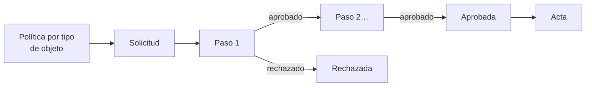

# Flujos de aprobación

Los [Flujos de aprobación](../glosario.md#flujos-de-aprobación) definen quién debe aprobar cada tipo de
decisión, en qué orden y con qué quórum, y dejan constancia inmutable de cada voto. Están disponibles
en todos los planes.

## Propósito

Que las decisiones de gobierno de la IA, como aceptar un riesgo residual o aprobar un documento, las
tome quien tiene autoridad para ello, siguiendo un circuito definido por la organización y con una
prueba de quién decidió, cuándo y en nombre de quién. Forma parte del [Core](../glosario.md#core).

## Problema que resuelve

El AI Act pide que el riesgo residual se juzgue aceptable. Juzgar es un acto de alguien, y ante una
auditoría tiene que constar quién lo hizo y con qué autoridad. Sin un circuito, las aprobaciones se
pierden en correos o en un campo de texto con la referencia a un acta. Fluxion:

- **Circuitos por tipo de decisión:** una política por tipo de objeto, con pasos sucesivos y
  condiciones de aplicación.
- **Aprobadores flexibles:** cada paso lo resuelve un rol, una persona concreta o un
  [comité](../glosario.md#comité) con quórum.
- **Delegaciones:** con fecha de fin obligatoria, para que una ausencia no bloquee el circuito.
- **Segregación de funciones:** por defecto, quien solicita no puede aprobar. Permitirlo queda
  registrado en la política.
- **Prueba inmutable:** cada decisión queda registrada sin posibilidad de cambio. Un rechazo exige
  motivo, y al cerrarse la solicitud se puede generar el [acta](../glosario.md#acta).

## Roles

| Rol | Responsabilidad |
|---|---|
| Administrador, Responsable del SGAI, CAIO | Definen las políticas de aprobación |
| Administrador, Responsable del SGAI | Gestionan las delegaciones |
| Aprobadores (según cada paso) | Aprueban, rechazan o se abstienen en las solicitudes que les corresponden |
| Solicitante | Envía el objeto a aprobación; puede cancelar la solicitud |
| Auditor | Consulta el histórico de aprobaciones |

## Flujo de trabajo

1. **Política.** En **Ajustes › Aprobaciones** se define una política por tipo de objeto, con pasos
   sucesivos. Los tipos son: plan de tratamiento, evaluación de impacto (AISIA), documento regulatorio,
   Declaración de Aplicabilidad y evidencia. Cada paso indica:
   - **Quién aprueba:** un rol, una persona o un comité.
   - **Quórum:** solo en comités.
   - **Delegación:** si la admite.

   La política también indica si quien solicita puede aprobar. Solo puede haber una política activa por
   tipo de objeto.
2. **Solicitud.** Al enviar un objeto a aprobación, Fluxion abre una solicitud con una copia congelada
   de la política vigente, de modo que un cambio posterior de la política no altera las solicitudes en
   curso. Solo puede haber una solicitud pendiente por objeto.
3. **Decisión.** Cada aprobador ve sus pendientes en **Aprobaciones**. Puede aprobar, rechazar (con
   motivo) o abstenerse. Si el paso es de comité, se cierra al alcanzar el quórum. Las delegaciones
   permiten que otra persona decida en nombre del aprobador hasta la fecha indicada.
4. **Avisos.** Fluxion avisa al aprobador de cada paso pendiente y al solicitante del resultado. Los
   eventos de aprobación se pueden enviar a sistemas externos mediante
   [integraciones salientes](../glosario.md#integración-saliente-webhook).
5. **Cierre.** Al aprobarse o rechazarse la solicitud, Fluxion aplica el resultado al objeto. Por
   ejemplo, el plan de tratamiento pasa a aprobado. El histórico guarda todas las decisiones.

Si no hay política para un tipo de objeto, el objeto se aprueba con su mecanismo propio; en el plan de
tratamiento, el aprobador asignado según el [nivel de aprobación](../glosario.md#nivel-de-aprobación).

> **Pendiente de implementar.**
> - Hoy solo los planes de tratamiento abren solicitudes en este circuito. Las políticas se pueden
>   configurar para los cinco tipos, pero la evaluación de impacto, los documentos, la Declaración de
>   Aplicabilidad y las evidencias todavía se aprueban con su propio cambio de estado.
> - Integración completa de la aprobación del plan de tratamiento en este circuito.

> **Pendiente de definir.** Qué rol aprueba en cada nivel de aprobación del plan de tratamiento.

## Relación normativa

| Norma | Referencia | Qué cubre |
|---|---|---|
| AI Act | Art. 9.5 | El riesgo residual se juzga aceptable: queda constancia de quién lo juzga y con qué autoridad |
| ISO/IEC 42001 | §5.1 y §5.3 | Liderazgo y asignación de autoridades para aprobar decisiones del sistema de gestión |
| ISO/IEC 42001 | §7.5.2 | Revisión y aprobación de la información documentada |

## Módulos relacionados

- **[Plan de tratamiento](plan-de-tratamiento.md):** principal objeto aprobado.
- **[Plataforma](plataforma.md):** roles, personas y comités que actúan como aprobadores.
- **[Declaración de Aplicabilidad ISO 42001](declaracion-aplicabilidad.md) y
  [Biblioteca de evidencias](biblioteca-evidencias.md):** objetos aprobables previstos.
- **Actas y paquetes de auditoría** (módulo): acta generada al cerrar la solicitud.
- **Vistas:** [Aprobaciones](../funcional/aprobaciones.md), [Ajustes](../funcional/ajustes.md).
