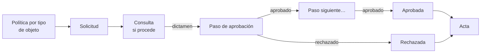

# Flujos de aprobación

Los [Flujos de aprobación](../glosario.md#flujos-de-aprobación) definen quién debe aprobar cada tipo de
decisión, en qué orden y con qué quórum, y dejan constancia inmutable de cada voto. Están disponibles
en todos los planes.

## Propósito

Que las decisiones de gobierno de la IA, como aceptar un riesgo residual o aprobar un documento, las
tome quien tiene autoridad para ello, siguiendo un circuito definido por la organización y con una
prueba de quién decidió, cuándo y en nombre de quién. Forma parte del [Core](../glosario.md#core).

## Problema que resuelve

El AI Act pide que el riesgo residual se juzgue aceptable. Juzgar es un acto de alguien, y ante una
auditoría tiene que constar quién lo hizo y con qué autoridad. Sin un circuito, las aprobaciones se
pierden en correos o en un campo de texto con la referencia a un acta. Fluxion:

- **Circuitos por tipo de decisión:** políticas por tipo de objeto, con pasos sucesivos y condiciones de
  aplicación (el nivel del plan, la plantilla del expediente o el tipo de brecha). Cada organización
  empieza con el mapa de aprobaciones recomendado ya configurado.
- **Aprobadores flexibles:** cada paso lo resuelve un rol, una persona concreta, un
  [comité](../glosario.md#comité) con quórum o una función de gobierno (por ejemplo, el CISO o el
  Responsable del tratamiento). Si el comité no está constituido o la función no está asignada, decide un
  rol de respaldo.
- **Consultas:** además de aprobar, un paso puede pedir un dictamen, por ejemplo el del Delegado de
  protección de datos en una evaluación de impacto. El dictamen consta en la solicitud y en el acta, pero
  no decide.
- **Pasos que dependen del caso:** un paso puede entrar solo cuando procede; por ejemplo, el CISO revisa
  el plan de tratamiento solo si incluye controles de seguridad.
- **Delegaciones:** con fecha de fin obligatoria, para que una ausencia no bloquee el circuito.
- **Segregación de funciones:** por defecto, quien solicita no puede aprobar. Permitirlo queda
  registrado en la política. El Auditor nunca decide: audita lo aprobado.
- **Sin solicitudes olvidadas:** quien solicita puede cancelar, y las solicitudes pueden caducar si nadie
  decide en el plazo fijado.
- **Prueba inmutable:** cada decisión queda registrada sin posibilidad de cambio. Un rechazo exige
  motivo, y cada cierre con decisión genera su [acta](../glosario.md#acta).

## Roles

| Rol | Responsabilidad |
|---|---|
| Administrador, Responsable del SGAI, CAIO | Definen las políticas de aprobación |
| Cualquier miembro | Delega su autoridad de aprobación; el Administrador y el Responsable del SGAI pueden registrar delegaciones en nombre de otros |
| Aprobadores (según cada paso) | Aprueban, rechazan o se abstienen en las solicitudes que les corresponden |
| Consultados (según cada paso) | Emiten un dictamen favorable o desfavorable, siempre razonado |
| Solicitante | Envía el objeto a aprobación; puede cancelar la solicitud |
| Auditor | Consulta el histórico de aprobaciones. Nunca aprueba ni dictamina |

## Flujo de trabajo

1. **Política.** En **Ajustes › Aprobaciones** se definen las políticas, con pasos sucesivos. Los tipos de
   objeto son: plan de tratamiento, evaluación de impacto (AISIA), documento regulatorio, Declaración de
   Aplicabilidad, evidencia y exclusión de brecha. Cada paso indica:
   - **Qué hace:** aprobar o emitir un dictamen (consulta).
   - **Quién:** un rol, una persona, un comité o una función de gobierno, con su rol de respaldo.
   - **Cuándo entra:** siempre o solo en determinados casos.
   - **Quórum:** solo en comités.
   - **Delegación:** si la admite.

   La política también indica si quien solicita puede aprobar y en cuántos días caduca la solicitud. Puede
   haber varias políticas por tipo de objeto con condiciones distintas: se aplica la más específica.

   **Mapa de aprobaciones por defecto:**

   | Objeto | Consulta | Aprueba |
   |---|---|---|
   | Plan de tratamiento · Nivel 1 | CISO, si el plan tiene controles de seguridad | Responsable del SGAI |
   | Plan de tratamiento · Nivel 2 | CISO, si el plan tiene controles de seguridad | Comité de Riesgos de IA |
   | Plan de tratamiento · Nivel 3 | — | Revisión por la Dirección (o un Directivo, si no está constituida) |
   | Evaluación AISIA | DPO | Comité de IA |
   | FRIA | DPO | Comité de IA |
   | DPIA | DPO | Responsable del tratamiento |
   | Anexo IV y ficha del modelo | — | Responsable del SGAI |
   | Declaración de Aplicabilidad | — | Revisión por la Dirección |
   | Evidencia | — | Responsable del SGAI |
   | Exclusión de un riesgo sin tratar o de una obligación sin cubrir | — | Responsable del SGAI |

   Si no hay nadie a quien consultar, la consulta se omite y consta en el acta.
2. **Solicitud.** Al enviar un objeto a aprobación, Fluxion abre una solicitud con una copia congelada
   de la política vigente, de modo que un cambio posterior de la política no altera las solicitudes en
   curso. Solo puede haber una solicitud pendiente por objeto.
3. **Decisión.** Cada aprobador ve sus pendientes en **Aprobaciones**. Puede aprobar, rechazar (con
   motivo) o abstenerse. Si el paso es de comité, se cierra al alcanzar el quórum. En un paso de
   consulta, quien consulta emite su dictamen, favorable o desfavorable y siempre razonado, y la
   solicitud pasa al paso siguiente: quien aprueba decide con el dictamen delante. Las delegaciones
   permiten que otra persona decida en nombre del aprobador hasta la fecha indicada.
4. **Avisos.** Fluxion avisa al aprobador de cada paso pendiente y al solicitante del resultado. Los
   eventos de aprobación se pueden enviar a sistemas externos mediante
   [integraciones salientes](../glosario.md#integración-saliente-webhook).
5. **Cierre.** Al aprobarse o rechazarse la solicitud, Fluxion aplica el resultado al objeto. Por
   ejemplo, el plan de tratamiento pasa a aprobado, y una brecha cuya exclusión se aprueba sale de la cola
   de trabajo. Si se cancela o caduca, el objeto vuelve a borrador. El histórico guarda todas las
   decisiones y dictámenes.

**Exclusión de brechas.** Excluir un riesgo sin tratar o una obligación sin cubrir equivale a aceptar un
riesgo o un incumplimiento, así que pasa por aprobación: la brecha sigue en la cola hasta que se aprueba.
Las demás brechas se excluyen directamente.

Solo un objeto al que no se aplica ninguna política se aprueba con su mecanismo propio; en el plan de
tratamiento, el aprobador asignado según el [nivel de aprobación](../glosario.md#nivel-de-aprobación).

> **Pendiente de implementar.**
> - La clasificación AI Act y la política de IA como objetos aprobables.
> - Retirar el mecanismo propio de aprobación del plan de tratamiento.

## Relación normativa

| Norma | Referencia | Qué cubre |
|---|---|---|
| AI Act | Art. 9.5 | El riesgo residual se juzga aceptable: queda constancia de quién lo juzga y con qué autoridad |
| ISO/IEC 42001 | §5.1 y §5.3 | Liderazgo y asignación de autoridades para aprobar decisiones del sistema de gestión |
| ISO/IEC 42001 | §7.5.2 | Revisión y aprobación de la información documentada |

## Módulos relacionados

- **[Plan de tratamiento](plan-de-tratamiento.md):** principal objeto aprobado.
- **[Plataforma](plataforma.md):** roles, personas y comités que actúan como aprobadores.
- **[Declaración de Aplicabilidad ISO 42001](declaracion-aplicabilidad.md) y
  [Biblioteca de evidencias](biblioteca-evidencias.md):** objetos aprobables.
- **[Análisis de brechas](brechas.md):** la exclusión de riesgos sin tratar y obligaciones sin cubrir.
- **Actas y paquetes de auditoría** (módulo): acta generada al cerrar la solicitud.
- **Vistas:** [Aprobaciones](../funcional/aprobaciones.md), [Ajustes](../funcional/ajustes.md).
