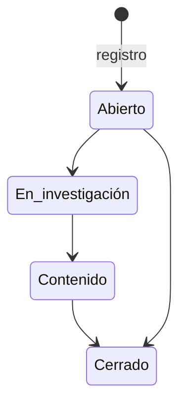

# Incidentes

El registro de [incidentes](../glosario.md#incidente) permite documentar, investigar y cerrar los
sucesos relacionados con los sistemas de IA. En los [incidentes graves](../glosario.md#incidente-grave)
controla además el [plazo de notificación](../glosario.md#plazo-de-notificación) a la autoridad que fija
el AI Act y avisa a tiempo a las personas de gobierno.

## Propósito

Que ningún incidente grave quede sin notificar en plazo y que cada incidente tenga su análisis de
causa, su impacto, sus acciones correctoras y su cierre documentado. Forma parte del
[Core](../glosario.md#core).

## Problema que resuelve

El AI Act obliga a notificar los incidentes graves de los sistemas de alto riesgo en plazos muy cortos:
2, 10 o 15 días según el caso, contados desde que la organización tiene conocimiento. Calcular el plazo
correcto, vigilar el reloj y conservar la prueba de la notificación es fácil de hacer mal bajo presión.
Fluxion:

- **Calcula el plazo** automáticamente a partir de la categoría del incidente y de la fecha en que se
  tuvo conocimiento.
- **Vigila el reloj:** avisa a la mitad del plazo, con el 80 % consumido y al vencer.
- **Registra la notificación:** autoridad destinataria, fecha y referencia, admitiendo una notificación
  inicial incompleta seguida de la completa.
- **Gestiona el incidente** de principio a fin, con acciones correctoras que se convierten en tareas.

## Roles

| Rol | Responsabilidad |
|---|---|
| Cualquier miembro | Registra un incidente |
| Administrador, Responsable del SGAI, CAIO, DPO, Analista de riesgos, Analista de cumplimiento | Gobiernan el incidente: lo clasifican, registran la notificación y lo gestionan hasta su cierre. Reciben los avisos de plazo |
| Responsable del incidente | Persona asignada que lleva la investigación; recibe también los avisos de plazo |
| Auditor | Consulta el registro de incidentes |

## Flujo de trabajo

1. **Registro.**
   - Cualquier miembro registra el incidente con título, descripción, sistemas afectados y fechas: cuándo
     ocurrió y cuándo se tuvo conocimiento.
   - Fluxion le asigna una referencia (INC-año-número).
   - Avisa a las personas de gobierno y a los canales de Slack o Teams configurados.
2. **Clasificación.** Las personas de gobierno deciden:
   - **Categoría:** fallecimiento, daño a la salud, infraestructura crítica, derechos fundamentales,
     propiedad o medio ambiente, u otro.
   - **Si es incidente grave.** Es una decisión humana: un daño a la salud puede no alcanzar la gravedad
     exigida.
   - **Si hay infracción generalizada.**
   - **El papel de la organización:** proveedor o responsable del despliegue. El responsable del
     despliegue informa primero al proveedor.
3. **Plazo.** Si el incidente es grave, Fluxion calcula la fecha límite de notificación:
   - **2 días:** infraestructura crítica o infracción generalizada.
   - **10 días:** fallecimiento.
   - **15 días:** el resto.

   Si no es grave, no hay obligación de notificar. La pantalla muestra el tiempo restante con un reloj.
4. **Avisos de plazo.** Cada hora Fluxion revisa los plazos y, la primera vez que se alcanza cada
   umbral, avisa en la aplicación y en Slack o Teams. Los umbrales son la mitad del plazo, el 80 %
   consumido y el plazo vencido. Los avisos van al responsable del incidente y a las personas de gobierno.
5. **Notificación.** Se registra la notificación enviada: inicial o completa, autoridad, fecha y
   referencia de acuse.
6. **Investigación y acciones correctoras.**
   - Se documentan la causa raíz y el resumen del impacto.

     > TODO: confirmar el registro del número de personas afectadas. El dato existe, pero hoy no se
     > puede introducir.
   - Las acciones correctoras se crean como [tareas](../glosario.md#tarea) vinculadas al incidente.
7. **Cierre.** El incidente avanza a «En investigación», «Contenido» y «Cerrado»; el cierre registra la
   fecha.

El menú de la aplicación muestra un contador de los incidentes graves con notificación pendiente.

Un incidente puede nacer de una [señal de riesgo](../glosario.md#señal-de-riesgo) recibida desde la
monitorización, que queda vinculada como su origen.

> TODO: confirmar desde dónde se crea un incidente a partir de una señal de riesgo. El vínculo existe en
> los datos, pero no se ha localizado la acción en la interfaz.

> **Pendiente de implementar.**
> - Envío de la notificación a la autoridad desde la aplicación; hoy se registra después de enviarla por
>   el canal oficial.
> - Integración con herramientas ITSM, en la [Hoja de ruta](hoja-de-ruta.md).
> - Reapertura automática del análisis de riesgos cuando un incidente revela un modo de fallo no
>   contemplado.

## Relación normativa

| Norma | Referencia | Qué cubre |
|---|---|---|
| AI Act | Art. 3.49 | Definición de incidente grave y sus supuestos (categorías) |
| AI Act | Art. 73.2, 73.3 y 73.4 | Plazos de notificación de 15, 2 y 10 días |
| AI Act | Art. 73.5 | Notificación inicial incompleta seguida de la completa |
| AI Act | Art. 26.5 | El responsable del despliegue informa al proveedor |
| ISO/IEC 42001 | §10.2 | No conformidad y acción correctiva |

## Módulos relacionados

- **[Inventario de sistemas de IA](inventario.md):** sistemas afectados por el incidente.
- **[Tareas](../glosario.md#tarea):** acciones correctoras.
- **[Plataforma](plataforma.md):** avisos en la aplicación y en Slack o Teams.
- **Supervisión post-comercialización** (módulo): sus señales pueden originar incidentes.
- **Vistas:** [Incidentes](../funcional/incidentes.md), [Detalle de incidente](../funcional/incidente-detalle.md).
