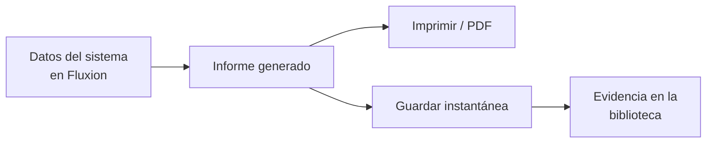

# Informes del sistema

Los [informes del sistema](../glosario.md#informes-del-sistema) son tres documentos que Fluxion compone
automáticamente con los datos de un [sistema de IA](../glosario.md#sistema-de-ia):
- el **dossier técnico**;
- la **[ficha para el registro UE](../glosario.md#ficha-para-el-registro-ue)**, que desde B16b es un documento
  del expediente (ver más abajo);
- el **informe de brechas del sistema**.

No se redactan: reflejan en cada momento lo registrado en la plataforma y se pueden congelar como
[instantánea](../glosario.md#instantánea) y guardar como [evidencia](../glosario.md#evidencia).

## Propósito

Tener, sin trabajo de redacción, una visión documental completa y actual de cada sistema, para uso
interno, para un auditor o para preparar el registro del sistema en la base de datos de la UE. Forma
parte del [Core](../glosario.md#core).

## Problema que resuelve

Reunir la información de un sistema para un informe exige recopilar datos de varias fuentes, y el
resultado queda obsoleto en cuanto algo cambia. Los informes del sistema:

- **Siempre al día:** se generan con los datos vigentes del inventario, la clasificación, las
  obligaciones, el análisis de riesgos, los planes y las evidencias.
- **Con versiones:** cada informe se puede guardar como instantánea fechada y consultar después.
- **Como prueba:** el informe guardado se convierte en evidencia de la biblioteca.

## Roles

| Rol | Responsabilidad |
|---|---|
| Responsable del sistema | Consulta y guarda los informes de sus sistemas |
| Analista de cumplimiento | Prepara la ficha para el registro UE y presenta la información ante la autoridad |
| Responsable del SGAI | Usa el informe de brechas para priorizar |
| Auditor, Directivo | Consultan los informes y sus instantáneas |

## Flujo de trabajo

Los tres informes se abren desde la ficha del sistema.

| Informe | Contenido |
|---|---|
| Dossier técnico | Identificación y propósito · Arquitectura y tecnología · Datos y tratamiento · Gobierno y responsabilidades · Controles y cumplimiento · Cobertura de obligaciones · Planes de tratamiento de riesgo · Cadenas causales activas · Evidencias del sistema, con resúmenes de ISO 42001 y del análisis de modos de fallo |
| Informe de brechas del sistema | Resumen ejecutivo · Prioridades inmediatas · Obligaciones AI Act pendientes · Brechas ISO 42001 · Situación de evidencias · Modos de fallo activados · Planes de tratamiento |

1. **Consulta.** El informe se genera al abrirlo, con los datos actuales.
2. **Impresión.** Se puede imprimir o guardar en PDF desde el navegador.
3. **Instantánea y evidencia.** Al guardarlo, Fluxion crea una instantánea inmutable con la fecha y la
   registra como evidencia del sistema. Las instantáneas anteriores se pueden consultar.
4. **Registro UE.** La ficha para el registro UE ya no es un informe: es un documento de la
   [Documentación del sistema](documentacion-del-sistema.md) con los datos del Anexo VIII, que se redacta,
   se aprueba y se entrega en PDF. Solo aparece cuando la organización tiene que registrar el sistema: si es
   su proveedora y el sistema es de alto riesgo o aplica la excepción del Art. 6.3, o si lo despliega como
   organismo público. La presentación en la base de datos de la UE la hace la organización, de forma
   manual.

La documentación técnica formal del Anexo IV, con redacción y aprobación, pertenece al módulo
[Documentación del sistema](../glosario.md#documentación-del-sistema).

## Relación normativa

| Norma | Referencia | Qué cubre |
|---|---|---|
| AI Act | Art. 49 y 71 | Información para el registro de sistemas de alto riesgo en la base de datos de la UE (Anexo VIII) |
| AI Act | Art. 11 | Información de base para la documentación técnica (el documento formal es del módulo Documentación del sistema) |
| ISO/IEC 42001 | §7.5 | Información documentada y conservación de versiones |

> TODO: confirmar con la revisión jurídica la lectura del Anexo VIII que sigue la ficha para el registro UE
> (DP-11).

## Módulos relacionados

- **[Inventario de sistemas de IA](inventario.md), [Clasificación AI Act](clasificacion-ai-act.md) y
  [Obligaciones](obligaciones.md):** fuentes de los datos.
- **[Análisis de modos de fallo (FMEA)](analisis-modos-de-fallo.md) y [Plan de tratamiento](plan-de-tratamiento.md):**
  riesgos, cadenas causales y planes.
- **[Biblioteca de evidencias](biblioteca-evidencias.md):** recibe los informes guardados.
- **[Análisis de brechas](brechas.md):** versión de toda la organización del informe de brechas.
- **Documentación del sistema** (módulo): documentación técnica formal.
- **Vistas:** [Dossier técnico](../funcional/dossier-tecnico.md),
  [Ficha para el registro UE](../funcional/registro-ue.md),
  [Informe de brechas del sistema](../funcional/informe-brechas-sistema.md).
