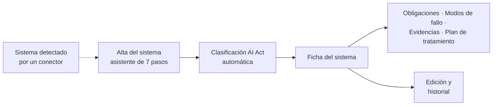

# Inventario de sistemas de IA

El [inventario de sistemas de IA](../glosario.md#inventario-de-sistemas-de-ia) es el registro
centralizado de todos los [sistemas de IA](../glosario.md#sistema-de-ia) de la organización. Es el punto
de partida de Fluxion: la clasificación, las obligaciones, el análisis de riesgos y las evidencias se
refieren siempre a un sistema del inventario.

## Propósito

Saber qué sistemas de IA tiene la organización, para qué se usan, qué datos tratan, quién responde de
ellos y en qué estado están, con la información necesaria para clasificarlos según el AI Act y evaluar
sus riesgos. Forma parte del [Core](../glosario.md#core).

## Problema que resuelve

Sin inventario no hay gobernanza posible: no se puede cumplir una obligación sobre un sistema que no se
sabe que existe. En muchas organizaciones la IA está repartida entre áreas, proveedores y proyectos
piloto, y nadie tiene la lista completa. El inventario de Fluxion:

- **Una sola lista** de todos los sistemas, con su estado (desarrollo, piloto, producción, deprecado o
  retirado) y su ámbito de negocio.
- **Datos estructurados** que alimentan la [clasificación AI Act](../glosario.md#clasificación-ai-act):
  propósito, tipo de resultados, personas afectadas, colectivos vulnerables, datos tratados, tecnología
  y supervisión.
- **Responsabilidades** explícitas: quién es el responsable de cada sistema y qué miembros trabajan en
  él.
- **Trazabilidad:** cada cambio queda en el [historial del sistema](../glosario.md#historial-del-sistema).

## Roles

| Rol | Responsabilidad en el inventario |
|---|---|
| Responsable del sistema | Da de alta y mantiene la información de sus sistemas |
| Responsable del SGAI | Supervisa que el inventario esté completo y actualizado |
| Analista de cumplimiento | Revisa los datos que condicionan la clasificación y las obligaciones |
| Analista de riesgos | Usa la información del sistema para el análisis de modos de fallo |
| Directivo, Auditor, Lector | Consultan el inventario |

A cada sistema se le pueden asignar miembros de la organización, uno de ellos como responsable
principal. Esa asignación decide, por ejemplo, quién recibe los avisos de las
[señales de riesgo](../glosario.md#señal-de-riesgo) del sistema.

> **Pendiente de definir.** Qué roles pueden dar de alta, editar o retirar sistemas. Hoy cualquier
> miembro de la organización puede hacerlo.

## Flujo de trabajo

1. **Alta.** El sistema se registra con un asistente de siete pasos:
   1. **Identificación:** nombre, descripción, estado y versión.
   2. **Propósito y función:** para qué se usa, qué resultados produce y a quién afecta.
   3. **Impacto:** tipo de sistema y características de riesgo, como uso de datos biométricos,
      menores, colectivos vulnerables o infraestructuras críticas.
   4. **Datos:** qué datos trata y con qué base legal.
   5. **Tecnología:** tecnología, arquitectura y proveedor.
   6. **Gobierno:** responsables y tipo de supervisión humana.
   7. **Controles:** salvaguardias, documentación y evidencias existentes.

   En el paso de impacto se declara el [rol de la organización en la cadena de valor](../glosario.md#rol-en-la-cadena-de-valor)
   del sistema: proveedor, responsable del despliegue, importador, distribuidor o representante
   autorizado. No son excluyentes.

   El alta puede partir de un [cuestionario preliminar](../glosario.md#cuestionario-preliminar)
   completado: el asistente se abre con sus respuestas ya rellenas, la persona las revisa y completa, y el
   sistema queda vinculado a su cuestionario de origen. Ver
   [Evaluación de impacto](evaluacion-de-impacto.md).
2. **Clasificación inicial.** Al guardar, Fluxion propone automáticamente el
   [nivel de riesgo AI Act](../glosario.md#nivel-de-riesgo-ai-act). Si la clasificación automática falla,
   el alta se completa igualmente y el sistema se puede clasificar después. Ver
   [Clasificación AI Act](clasificacion-ai-act.md).
3. **Alta desde un sistema detectado.** Con el módulo
   [Descubrimiento de inventario](../glosario.md#descubrimiento-de-inventario), los sistemas encontrados
   en MLflow o en los repositorios de código llegan como
   [sistemas detectados pendientes de alta](../glosario.md#sistema-detectado-pendiente-de-alta). Desde
   ahí se vinculan a un sistema existente, se dan de alta o se ignoran.
4. **Ficha del sistema.** Cada sistema tiene una [ficha](../glosario.md#ficha-del-sistema) con siete
   pestañas, en el orden en que suelen trabajarse:
   - [Obligaciones](obligaciones.md) AI Act;
   - ficha técnica;
   - ISO 42001;
   - historial;
   - [evidencias](biblioteca-evidencias.md);
   - [modos de fallo](analisis-modos-de-fallo.md);
   - [plan de tratamiento](plan-de-tratamiento.md).

   Desde la ficha se accede también a los [informes del sistema](../glosario.md#informes-del-sistema), a
   la evaluación de impacto y a la documentación regulatoria.
5. **Mantenimiento.** Los datos se editan en cualquier momento y cada cambio relevante queda en el
   historial del sistema, junto con las reclasificaciones y las señales recibidas.

> TODO: confirmar qué contiene hoy la pestaña «ISO 42001» de la ficha. Sus datos de origen se
> consideran legacy en el inventario (decisión 46).

> TODO: confirmar qué identificador ve el usuario como [código del sistema](../glosario.md#código-del-sistema).

## Relación normativa

| Norma | Referencia | Qué cubre el inventario |
|---|---|---|
| AI Act | Art. 3.1 | Identificación de qué es un sistema de IA a efectos del Reglamento |
| AI Act | Art. 3.3 a 3.7 | Registro del rol de la organización en la cadena de valor de cada sistema |
| AI Act | Art. 6 y Anexo III | Recogida de las características que determinan el nivel de riesgo |
| ISO/IEC 42001 | §4.3 | Determinación del alcance del sistema de gestión: qué sistemas de IA están dentro |

> TODO: confirmar la referencia a ISO/IEC 42001, §4.3. El inventario aporta la información para
> definir el alcance, pero la aplicación no registra el alcance del SGAI salvo en la Declaración de
> Aplicabilidad.

## Módulos relacionados

- **[Clasificación AI Act](clasificacion-ai-act.md):** se calcula con los datos del inventario.
- **[Obligaciones](obligaciones.md):** cuelgan de cada sistema según su clasificación.
- **[Análisis de modos de fallo (FMEA)](analisis-modos-de-fallo.md):** los modos de fallo se activan
  según las características del sistema.
- **[Biblioteca de evidencias](biblioteca-evidencias.md):** las evidencias de sistema pertenecen a un
  sistema del inventario.
- **Descubrimiento de inventario** (módulo): propone sistemas para el inventario.
- **Vistas:** Inventario, Alta de sistema, Ficha del sistema, Edición de la ficha (documentos
  funcionales pendientes). **Técnico:** [modelo-datos.md](../tecnica/modelo-datos.md#inventario-clasificación-y-obligaciones).
