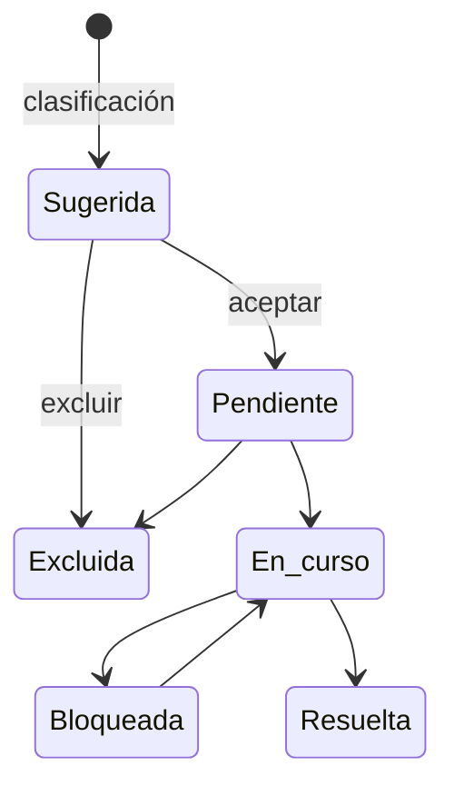

# Obligaciones

Las [obligaciones](../glosario.md#obligación) son los requisitos normativos concretos que aplican a
cada [sistema de IA](../glosario.md#sistema-de-ia). Fluxion las sugiere a partir de la clasificación y
la organización las acepta, las trabaja hasta resolverlas y aporta las [evidencias](../glosario.md#evidencia)
que lo demuestran.

## Propósito

Convertir el nivel de riesgo de cada sistema en una lista de trabajo de cumplimiento: qué hay que hacer,
quién, para cuándo y con qué prueba. Es la pestaña que abre por defecto la ficha del sistema. Forma
parte del [Core](../glosario.md#core).

## Problema que resuelve

Saber que un sistema es de alto riesgo no dice qué hay que hacer. Las obligaciones del AI Act están
repartidas en decenas de artículos y dependen del papel que la organización tenga en el sistema. Fluxion:

- **Bajada a tierra:** cada obligación aparece con su artículo de referencia, una descripción y su
  estado.
- **Lista de trabajo:** cada obligación tiene responsable, prioridad, fecha límite y notas de trabajo.
- **Prueba:** cada obligación se vincula a las evidencias que la cubren. Fluxion indica qué
  [tipos de evidencia](../glosario.md#tipo-de-evidencia) se esperan para cada una.
- **Visión de conjunto:** las obligaciones sin resolver aparecen como [brechas](../glosario.md#brecha)
  en el análisis de brechas.

## Roles

| Rol | Responsabilidad |
|---|---|
| Analista de cumplimiento | Acepta o excluye las obligaciones sugeridas y sigue su resolución |
| Responsable del sistema | Responsable de las obligaciones asignadas; aporta las evidencias |
| DPO | Interviene en las obligaciones relacionadas con datos personales |
| Responsable del SGAI | Supervisa el grado de cumplimiento de la cartera |
| Auditor | Consulta las obligaciones, su resolución y sus evidencias |

> **Pendiente de definir.** Qué roles pueden aceptar, excluir o resolver obligaciones. Hoy lo puede
> hacer cualquier miembro de la organización.

## Flujo de trabajo

1. **Sugerencia.** Al clasificar el sistema, Fluxion crea, en estado «Sugerida», las obligaciones del
   catálogo que corresponden a su nivel de riesgo, a su categoría de modelo de uso general, a sus
   supuestos concretos (por ejemplo, cada apartado del Art. 50) y al papel de la organización en la
   cadena de valor. Ver [Clasificación AI Act](clasificacion-ai-act.md#flujo-de-trabajo).
2. **Aceptación o exclusión.** La organización acepta las que aplican, que pasan a «Pendiente», y
   excluye las que no.
3. **Trabajo.** Cada obligación se asigna a un responsable, con prioridad (baja, media, alta o crítica)
   y fecha límite, y avanza por los estados «En curso», «Bloqueada» y «Resuelta». Se registran notas de
   trabajo y de resolución.
4. **Evidencias.** A cada obligación se vinculan las evidencias que la cubren. La ficha muestra si esas
   evidencias están vigentes, pendientes de revisión o caducadas. Desde la Biblioteca de evidencias se
   pueden vincular varias a la vez.
5. **Cambios de clasificación.** Si el sistema se reclasifica y cambia su conjunto de obligaciones,
   la organización concilia cada diferencia antes de aplicarla. Ver
   [Clasificación AI Act](clasificacion-ai-act.md#flujo-de-trabajo).

### Catálogo de obligaciones

Fluxion mantiene un catálogo de obligaciones dentro del
[catálogo de tablas básicas](../glosario.md#catálogo-de-tablas-básicas):

| Marco | Contenido |
|---|---|
| AI Act | 40 obligaciones en uso, cada una con su artículo (por ejemplo, Art. 9 gestión de riesgos, Art. 11 documentación técnica, Art. 14 supervisión humana, Art. 27 FRIA, Art. 72 vigilancia poscomercialización, Art. 73 notificación de incidentes graves). La transparencia del Art. 50 se divide en sus cuatro apartados (50.1 a 50.4), cada uno con su obligado, y hay una obligación para documentar y registrar la excepción del Art. 6.3 (Art. 6.4). Cada una indica a qué roles de la cadena de valor afecta y si aplica a todo sistema dentro del ámbito, a los de alto riesgo, a los proveedores de modelos de uso general o solo cuando hay obligaciones de transparencia |
| ISO/IEC 42001 | 10 obligaciones del sistema de gestión: objetivos, evaluación de impacto, recursos, competencia, evaluación de riesgos, desempeño, auditoría interna, revisión por la dirección y no conformidades |

Cada obligación del catálogo tiene asociados los tipos de evidencia que la cubren, con su nivel de
exigencia.

Las obligaciones sugeridas a cada sistema salen de este catálogo. Una obligación que deja de usarse no se
borra: queda **retirada**, ya no se sugiere y se conserva en los sistemas que la tenían registrada. Es el
caso de la antigua obligación única del Art. 50, sustituida por sus cuatro apartados.

## Relación normativa

| Norma | Referencia | Qué cubre |
|---|---|---|
| AI Act | Capítulo III, Secciones 2 y 3 (Art. 8 a 27) | Requisitos de los sistemas de alto riesgo y obligaciones de proveedores, responsables del despliegue y otros operadores |
| AI Act | Art. 50 | Obligaciones de transparencia |
| AI Act | Art. 53 y 55 | Obligaciones de los proveedores de modelos de uso general |
| AI Act | Art. 72 y 73 | Vigilancia poscomercialización y notificación de incidentes graves |
| ISO/IEC 42001 | Cláusulas 6 a 10 | Requisitos del sistema de gestión cubiertos por las obligaciones ISO del catálogo |

> TODO: confirmar las referencias ISO/IEC 42001 de las obligaciones del catálogo. Están codificadas
> como «A.6.1», «A.9.3», etc., pero su contenido corresponde a cláusulas del cuerpo de la norma (6.1,
> 9.3…), no a controles del Anexo A.

## Módulos relacionados

- **[Clasificación AI Act](clasificacion-ai-act.md):** origen de las obligaciones de cada sistema.
- **[Biblioteca de evidencias](biblioteca-evidencias.md):** evidencias que cubren cada obligación.
- **[Análisis de brechas](brechas.md):** las obligaciones sin resolver aparecen como
  «Obligación sin cubrir».
- **[Análisis de modos de fallo (FMEA)](analisis-modos-de-fallo.md):** los modos de fallo están
  anclados a los artículos de los que proceden.
- **Vistas:** [Ficha del sistema](../funcional/ficha-sistema.md), pestaña Obligaciones. **Técnico:**
  [modelo-datos.md](../tecnica/modelo-datos.md#inventario-clasificación-y-obligaciones).
