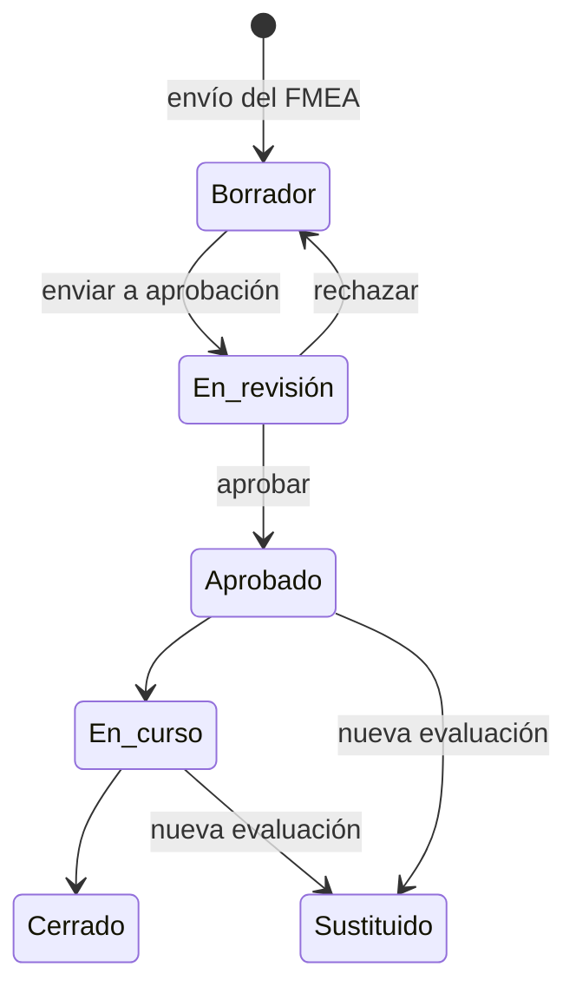

# Plan de tratamiento

El [plan de tratamiento](../glosario.md#plan-de-tratamiento) recoge qué decide hacer la organización con
cada [modo de fallo](../glosario.md#modo-de-fallo) que requiere atención tras el análisis: mitigarlo,
aceptarlo, transferirlo, evitarlo o posponerlo. Para cada uno fija un responsable, un plazo y, cuando
procede, un [control](../glosario.md#control) y su [evidencia](../glosario.md#evidencia).

## Propósito

Convertir la evaluación de riesgos en un compromiso de acción aprobado, con responsables y fechas, y
seguir su ejecución hasta reducir el riesgo a un nivel aceptado. Forma parte del [Core](../glosario.md#core).

## Problema que resuelve

Evaluar el riesgo no basta: el AI Act y la ISO/IEC 42001 piden adoptar medidas, que alguien con
autoridad acepte el riesgo residual y que se pueda demostrar. Sin una herramienta, las decisiones de
tratamiento quedan en actas sueltas y no se sabe si se ejecutaron. El plan de tratamiento de Fluxion
aporta:

- **Una decisión por riesgo:** cada modo con severidad alta tiene su
  [acción de tratamiento](../glosario.md#acción-de-tratamiento), con reglas que impiden decisiones sin
  justificar.
- **Aprobación proporcional:** el [nivel de aprobación](../glosario.md#nivel-de-aprobación) depende de la
  [zona de riesgo](../glosario.md#zona-de-riesgo) del sistema.
- **Ejecución:** las acciones se vinculan a [tareas](../glosario.md#tarea), a controles y
  evidencias, y el plan muestra el progreso y la zona que se alcanzará al completarlo.
- **Seguimiento en el tiempo:** lo aceptado o pospuesto se revisa periódicamente.
- **Trazabilidad:** cada cambio de las acciones y cada cambio de estado del plan quedan registrados.

## Roles

| Rol | Responsabilidad |
|---|---|
| Analista de riesgos | Prepara el plan y decide la opción de tratamiento de cada modo |
| Responsable del sistema | Ejecuta las acciones, implanta los controles y aporta las evidencias |
| Aprobador del plan | Aprueba o rechaza el plan. Fluxion lo asigna al crearlo según el nivel de aprobación |
| Responsable de cada acción | Ejecuta su acción dentro del plazo |
| Auditor | Consulta el plan, su aprobación y su historial |

> **Pendiente de definir.** Qué rol aprueba en cada nivel de aprobación y qué roles pueden editar el plan.

## Flujo de trabajo

> TODO: confirmar cómo pasa un plan a «En curso» y a «Cerrado». Los estados existen en la aplicación,
> pero no se ha encontrado en el código la transición desde «Aprobado».

1. **Creación.** Al enviar el [análisis de modos de fallo](analisis-modos-de-fallo.md) a revisión,
   Fluxion crea el plan en borrador con una acción por cada modo de severidad actual 7 o más, o que
   pasó por segunda revisión. El plan registra:
   - la zona de partida;
   - el [suelo AI Act](../glosario.md#suelo-ai-act);
   - el nivel de aprobación;
   - el aprobador asignado;
   - un plazo según la zona: 30, 90, 180 o 365 días.
2. **Decisión por acción.** Para cada modo se elige una [opción de tratamiento](../glosario.md#opción-de-tratamiento):

   | Opción | Reglas |
   |---|---|
   | Mitigar | Se asocia un control, del catálogo o nuevo, y una severidad residual objetivo menor que la actual |
   | Aceptar | Justificación de al menos 100 caracteres y fecha de revisión obligatoria. No se permite con severidad 9 |
   | Transferir | Justificación de al menos 50 caracteres |
   | Evitar | Justificación de al menos 50 caracteres |
   | Posponer con revisión | Justificación de al menos 50 caracteres; de al menos 100 si el aplazamiento supera 90 días |

   Cada acción tiene responsable y fecha límite. Se pueden asignar, fechar o cambiar de opción varias
   acciones a la vez.
3. **Zona objetivo.** Con las severidades residuales objetivo de las mitigaciones, Fluxion calcula la
   zona que alcanzará el sistema al completar el plan. Nunca queda por debajo del suelo AI Act.
4. **Envío a aprobación.** El plan solo se puede enviar cuando todas las acciones están decididas y
   completas.
5. **Aprobación.** El aprobador asignado aprueba el plan, con notas del comité si las hay, o lo rechaza.
   Si la organización ha configurado una política en [Flujos de aprobación](../glosario.md#flujos-de-aprobación),
   la decisión se toma desde allí con sus pasos y aprobadores. Cada transición guarda una
   [instantánea](../glosario.md#instantánea) del plan.
6. **Ejecución.**
   - Cada acción, salvo las aceptadas, está pensada para tener su tarea. Cuando la tarea se completa, la
     acción se cierra.

     > TODO: confirmar la creación automática de tareas. La regla que las crea solo actúa cuando la acción
     > nace con una opción decidida, y Fluxion crea las acciones sin opción. En la práctica no se crea
     > ninguna tarea automáticamente.
   - En las mitigaciones se implanta el control, se adjunta la evidencia y se registra la severidad
     residual alcanzada.
   - El plan muestra el progreso, las advertencias (por ejemplo, plazos vencidos) y su historial.
7. **[Revisión periódica](../glosario.md#revisión-periódica).**
   - Las acciones aceptadas o pospuestas se revisan con la frecuencia que marca la zona.
   - Cada lunes, Fluxion avisa a cada responsable de las revisiones que vencen en los próximos 30 días
     o ya vencidas.
   - Un aviso en la parte superior de la aplicación recuerda las revisiones atrasadas.
8. **Vista de conjunto.** La vista **Planes de tratamiento** reúne todos los planes de la
   organización. **Revisiones pendientes** agrupa las acciones que toca revisar.

> TODO: confirmar cuándo la severidad residual pasa a contar para la zona del sistema. El diseño de
> producto dice que solo cuando la evidencia del control está verificada; el código registra la
> severidad residual de las mitigaciones, pero no se ha comprobado que exija la evidencia validada.

> **Pendiente de implementar.**
> - Aviso al aprobador cuando se escala una revisión de aceptación.
> - Integración completa del plan en Flujos de aprobación, para que la aprobación del plan siga siempre
>   ese circuito.

## Relación normativa

| Norma | Referencia | Qué cubre |
|---|---|---|
| AI Act | Art. 9.2.d | Adopción de medidas de gestión de riesgos adecuadas y específicas |
| AI Act | Art. 9.5 | Riesgo residual juzgado aceptable y aprobado |
| AI Act | Art. 9.2 | Gestión de riesgos como proceso iterativo: revisión periódica de lo aceptado o pospuesto |
| ISO/IEC 42001 | §6.1.3 | Tratamiento de riesgos de la IA: selección de opciones y controles |
| ISO/IEC 42001 | §8.3 | Implantación del plan de tratamiento de riesgos de la IA |

## Módulos relacionados

- **[Análisis de modos de fallo (FMEA)](analisis-modos-de-fallo.md):** origen de las acciones del plan.
- **[Flujos de aprobación](../glosario.md#flujos-de-aprobación):** circuito de aprobación del plan.
- **[Tareas](../glosario.md#tarea):** ejecución de las acciones.
- **[Biblioteca de evidencias](biblioteca-evidencias.md):** evidencias de los controles implantados.
- **[Análisis de brechas](brechas.md):** muestra los controles sin implantar.
- **Evaluación de impacto (AISIA)** (módulo): su sección de acciones de tratamiento se alimenta del
  plan.
- **Actas y paquetes de auditoría** (módulo): acta de la aprobación.
- **Vistas:** Plan de tratamiento, Planes de tratamiento, Revisiones pendientes (documentos
  funcionales pendientes). **Técnico:** [modelo-datos.md](../tecnica/modelo-datos.md#riesgo-y-tratamiento).
