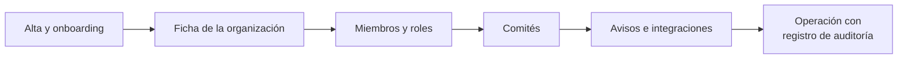

# Plataforma

Funcionalidades comunes a toda la aplicación:
- la ficha de la [organización](../glosario.md#organización);
- los [miembros](../glosario.md#miembro) y sus [roles](../glosario.md#rol);
- los [comités](../glosario.md#comité) de gobierno;
- los avisos;
- las integraciones con otros sistemas;
- la seguridad de las cuentas y el registro de auditoría.

Forman parte del [Core](../glosario.md#core).

## Propósito

Dar a cada organización un espacio propio y aislado en Fluxion, con sus responsables de gobierno
identificados, sus miembros con permisos acordes a su función, y avisos e integraciones que llevan
la información a quien tiene que actuar.

## Problema que resuelve

La gobernanza de la IA exige saber quién es responsable de qué y poder demostrarlo: quién aprobó un
plan, quién revisó una evidencia, quién cambió un rol. También exige que los avisos importantes, como
el plazo de un incidente o un presupuesto superado, lleguen a tiempo a las personas adecuadas. La
plataforma resuelve ambas cosas:
- **Responsabilidad:** roles definidos y responsables de gobierno nombrados en la ficha de la
  organización.
- **Trazabilidad:** registro de auditoría de las acciones administrativas.
- **Avisos:** dentro de la aplicación y en las herramientas de mensajería de la organización.

## Roles

Un miembro puede tener varios roles en su organización, y sus permisos son la suma de todos. Solo un
administrador puede cambiar roles; puede haber varios administradores y la organización conserva siempre
al menos uno. DPO y Responsable del SGAI no pueden recaer en la misma persona.

| Rol | Descripción |
|---|---|
| Administrador | Acceso completo. Gestiona miembros, roles, organización y todos los módulos |
| Responsable del SGAI | Responsable del [sistema de gestión de la IA](../glosario.md#sgai-sistema-de-gestión-de-la-ia). Coordina el ciclo de gobernanza |
| CAIO | *Chief AI Officer*. Supervisión estratégica de la cartera de sistemas de IA |
| DPO | Delegado de protección de datos. Responsable del cumplimiento en protección de datos |
| Responsable del sistema | Propietario de uno o varios sistemas de IA. Gestiona su ciclo de vida |
| Analista de riesgos | Evalúa y trata los riesgos de los sistemas mediante el [análisis de modos de fallo](../glosario.md#análisis-de-modos-de-fallo-fmea) y el análisis causal |
| Analista de cumplimiento | Verifica el cumplimiento del AI Act, ISO/IEC 42001 y la normativa aplicable |
| Directivo | Consulta de indicadores y resúmenes ejecutivos |
| Auditor | Consulta de solo lectura de todos los módulos y evidencias |
| Lector | Consulta de datos e informes, sin modificar registros |

Quien crea la organización es su administrador. El resto de roles se asignan al invitar o dar de alta
a cada miembro. A un miembro se le pueden asignar además sistemas concretos, como responsable
principal o como colaborador.

Funciones administrativas reservadas a ciertos roles:

| Función | Quién |
|---|---|
| Ficha de la organización, miembros, módulos, seguridad, claves API, webhooks y registro de auditoría | Administrador |
| Conectores y [avisos a Slack/Teams](../glosario.md#aviso-a-slackteams) | Administrador y Responsable del SGAI |
| Políticas de aprobación y comités | Administrador, Responsable del SGAI y CAIO |

> **Pendiente de definir.** El detalle de qué puede leer y modificar cada rol en cada módulo. La
> aplicación aplica hoy los permisos funcionalidad a funcionalidad, sin una matriz única.

> TODO: confirmar los nombres de negocio «Responsable del SGAI» y «Responsable del sistema» (en la
> aplicación: «SGAI Manager» y «System Owner»).

## Flujo de trabajo

1. **Alta.** Quien se registra crea su organización y queda como administrador. Un onboarding de cuatro
   pasos recoge el perfil de la organización, su situación frente a ISO/IEC 42001 y el foco inicial,
   que decide qué guía de primeros pasos muestra el panel principal. Los pasos se pueden omitir.
2. **Ficha de la organización.** Agrupa:
   - identidad;
   - datos legales y domicilio fiscal;
   - perfil regulatorio y [marcos aplicables](../glosario.md#marco-aplicable);
   - gobernanza: responsable del SGAI, delegado de protección de datos y auditor externo designado;
   - parámetros operativos;
   - políticas de retención (de 1 a 10 años);
   - aspecto de los documentos generados.

   La pestaña de gobernanza nombra a las personas que después firman.
3. **Miembros.** El administrador invita a cada persona por correo, individualmente o en bloque, o la
   da de alta directamente, con su rol.
   - La invitación caduca a los 7 días y se puede reenviar.
   - Los miembros se pueden desactivar, reactivar o eliminar.
   - Cada cambio de rol o de estado queda registrado.
4. **Comités.** Se constituyen los órganos de gobierno: Comité de IA, Comité de Riesgos de IA y
   Revisión por la Dirección. Cada uno tiene cadencia (1, 3, 6 o 12 meses) y miembros internos o
   externos con un papel: presidente, secretario, miembro o asesor.
5. **Avisos e integraciones.**
   - [Avisos en la app](../glosario.md#aviso-en-la-app): cada persona elige qué avisos recibe, por
     ejemplo una acción o tarea asignada, un plan pendiente de su aprobación, una acción vencida, una
     revisión periódica próxima o una evidencia por caducar.
   - **Avisos a Slack/Teams:** envían a canales de la organización los eventos críticos: incidente
     registrado, mitad del plazo de notificación, 80 % del plazo consumido, plazo vencido, presupuesto
     de IA superado y subida de la discordancia en supervisión humana.
   - [Integraciones salientes (webhooks)](../glosario.md#integración-saliente-webhook): notifican a
     sistemas de la organización las decisiones de aprobación y las tareas completadas, con firma
     verificable.
   - [Claves API](../glosario.md#clave-api): permiten que los módulos y los sistemas de la organización
     envíen datos a Fluxion con permisos acotados.
6. **Operación.** Las acciones administrativas quedan en el registro de auditoría: cambios de rol,
   invitaciones, claves, webhooks, conectores, módulos y políticas. Cada persona puede ver sus sesiones
   abiertas, cerrar las demás y activar la verificación en dos pasos (TOTP) en su perfil.

> **Pendiente de implementar.**
> - **Recuperación de contraseña:** el enlace existe, pero no funciona todavía.
> - **Política de seguridad de la organización:** verificación en dos pasos obligatoria, dominios de
>   correo permitidos y caducidad de sesión. Se configuran, pero aún no se aplican.
> - **Miembros desactivados:** bloqueo de su acceso.
> - **Varias organizaciones:** selector para quien pertenece a más de una.
> - **Avisos por correo:** envío de la mayoría de avisos (las preferencias de correo se guardan).
> - **Webhooks:** más eventos (evaluaciones, brechas, sistemas, miembros).

> TODO: confirmar si el «Resumen semanal» que aparece en las preferencias de avisos se envía.

## Relación normativa

| Norma | Referencia | Qué cubre |
|---|---|---|
| ISO/IEC 42001 | §5.3 | Roles, responsabilidades y autoridades en la organización |
| ISO/IEC 42001 | §9.3 | Revisión por la Dirección, como tipo de comité |
| ISO/IEC 42001 | §7.5 | Conservación de información documentada: políticas de retención y registro de auditoría |

> TODO: confirmar si se quiere vincular la designación del responsable del SGAI con alguna cláusula
> concreta, y si la designación del DPO se presenta con referencia al RGPD (Art. 37).

## Módulos relacionados

- **Todos los módulos** dependen de la plataforma: los roles determinan quién trabaja en cada uno, y
  los avisos e integraciones transmiten sus eventos.
- **[Flujos de aprobación](../glosario.md#flujos-de-aprobación):** usan los roles, las personas y los
  comités definidos aquí como aprobadores.
- **[Incidentes](../glosario.md#incidente)** y **[Coste y uso de IA](../glosario.md#coste-y-uso-de-ia-finops):**
  generan los avisos a Slack/Teams.
- **[Descubrimiento de inventario](../glosario.md#descubrimiento-de-inventario):** se configura con los
  conectores y las claves API de la plataforma.
- **[Módulos y planes](modulos-y-planes.md):** activación de módulos desde la ficha de la organización.
- **Vistas:** Organización, Usuarios, Ajustes, Perfil y Notificaciones (documentos funcionales
  pendientes). **Técnico:** [arquitectura.md](../tecnica/arquitectura.md).
