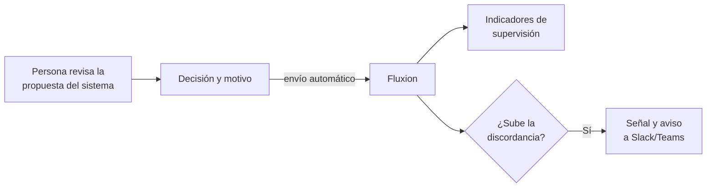

# Supervisión post-comercialización

[Supervisión post-comercialización](../glosario.md#supervisión-post-comercialización) es un módulo que
vigila los sistemas de IA una vez en uso. Hoy incluye la [supervisión humana](../glosario.md#supervisión-humana):
registra cada vez que una persona acepta, modifica, anula o no usa la propuesta de un sistema de IA, y por
qué. Así demuestra que la supervisión ocurre de verdad y detecta a tiempo cuándo un sistema empieza a
fallar.

## Propósito

Generar evidencia medible de que la supervisión humana es efectiva y usar el criterio de las personas
como alerta temprana del deterioro de un sistema. Es un [módulo](../glosario.md#módulo) contratable.

## Problema que resuelve

El AI Act exige una supervisión humana **efectiva**. Casi siempre se documenta con una frase en un
procedimiento, y eso no prueba nada. La pregunta de un auditor es: ¿cuántas veces ha discrepado la
persona de la máquina? Si la respuesta es «nunca», no hay supervisión, sino un sello automático. El
módulo:

- **Mide la supervisión:** número de decisiones revisadas, tasa de concordancia entre persona y sistema,
  tiempo mediano de decisión y discordancias registradas sin motivo.
- **Explica la discrepancia:** cada anulación o modificación lleva un motivo. Hay nueve motivos
  predefinidos agrupados en cinco familias (error del modelo, falta de contexto, criterio humano,
  proceso, otros).
- **Avisa antes que las métricas:** las personas notan que un modelo empeora antes que los indicadores
  estadísticos. Fluxion compara la discordancia reciente de cada sistema con su propia línea base y avisa
  si sube de forma significativa.
- **Sin datos personales:** se registra la decisión y su referencia, no el caso. Fluxion rechaza los
  envíos que contienen campos con aspecto de dato personal.

## Roles

| Rol | Responsabilidad |
|---|---|
| Responsable del SGAI | Revisa los indicadores y las alertas de discordancia |
| Responsable del sistema | Investiga las alertas de su sistema |
| Equipo técnico de la organización | Integra el envío de las decisiones desde la aplicación donde trabajan los supervisores |
| Auditor | Consulta la evidencia de supervisión |

## Flujo de trabajo

1. **Integración.** La aplicación en la que trabajan los supervisores envía a Fluxion cada decisión,
   con una [clave API](../glosario.md#clave-api). Cada decisión incluye:
   - el sistema;
   - una referencia opaca del caso;
   - el tipo de decisión: aceptada, modificada, anulada o no usada;
   - opcionalmente, la propuesta y la confianza del sistema, el motivo y el tiempo dedicado.
2. **Indicadores.** La vista **Supervisión humana** muestra, para 30, 90 o 180 días:
   - decisiones revisadas;
   - tasa de concordancia;
   - tiempo mediano de decisión;
   - discordancias sin motivo.

   Los indicadores se desglosan por sistema y por motivo.
3. **Alerta de discordancia.** Cada día Fluxion compara la última semana de cada sistema con los dos
   meses anteriores. Si la discordancia sube al menos 8 puntos, con un mínimo de 30 decisiones recientes
   y 50 de referencia, registra una [señal de riesgo](../glosario.md#señal-de-riesgo) y avisa a los
   canales de Slack o Teams configurados.
4. **Uso como evidencia.** Los indicadores y su evolución sirven como prueba ante un auditor de que la
   supervisión humana del sistema funciona.

Se compara siempre con la línea base de cada sistema y no con un umbral fijo: un 15 % de discordancia
puede ser normal en un sistema de triaje y alarmante en uno de lectura de facturas.

> **Pendiente de implementar.**
> - Deriva y equidad: desplazamiento de datos, caída de rendimiento y sesgos. Está previsto dentro de
>   este módulo y figura en la [Hoja de ruta](hoja-de-ruta.md).
> - Acceso condicionado a la activación del módulo. Hoy la vista aparece siempre en el menú.

> TODO: confirmar si la organización puede definir motivos de discrepancia propios. El modelo de datos lo
> admite, pero no se ha encontrado pantalla para hacerlo.

> TODO: confirmar el nombre del módulo. El texto oficial del AI Act (Art. 72) usa «vigilancia
> poscomercialización».

## Relación normativa

| Norma | Referencia | Qué cubre |
|---|---|---|
| AI Act | Art. 14.4.b | Conciencia del sesgo de automatización: la tasa de concordancia es su medida directa |
| AI Act | Art. 14.4.d | Capacidad de no usar, descartar, invalidar o revertir el resultado: base de los cuatro tipos de decisión |
| AI Act | Art. 26.2 | Supervisión encomendada por el responsable del despliegue a personas con competencia y autoridad |
| AI Act | Art. 72 | Vigilancia poscomercialización: seguimiento del funcionamiento en uso |
| ISO/IEC 42001 | §9.1 | Seguimiento y medición del desempeño de los sistemas de IA |

## Módulos relacionados

- **[Inventario de sistemas de IA](inventario.md):** sistemas supervisados.
- **[Incidentes](incidentes.md):** una alerta de discordancia puede revelar un incidente.
- **[Análisis de modos de fallo (FMEA)](analisis-modos-de-fallo.md):** la supervisión humana es uno de
  los controles de los modos de fallo de gobernanza.
- **[Plataforma](plataforma.md):** claves API y avisos.
- **Vistas:** [Supervisión humana](../funcional/supervision-humana.md). **Técnico:** [API de ingesta](../tecnica/api-ingesta.md).
